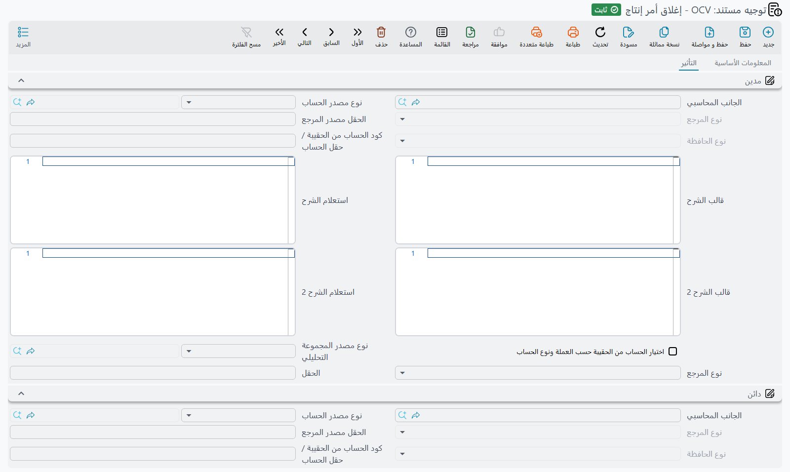

# توجيهات مستندات التكاليف والموارد والقوالب

معظم مستندات التصنيع تحرّك الكميات وتترك المال للمستندات المخزنية التي تُنشئها. وقليل منها يُنشئ قيوده في الأستاذ بنفسه: سند **إغلاق أمر إنتاج**، و**سند موارد**، ومستندات القوالب الثلاثة. وتوجيهاتها هي مصدر الحسابات.

كيف تعمل توجيهات التصنيع عمومًا تجده في [توجيهات مستندات أوامر الإنتاج والتخطيط](/ar/modules/manufacturing/document-terms/mfg-terms-production-orders). ومجموعات المدين والدائن في هذه التوجيهات جوانب محاسبية عادية — مصدر حساب وذمة وقوالب شرح — وتعمل كما هو موصوف في [إعدادات التأثيرات المحاسبية](/ar/modules/supplychain/document-terms/doc-term-accounting-effects).

::: info الترخيص المطلوب
توجيهات إغلاق الأمر وسند الموارد والسعر القياسي ضمن ترخيص التصنيع الأساسي `manufacturing`؛ وتوجيهات القوالب الثلاثة تحتاج `manufacturing-molds`.
:::

## إغلاق أمر إنتاج

يُنشئ سند إغلاق الأمر نوعين من القيود.

**التكاليف غير المباشرة.** لكل سطر تكاليف غير مباشرة في السند يُسجَّل المبلغ على جانبي المدين والدائن المعرَّفين **في نوع التكاليف غير المباشرة**، لا في التوجيه. والمبلغ هو القيمة الفعلية للسطر، أو قيمة التكلفة غير المباشرة حيث لم تُملأ قيمة فعلية. و**عدم تحديث القيود بالقيم الفعلية** (`termConfig.doNotUpdateAccountingEffectsWithActualValues`)، في مجموعة **التكاليف الغير مباشرة**، يجعله يُسجِّل دائمًا القيمة المخططة بدلًا من ذلك — مفيد حين تُوزَّع التكاليف الفعلية للتحليل لكن يجب أن تحتفظ الدفاتر بالرقم المخطط.

و**التكاليف الغير مباشرة** (`termConfig.overhead`)، في المجموعة نفسها، هو نوع التكاليف غير المباشرة الافتراضي للسند، ويتقدم على ما في توجيه أمر الإنتاج.

**انحراف التكلفة القياسية.** **مدين الإنحراف** (`termConfig.deviationDebit`) و**دائن الإنحراف** (`termConfig.deviationCredit`) هما حسابا قيد انحراف التكلفة القياسية. ولا يُنشأ القيد إلا إذا مُلئ الاثنان، وكان الانحراف غير صفري، وكان **حساب الانحرافات مع الحفظ** مفعّلًا في توجيه أمر الإنتاج — فبدونه لا يُحسب أي انحراف أصلًا. والمجموعة التي تضمهما تظهر بعنوان غير مترجم على الشاشة.

وطريقة الإغلاق في [تكاليف الإنتاج](/ar/modules/manufacturing/production-costing).

## سند موارد

يحمّل سند الموارد زمن الماكينات والعمالة على الأمر ويُنشئ قيده.

**القيد الرئيسي.** مجموعتا **مدين** (`termConfig.config.debit`) و**دائن** (`termConfig.config.credit`) في تبويب **التأثير** تُسجِّلان إجمالي كل سطر. والمورد الذي له جانب مدين أو دائن خاص به يستخدمه بدلًا منهما، فجانبا التوجيه احتياطيان للموارد التي لا جوانب لها. ويجب أن يصل الجانبان إلى حساب حتى يُسجَّل السطر.

**الضريبة**، في مجموعة **معلومات الضرائب**:

| الخيار | معرّف الحقل | ما يفعله |
|---|---|---|
| **خاضع للضريبة** | `termConfig.taxable` | مع تعطيله تُصفَّر كل نسب الضريبة في السند. |
| **سياسة الضريبة** | `termConfig.taxPlan` | نسبتاها الأولى والثانية تصبحان **ضريبة 3** و**ضريبة 4** في السطور. أما **ضريبة 1** و**ضريبة 2** فتأتيان من سياسة ضريبة كل مورد. |
| **يمكن تعديل الضريبة** | `termConfig.modifiableTax` | مع تعطيله تُعاد النسب من سياسات الضريبة في كل حفظ. ومع تفعيله تُحفظ النسب التي كتبها المستخدم. |
| **مدين ضريبة 1** … **دائن ضريبة 4** | `termConfig.tax1Debit` … `termConfig.tax4Credit` | الجوانب التي تُسجَّل عليها كل ضريبة، حين لا تكون للمورد جوانب ضريبة خاصة به. ولا تُسجَّل الضريبة إلا إذا وصل جانباها إلى حساب. |
| **عدم إضافة ضريبة 1 للتكلفة** … **عدم إضافة ضريبة 4 للتكلفة** | `termConfig.doNotAddTax1ToCost` … `termConfig.doNotAddTax4ToCost` | يستبعد تلك الضريبة من إجمالي السطر بعد الضرائب، وهو الرقم المستخدم كتكلفة المورد حين يُكلَّف الأمر لكل شحنة أو مع الانحرافات. |

والسند نفسه في [سندات الموارد](/ar/modules/manufacturing/manufacturing-resource-voucher).

## سعر قياسي للتصنيع

توجيه مستند السعر القياسي ليس له خيارات خاصة — فقط أعلى الشاشة المشترك.

## توريد قالب تصنيع واستهلاكه وتخريده

لكل من توجيهات القوالب الثلاثة تبويب **التأثير** واحد فيه مجموعتا **مدين** (`termConfig.config.debit`) و**دائن** (`termConfig.config.credit`)، وكل منها يُسجِّل رقمًا واحدًا لكل سطر. ويجب ملء الجانبين.

| التوجيه | ما يُسجِّله كل سطر |
|---|---|
| **توريد قالب تصنيع** | **القيمة الحالية** للقالب — التكلفة التي يدخل بها الدفاتر. |
| **استهلاك قالب تصنيع** | رسم الاستخدام: إجمالي السطر، أي التكلفة بالساعة مضروبة في العدد. |
| **تخريد قالب تصنيع** | **القيمة المتبقية** للقالب — ما يُشطب عند تخريده. |

والقوالب في [قوالب التصنيع](/ar/modules/manufacturing/manufacturing-molds).
