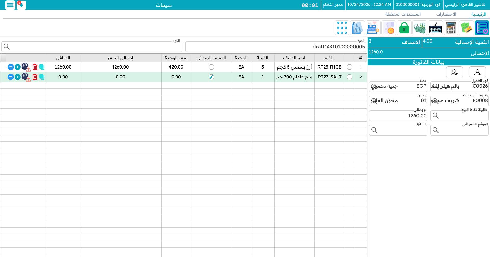

# دليل استعمال النقاط الفنية في نقاط البيع

نظام نما نظام ويب، لكن وحدة **نقاط البيع** فيه تضم **تطبيقًا مكتبيًا** مخصصًا لنقاط البيع يعمل متصلًا وغير متصل:

* تعمل نقطة البيع دون اتصال باستخدام قاعدة بيانات محلية خاصة بها.
* تتزامن تلقائيًا مع قاعدة البيانات المركزية لنظام نما.
* تتكامل مع أجهزة الدفع، ومنها معالج بطاقات ائتمان مدمج للهواتف المحمولة.
* تتوفر وظائف نقاط البيع على Android وiOS من خلال تطبيق **Captain Order** للهاتف.

## إعداد شاشة العميل (Pole Display) في نقاط البيع باستخدام Tempo


---

## إعداد شاشة العميل (Pole Display)

لإعداد شاشة العميل لنقاط البيع اتبع الخطوات التالية:

1. افتح شاشة **خصائص ال Pole Display لنقاط البيع**.
2. اضبط:

* **نوع الاتصال**: **CommPort** — تتحكم الماكينة في شاشة العميل عبر منفذ تسلسلي (COM).
* **اسم الطابعة أو رقم المنفذ**: منفذ COM الموصولة به الشاشة، مثل `COM3`. إن وُجد سطر `commPortName` في ملف `nama.properties` الخاص بالماكينة فهو المقدَّم على هذا الحقل، وإن لم يوجد أيٌّ منهما تستخدم الماكينة `COM4`.
3. اربط الإعداد بالماكينة باختياره في حقل **خصائص ال Pole Display لنقاط البيع** في سجل الماكينة.

---

## عرض البيانات على شاشة العميل

تتيح نقاط البيع تعريف **رسائل بالقوالب** لكل حدث في عملية البيع. وتُضبط القوالب في شاشة **خصائص ال Pole Display لنقاط البيع**.

### الدوال المتاحة

* **مسح سطر:**

```
@CLEARLINE@
```

كل `@CLEARLINE@` يرسل إلى شاشة العميل أمر المسح فيُفرغها، ويُكتب النص الذي بعده على الشاشة الفارغة. أما النص الذي قبله فيُكتب أولًا ثم يُمسح.

**مثال:**

```
@CLEARLINE@@CLEARLINE@ Welcome
```

يمسح الشاشة ثم يعرض: `Welcome`.

* **آخر سطر معدَّل:**

```tempo
{lastModifiedLine}
```

يعطيك آخر سطر أُضيف إلى الفاتورة.

**مثال:**

```tempo
{lastModifiedLine.qty.value}
```

يعطيك كمية آخر صنف أُضيف.

---

## قوالب شاشة العميل

### قالب البدأ (Idle Template)

يظهر عند تشغيل الماكينة، وعند فتح أي شاشة لأول مرة في الجلسة، وبعد ثلاث ثوانٍ من بدء مستند جديد فارغ (مثلًا بعد إنهاء عملية بيع). وحقوله هي حقول الماكينة.

```tempo
@CLEARLINE@@CLEARLINE@**** Welcome to Register {name2}
```

يمسح الشاشة ويعرض رسالة ترحيب باسم الماكينة.

---

### قالب إضافة سطر (Line Adding Template)

يظهر عند إضافة صنف جديد إلى الفاتورة.

```tempo
@CLEARLINE@@CLEARLINE@
{padleft(20)}Item: {lastModifiedLine.item.name2}{endpad}
{padleft(20)}Qty: {lastModifiedLine.qty.uom.name2} - {round(lastModifiedLine.qty.value,0)}{endpad}
```

يعرض اسم الصنف وكميته، مع حشو لمحاذاة النص.

---

### قالب الإجمالي (Total Template)

يظهر عند فتح شاشة التحصيل (قبل الدفع).

```tempo
@CLEARLINE@@CLEARLINE@
{padleft(20)}Total: {round(netPrice,2)}${endpad}
```

يعرض إجمالي مبلغ الفاتورة.

---

### قالب المتبقي (Remaining Template)

يظهر عند حفظ الفاتورة وفيها باقٍ يُردّ إلى العميل؛ ولا يظهر إذا دُفع المبلغ بالضبط.

```tempo
@CLEARLINE@@CLEARLINE@
{padleft(20)}Remaining: {round(change,2)}${endpad}
```

يعرض الباقي الذي يُردّ إلى العميل.

---

### قالب حذف السطر (Delete Line Template)

يظهر عند حذف سطر من الفاتورة. وحقوله، مثل قالب إضافة سطر، هي حقول الفاتورة.

---

تمنحك هذه القوالب طريقة مرنة للتحكم في الرسائل التي تظهر لحظيًا على شاشات نقاط البيع باستخدام صيغة Tempo.


## فلترة البحث في شاشات نقاط البيع باستخدام محددات الماكينة

في نظام نما، يتم تطبيق الفلترة تلقائيًا على محددات الدخول (مثل الشركة، الفرع، القطاع...) في الشاشات العادية.
ولكن في **نظام نقاط البيع (POS)**، لا يتم تطبيق هذه الفلاتر بشكل تلقائي، لأن النظام يعتمد على محددات الجهاز (الماكينة) بدلاً من المستخدم.

لذلك، لتفعيل الفلترة في شاشات البحث داخل نقاط البيع بناءً على محددات الماكينة، يتم استخدام **شاشة إعدادات نقاط البيع**، وتحديدًا من خلال جدول **"فلترة المحددات عند الإرسال"**.

### مثال:

لنفترض أنك تريد فلترة **المنطقة (المستخدمة في عنوان التوصيل)** في **فاتورة مبيعات نقاط البيع** بحيث تظهر فقط المناطق المرتبطة بفرع الماكينة الحالية:

1. افتح **شاشة إعدادات نقاط البيع**.
2. في جدول **"فلترة المحددات عند الإرسال"**:

    * أضف سطرًا جديدًا.
    * اختر النوع **"منطقة"** في حقل **للنوع**.
    * في حقل **"مفلتر في نوع مستند"**، اختر **"فاتورة مبيعات نقاط البيع"**.
    * فعّل خيار **"فلترة بالفرع"**.
3. يمكنك أيضًا اختيار **قائمة الأنواع** تحتوي على "منطقة" وأنواع بيانات أخرى لتطبيق نفس الفلترة عليها.

السطر الذي يُترك فيه **مفلتر في نوع مستند** فارغًا يُطبَّق في كل شاشات نقاط البيع. وإذا انطبق أكثر من سطر على نوع البيانات نفسه في شاشة ما، يُستخدم أولها في الجدول. وتبقى في القائمة السجلات التي تحمل قيمة الماكينة نفسها في المحدد المختار، وكذلك السجلات التي تحمل السجل المشترك الذي يمثّل عدم وجود قيمة.

### الخيارات المتاحة للفلترة:

* ✅ فلترة بالشركة
* ✅ فلترة بالفرع
* ✅ فلترة بالقطاع
* ✅ فلترة بالإدارة
* ✅ فلترة بالمجموعة التحليلية

## تسجيل الدخول باستخدام API Key في نقاط البيع

أضيفت آلية جديدة لتسجيل الدخول إلى نظام نقاط البيع باستخدام **مفتاح API** بدلاً من اسم المستخدم وكلمة المرور. الهدف من هذه الآلية هو تجنّب تخزين كلمة المرور (حتى وإن كانت مشفّرة) داخل ملفات نقاط البيع، مع ضمان استمرار عمل النقاط حتى بعد تغيير كلمة المرور.

يمكن تفعيل هذه الآلية بطريقتين:

---

### الطريقة الأولى: الإنشاء التلقائي عبر تسجيل الدخول التقليدي

1. قم بتشغيل نقطة البيع باستخدام اسم المستخدم وكلمة المرور كما هو معتاد.
2. يقوم النظام تلقائيًا بـ:
   - إنشاء ملف `APICredentials`
      - الكود الخاص بالملف يتضمن معرف المستخدم الذي تم استخدامه.
   - حفظ مفتاح API داخل ملف `nama.properties`.
   - عند التشغيل، يبحث النظام أولًا عن ملف `APICredentials` بالكود المناسب، وإن وُجد يستخدمه بدلاً من إنشاء واحد جديد.

هذه الطريقة تتيح الانتقال السلس إلى تسجيل الدخول بمفتاح API دون الحاجة لأي تعديل يدوي.

---

### الطريقة الثانية: الإنشاء اليدوي

1. أنشئ ملف `APICredentials` يدويًا وعيّن فيه المستخدم الذي سيتم تنفيذ العمليات باسمه داخل نقاط البيع (قراءة / كتابة السجلات).
2. انسخ المفتاح من الملف الناتج.
3. يمكنك استخدام المفتاح في أحد المواضع التالية:
   - إدخاله في نافذة الإعدادات المبدئية.
   - أو وضعه مباشرة في ملف `nama.properties` الخاص بنقطة البيع:
     ```
     apiKey=dddsbddhbskbsdhdd
     ```

في نافذة الإعدادات المبدئية يُكتب المفتاح في حقل **مفتاح API** ضمن مجموعة **إعدادات الخادم**. وتظل فحوص النافذة تطلب حقلي **مستخدم خادم نما** و**كلمة سر خادم نما**.


---

استخدام API Key يمنحك مرونة وأمانًا أكبر، خصوصًا عند الحاجة لتحديث كلمات المرور أو عند إدارة عدد كبير من نقاط البيع.

## طرق متطورة لتغيير عرض أعمدة جدول المبيعات في نظام نقاط البيع

جدول المبيعات هو الجدول في منتصف شاشة المبيعات: صف لكل سطر في الفاتورة، وأعمدة مثل **الكود** و**اسم الصنف** و**الكمية** و**الوحدة** و**الصنف المجانى** و**سعر الوحدة** و**إجمالي السعر** و**الصافي**. الأعمدة الظاهرة تأتي من إعدادات واجهة نقاط البيع الخاصة بالماكينة، والطريقتان التاليتان تتحكمان في عرض كل عمود.



### الطريقة اليدوية (السحب والتعديل المباشر)

- **كيفية الاستخدام**:  
  - يتم سحب حدود الأعمدة يدوياً (مشابه لبرنامج Excel) لتغيير العرض.  
  - عند تعديل العرض لأول مرة، يحفظ النظام القيم الجديدة تلقائياً في ملف:  
    ```screenProperties.properties```  
  - يمكن نسخ هذا الملف بعد ضبط جميع الحقول كما هو مطلوب.  

- **نشر التعديلات على أجهزة نقاط البيع**:  
  - **الخيار الأول**: لصق الملف يدوياً في كل جهاز.  
  - **الخيار الثاني**: فتح سجل **الماكينة** ← لصق محتويات الملف في **خصائص أعمدة المبيعات** ← تفعيل **"إرسال الخصائص إلى ماكينة نقاط البيع"** ← حفظ. تكتب الماكينة النص في ملف `screenProperties.properties` عندما تستلم سجل الماكينة في المرة التالية.  

- **مميزاتها**:  
  - مرنة وسريعة للتعديلات الأولية.  
  - تسمح بضبط دقيق حسب احتياجات المستخدم.  

- **عيوبها**:  
  - تتطلب تدخلاً يدوياً في حالة التحديث على عدة أجهزة.  

---

### التحكم في العرض عبر إعدادات واجهة نقاط البيع

- **كيفية الاستخدام**:  
  - في سجل **"إعدادات واجهة نقاط البيع الجديدة"**، لكل سطر حقل في جدول المبيعات عمود **"مقاس العرض"**.  
  - يُختار حجم العمود من خيارات ثابتة، كل منها نسبة ثابتة من عرض الشاشة: **1-صغير جدا جدا** (2.5%)، و**2-صغير جدا** (5%)، و**3-صغير** (7.5%)، و**4-متوسط** (10%)، و**5-كبير** (12.5%)، و**6-كبير جدا** (15%)، و**7-كبير جدا جدا** (17.5%).  

- **متى تُستخدم؟**  
  - عند الرغبة في ضبط العرض بشكل منظم دون الحاجة للسحب اليدوي.  
  - في حالات التوزيع النسبي للحقول داخل الجدول.  

- **ماذا لو أردت السحب اليدوي مع تفعيل هذه الميزة؟**  
  - يتم ترك حقل **"مقاس العرض"** فارغاً، مما يسمح للمستخدم بتعديل الحجم يدوياً عند التشغيل.  

- **مميزاتها**:  
  - لا تحتاج إلى تعديل يدوي لكل جهاز.  
  - توفر خيارات محددة مسبقاً لتوحيد الشكل عبر الفروع.  

- **عيوبها**:  
  - أقل مرونة من الطريقة اليدوية في بعض الحالات الخاصة.  

---

## مركز الاتصال وإضافات الأصناف

انتقل هذان الموضوعان إلى الدليل التشغيلي:

- **مركز الاتصال / الطلبات الإلكترونية** — إرسال الطلبات من ماكينة إلى أخرى — صار جزءًا من [الطاولات والحجوزات وكابتن أوردر](./pos-tables-and-restaurant.md).
- **إضافات الأصناف** (الإضافات والمقاسات والألوان) صارت صفحةً خاصة: [إضافات الأصناف](./pos-item-addons.md).

## إعادة تعيين عداد محاولات الإرسال للمستندات غير المرسلة

عندما تفشل مستندات نقاط البيع في الإرسال إلى الخادم، يقوم النظام بزيادة عداد المحاولات الفاشلة (`writeFailures`). حدّ المحاولات وطرق إعادة تعيينه من شاشة الماكينة أو من سجل الماكينة موضحة في [كيف تتزامن بيانات نقاط البيع مع الخادم](/ar/modules/pos/pos-data-sync).

لإعادة تعيين عداد كل المستندات غير المرسلة مباشرةً، قم بتنفيذ الاستعلام التالي على قاعدة بيانات نقاط البيع:

```sql
UPDATE POSSalesInvoice SET writeFailures = 0 WHERE sent = 0;
UPDATE POSSalesReturn SET writeFailures = 0 WHERE sent = 0;
UPDATE POSSalesReplacement SET writeFailures = 0 WHERE sent = 0;
UPDATE POSPaymentToRegistery SET writeFailures = 0 WHERE sent = 0;
UPDATE POSReceiptFromRegistery SET writeFailures = 0 WHERE sent = 0;
UPDATE POSShiftOpen SET writeFailures = 0 WHERE sent = 0;
UPDATE POSShiftClose SET writeFailures = 0 WHERE sent = 0;
UPDATE POSCustomer SET writeFailures = 0 WHERE sent = 0;
UPDATE POSStockTransferReq SET writeFailures = 0 WHERE sent = 0;
UPDATE POSOrderReservation SET writeFailures = 0 WHERE sent = 0;
UPDATE POSCreditNote SET writeFailures = 0 WHERE sent = 0;
UPDATE POSDiscountCoupon SET writeFailures = 0 WHERE sent = 0;
UPDATE POSStockTakingDetailsDoc SET writeFailures = 0 WHERE sent = 0;
UPDATE POSStockReceipt SET writeFailures = 0 WHERE sent = 0;
UPDATE POSScrapDoc SET writeFailures = 0 WHERE sent = 0;
UPDATE POSShortfallsDoc SET writeFailures = 0 WHERE sent = 0;
UPDATE POSError SET writeFailures = 0 WHERE sent = 0;
UPDATE POSInternalMessage SET writeFailures = 0 WHERE sent = 0;
UPDATE POSInventory SET writeFailures = 0 WHERE sent = 0;
```

::: warning
تأكد من حل المشكلة الأساسية التي تسببت في فشل الإرسال (مثل مشاكل الشبكة أو إعدادات الخادم) قبل تنفيذ هذا الاستعلام.
:::

## تسجيل الدخول بالبصمة

يدعم نظام نقاط البيع تسجيل الدخول باستخدام بصمة الإصبع عبر جهاز Digital Persona URU4500، مما يتيح تبديل المستخدمين بسرعة وأمان دون الحاجة لكتابة بيانات الدخول في كل مرة.

للاطلاع على التفاصيل الكاملة: [تسجيل الدخول بالبصمة في نقاط البيع](./pos-fingerprint-login.md)
