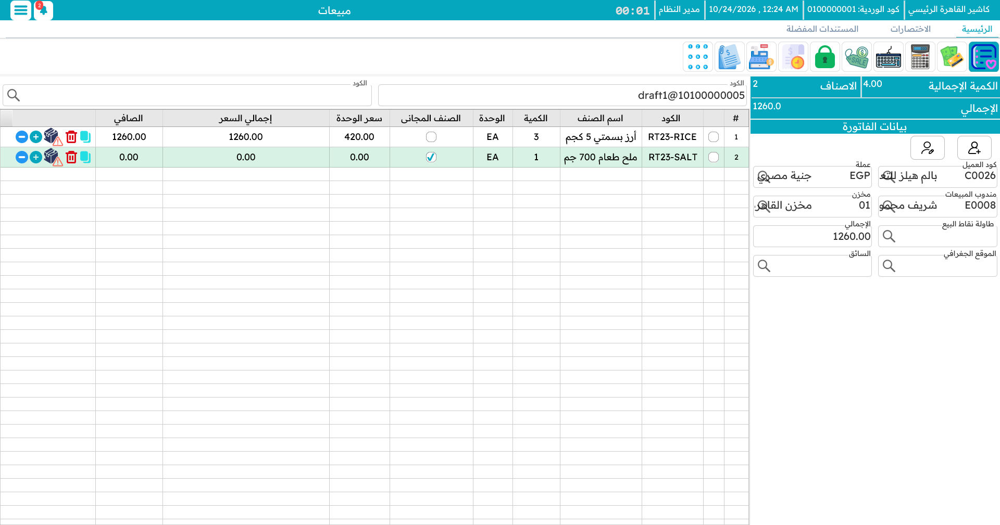

# دليل استعمال النقاط الفنية في نقاط البيع

<rtl>

نظام نما نظام ويب، لكن وحدة **نقاط البيع** فيه تضم **تطبيقًا مكتبيًا** مخصصًا لنقاط البيع يعمل متصلًا وغير متصل:

* تعمل نقطة البيع دون اتصال باستخدام قاعدة بيانات محلية خاصة بها.
* تتزامن تلقائيًا مع قاعدة البيانات المركزية لنظام نما.
* تتكامل مع أجهزة الدفع، ومنها معالج بطاقات ائتمان مدمج للهواتف المحمولة.
* تتوفر وظائف نقاط البيع على Android وiOS من خلال تطبيق **Captain Order** للهاتف.

## إعداد شاشة العميل (Pole Display) في نقاط البيع باستخدام Tempo


---

## إعداد شاشة العميل (Pole Display)

لإعداد شاشة العميل لنقاط البيع اتبع الخطوات التالية:

1. افتح شاشة **خصائص ال Pole Display لنقاط البيع**.
2. اضبط:

* **نوع الاتصال**: **CommPort** أو **Printer**.
* **اسم الطابعه او رقم المنفذ**: لتحديد واجهة الاتصال.
3. اربط الإعداد بالماكينة باختياره في حقل **خصائص ال Pole Display لنقاط البيع** في سجل الماكينة.

---

## عرض البيانات على شاشة العميل

تتيح نقاط البيع تعريف **رسائل بالقوالب** لكل حدث في عملية البيع. وتُضبط القوالب في شاشة **خصائص ال Pole Display لنقاط البيع**.

### الدوال المتاحة

* **مسح سطر:**

```
@CLEARLINE@
```

يمسح سطرًا واحدًا على شاشة العميل.

**مثال:**

```
@CLEARLINE@@CLEARLINE@ Welcome
```

يمسح سطرين ثم يعرض: `Welcome`.

* **آخر سطر معدَّل:**

```
{lastModifiedLine}
```

يعطيك آخر سطر أُضيف إلى الفاتورة.

**مثال:**

```
{lastModifiedLine.qty.value}
```

يعطيك كمية آخر صنف أُضيف.

---

## قوالب شاشة العميل

### قالب البدأ (Idle Template)

يظهر حين تكون نقطة البيع في وضع الانتظار، قبل إنشاء أي فاتورة.

```
@CLEARLINE@@CLEARLINE@**** Welcome to Register {name2}
```

يمسح السطرين ويعرض رسالة ترحيب باسم الماكينة.

---

### قالب إضافة سطر (Line Adding Template)

يظهر عند إضافة صنف جديد إلى الفاتورة.

```
@CLEARLINE@@CLEARLINE@
{padleft(20)}Item: {lastModifiedLine.item.name2}{endpad}
{padleft(20)}Qty: {lastModifiedLine.qty.uom.name2} - {round(lastModifiedLine.qty.value,0)}{endpad}
```

يعرض اسم الصنف وكميته، مع حشو لمحاذاة النص.

---

### قالب الإجمالي (Total Template)

يظهر عند فتح شاشة التحصيل (قبل الدفع).

```
@CLEARLINE@@CLEARLINE@
{padleft(20)}Total: {round(netPrice,2)}${endpad}
```

يعرض إجمالي مبلغ الفاتورة.

---

### قالب المتبقي (Remaining Template)

يظهر بعد أن يدفع العميل ويُحسب الباقي.

```
@CLEARLINE@@CLEARLINE@
{padleft(20)}Remaining: {round(change,2)}${endpad}
```

يعرض الباقي الذي يُردّ إلى العميل.

---

تمنحك هذه القوالب طريقة مرنة للتحكم في الرسائل التي تظهر لحظيًا على شاشات نقاط البيع باستخدام صيغة Tempo.


## فلترة البحث في شاشات نقاط البيع باستخدام محددات الماكينة

في نظام نما، يتم تطبيق الفلترة تلقائيًا على محددات الدخول (مثل الشركة، الفرع، القطاع...) في الشاشات العادية.
ولكن في **نظام نقاط البيع (POS)**، لا يتم تطبيق هذه الفلاتر بشكل تلقائي، لأن النظام يعتمد على محددات الجهاز (الماكينة) بدلاً من المستخدم.

لذلك، لتفعيل الفلترة في شاشات البحث داخل نقاط البيع بناءً على محددات الماكينة، يتم استخدام **شاشة إعدادات نقاط البيع**، وتحديدًا من خلال جدول **"فلترة المحددات"**.

### مثال:

لنفترض أنك تريد فلترة **المنطقة (المستخدمة في عنوان التوصيل)** في **فاتورة مبيعات نقاط البيع** بحيث تظهر فقط المناطق المرتبطة بفرع الماكينة الحالية:

1. افتح **شاشة إعدادات نقاط البيع**.
2. في جدول **"فلترة المحددات"**:

    * أضف سطرًا جديدًا.
    * اختر النوع **"منطقة"** في حقل **النوع**.
    * في حقل **"مفلتر في النوع"**، اختر **"فاتورة مبيعات نقاط البيع"**.
    * فعّل خيار **"فلترة بالفرع"**.
3. يمكنك أيضًا إنشاء **قائمة أنواع** تحتوي على "منطقة" وأنواع بيانات أخرى لتطبيق نفس الفلترة عليها.

### الخيارات المتاحة للفلترة:

* ✅ فلترة بالشركة
* ✅ فلترة بالفرع
* ✅ فلترة بالقطاع
* ✅ فلترة بالإدارة
* ✅ فلترة بالمجموعة التحليلية

## تسجيل الدخول باستخدام API Key في نقاط البيع

أضيفت آلية جديدة لتسجيل الدخول إلى نظام نقاط البيع باستخدام **مفتاح API** بدلاً من اسم المستخدم وكلمة المرور. الهدف من هذه الآلية هو تجنّب تخزين كلمة المرور (حتى وإن كانت مشفّرة) داخل ملفات نقاط البيع، مع ضمان استمرار عمل النقاط حتى بعد تغيير كلمة المرور.

يمكن تفعيل هذه الآلية بطريقتين:

---

### الطريقة الأولى: الإنشاء التلقائي عبر تسجيل الدخول التقليدي

1. قم بتشغيل نقطة البيع باستخدام اسم المستخدم وكلمة المرور كما هو معتاد.
2. يقوم النظام تلقائيًا بـ:
   - إنشاء ملف `APICredentials`
      - الكود الخاص بالملف يتضمن معرف المستخدم الذي تم استخدامه.
   - حفظ مفتاح API داخل ملف `nama.properties`.
   - عند التشغيل، يبحث النظام أولًا عن ملف `APICredentials` بالكود المناسب، وإن وُجد يستخدمه بدلاً من إنشاء واحد جديد.

هذه الطريقة تتيح الانتقال السلس إلى تسجيل الدخول بمفتاح API دون الحاجة لأي تعديل يدوي.

---

### الطريقة الثانية: الإنشاء اليدوي

1. أنشئ ملف `APICredentials` يدويًا وعيّن فيه المستخدم الذي سيتم تنفيذ العمليات باسمه داخل نقاط البيع (قراءة / كتابة السجلات).
2. انسخ المفتاح من الملف الناتج.
3. يمكنك استخدام المفتاح في أحد المواضع التالية:
   - إدخاله في نافذة الإعدادات المبدئية بدلاً من اسم المستخدم وكلمة المرور.
   - أو وضعه مباشرة في ملف `nama.properties` الخاص بنقطة البيع:
     ```
     apiKey=dddsbddhbskbsdhdd
     ```

في نافذة الإعدادات المبدئية يُكتب المفتاح في حقل **API Key** ضمن مجموعة **إعدادات الخادم**، ويمكن عندها ترك حقلي **مستخدم خادم نما** و**كلمة سر خادم نما** فارغين.


---

استخدام API Key يمنحك مرونة وأمانًا أكبر، خصوصًا عند الحاجة لتحديث كلمات المرور أو عند إدارة عدد كبير من نقاط البيع.

## طرق متطورة لتغيير عرض أعمدة جدول المبيعات في نظام نقاط البيع

جدول المبيعات هو الجدول في منتصف شاشة المبيعات: صف لكل سطر في الفاتورة، وأعمدة مثل **الكود** و**اسم الصنف** و**الكمية** و**الوحدة** و**الصنف المجانى** و**سعر الوحدة** و**إجمالي السعر** و**الصافي**. الأعمدة الظاهرة تأتي من إعدادات واجهة نقاط البيع الخاصة بالماكينة، والطريقتان التاليتان تتحكمان في عرض كل عمود.



### الطريقة اليدوية (السحب والتعديل المباشر)

- **كيفية الاستخدام**:  
  - يتم سحب حدود الأعمدة يدوياً (مشابه لبرنامج Excel) لتغيير العرض.  
  - عند تعديل العرض لأول مرة، يحفظ النظام القيم الجديدة تلقائياً في ملف:  
    ```screenProperties.properties```  
  - يمكن نسخ هذا الملف بعد ضبط جميع الحقول كما هو مطلوب.  

- **نشر التعديلات على أجهزة نقاط البيع**:  
  - **الخيار الأول**: لصق الملف يدوياً في كل جهاز.  
  - **الخيار الثاني**: الدخول إلى إعدادات النظام ← **خصائص أعمدة المبيعات** ← لصق محتويات الملف ← اختيار **"إرسال الخصائص إلى أجهزة نقاط البيع"** ← حفظ.  

- **مميزاتها**:  
  - مرنة وسريعة للتعديلات الأولية.  
  - تسمح بضبط دقيق حسب احتياجات المستخدم.  

- **عيوبها**:  
  - تتطلب تدخلاً يدوياً في حالة التحديث على عدة أجهزة.  

---

### التحكم في العرض عبر إعدادات واجهة نقاط البيع

- **كيفية الاستخدام**:  
  - في صفحة **"إعدادات واجهة نقاط البيع"**، تم إضافة عمود جديد باسم **"العرض"** لكل حقل في جدول المبيعات.  
  - يمكن تحديد حجم العمود من خلال خيارات محددة مسبقاً (مثل: صغير، صغير جداً، متوسط، كبير، ... إلخ).  
  - يتم توزيع المساحة تلقائياً بناءً على المقاس المحدد لكل حقل.  

- **متى تُستخدم؟**  
  - عند الرغبة في ضبط العرض بشكل منظم دون الحاجة للسحب اليدوي.  
  - في حالات التوزيع النسبي للحقول داخل الجدول.  

- **ماذا لو أردت السحب اليدوي مع تفعيل هذه الميزة؟**  
  - يتم ترك حقل **"العرض"** فارغاً، مما يسمح للمستخدم بتعديل الحجم يدوياً عند التشغيل.  

- **مميزاتها**:  
  - لا تحتاج إلى تعديل يدوي لكل جهاز.  
  - توفر خيارات محددة مسبقاً لتوحيد الشكل عبر الفروع.  
  - توزع المساحة تلقائياً بين الحقول.  

- **عيوبها**:  
  - أقل مرونة من الطريقة اليدوية في بعض الحالات الخاصة.  

---

## مركز الاتصال وإضافات الأصناف

انتقل هذان الموضوعان إلى الدليل التشغيلي:

- **مركز الاتصال / الطلبات الإلكترونية** — إرسال الطلبات من ماكينة إلى أخرى — صار جزءًا من [الطاولات والحجوزات وكابتن أوردر](./pos-tables-and-restaurant.md).
- **إضافات الأصناف** (الإضافات والمقاسات والألوان) صارت صفحةً خاصة: [إضافات الأصناف](./pos-item-addons.md).

## إعادة تعيين عداد محاولات الإرسال للمستندات غير المرسلة

عندما تفشل مستندات نقاط البيع في الإرسال إلى الخادم، يقوم النظام بزيادة عداد المحاولات الفاشلة (`writeFailures`). بعد 25 محاولة فاشلة (القيمة الافتراضية)، يتوقف النظام عن محاولة إرسال المستند.

لإعادة تعيين العداد والسماح للنظام بمحاولة الإرسال مرة أخرى، قم بتنفيذ الاستعلام التالي على قاعدة بيانات نقاط البيع:

```sql
UPDATE POSSalesInvoice SET writeFailures = 0 WHERE sent = 0;
UPDATE POSSalesReturn SET writeFailures = 0 WHERE sent = 0;
UPDATE POSSalesReplacement SET writeFailures = 0 WHERE sent = 0;
UPDATE POSPaymentToRegistery SET writeFailures = 0 WHERE sent = 0;
UPDATE POSReceiptFromRegistery SET writeFailures = 0 WHERE sent = 0;
UPDATE POSShiftOpen SET writeFailures = 0 WHERE sent = 0;
UPDATE POSShiftClose SET writeFailures = 0 WHERE sent = 0;
UPDATE POSCustomer SET writeFailures = 0 WHERE sent = 0;
UPDATE POSStockTransferReq SET writeFailures = 0 WHERE sent = 0;
UPDATE POSOrderReservation SET writeFailures = 0 WHERE sent = 0;
UPDATE POSCreditNote SET writeFailures = 0 WHERE sent = 0;
UPDATE POSDiscountCoupon SET writeFailures = 0 WHERE sent = 0;
UPDATE POSStockTakingDetailsDoc SET writeFailures = 0 WHERE sent = 0;
UPDATE POSStockReceipt SET writeFailures = 0 WHERE sent = 0;
UPDATE POSScrapDoc SET writeFailures = 0 WHERE sent = 0;
UPDATE POSShortfallsDoc SET writeFailures = 0 WHERE sent = 0;
UPDATE POSError SET writeFailures = 0 WHERE sent = 0;
UPDATE POSInternalMessage SET writeFailures = 0 WHERE sent = 0;
UPDATE POSInventory SET writeFailures = 0 WHERE sent = 0;
```

::: warning
تأكد من حل المشكلة الأساسية التي تسببت في فشل الإرسال (مثل مشاكل الشبكة أو إعدادات الخادم) قبل تنفيذ هذا الاستعلام.
:::

## تسجيل الدخول بالبصمة

يدعم نظام نقاط البيع تسجيل الدخول باستخدام بصمة الإصبع عبر جهاز Digital Persona URU4500، مما يتيح تبديل المستخدمين بسرعة وأمان دون الحاجة لكتابة بيانات الدخول في كل مرة.

للاطلاع على التفاصيل الكاملة: [تسجيل الدخول بالبصمة في نقاط البيع](./pos-fingerprint-login.md)
</rtl>
