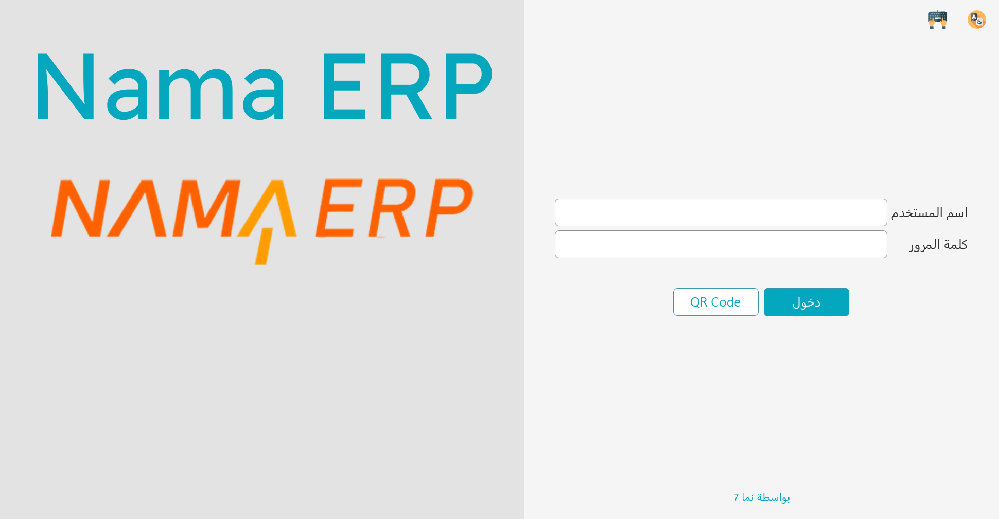

# البداية على الماكينة

تستعرض هذه الصفحة الأساسيات اليومية: تشغيل التطبيق، تسجيل الدخول، التنقّل في القائمة، قفل الشاشة عند الابتعاد، وتبديل اللغة أو المظهر.

## تشغيل التطبيق

عند تشغيل نقاط البيع تظهر أولًا **شاشة بدء** بشريط تقدّم بينما تستيقظ الماكينة.

خلف هذه الشاشة تقوم الماكينة بعدة أمور: فتح **قاعدة بياناتها المحلية**، وتطبيق اللغة والمظهر المحفوظين، وتحميل إعداداتها وأسعارها من الذاكرة المؤقتة، و — إن أمكنها الوصول إلى الخادم — سحب أحدث البيانات ورفع ما تبقّى من المرة السابقة. وإن تعذّر الوصول إلى الخادم، تواصل الماكينة العمل دون اتصال؛ فبإمكانك البيع.

## تسجيل الدخول

بمجرد جهوزية الماكينة تظهر **شاشة الدخول**.

العنوان والصورة في النصف الآخر من الشاشة يأتيان من الحقلين **عنوان الدخول للماكينه** و**لوجو الماكينة** في [إعداد الماكينة](./erp-setup/pos-register-setup.md). فإن لم يُحدَّد عنوان، تعرض الماكينة اسم الشركة التابعة لها. وإن لم يُحدَّد لوجو، تستخدم لوجو الفرع، ثم لوجو الشركة، وأخيرًا لوجو نما.

| الزر | بالإنجليزية | ما يفعله |
|---|---|---|
| **دخول** | Login | يسجّل الدخول باسم المستخدم وكلمة المرور المكتوبين أعلاه (ومثله Enter). |
| **QR Code** | QR Code | يعرض رمز QR يحمل عنوان هذه الماكينة، تمسحه تطبيقات الموبايل الخاصة بالماكينة (مثل كابتن أوردر) لتتصل بها. وإن كان للجهاز أكثر من كارت شبكة تختار أحدها أولًا. |
| **العربية** / **الإنجليزية** (أيقونة في الركن العلوي) | Arabic / English | يبدّل لغة الماكينة. ويحمل الزر اسم اللغة التي سينتقل إليها. |
| **لوحة المفاتيح** (أيقونة في الركن العلوي) | Keyboard | يفتح لوحة مفاتيح ويندوز على الشاشة، للشاشات اللمسية. |

هناك ثلاث طرق لتسجيل الدخول، ويمكن استخدامها جميعًا على الماكينة نفسها:

**اسم المستخدم وكلمة المرور.** الطريقة التقليدية. اكتب اسم المستخدم ثم كلمة المرور واضغط Enter. ويُحمَّل معك **ملف الصلاحيات** الخاص بك، وهو ما يحدّد العمليات المسموح لك بها (انظر قسم **القفل والأمان** أدناه).

**البصمة.** إن سُجّلت بصمتك، فما عليك سوى وضع إصبعك على القارئ — دون أي كتابة. يبقى القارئ مُنصِتًا في الخلفية على شاشة الدخول وشاشة إلغاء القفل ونافذة اعتماد المشرف. ويُشرَح التسجيل والإعداد في [تسجيل الدخول بالبصمة](./pos-fingerprint-login.md).

**مفتاح API.** بدلًا من تخزين كلمة المرور على الجهاز، يمكن للماكينة الدخول بـ**مفتاح API** مرتبط بمستخدم. وهذا يستمر في العمل حتى بعد تغيير كلمة مرور ذلك المستخدم، ويتجنّب الاحتفاظ بكلمة المرور (ولو مشفّرة) في ملفات الماكينة. يمكنك لصق المفتاح في نافذة الإعدادات الأولية بدل اسم المستخدم وكلمة المرور. وتجد الإعداد التفصيلي في [دليل النقاط الفنية](./nama-pos.md).

## التنقّل

### القائمة المنزلقة

تنزلق القائمة الرئيسية من جانب الشاشة حين تضغط زر **القائمه** (☰) في طرف شريط العنوان. تضم أزرارًا للعمليات الشائعة — بيع جديد، دفع، مرتجعات، ورديات، الفواتير المعلّقة، التقارير، القفل، وغيرها. المستوى الأول قائمة مجموعات؛ اضغط مجموعة لترى بنودها، واضغط **الرئيسية** في المسار أعلاها للعودة. ومربع البحث تحت المسار يجد البند باسمه. والبنود التي يتبع اسمَها مفتاحٌ تعرض اختصارها الافتراضي.

البند الذي لا يملك المستخدم صلاحيته مخفيّ، إلا إذا نصّت إعدادات نقاط البيع على عدم إخفاء هذه الحقول. المجموعات وما تفعله بنودها:

| المجموعة | البند | بالإنجليزية | ما يفعله |
|---|---|---|---|
| **مستندات** (Documents) | **شاشة المبيعات** | Sales Screen | يفتح فاتورة مبيعات جديدة. |
| | **مردودات مبيعات** / **استبدال مبيعات** | Sales Return / Sales Replacement | يفتح مردودًا أو استبدالًا جديدًا — راجع [المرتجعات والإحلال](./pos-returns-and-replacements.md). |
| | **طلب تحويل مخزني**، **توريد مخزني**، **لجنة جرد مخزني**، **مستندات النواقص**، **مستندات الهوالك** | Stock Transfer Request, Stock Receipt, Stock Taking Details, Shortfalls Documents, Scrap Documents | يفتح ذلك المستند المخزني — راجع [العمليات المخزنية على الماكينة](./pos-inventory-operations.md). |
| | **شاشة الورديات** / **شاشة الجرد** | shiftScreen / Cash Count Screen | يفتح شاشة الورديات أو جرد النقدية — راجع [الورديات والنقدية](./pos-shifts-and-cash.md). |
| | **مقبوضات** / **مصروفات** | Receipts / Payments | يفتح سند قبض أو صرف من الماكينة. |
| | **إنشاء سند مصروف لأشعار دائن** | Create Payment To Credit Note | يفتح سند صرف مقابل إشعار دائن لعميل. |
| | **كتابة رسائل داخليه** | Write Internal Message | يفتح شاشة الرسائل الداخلية — راجع [التقارير والأدوات](./pos-reports-and-tools.md). |
| | **شاشة حجز اوردر** / **شاشة إلغاء الحجز** | Reservation Screen / Cancel Reservation Screen | عند استخدام الحجوزات فقط: يفتح حجزًا أو إلغاءه — راجع [الطاولات والحجوزات وكابتن أوردر](./pos-tables-and-restaurant.md). |
| **إعدادات بيانات الارسال** (Data Settings) | **إحصائيات البيانات** | Show Data Statistics | يعرض إحصائيات الماكينة عن البيانات التي قرأتها من الخادم. |
| | **مزامنة فورية للبيانات** | Instant Data Sync | يسأل عن البيانات المطلوب جلبها الآن — العملاء والأصناف وقوائم أسعار البيع وعروض البيع — ويسحبها من الخادم دون انتظار القراءة المجدولة التالية. |
| | **التنويهات** | Notifications | يفتح قائمة التنويهات. |
| | **عرض أخطاء نقل البيانات** | Errors Show | يعرض الأخطاء التي واجهتها الماكينة أثناء إرسال البيانات. يحتاج صلاحية عرض أخطاء نقل البيانات. |
| | **نقل جميع إشعارات الخصم** | Transfer Credit Notes | يرسل إشعارات الخصم التي لم تصل إلى الخادم بعد. |
| | **تفعيل اللوج التفصيلي بالخادم** / **تعطيل اللوج التفصيلي بالخادم** | Activate Server Log / Deactivate Server Log | يشغّل التسجيل التفصيلي لاتصالات الماكينة بالخادم أو يوقفه، لأعمال الدعم. |
| **اجراءات الفاتورة** (Invoice Actions) | **تعليق فاتورة**، **الفواتير المعلقة**، **فواتير خدمة العملاء المعلقة**، **دفع الفاتورة**، **مسح فاتورة معلقة**، **اختيار فاتورة**، **تخفيض** | Hold Invoice, Show Held Invoices, Show Call Center Held Invoices, Invoice Payment, Delete Held Invoice, Open Invoice, Apply Discount | مثل أزرار شريط الأدوات: تعليق الفاتورة، والفواتير المعلقة، وخدمة العملاء، والدفع، وحذف المعلق، وعرض مستند، والخصم — راجع [أزرار شاشة المبيعات](./pos-sales-invoice.md). |
| | **تخفيض 1 على السطر** … **تخفيض 8 على السطر** | Apply Line Discount … Apply Line Discount 8 | يفتح عمود الخصم المقابل في جدول السطور للكتابة. ولكل مستوى صلاحيته. |
| | **عمل مردود بعد تجاوز مدة المردود المسموح بها** | Return After Allowed Period | في المردود أو الاستبدال: يطلب كود الفاتورة، ويجلب من الخادم أي تمديد لمدة مردود تلك الفاتورة، ثم يحمّلها. يحتاج صلاحية المردود بعد المدة المسموح بها واتصالًا بالخادم. |
| | **حذف سطر** / **تعديل كمية السطر** | Delete Line / Edit Line Quantity | يحذف السطر المحدد، أو يفتح محرّر كميته. |
| | **الوصول لجدول الأصناف** / **الوصول لرأس المستند** | Access Sales Table / Access header | ينقل المؤشّر إلى جدول السطور أو إلى حقول الرأس. |
| | **فتح جدول البحث** | Open Search Table | يفتح قائمة البحث للحقل الذي فيه المؤشّر. |
| | **إلغاء الخصم** | Delete Discount | يلغي خصم الفاتورة. |
| | **تعديل تصنيف الفاتورة** | Can Edit Invoice Classification | ينقل المؤشّر إلى حقل تصنيف الفاتورة. |
| | **الفواتير المؤجلة الدفع** | Delayed Payment Invoices | يعرض الفواتير المحفوظة بدفع مؤجّل لتفتح إحداها. |
| **اجراءات مندوب المبيعات** (Sales Man Actions) | **تغيير مندوب المبيعات** / **حذف مندوب المبيعات** | ChangeSalesman / DeleteSalesman | ينقل المؤشّر إلى حقل المندوب، أو يمسح المندوب. |
| **اجراءات العميل** (Customer Actions) | **تغيير العميل**، **حذف العميل**، **إضافة عميل جديد**، **تعديل عميل** | Change Customer, Delete Customer, Add New Customer, Edit Customer | ينقل المؤشّر إلى حقل العميل، أو يمسح العميل، أو يفتح نافذة العميل الجديد أو تعديل العميل. |
| **إعدادات الواجهه** (UI Settings) | **تعديل الفونت** | Change Font | يختار خط الشاشة من ملفات الخطوط في مجلد **Fonts** على الماكينة. |
| | **تعديل ألأحجام** | Edit Sizes | يغيّر حجم خط حقول النص وعناوين الجداول وخلاياها، وارتفاع أزرار الاختصارات. |
| | **إعادة ضبط الأعمدة** | Reset Columns Size | بعد التأكيد ينسى كل عروض الأعمدة وأحجام الشاشة التي خصّصتها ويُغلق التطبيق. |
| **اجراءات اخري** (Actions) | **عرض سجل الاجراءات** | List Action History | يعرض سجل إجراءات الماكينة: الدخول والخروج والطباعة والقفل وتغييرات السجلات. |
| | **قفل الشاشة** / **إنهاء** | Lock Screen / Terminate | يقفل الشاشة، أو يُغلق التطبيق. |
| | **استعلام عن سعر صنف** | Inquiry Item Price | يفتح الاستعلام عن السعر. |
| | **التقارير** | Reports | يفتح قائمة التقارير — راجع [التقارير والأدوات](./pos-reports-and-tools.md). |
| | **تغيير كلمة السر** | Change Password | يغيّر كلمة سر المستخدم الحالي. يحتاج اتصالًا بالخادم. |
| | **QR Code لأجهزه الموبايل** | Mobile Apps QR Code | يعرض رمز QR الذي تمسحه تطبيقات الموبايل للاتصال (مثل الذي في شاشة الدخول). |
| | **تقسيم الفاتورة** | Split Invoice | في فاتورة المبيعات: يقسم سطورها على فواتير منفصلة. |
| | **طاولات المستند** / **استعلام عن طاولات** | Invoice Tables / Tables Inquiry | يفتح الصالات والطاولات للفاتورة أو الحجز، أو الاستعلام عن حالة الطاولات. |
| | **إعادة احتساب تفاصيل إغلاق وردية** | Recalculate Shift Close Details | يطلب تاريخ بداية ويعيد احتساب تفاصيل إغلاقات الورديات من ذلك التاريخ. |
| | **إخفاء Dialog العروض** / **إظهار Dialog العروض** | Hide Offers Dialog / Show Offers Dialog | يوقف النافذة المنبثقة التي تعرض على العميل عرضًا متاحًا أو يعيدها. يحتاج صلاحية إخفاء نافذة العروض. |
| | **عرض الصور** / **إخفاء الصور** | Show Images / Hide Images | يُظهر صور الأصناف على أزرار الأصناف المفضلة أو يخفيها. |
| | **نافذة العميل** | Customer Display Window | يفتح نافذة العميل أو يغلقها. |
| | **ShowMore** | ShowMore | يبدّل رأس المستند بين حقوله الرئيسية والحقول الإضافية المحددة في إعدادات الواجهة. ويظهر الاسم هكذا باللغتين. |
| | **ReSendAllDocs** | ReSendAllDocs | يفتح **إرسال الكل** بخيارين: **إرسال إجباري** يرسل كل المستندات مرة أخرى، و**إعادة تعيين وإرسال إجباري** يعيد تعيين المستندات التي فشلت ويرسلها مرة أخرى. ويظهر الاسم هكذا باللغتين. |
| | **تعطيل الطباعة** / **تفعيل الطباعة** | Disable Printing / Enable Printing | يوقف الطباعة على هذه الماكينة أو يعيدها حتى يُغلق التطبيق. |
| | **صلاحيات تمت بمستخدم اخر** | User Security Capabilities By Another User | يعرض الإجراءات التي فوّضها مشرفٌ للمستخدم الحالي. |
| | **تسجيل بصمة إصبع** | Fingerprint Enrollment | يسجّل بصمة مستخدم — راجع [تسجيل الدخول بالبصمة في نقاط البيع](./pos-fingerprint-login.md). |
| | **استعلام عن حالة طلب نقاط بيع أون لاين** | Inquiry POS Online Order Status | يستعلم عن حالة طلب أون لاين — راجع [الطاولات والحجوزات وكابتن أوردر](./pos-tables-and-restaurant.md). |
| | **فحص مواصفات الطابعة** | Check Printer Specifications | يشغّل فحصًا من ويندوز يعرض حدود صفحة الطابعات. |
| **DownloadAppLogs** | — | DownloadAppLogs | يحفظ ملفات سجلّ التطبيق، للدعم. ويظهر الاسم في القائمة هكذا باللغتين، وتلميحه «تحميل ملفات اللوج». |
| **المستندات المحفوظة مؤقتا** (Temporal Documents) | **عرض المستندات المؤقتة** / **حذف المستندات المؤقتة** | Show Temporarily Saved Documents / Delete Temporarily Saved Documents | فقط حين تحفظ إعدادات نقاط البيع المستند المفتوح تلقائيًا: يعيد فتح النسخ المحفوظة تحسّبًا لإغلاق الماكينة فجأة أو يحذفها. |
| **الإعدادات** (Settings) | — | Settings | أسفل القائمة: يفتح نافذة إعدادات الماكينة. يحتاج **تعديل الإعدادات**. |
| **وضع النظام** (System Mode) | — | System Mode | أسفل القائمة: يبدّل المظهر بين الوضع التقليدي والمضغوط ووضع الألوان الزاهية والداكن. |

### اختصارات لوحة المفاتيح

الكاشير المزدحم يعمل بلوحة المفاتيح لا بالفأرة. تأتي نقاط البيع باختصارات افتراضية معقولة (يمكن لمسؤولك تغيير أيٍّ منها على الخادم، فقد تختلف لديك):

| الاختصار | العملية | الاختصار | العملية |
|---|---|---|---|
| `Alt+F1` | بيع جديد | `F6` | تعليق الفاتورة |
| `F1` | التنقّل بين الجدول والترويسة | `Ctrl+F6` | عرض الفواتير المعلّقة |
| `Ctrl+F1` | مرتجع مبيعات | `Alt+F6` | حذف الفاتورة المعلّقة المفتوحة |
| `Shift+F1` | إحلال (استبدال) | `Ctrl+Shift+F6` | عرض طلبات مركز الاتصال المعلّقة |
| `F2` | شاشة الوردية (فتح/إغلاق) | `F7` | اختيار العميل |
| `Ctrl+F2` | الجرد النقدي | `Shift+F7` | إضافة عميل جديد |
| `F3` | البحث عن صنف/مستند | `Ctrl+F7` | إزالة العميل |
| `Ctrl+F3` | فتح فاتورة قائمة | `F8` | اختيار المندوب |
| `F4` | تغيير حجم الخط | `Ctrl+F8` | إزالة المندوب |
| `F5` | الدفع / التحصيل | `Ctrl+F9` | استعلام السعر |
| `F10` | خصم الفاتورة | `Alt+1` … `Alt+8` | مستويات خصم السطر 1–8 |
| `Ctrl+F10` | إلغاء خصم الفاتورة | `Ctrl+Q` | تعديل كمية السطر المحدد |
| `F11` | قفل الشاشة | `Ctrl+Del` | حذف السطر المحدد |
| `Ctrl+F11` | عرض كل الإشعارات | `+` | نسخة مماثلة للسطر |
| `F12` | المساعدة | `Alt+P` | إعادة الطباعة |
| `Alt+R` | الدفع بنقاط المكافأة | `Ctrl+O` | استعلام الطلبات الإلكترونية |
| `Page Up` | الانتقال إلى حقول الترويسة | `Page Down` | الانتقال إلى جدول السطور |
| `Alt+F4` | إغلاق التطبيق | `Ctrl+I` | فتح فاتورة معلّقة بالكود |

::: tip
لا حاجة لحفظها كلها. تعرض القائمة المنزلقة الاختصار بجوار كل عملية، والأكثر استخدامًا (بيع جديد، دفع، تعليق، خصم) يصبح تلقائيًا خلال يوم.
:::

## القفل والأمان

### قفل الشاشة

كلما ابتعدت عن الماكينة — ولو لحظة — **اقفل الشاشة** بـ `F11`. عندها يغطّي الشاشةَ طلبُ دخول، وعلى من يريد استخدام الماكينة تسجيل الدخول من جديد. هذا يمنع تسجيل مبيعات باسمك أثناء غيابك، ويُسجَّل القفل وإلغاؤه للتدقيق.

لإلغاء القفل، سجّل الدخول مجددًا (ببياناتك، أو ببيانات مستخدم آخر مخوّل، أو بالبصمة) واضغط **تسجيل الدخول** (Sign in) أو Enter. ولا يُغلق `Esc` هذه النافذة. ومن يلغي القفل يصبح المشغّل الفعّال.

### اعتماد المشرف

بعض العمليات مقيّدة عمدًا — خصم كبير، مرتجع بعد المدة المسموحة، إلغاء فاتورة. وحين يحاول كاشير لا يملك تلك الصلاحية إحداها، لا تكتفي نقاط البيع بالرفض، بل تُظهر **نافذة اعتماد** صغيرة تطلب بيانات شخص يملك الصلاحية.

يكتب المشرف اسمه وكلمة مروره (أو يستخدم بصمته)، فتمرّ العملية ويتابع الكاشير — دون تسجيل خروج ودخول. ويُسجَّل كل اعتماد كهذا.

### المستخدمون وملفّات الأمان

تتكامل هنا فكرتان:

- **مستخدم نقاط البيع** هو حساب دخول مرتبط بموظف.
- **ملف الصلاحيات** حزمة مسمّاة من الصلاحيات — "كاشير"، "مشرف"، "مدير" وهكذا. لكل مستخدم ملف واحد، ويمكن لعدة مستخدمين مشاركة الملف نفسه.

ملف الصلاحيات هو ما يجيب أسئلة مثل: *هل يحق لهذا الشخص منح خصم؟ تنفيذ مرتجع؟ رؤية النقدية المتوقَّعة عند إغلاق الوردية؟ فتح درج النقود؟* وكلها تُضبط مركزيًا على الخادم وتُدفَع إلى كل الماكينات، فتغيير الملف يحدّث كل من يحمله.

## اللغة والمظهر

يمكن لنقاط البيع العمل بأكثر من لغة. من منطقة الإعدادات يمكنك تبديل لغة الواجهة؛ ويُحفَظ الاختيار على تلك الماكينة.

كما يمكنك التبديل بين مظهر **فاتح** و**داكن** — الداكن أرفق بالعين في متجر خافت الإضاءة، والفاتح أوضح تحت الإضاءة القوية.

ويمكن أيضًا **تخصيص** نصوص بعينها لكل ماكينة — فقد يفضّل مقهى كلمة "حساب" على "فاتورة". تُضبط هذه التخصيصات مركزيًا وتُدفَع إلى الماكينة، فقد تكون الكلمات التي تراها مفصّلة على نشاطك.

## رسائل قد تظهر لك

يُغيَّر اختصار لوحة المفاتيح على الخادم في شاشة **اختصارات نقاط البيع**، وهي التي ترفض الحفظ بإحدى هذه الرسائل.

| الرسالة | لماذا | ما تفعله |
|---|---|---|
| «filed id يجب أختيار إجراء أو» | سطر اختصار لا يسمّي إجراءً ولا حقل شاشة، فلا يفعل المفتاح شيئًا. (النص العربي مقلوب و«filed» خطأ مطبعي في المنتج نفسه.) | اختر أحدهما في ذلك السطر، أو احذف السطر. |
| «يجب اختيار مفتاح» | سطر اختصار له إجراء وليس له مفتاح. | اختر المفتاح، أو احذف السطر. |
| «يجب استخدام Ctrl/Alt مع الحروف الأبجدية» | سطر يربط حرفًا مجردًا. والحرف المجرد لازم للكتابة على الكاشير، فاختصار الحرف لا بد أن يكون مركّبًا. | علّم على Ctrl أو Alt في السطر، أو انقل الاختصار إلى أحد مفاتيح الوظائف. |
| «الاختصار في سطر رقم {0} متكرر في سطر رقم {1}» | سطران يربطان التركيبة نفسها، والرسالة تسمّي رقمي السطرين. | غيّر إحدى التركيبتين. |
