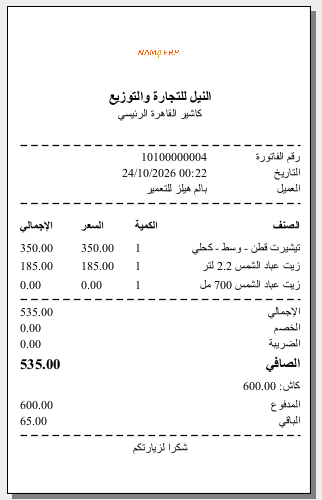

# الدفع والتحصيل

ضغط `F5` على فاتورة مكتملة يفتح **شاشة التحصيل** — لحظة الحقيقة حيث ينتقل المال. تغطّي هذه الصفحة كيف تعمل تلك الشاشة وكل طريقة قد يدفع بها العميل.

## شاشة التحصيل

التخطيط مبنيّ للسرعة:

- **قيمة الفاتورة** — المطلوب — في الأعلى.
- صفٌّ لكل **طريقة دفع** تقبلها الماكينة يتيح لك كتابة المبلغ المدفوع بتلك الطريقة. ولصفوف البطاقة والإشعار الدائن والكوبون حقلٌ لرقم اعتماد أو مرجع.
- **المتبقّي** في الأسفل يتحدّث مع كل ضغطة. الصفر يعني تغطية الفاتورة بالكامل؛ والباقي يعني وجود مبلغ ما زال يُحصّل؛ والزيادة في النقدي هي ببساطة **الباقي** الذي تُعيده.

تؤكّد لإنهاء البيع، فيُطبَع الإيصال، وتعود إلى شاشة بيع نظيفة للزبون التالي.

### أزرار شاشة الدفع

معظم أزرار هذه الشاشة أيقونات؛ مرّر المؤشر فوق الزر ليظهر اسمه. وأزرار الصف تقع يمين حقل **رقم العملية** لكل طريقة دفع، وما يظهر منها في الصف يتوقف على الطريقة.

| الزر | بالإنجليزية | ما يفعله |
|---|---|---|
| **تحويل المبلغ لطريقة الدفع** (أيقونة اليد والعملة، في كل صف) | Load Remaining To Method | يُفرغ كل المبالغ على الشاشة ويضع قيمة الفاتورة كاملةً على هذه الطريقة — أسرع طريقة لقول "الكل بالبطاقة". ومن لوحة المفاتيح يفعل `Alt+1` الشيء نفسه لصف الطريقة الأول، و`Alt+2` للثاني، وهكذا حتى `Alt+0` للعاشر؛ ويمكن أيضًا أن يكون للطريقة مفتاحها الخاص يُحدَّد مع طرق دفع الماكينة. |
| **إضافه** (`+`، في كل صف عدا النقدي) | Add | يضيف صفًّا ثانيًا للطريقة نفسها، لتحصيل بطاقتين من النوع نفسه على فاتورة واحدة، لكلٍّ رقم عمليته. |
| **حذف** (في صف أُضيف بزر **إضافه**) | Remove | يحذف ذلك الصف الإضافي ويعيد حساب المتبقّي. |
| أيقونة جهاز البطاقة (فقط في الطرق المرتبطة بجهاز دفع) | — | يرسل المبلغ المكتوب في الصف إلى الجهاز ويسجّل رده على الصف — راجع «البطاقة / جهاز الدفع» أدناه. |
| **فتح القفل** / **قفل** (فقط في طريقة معلَّمة **طريقة دفع حرجه لنقاط البيع**، لكاشير لا يملك ملف صلاحياته **امكانية استعمال طرق الدفع الحرجه**) | UnLock / Lock | يظهر الصف مقفلًا. يتحقق **فتح القفل** من الصلاحية — وإن كانت تلك الصلاحية ضمن [قائمة طلب التفويض](./erp-setup/pos-security-profiles.md) في الماكينة يطلب دخول مشرف — ثم يتيح الكتابة في الصف. ويعيد **قفل** إقفاله. |
| أيقونة القلم (فقط في صف **الإشعار الدائن**، لكاشير في ملف صلاحياته **منع تعديل قيمة إشعار الدائن في الدفع**) | — | يُملأ مبلغ الإشعار الدائن من الإشعار ولا يمكن الكتابة فوقه. وحين يكون هذا المنع ضمن قائمة طلب التفويض، يطلب القلم مشرفًا غير خاضع له، وبعد دخوله يصبح المبلغ قابلًا للتعديل؛ وإلا يُرفَض. |
| **استبدال نقاط المكافأة** (أيقونة الوسام، في صف **الكوبون**) | Redeem Reward Points | يفتح نافذة نقاط المكافأة الموضّحة في «نقاط المكافأة / الولاء» أدناه (`Alt+R`). |
| **عرض طرق الدفع الإضافية** (أسفل لوحة الأرقام؛ فقط حين تكون بعض الطرق معلَّمة **عرض في طرق الدفع الإضافية**) | Show Additional payment Methods | الطرق المعلَّمة هكذا لا تظهر في القائمة الرئيسية. يفتح هذا الزر نافذة فيها زر لكل طريقة منها؛ ضغطه يضيف صفّها إلى شاشة الدفع ويضع المؤشر فيه. |
| **لوحة المفاتيح** (أسفل لوحة الأرقام) | Keyboard | يفتح لوحة مفاتيح ويندوز على الشاشة، لماكينات اللمس بلا لوحة مفاتيح. |
| لوحة الأرقام `0`–`9` و`.` و`C` و`.25` و`.5` و`.75` | — | تكتب في الحقل الذي فيه المؤشر. يحذف `C` آخر حرف؛ وتكتب مفاتيح الكسور `0.25` و`0.5` و`0.75`. |
| **تأكيد** (`F5` أو `Alt+Enter`) | Confirm | يتحقق من المبالغ ويُتمّ البيع: تُحفَظ الفاتورة ويُطبَع الإيصال. وتُرفَض **قيمة الأجل** إن لم يكن على الفاتورة عميل. |
| **إلغاء** | Cancel | يغلق شاشة الدفع ويعود إلى الفاتورة دون دفع. |

## طرق الدفع

### نقدًا

اكتب النقد الذي سلّمه العميل. إن زاد عن الإجمالي صار المتبقّي سالبًا، وذلك الرقم هو **الباقي** المستحق. النقد يقبل الزيادة دائمًا — وهذا هو مغزى الباقي.

### البطاقة / جهاز الدفع

تمرّ مدفوعات البطاقات عبر **جهاز دفع** مدمج. أدخل المبلغ في صف البطاقة وأرسله إلى الجهاز (هناك زر مخصّص على الصف). يؤدّي الجهاز عمله ويعيد النتيجة — الموافقة، نوع البطاقة، رقم البطاقة المُقنَّع — فتُسجَّل على سطر الدفع. وإن تعذّر مطابقة رد الجهاز بطريقة معرّفة، يُبلَّغ الكاشير بدل أن يُترَك في حيرة. وإعداد الجهاز نفسه وقواعد مطابقة البطاقة بطريقة الدفع مشروحان في [طرق الدفع وأجهزة الدفع](/ar/platform/payments/payment-methods-and-terminals).

وأثناء دفع العميل تنتظر الماكينة في نافذة صغيرة فيها زر **إلغاء**. والإلغاء — أو مرور أكثر من ثلاث دقائق — يجعل الماكينة تسأل الجهاز عن آخر عملية قبل أن تتوقف، فالبطاقة التي قُبلت فعلًا تُسجَّل مع ذلك، ولا يجوز الخصم منها أو إدخالها يدويًا مرة أخرى. والتسلسل كاملًا ورسائله في [رحلة الدفع بالبطاقة عبر PGW](/ar/platform/payments/pgw-card-payment-flow).

### التجزئة على عدة طرق

يمكن تسوية الفاتورة الواحدة بأكثر من طريقة — نصفها نقدًا ونصفها بالبطاقة مثلًا. أدخل كل مبلغ؛ ويُبقيك **المتبقّي** على الصواب، ولا يكتمل البيع إلا ببلوغه الصفر (أو سالبًا كباقٍ على النقد). ويمكن أيضًا تجميع الطرق في أقسام قابلة للطيّ لترتيب قائمة طويلة.

### الآجل (الدفع لاحقًا)

أحيانًا يدفع العميل لاحقًا — حساب ائتماني، طلب محجوز. اختيار **الآجل** يصفّر المبالغ ويحفظ الفاتورة مع بقاء الرصيد مستحقًّا، دون فتح الدرج أو (افتراضيًا) طباعة إيصال. وهل يحق للكاشير التأجيل أصلًا أمرٌ تحكمه صلاحية.

### الإشعارات الدائنة والكوبونات

يمكن للعميل الدفع بـ**إشعار دائن** (رصيد متجر، يُصدَر غالبًا من مرتجع سابق) أو **كوبون خصم** (من عرض ترويجي). أدخل الكود؛ تتحقّق الماكينة من صلاحيته وبقاء رصيد فيه وانتمائه للعميل الصحيح حيث يلزم، ثم تطرح قيمته من المطلوب. ويُدفَع ما تبقّى عاديًّا. أما آلية إصدارها فموجودة في صفحة [المرتجعات والإحلال](./pos-returns-and-replacements.md).

### نقاط المكافأة / الولاء

إن كان العميل ضمن برنامج ولاء، اضغط `Alt+R` لاستبدال النقاط مقابل الفاتورة. تعرض النافذة رصيد نقاطه وقيمته النقدية، وتُدخل أنت قدر ما يُستبدَل (حتى إجمالي الفاتورة). وحيث يتطلّب البرنامج ذلك، يُطلَب **رمز تحقّق لمرة واحدة (OTP)** ويُدخَل قبل قبول الاستبدال؛ كما يدعم النظام برنامج ولاء STC. تُطرَح القيمة المستبدَلة من الفاتورة ويُدفَع الباقي كالمعتاد.

#### أزرار نافذة صرف مكافأة النقط

| الزر | بالإنجليزية | ما يفعله |
|---|---|---|
| **إرسال OTP** | Request OTP | يطلب من برنامج الولاء إرسال رمز لمرة واحدة إلى العميل. ويظل زر الصرف وحقل الرمز معطّلين حتى ينجح الطلب. ولا يظهر الزر حين يسمح إعداد نقاط المكافأة في الماكينة بالصرف دون رمز. |
| **إستبدال\|صرف** | Redeem | يتحقق من المبلغ (غير سالب، ولا يزيد على مبلغ المكافأة المتبقية ولا على إجمالي الفاتورة)، ثم يصرفه ويضع كود الكوبون الناتج في صف **الكوبون** بشاشة الدفع، فتُدفَع القيمة المصروفة ككوبون. ومع برنامج STC تكتب المبلغ في حقل **Redeem With Amount** بعد طلب الرمز. |
| **إلغاء** | Cancel | يغلق النافذة دون صرف. |

## قواعد مالية تستحق المعرفة

قواعد قليلة تحفظ الصندوق:

- **الباقي نقدًا.** الزيادة متوقّعة على النقد وتصبح باقيًا. أما البطاقة وسائر الطرق غير النقدية فلا يُسمح لها عادةً بالزيادة — لا يمكن إعطاء باقٍ على بطاقة.
- **أرقام الاعتماد مطلوبة حيث تهمّ.** دفعة البطاقة تحتاج رمز موافقتها؛ والإشعار الدائن أو الكوبون يحتاج مرجعه. ولن يكتمل البيع بدونها.
- **تُقرَّب المبالغ** إلى منازل العملة العشرية للعرض، بينما تحتفظ الحسابات تحتها بالدقة الكاملة.
- **خصم طريقة الدفع** (مثل "2% خصم نقدًا") يُعيد حساب الصافي تلقائيًا عند استخدام تلك الطريقة، ويُلغى إن أُلغي الدفع.

## الإيصال

بمجرد تأكيد الدفع يُطبَع **الإيصال**. وفي أسفل شاشة التحصيل خيارات لطباعة فاتورة مفصّلة بالكامل، و — لمن يملك الصلاحية — لمنع الطباعة. ويمكن إعادة طباعة الإيصالات لاحقًا من شاشة البيع بـ `Alt+P`.

