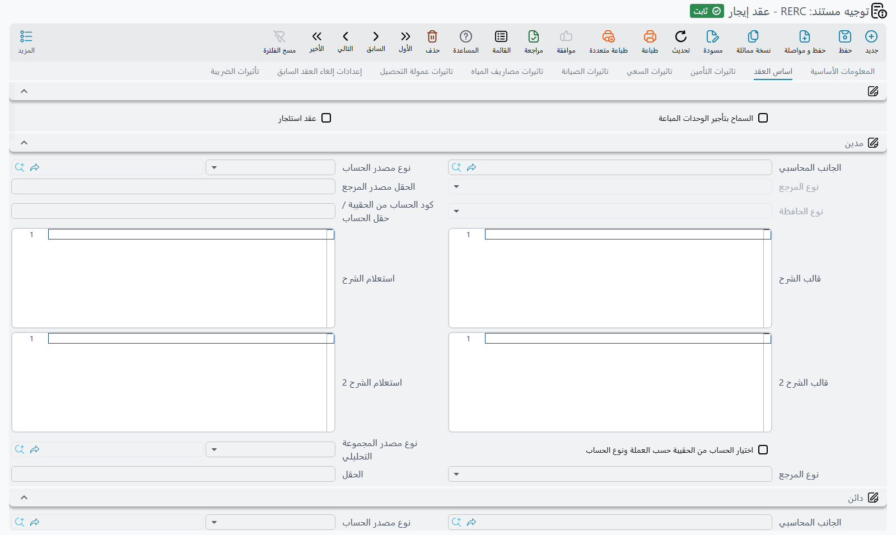

# توجيهات مستندات الإيجار

عقد الإيجار وعد ممتد على الزمن. عقد محل لثلاث سنوات بمبلغ 120,000 سنوياً يُوقَّع في سبتمبر يُلزِم
المستأجر بـ 360,000، لكن لا شيء تقريباً من ذلك إيراد هذه السنة — وإلى جانب الإيجار نفسه هناك تأمين ليس
إيراداً أصلاً، وسعي يُكتسب مرة واحدة، ومقابل صيانة، ومقابل مياه، وعمولة تحصيل. وكل واحد من هذه حديث
منفصل مع دفتر الأستاذ.

توجيه الإيجار يمنح كلاً منها صفحة خاصة. وهذه هي السمة المميزة لهذه العائلة: فبينما يحشر توجيه البيع
كل مجموعات الحسابات في صفحة واحدة طويلة، يوزّعها توجيه الإيجار على ثماني صفحات مرقّمة، صفحة لكل نوع من
المال. ولذلك فإن إعداد توجيه إيجار هو في معظمه المرور على الصفحات بالترتيب وحسم السؤال في كل صفحة: هل
تقيّد هذه الشركة هذا النوع من المال أصلاً؟ وكل صفحة تقابل قيمة على العقد نفسه، فيفيدك أن تفتح
[عقد الإيجار](/ar/modules/realestate/rent/realestate-rent-contract) بجوار شاشة التوجيه في أول مرة
تعدّ فيها توجيهاً.

اقرأ أولاً
[كيف تعمل توجيهات مستندات العقارات](/ar/modules/realestate/document-terms/realestate-terms-basics)
لمعرفة تشريح الجانب المحاسبي، وقاعدة الطرفين أو لا شيء، وجدول سطور إعدادات التوجيه، وأسبقية السياسة
الضريبية.

::: info اضبط بعنوان الصفحة لا باسم الحقل
أسماء الحقول خلف صفحات توجيه الإيجار قديمة وتصف أشياء مختلفة تماماً عما تفعله الصفحات فعلاً. فإذا أشار
زميل أو ملف استيراد أو تخصيص إلى إعداد في توجيه الإيجار باسمه الداخلي، فلا تفترض أنه يعني ما يقول.
**عرّف دائماً إعدادات توجيه الإيجار بالصفحة التي تعيش فيها**، تماماً كما يظهر عنوان التبويب على
الشاشة. كل تعليمة في هذه الصفحة مكتوبة بهذه الطريقة، وكذلك ينبغي أن تكون تعليماتك. ومعرّفات الحقول
مذكورة أدناه لتطابق بها عمود استيراد أو تخصيصاً مع التبويب الصحيح — فاقرأها كأسماء لا كأوصاف.
:::

## الصفحات الثماني في توجيه عقد الإيجار

| الصفحة | العنوان على الشاشة | معرّفا المدين / الدائن | المال الذي تقيّده |
|---|---|---|---|
| 0 | اساس العقد · Total contract effect | `termConfig.debit2` / `termConfig.credit2` | قيمة الإيجار الإجمالية للعقد، والفصل بين الإيراد المعترف به والمؤجل، وكل الخيارات السلوكية |
| 1 | تاثيرات التأمين · Insurrance effect | `termConfig.issuedDebit` / `termConfig.issuedCredit` | تأمين المستأجر |
| 2 | تاثيرات السعي · Commissions effect | `termConfig.feesValDebit` / `termConfig.feesValCredit` | سعي العقد |
| 3 | تاثيرات الصيانة · Maintenance effect | `termConfig.interestValDebit` / `termConfig.interestValCredit` | مقابل الصيانة المحمول على العقد |
| 4 | تاثيرات مصاريف المياه · Water expense effect | `termConfig.receivedDebit` / `termConfig.receivedCredit` | مقابل المياه والمرافق |
| 5 | تاثيرات عمولة التحصيل · commission Collection Effect | `termConfig.collectDebit1` / `termConfig.collectCredit1` | عمولة التحصيل |
| 6 | إعدادات إلغاء العقد السابق · Cancel Previuos RentContract | — | الدفتر والتوجيه المستعملان حين يُلغي التجديد العقد السابق آلياً |
| 7 | تأثيرات الضريبة · Tax Effects | — | خطة الضريبة وزوجا حسابي الضريبة |

العنوانان الإنجليزيان للصفحتين 1 و6 يصلان بأخطاء إملائية ("Insurrance" و"Previuos")، وقد أُثبتا هنا
كما هما لتتعرف على التبويبين على الشاشة.

الصفحات من 1 إلى 5 لا تحتوي كل منها إلا على مجموعة مدينة ومجموعة دائنة، وتضبط كل منها مبلغاً واحداً.
واترك مجموعتي صفحة فارغتين فلا يُقيَّد ذلك المبلغ — وهذا هو الإعداد الطبيعي لشركة لا تحصّل مقابل مياه
أو لا تدفع عمولة تحصيل.

## الصفحة 0 — تأثير العقد نفسه

تؤدي الصفحة 0 ثلاث وظائف معاً: تقيّد قيمة العقد، وتفصل الجدول بين هذه السنة والأعوام التالية، وتحمل كل
الخيارات السلوكية في العائلة.

### مجموعات الحسابات

| المجموعة | معرّفا الحقلين | تقيّد |
|---|---|---|
| مدين / دائن | `termConfig.debit2` / `termConfig.credit2` | قيمة الإيجار الإجمالية للعقد |
| الايرادات - مدين / دائن | `termConfig.loanValDebit` / `termConfig.loanValCredit` | الأقساط المستحقة داخل السنة المالية للمستند |
| الايرادات المقدمة - مدين / دائن | `termConfig.liquidDebit` / `termConfig.liquidCredit` | الأقساط المستحقة في الأعوام التالية |
| القيمة المدفوعة - مدين / دائن | `termConfig.paidValueDebit` / `termConfig.paidValueCredit` | المبالغ المسددة على العقد وقت معالجته |

الفصل بين الإيراد والإيراد المقدم هو قلب محاسبة الإيجار، فيستحق أن نمشي على حالة حقيقية. عقد المحل
لثلاث سنوات بمبلغ 120,000 سنوياً يُوقَّع في سبتمبر ويُفوتَر ربع سنوي، فيحمل جدوله اثني عشر قسطاً قيمة
كل منها 30,000. وعند معالجة العقد يذهب الربعان المستحقان قبل نهاية السنة المالية إلى مجموعتي الإيرادات
— أي 60,000 — وتذهب الأرباع العشرة الباقية، أي 300,000، إلى مجموعتي الإيرادات المقدمة. فتُظهر أرباح
وخسائر السنة الأولى 60,000 إيجاراً لا 360,000.

ويصقل خيار واحد هذا الفصل أكثر:

| الخيار | معرّف الحقل | ما يفعله |
|---|---|---|
| تقسيم القسط الواحد عند امتداده بين عامين متتاليين في القيد | `termConfig.splitInstallmentValueIfItSpansMoreThanTwoYears` | القسط الذي تبدأ فترته داخل السنة المالية وتنتهي بعدها يُقسَّم تناسبياً بعدد الأيام إلى سطرين في القيد، أحدهما حتى نهاية السنة والآخر بعدها. وسطور التأمين والسعي والمياه والصيانة لا تُقسَّم أبداً — الإيجار وحده هو ما يُقسَّم. |

بدونه ينزل ربع يمتد من نوفمبر إلى يناير كاملاً في إحدى السنتين. ومعه يصير ثلثا ذلك الربع إيراد هذه
السنة وثلثه إيراداً مؤجلاً.

### الخيارات السلوكية

| الخيار | معرّف الحقل | ما يفعله |
|---|---|---|
| عقد استئجار | `termConfig.rentalContract` | يقلب اتجاه العقد كله. فإن تُرك معطّلاً كنا نحن المؤجّر، ولا يُسمح إلا بسندات القبض من الجدول. وإن فُعِّل كنا نحن المستأجر، ولا يُسمح إلا بسندات الصرف. وخطأ هذا الإعداد يصطدم به المستخدم أول مرة يحاول فيها التحصيل. |
| السماح بتأجير الوحدات المباعة | `termConfig.allowRentSoldEstate` | معطّل افتراضياً، فيمنع تأجير وحدة موسومة بأنها مباعة. فعّله في حالة البيع ثم إعادة الاستئجار، أو حين تدير الشركة وحدة باعتها لمستثمر. ولا تظهر الوحدة المباعة في البحث عن الوحدات إلا إذا عُلِّم أيضاً **إتاحة الوحدة المباعة للإيجار** على الوحدة نفسها — انظر [كيف يُمثَّل العقار في النظام](/ar/modules/realestate/properties/realestate-estate-model.md). |
| اختصار القيد | `termConfig.shortenLedgerEffect` | يدمج سطور القيد المتشاركة في الحساب والمجموعة التحليلية، فينتج عقد من اثني عشر قسطاً قيداً مضغوطاً بدل سطر لكل قسط. |
| تكويد يدوي | `termConfig.manualCoding` | يوقف ترقيم النظام لسطور الأقساط فيكتب المستخدم الأكواد. ويبقى الإعداد قائماً عند تمديد العقد. |
| دفع الأقساط بالترتيب | `termConfig.payInstallmentsInOrder` | يلزم التحصيل على العقد بسداد الأقساط من الأقدم فالأحدث. |
| صيانة بقيمة ثابتة | `termConfig.fixedMaintenance` | لا يؤثر إلا في العقود التي ينشئها مولّد العقود المجمّعة. فالمعتاد أن يُعاد حساب مقابل الصيانة لكل سنة في العقد المولّد بنسبة الصيانة من إيجار تلك السنة، فيرتفع مع الزيادة السنوية. وعند التفعيل تبقى قيمة الصيانة على سطر المستند المجمّع ثابتة في كل سنوات العقد. أما عقد الإيجار المُدخَل وحده فيتجاهل هذا الخيار. |
| يمكن تعديل الضريبة | `termConfig.modifiableTax` | يترك قيم الضريبة في جدول الأقساط قابلة للتعديل. وعند تعطيله يُعاد حسابها من السياسة الضريبية في كل حفظ. |
| السياسة الضريبية | `termConfig.legalEntityTaxes` | جدول السياسة الضريبية الخاص بالتوجيه. إذا مُلئ ساد وحده، وإذا تُرك فارغاً طُبِّقت إعدادات الوحدة. |
| سطور إعدادات التوجيه | `termConfig.configLineList` | جدول التوجيه حسب نوع القسط. وهو في عقد الإيجار الموضع الذي ترسل منه إيجار العام الحالي وإيجار الأعوام التالية إلى حسابات مختلفة لكل نوع من المقابل. |

ويظهر خياران آخران في الصفحة 0 **في عروض أسعار الإيجار وإلغاءاتها فقط**، في مجموعة خاصة بهما:

| الخيار | معرّف الحقل | ما يفعله |
|---|---|---|
| حالة الحجز | `termConfig.reservationStatus` | حجز أو بدون حجز. واختيار التوجيه يعبّئ حقل حالة الحجز على العرض نفسه، فالتوجيه هو ما يقرر عملياً هل يحجب تسعير الوحدة الوحدةَ عن غيرها. |
| إنشاء التأثير المحاسبى | `termConfig.createAccountingEffects` | عند تعطيله لا يقيّد العرض شيئاً إطلاقاً — وهو الإعداد الطبيعي لعرض السعر. أما عقد الإيجار فيقيّد دائماً؛ العروض وحدها هي ما يمكن إسكاته بهذه الطريقة. |

## توليد قيود إثبات الاستحقاق

في الصفحة 0 أيضاً، في مجموعة خاصة، تقع الكتلة التي تنتج مستندات إثبات الإيراد الدورية. ومن هنا تأتي
قيود إثبات استحقاق الإيجار الموصوفة في
[قيود إثبات استحقاق أقساط الإيجار](/ar/modules/realestate/rent/realestate-rent-accrual-ledger) —
فتلك المستندات مولّدة لا مكتوبة، وكل ما يخصها يُحسم هنا لا في شاشتها.

| الخيار | معرّف الحقل | ما يفعله |
|---|---|---|
| إنشاء قيد إثبات استحقاق قسط إيجار أليا | `termConfig.generateRentInstallmentLedger` | المفتاح الرئيسي. عند تعطيله لا يُولَّد شيء إطلاقاً. وعند تفعيله يجمع كل حفظ أو تعديل للعقد سطورَ الأقساط حسب الفترة وينشئ أو يحدّث مستند إثبات لكل مجموعة؛ والمجموعة التي تفرغ يُحذف مستندها. |
| نوع فترة قيد إثبات استحقاق الأقساط | `termConfig.rentLedgerPeriodType` | يومي أو شهري أو سنوي. ويحدد التجميع وتاريخ مستند الإثبات معاً. **وتركه فارغاً يعني يومياً** — أي مستند إثبات لكل تاريخ استحقاق متميز، وهو نادراً ما يكون المطلوب. |
| إنشاء قيد إثبات استحقاق قسط إيجار بالسطر | `termConfig.generateRentInstallmentLedgerByLine` | عند تفعيله تُجمَّع السطور حسب **كود القسط** بدلاً من الفترة، فيأخذ كل قسط مستند إثبات خاصاً به. ويبقى نوع الفترة هو الذي يحدد تاريخ المستند: بداية الشهر أو السنة في الشهري أو السنوي. |
| حفظ قيد إثبات استحقاق قسط الإيجار المنشأ كمسودة | `termConfig.saveGeneratedLedgerAsDraft` | عند تفعيله تُترك الإثباتات المولّدة مسودات للمراجعة. وعند تعطيله تُعتمد فوراً. |
| دفتر قيد إثبات استحقاق قسط الإيجار المنشأ | `termConfig.generatedRERentLedgerBook` | الدفتر الذي تُنشأ فيه الإثباتات المولّدة. |
| توجيه قيد إثبات استحقاق قسط الإيجار المنشأ | `termConfig.generatedRERentLedgerTerm` | التوجيه الذي تُنشأ به الإثباتات المولّدة — **وهنا تعيش حسابات الإثبات نفسها**، لا في توجيه العقد. |

هذه النقطة الأخيرة يخطئ فيها كثيرون. فتوجيه العقد يقرر *هل* تُولَّد الإثباتات و*متى*، أما التوجيه
المسمّى في *توجيه قيد إثبات استحقاق قسط الإيجار المنشأ* فهو الذي يقرر *أي الحسابات* تصيبها. وتوجيه قيد
الإثبات هو الآخر من عائلة الإيجار لكنه قصير جداً: لا يعرض إلا صفحتي *اساس العقد* و*تأثيرات الضريبة*،
لأن قيد الإثبات ليس فيه تأمين ولا سعي ولا مقابل مياه يُقيَّد.

::: tip مثال عملي — توجيه مؤجّر يثبت الاستحقاق شهرياً
لعقد المحل ذي الثلاث سنوات بمبلغ 120,000 سنوياً، الإعداد المعتاد للمؤجّر هو:

- **الصفحة 0**، مجموعتا الإيرادات تشيران إلى إيراد الإيجار، ومجموعتا الإيرادات المقدمة تشيران إلى
  إيراد إيجار مؤجل، مع تفعيل *تقسيم القسط الواحد عند امتداده بين عامين متتاليين في القيد* ليُوزَّع ربع
  سبتمبر–نوفمبر توزيعاً صحيحاً.
- تفعيل *إنشاء قيد إثبات استحقاق قسط إيجار أليا*، وضبط *نوع فترة قيد إثبات استحقاق الأقساط* على
  *شهري*، وتعطيل *حفظ قيد إثبات استحقاق قسط الإيجار المنشأ كمسودة*، وتسمية دفتر وتوجيه مخصصين
  للإثبات.
- توجيه الإثبات نفسه يجعل المدين إيراد الإيجار المؤجل والدائن إيراد الإيجار في صفحة *اساس العقد*.

حفظ العقد الآن ينتج ستة وثلاثين مستند إثبات شهرياً، يحرر كل منها حصة شهر واحد من الإيراد المؤجل إلى
الإيراد. فقد قيّد العقد 300,000 مؤجلة في يومه الأول، وتعيدها الإثباتات شهراً بشهر.
:::

## الصفحات من 1 إلى 5 — التأمين والسعي والمقابل

كل صفحة من هذه تحمل مجموعة مدينة ومجموعة دائنة، وتقيّد مبلغاً واحداً بعينه من كتلة قيم العقد.

**تاثيرات التأمين** تقيّد تأمين المستأجر. وهو ليس إيراداً — بل مال محتفظ به نيابة عن المستأجر — فالزوج
يُجعل دائناً لحساب تأمينات محتجزة في الغالب الأعم. وعند انتهاء العقد يقرر مستند الإنهاء ما الذي يعود
منه.

**تاثيرات السعي** تقيّد سعي العقد. وفي هذه الصفحة خيار واحد:

| الخيار | معرّف الحقل | ما يفعله |
|---|---|---|
| قيمة الايجار تشمل السعي | `termConfig.rentValueIncludeCommission` | عند تعطيله يضيف الجدول المولّد السعي كسطر مستقل فوق الإيجار. وعند تفعيله يُعتبر السعي داخلاً في قيمة الإيجار المعلنة فلا يُنتَج سطر إضافي. |

**تاثيرات الصيانة** تقيّد مقابل الصيانة المحمول على العقد، و**تاثيرات مصاريف المياه** تقيّد مقابل
المياه والمرافق. وكلاهما مقابل يدفعه المستأجر إلى جانب الإيجار، وكلاهما اختياري — فالعقد الذي لا
يفرضهما يترك صفحتيهما فارغتين.

**تاثيرات عمولة التحصيل** هي الصفحة التي تضبط فيها حسابات العمولة المفروضة على تحصيل الإيجار — أي
الأتعاب التي تحتفظ بها شركة الإدارة مما تحصّله للمالك. وهي كسائر صفحات المقابل تحمل مجموعة مدينة
ومجموعة دائنة، ويجب ملء الاثنتين حتى تُقيَّد العمولة أصلاً. وعنوانا مجموعتيها معكوسان: المجموعة
المعنونة *تاثير عمولة التحصيل-دائن* تحمل الطرف المدين (`termConfig.collectDebit1`)، والمعنونة
*تاثير عمولة التحصيل-مدين* تحمل الطرف الدائن (`termConfig.collectCredit1`).

## الصفحة 6 — دفتر وتوجيه الإلغاء الآلي

حين يُجدَّد عقد إيجار بزر **تمديد العقد**، يُلغي التجديد آلياً العقدَ الذي يحل محله، وليفعل ذلك يحتاج
موضعاً يضع فيه مستند الإنهاء المولّد. وهذا هو كل محتوى هذه الصفحة:

| الحقل | معرّف الحقل | ما يفعله |
|---|---|---|
| دفتر سند إلغاء عقد الايجار | `termConfig.cancelContractBook` | الدفتر الذي يُنشأ فيه مستند إنهاء العقد المولّد آلياً |
| توجيه سند إلغاء عقد الايجار | `termConfig.cancelContractTerm` | التوجيه الذي يُنشأ به |

وكلاهما **إجباري كلما استعمل العقد الإلغاء الآلي**، ولأن تمديد العقد يفعّل الإلغاء الآلي دائماً فهما
عملياً إجباريان في أي توجيه يُستعمل لعقود قابلة للتجديد. واتركهما فارغين يفشل حفظ التجديد برسالة
*"Please specify cancel contract book"* أو *"Please specify cancel contract term"*، مع إشارة الخطأ
إلى حقل التوجيه. انظر
[تمديد عقد الإيجار وإنهاؤه](/ar/modules/realestate/rent/realestate-rent-renewal-and-termination).

## الصفحة 7 — تأثيرات الضريبة

| الحقل | معرّف الحقل | ما يفعله |
|---|---|---|
| خاضع للضريبة | `termConfig.taxable` | يُنسخ إلى العقد، ويقرر هل تُحسب سطور الضريبة للأقساط أصلاً |
| خطة الضريبة | `termConfig.taxPlan` | خطة الضريبة التي يرجع إليها العقد |
| مدين ضريبة 1 / دائن ضريبة 1، مدين ضريبة 2 / دائن ضريبة 2 | `termConfig.tax1Debit` / `termConfig.tax1Credit`، `termConfig.tax2Debit` / `termConfig.tax2Credit` | الحسابات التي تُقيَّد فيها الضريبتان |

## توجيه إنهاء عقد الإيجار

إنهاء عقد الإيجار مبكراً تسوية لا إلغاء: فعدة أوعية من المال تعود إلى المستأجر أو تبقى عند المؤجّر،
وكل منها ينتمي إلى موضع مختلف. لذلك لمستند الإنهاء توجيه خاص به من **تسع صفحات**: ثمانٍ تملك كل منها
وعاءً، وصفحة للضرائب:

| الصفحة | العنوان على الشاشة | معرّفا المدين / الدائن | الوعاء |
|---|---|---|---|
| 0 | تاثيرات صافي التامين · Remaining inssurance effects | `termConfig.debit` / `termConfig.credit` | صافي التأمين بعد خصم كل شيء |
| 1 | تاثيرات التامين · Inssurance effects | `termConfig.debit2` / `termConfig.credit2` | إجمالي التأمين |
| 2 | تأثيرات السعي · Commissions Effects | `termConfig.commissionDebit` / `termConfig.commissionCredit` | الجزء غير المستهلك من السعي |
| 3 | تأثيرات تكاليف المياه · Water Expenses Effects | `termConfig.waterExpenseDebit` / `termConfig.waterExpenseCredit` | مقابل المياه غير المستهلك |
| 4 | تأثيرات تكاليف الصيانة · Maintenance Effects | `termConfig.maintenanceDebit` / `termConfig.maintenanceCredit` | مقابل الصيانة غير المستهلك |
| 5 | تاثيرات خصم التامين · Discount value insurance effects | `termConfig.issuedDebit` / `termConfig.issuedCredit` | الخصم المقتطع من التأمين |
| 6 | تاثيرات الخصومات الأخرى · Other discount effects | `termConfig.receivedDebit` / `termConfig.receivedCredit` | أي خصم آخر على التسوية |
| 7 | تاثيرات المتبقي · Remaining Effects | `termConfig.loanValDebit` / `termConfig.loanValCredit` | كل ما بقي مستحقاً أو مدفوعاً مقدماً عند الإنهاء |
| 8 | الضرائب · Taxes | `termConfig.sendAs` | ليست وعاءً: حقل واحد هو **يرسل ك** — فاتورة أو إشعار دائن أو إشعار مدين — يحدد كيف يُرسَل مستند الإنهاء إلى مصلحة الضرائب |

الصفحات 2 و3 و4 تحمل كل منها مجموعة مدينة ومجموعة دائنة لوعائها، وتخضع لقاعدة الطرفين أو لا شيء
كغيرها: فالصفحة غير المُعَدّة تعني أن ذلك الوعاء لا يُقيَّد وأن تسوية المستأجر تنقص بمقداره ببساطة.

::: warning عناوين المجموعتين معكوسة في الصفحات 2 و3 و4
في هذه الصفحات الثلاث تحمل المجموعة المعنونة **مدين** الطرف الدائن، وتحمل المجموعة المعنونة **دائن**
الطرف المدين (ففي الصفحة 2 مثلاً مجموعة *مدين* هي `termConfig.commissionCredit`). فضع الحساب الذي تريده
مديناً في المجموعة المعنونة *دائن*. أما الصفحات 0 و1 و5 و6 و7 فعناوينها صحيحة.
:::

والصفحة 7 هي الأكبر. تحمل مجموعتي المتبقي، إضافة إلى أربعة أزواج حسابات تفصل ما يخص هذا العام عما يخص
العام التالي:

- مدين / دائن المتبقي من الإيجار للعام الحالي، ومدين / دائن المدفوع مقدم للعام التالي
  (`termConfig.rentForCurrentYearDebit` / `rentForCurrentYearCredit`، `termConfig.rentForNextYearDebit` /
  `rentForNextYearCredit`)
- مدين / دائن المتبقي من المصروفات للعام الحالي، ومدين / دائن المدفوع مقدم من المصروفات للعام التالي
  (`termConfig.expenseForCurrentYearDebit` / `expenseForCurrentYearCredit`،
  `termConfig.expenseForNextYearDebit` / `expenseForNextYearCredit`)

وهذا الفصل هو ما يتيح لمستأجر يغادر في سبتمبر أن يُعامَل إيجار هذا العام غير المكتسب معاملة مختلفة عن
إيجار سدّده مقدماً عن العام التالي.

وأربعة خيارات سلوكية تكمل التوجيه:

| الخيار | معرّف الحقل | ما يفعله |
|---|---|---|
| السماح بانهاء عقد الايجار مع وجود اقساط غير مسددة | `termConfig.allowUnpaidInstallments` | عند تعطيله لا يمكن إنهاء العقد وفيه قسط غير مسدد. وعند تفعيله يمضي الإنهاء وتحمل حسابات *تاثيرات المتبقي* المتأخرات — وهكذا تعالج معظم الشركات مستأجراً يغادر وعليه مستحقات. |
| احتساب المتبقي من الإيجار بناءً على الإيجارات المدفوعة نظامياً | `termConfig.calcCurrentYearAndNextYearValueFromPaidRent` | يشتق الفصل بين إيجار العام الحالي والعام التالي من المبالغ المسجَّلة فعلاً كمدفوعة بدل جدول العقد. |
| حذف مسودات القيود عند إنشاء إنهاء العقد | `termConfig.deleteDraftLdegersAfterSave` | يحذف مستندات الإثبات **المسودة** للعقد المنتهي عند حفظ الإنهاء، فلا تبقى إثباتات مستقبلية معلّقة. ويعمل مع *حفظ قيد إثبات استحقاق قسط الإيجار المنشأ كمسودة* في توجيه العقد. *(العنوان الإنجليزي يحمل خطأ إملائياً: "Ldegers".)* |
| إعادة إنشاء القيود مع حذف إنهاء العقد | `termConfig.reCreateLedgersAfterDelete` | إذا حُذف مستند الإنهاء لاحقاً أعاد إنشاء مستندات إثبات العقد الأصلي فيعود الجدول كاملاً. |

مثال كامل: مستأجر على عقد المحل بمبلغ 120,000 سنوياً يغادر قبل الموعد بأربعة أشهر. *السماح بانهاء عقد
الايجار مع وجود اقساط غير مسددة* مفعّل، فيُحفظ الإنهاء رغم بقاء ربع غير مسدد. ويُقيَّد إجمالي
التأمين في الصفحة 1، وخصم الإنهاء المبكر بنسبة 10% في الصفحة 5، والسعي غير المستهلك في الصفحة 2،
وصافي المردود في الصفحة 0. أما الربع غير المسدد والإيجار المسدد مقدماً عن العام التالي فينزلان في
مجموعتي العام الحالي والعام التالي في الصفحة 7.

## توجيها الإيجار الباقيان

**مولّد العقود المجمّعة** — المستند الذي يفتح أربعين عقد محل في تشغيلة واحدة — له صفحة واحدة عنوانها
**الإعدادات** تحمل حقلين فقط: **الدفتر** (`termConfig.rentContractBook`) و**التوجيه**
(`termConfig.rentContractTerm`) اللذين ستُنشأ بهما عقود الإيجار المولّدة.
وكلاهما **إجباري**، ولا يعرض منتقياهما إلا الدفاتر والتوجيهات التي تخص عقد الإيجار، فلا يمكنك توجيههما
إلى نوع مستند خاطئ بالخطأ. وكل الإعداد المحاسبي الحقيقي يعيش في التوجيه الذي تسميه هنا — أما المستند
المجمّع نفسه فلا يقيّد شيئاً. انظر
[إنشاء جدول الإيجارات](/ar/modules/realestate/rent/realestate-rent-schedule).

**توجيه عقد الإيجار الافتتاحي** هو توجيه عقد الإيجار العادي مع صفحة إضافية واحدة، **تأثيرات المدفوع
مسبقا · Pre paid effects**، للإيجار الذي سدده المستأجر قبل بدء التشغيل. وهذه الصفحة تعدّل الحقلين
أنفسهما اللذين تعدّلهما صفحة *تاثيرات عمولة التحصيل* (`termConfig.collectDebit1` /
`termConfig.collectCredit1`)، فتعرض الصفحتان في العقد الافتتاحي الحسابات نفسها دائماً، وتعبئة إحداهما
تعبئ الأخرى: فالإيجار المدفوع مسبقاً وعمولة التحصيل يُقيَّدان على الزوج نفسه. وكل ما عداها — الصفحات الثماني
أعلاه، وكتلة توليد الإثباتات، وصفحة الضريبة — يعمل تماماً كما يعمل في عقد عادي، وهذا هو المقصود: العقد
الافتتاحي عقد عادي تاريخ بدايته تاريخي. انظر
[عقود الإيجار الافتتاحية](/ar/modules/realestate/opening/realestate-opening-rent-contracts).
