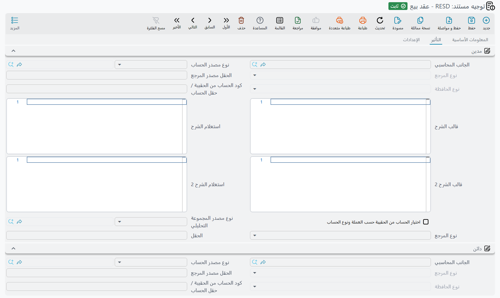

# توجيهات مستندات البيع

بيع العقار ليس حدثاً محاسبياً واحداً. الثمن إيراد، لكن ليس كله يخص هذه السنة. ووديعة الصيانة الداخلة
في الثمن ليست إيراداً أصلاً. والسعي الذي يدفعه المالك والسعي الذي يدفعه المشتري يذهبان إلى موضعين
مختلفين. والغرامات والخصومات تتراكم على مدى عمر العقد. وفي كثير من الشركات لا يُعترف بشيء من ذلك كله
حتى تُسلَّم المفاتيح فعلاً.

توجيه البيع هو الموضع الذي يُحسم فيه هذا كله. تسعة أنواع من المستندات تتشارك مجموعة الخيارات نفسها —
عقد البيع، وعقد البيع المبدئي، وعقد البيع الافتتاحي، والحجز، وإلغاء الحجز، والتنازل، والتسليم، وعقد
الشراء، وعرض سعر البيع — فإذا أعددت أحدها إعداداً سليماً كانت البقية تنويعات على الشاشة نفسها.

اقرأ أولاً
[كيف تعمل توجيهات مستندات العقارات](/ar/modules/realestate/document-terms/realestate-terms-basics):
تشريح الجانب المحاسبي، وقاعدة أن الزوج لا يعمل إلا باكتمال طرفيه، وجدول سطور إعدادات التوجيه، وأسبقية
السياسة الضريبية — كلها مشروحة هناك ولا تتكرر هنا.

## ما الذي يقيّده التوجيه، مجموعةً مجموعة

قلب توجيه البيع هو الصفحة 0 وعنوانها **التأثير**. وهي صفحة طويلة، وطولها سببه أن قيد عقد البيع يُركَّب
من نحو اثنتي عشرة مجموعة مستقلة، ولا تُنتَج أي منها إلا إذا اكتمل طرفاها.

| مجموعة الحسابات | معرّفا الحقلين | تقيّد |
|---|---|---|
| مدين / دائن | `termConfig.debit2` / `termConfig.credit2` | ثمن العقد |
| الايرادات - مدين / دائن | `termConfig.loanValDebit` / `termConfig.loanValCredit` | الأقساط المستحقة داخل السنة المالية للمستند — الإيراد المعترف به |
| الايرادات المقدمة - مدين / دائن | `termConfig.liquidDebit` / `termConfig.liquidCredit` | الأقساط المستحقة في الأعوام التالية — الإيراد المؤجل |
| السعي - مدين المالك / دائن المالك | `termConfig.collectDebit1` / `termConfig.collectCredit1` | السعي المحمّل على المالك |
| السعي - مدين المشتري / دائن المشتري | `termConfig.collectDebit2` / `termConfig.collectCredit2` | السعي المحمّل على المشتري |
| مدين دفعة الصيانة / دائن دفعة الصيانة | `termConfig.maintenanceDebit` / `termConfig.maintenanceCredit` | وديعة الصيانة المضمّنة في الثمن |
| إجمالي الغرامات - مدين / دائن | `termConfig.feesValDebit` / `termConfig.feesValCredit` | مجموع غرامات التأخير على سطور الأقساط |
| إجمالي الخصومات - مدين / دائن | `termConfig.feesDebit` / `termConfig.feesCredit` | مجموع الخصومات على سطور الأقساط |
| مدين التخفيض على السعر / دائن التخفيض على السعر | `termConfig.hdrDiscountDebit` / `termConfig.hdrDiscountCredit` | التخفيض المطبَّق على الثمن كله على مستوى رأس المستند |
| مدين ما قبل التسلم / دائن ما قبل التسلم | `termConfig.preHandoverDebit` / `termConfig.preHandoverCredit` | تكلفة الإنشاء المستحقة على العقار قبل تسليمه |
| مدين ضريبة 1 / دائن ضريبة 1 | `termConfig.tax1Debit` / `termConfig.tax1Credit` | ضريبة 1 على سطور الأقساط |
| مدين ضريبة 2 / دائن ضريبة 2 | `termConfig.tax2Debit` / `termConfig.tax2Credit` | ضريبة 2 على سطور الأقساط |

وهناك مبلغان آخران على عقد البيع **لا يُعدّان هنا إطلاقاً**: كل سطر في جدول الرسوم الأخرى يُقيَّد من
حسابات نوع الرسم الخاص به، وكل سطر عمولة يُقيَّد من حسابات نوع العمولة الخاص به. والكتالوجان موصوفان في
[أنواع الرسوم والعمولات والوسطاء والمصروفات](/ar/modules/realestate/costs/realestate-fee-commission-and-expense-types).

وتحت مجموعات الحسابات يقع جدول التوجيه (سطور إعدادات التوجيه، `termConfig.configLineList`) وجدول
السياسة الضريبية الخاص بالتوجيه (`termConfig.legalEntityTaxes`)، ثم مجموعة من المفاتيح السلوكية.

### الفصل بين الإيراد والإيراد المقدم

المجموعة التي تستحق وقفة هي زوج الإيرادات في مقابل زوج الإيرادات المقدمة، لأنه الآلية التي تمنع خطة
أقساط طويلة من أن تنزل كلها في أرباح وخسائر سنة واحدة.

تُباع الفيلا B-12 في الأول من مارس بمبلغ 1,200,000، مقدَّمها 240,000 و60 قسطاً شهرياً قيمة كل منها
16,000. وعند معالجة العقد يمرّ النظام على جدول الأقساط ويسأل عن كل سطر: هل يستحق داخل السنة المالية
للمستند؟ فالأقساط العشرة المستحقة قبل 31 ديسمبر تذهب إلى زوج **الإيرادات**، والخمسون الباقية تذهب إلى
زوج **الإيرادات المقدمة**. ولا يحرّكها فتح السنة التالية — بل تتحرر تباعاً مع التحصيل والاستحقاق.

والقسط الذي تمتد فترته عبر نهاية السنة يمكن تقسيمه تناسبياً بعدد الأيام إذا كان التوجيه ينص على ذلك،
فلا ينزل في الإيراد إلا الجزء المكتسب هذا العام.

### زوجا الضريبة

جدول الأقساط يحمل قيمتي ضريبة 1 وضريبة 2 منذ البداية: النسب تأتي من جدول السياسة الضريبية، والقيم تقع
على كل سطر قسط، والعقد يجمعها. والذي يحدد أين تنزل هذه القيم في القيد هو مجموعة **الضرائب** أسفل صفحة
التأثير نفسها، وفيها *مدين ضريبة 1* / *دائن ضريبة 1* و*مدين ضريبة 2* / *دائن ضريبة 2*.

وثلاثة أمور في هذه المجموعة تفاجئ المستخدمين.

**كل ضريبة تُقيَّد سطراً سطراً لا كإجمالي واحد للمستند.** فعقد من ستين قسطاً ينتج ستين زوجاً ضريبياً،
يحمل كل منها بيانات مرجع قسطه، فتصل المجموعة التحليلية التابعة للسطر إلى قيد الضريبة أيضاً. ويجمعها
*اختصار القيد* في زوج واحد لكل حساب، تماماً كما يفعل ببقية القيد.

**توجيه البيع لا يرجع إلى نوع المصروف ولا إلى الوحدة.** وهذا هو الموضع الوحيد الذي تختلف فيه عائلة
البيع عن التحصيل. فتوجيه التحصيل هو **آخر** حلقة في سلسلة تبدأ من نوع المصروف وتمرّ بالوحدة وبنموذج
الوحدة، أما توجيه البيع فهو الموضع **الوحيد** الذي يُنظر فيه. والحسابات الموضوعة على الوحدة أو على نوع
المصروف لا تُقرأ هنا، فإذا كان الزوج فارغاً على التوجيه لم تُقيَّد الضريبة إطلاقاً.

**الضريبة المعلَّمة كاستقطاع تبقى بالسالب.** فالضريبة المستقطعة تُحفظ بقيمة سالبة على سطر القسط،
ويقيّدها الزوج كما هي — مديناً سالباً في مقابل دائن سالب، لا بتبديل الجانبين. والقيد يظل متوازناً،
غاية ما في الأمر أنه يُقرأ بإشارات سالبة.

والقاعدة العامة سارية هنا كسريانها في كل موضع: الزوج الذي يُملأ أحد طرفيه فقط لا يقيّد شيئاً ولا ينبّه
إلى شيء.

والمجموعة موجودة في التوجيهات الخمسة التي تنتج مستنداتها قيداً فعلاً — عقد البيع وعقد البيع الافتتاحي
وسند التنازل وعقد شراء العقار والتسليم. أما العقد المبدئي والحجز وإلغاء الحجز فلا مجموعات حسابات فيها
أصلاً، فلا ضريبة تُقيَّد فيها.

## المفاتيح السلوكية

هذه هي الخيارات التي تغيّر ما يفعله المستند لا موضع نزول المبالغ. وهي في مجموعة أسفل الصفحة 0، واثنان
منها في صفحة ثانية عنوانها **الإعدادات**.

| الخيار | معرّف الحقل | ما يفعله |
|---|---|---|
| إنشاء تأثير محاسبى لمستندات التسليم فقط | `termConfig.createAccEffectsForHandoveredDocumentsOnly` | يكبح قيد العقد كله حتى تُسلَّم الوحدة فعلاً. فلا يُقيَّد شيء عند التوقيع، ومستند التسليم هو الذي يحرره لاحقاً. *(العنوان الإنجليزي يصل بخطأ إملائي: "Handoverd".)* |
| التحقق من مطابقة المتبقي لإجمالى الاقساط | `termConfig.validateInstallmentsTotal` | مفعّل افتراضياً. يمنع الحفظ حين لا يطابق إجمالي الأقساط القيمة المتبقية، ضمن الفرق المسموح به المحدد في [إعدادات وحدة العقارات](/ar/modules/realestate/realestate-configuration). لا تعطّله إلا لعقود لا تُقصَد فيها مطابقة خطة الأقساط للثمن. |
| اختصار القيد | `termConfig.shortenLedgerEffect` | يضغط القيد: تُدمج السطور المتشاركة في الحساب والمجموعة التحليلية بدل إنتاج سطر لكل قسط. وفي عقد من ستين قسطاً هذا هو الفرق بين قيد من سطرين وقيد من ستين. |
| تكويد يدوي | `termConfig.manualCoding` | غير مفعّل افتراضياً، أي أن النظام يرقّم سطور الأقساط بنفسه. فعّله حين يجب أن تطابق أكواد الأقساط ترقيماً خارجياً أو قديماً يكتبه المستخدم بيده. |
| دفع الأقساط بالترتيب | `termConfig.payInstallmentsInOrder` | يلزم التحصيل على هذا العقد بسداد الأقساط من الأقدم فالأحدث. ويستطيع توجيه التحصيل تجاوزه لدفتر تحصيل بعينه — انظر [توجيهات مستندات التحصيل والصيانة والاستثمار والتكاليف](/ar/modules/realestate/document-terms/realestate-terms-other). |
| حساب وديعة الصيانة من السطور | `termConfig.calcMaintenanceFromDetails` | يغيّر مصدر إجمالي وديعة الصيانة. عند التفعيل: يُجمَع من سطور أقساط تكلفة الصيانة، ويُصفَّر حقل النسبة. وعند التعطيل: يُجمَع من سطور إنشاء الأقساط. والاختلاف بين الاثنين هو ما ينتج رسالة «إجمالي تكاليف الصيانة {0} لا تساوي تكاليف الصيانة {1}». |
| دمج سطور الدفعات المتشابهة | `termConfig.mergeSimilarPaymentLines` | عند توليد خطة الأقساط تُدمج السطور المتفقة في النوع وتاريخ الاستحقاق في سطر واحد. وتبقى المبالغ الأصلية كخمس قيم مدمجة يستطيع جدول التوجيه تقييد كل منها على حدة. |
| عدم إنشاء قيد محاسبي لسطور رسوم أخرى | `termConfig.preventAccEffectsForOtherFeesLines` | يتخطى تقييد جدول الرسوم الأخرى كلياً، للشركات التي تفوتر تلك الرسوم بمستند منفصل. |
| الالتزام بقوائم الأسعار | `termConfig.forcePriceList` | يمنع الحفظ ما لم يساوِ ثمن العقد السعر الذي تنتجه قائمة الأسعار لذلك العقار. |
| اعتبار المدفوع من الحجز مسدد من الأقساط | `termConfig.considerPaidWithReservationPaidFromInstallments` | يعامل دفعة الحجز باعتبارها محصّلة مسبقاً على أول قسط بدل أن تكون دائنية منفصلة: فيحمل سطر الدفعة المقدمة المولّد قيمة الحجز كقيمة مدفوعة ولا يبقى مستحقاً إلا الفرق. |

::: tip الاعتراف بالإيراد عند التسليم — المثال العملي
هذا أكثر إعداد يُسأل عنه في الوحدة، وهو يحتاج **توجيهين** لا توجيهاً واحداً.

1. في توجيه **عقد البيع** فعّل *إنشاء تأثير محاسبى لمستندات التسليم فقط*. فيُحفظ عقد الفيلا B-12 في
   الأول من مارس بلا أي قيد.
2. في توجيه **التسليم** احسم خياره الخاص *إنشاء التأثير المحاسبى*. اتركه معطّلاً إن كان التسليم مجرد
   مُطلِق للقيد، وفعّله إن كان يجب أن ينتج مستند التسليم قيداً خاصاً به أيضاً.
3. وحين يُحفظ مستند التسليم في سبتمبر يُنشأ قيد العقد المكبوح في تلك اللحظة. وإلغاء مستند التسليم أو حذفه
   يعكسه من جديد.

الاكتفاء بالخطوة الأولى يعطيك عقداً لا يقيّد أبداً. والاكتفاء بالثانية يعطيك عقداً يقيّد عند التوقيع
وتسليماً يقيّد مرة ثانية. الخطوتان متلازمتان.
:::

## أين يختلف كل مستند

التوجيهات التسعة تحمل مجموعة الخيارات نفسها. والذي يتغير هو ما تعرضه الشاشة وما يضيفه كل مستند.

### عقد البيع

الشاشة كاملة: الصفحة 0 **التأثير** بكل مجموعات الحسابات وجدول الضريبة ومجموعة المفاتيح وجدول التوجيه،
ثم الصفحة 1 **الإعدادات** وفيها *الالتزام بقوائم الأسعار* و*اعتبار المدفوع من الحجز مسدد من الأقساط*.
وكل ما سبق ينطبق كما هو مكتوب. انظر [عقد البيع](/ar/modules/realestate/sales/realestate-sales-contract).

### تسليم الوحدة

صفحة واحدة فقط، وتضيف خياراً واحداً:

| الخيار | معرّف الحقل | ما يفعله |
|---|---|---|
| إنشاء التأثير المحاسبى | `termConfig.createAccountingEffects` | عند التفعيل ينتج مستند التسليم قيده الخاص، مبنياً على المجموعات نفسها التي يستعملها العقد. وعند التعطيل يقتصر حفظ التسليم على ختم العقد والوحدة بأنها سُلِّمت. وتعطيله بعد وجود قيود يحذف قيد التسليم نفسه. |

انظر [تسليم الوحدة](/ar/modules/realestate/sales/realestate-handover).

### عقد شراء عقار

الشركة هنا هي المشتري، فتعمل المجموعات نفسها في الاتجاه التجاري المعاكس. ويضيف التوجيه خياراً:

| الخيار | معرّف الحقل | ما يفعله |
|---|---|---|
| حقل قيمة العقار | `termConfig.estateValueField` | القيمة المرسملة على العقار المشترى هي ثمن العقد عادةً. وتسمية حقل هنا تجعل النظام يقرأ ذلك الحقل على عقد الشراء بدلاً منه — ويُستعمل حين يكون المبلغ الواجب رسملته هو الثمن مضافاً إليه الرسوم وتكاليف التسجيل المحفوظة في حقل آخر على المستند. |

انظر [قيم العقارات والتعلية وإعادة التقييم](/ar/modules/realestate/investment/realestate-estate-values-and-revaluation).

### عقد البيع الافتتاحي

الصفحتان نفسهما، التأثير والإعدادات، والمجموعات نفسها للثمن ولسعي المالك والمشتري ولوديعة الصيانة
وللغرامات والخصومات وللإيراد المعترف به وللتخفيض على السعر وللضريبتين — لأن العقد الافتتاحي عقد عادي
لكن تاريخه سابق لبدء التشغيل. وينفرد بأمرين، زوج حسابات إضافي وخيار:

| المجموعة أو الخيار | معرّف الحقل | ما يفعله |
|---|---|---|
| إجمالي الاقساط المدفوعة-مدين / إجمالي الاقساط المدفوعة-دائن | `termConfig.issuedDebit` / `termConfig.issuedCredit` | يقيّد المبلغ الذي كان المشتري قد سدّده على العقد قبل بدء التشغيل (إجمالي المدفوع مسبقاً على العقد الافتتاحي). وككل زوج، لا يُقيَّد إلا إذا اكتمل طرفاه. |
| السماح بفترات محاسبيه غير افتتاحيه في عقد البيع الإفتتاحي | `termConfig.allowNotOpenPerInOpenSales` | معطّل افتراضياً: فيرفض المستند الحفظ خارج فترة مالية افتتاحية برسالة *«نوع الفترة المحاسبية لا بد ان تكون افتتاحية»*. لا تفعّله إلا حين تضطر فعلاً إلى إدخال أرصدة افتتاحية في فترة عادية. |

انظر [عقود البيع الافتتاحية](/ar/modules/realestate/opening/realestate-opening-sales).

### عقد البيع المبدئي

أقصر توجيهات العائلة. له **صفحة واحدة عنوانها الإعدادات**، ولا يعرض أي مجموعة حسابات — وهو ما يوافق
طبيعة المستند، إذ لا تأثير محاسبي لعقد مبدئي. ويحمل *دمج سطور الدفعات المتشابهة* و*الالتزام بقوائم
الأسعار* و*اعتبار المدفوع من الحجز مسدد من الأقساط* وجدول التوجيه، وخيارين لا يعرضهما عقد البيع:

| الخيار | معرّف الحقل | ما يفعله |
|---|---|---|
| له مشتري | `termConfig.hasBuyer` | مفعّل افتراضياً، ويجعل حقل المشتري إجبارياً. يُعطَّل في العقود المبدئية المملوكة للشركة حيث لا مشتري بعد. |
| حجز العقار | `termConfig.reserveEstate` | يفرض تفعيل خانة *حجز العقار* على المستند نفسه عند الحفظ، فيكتب العقد المبدئي نفسه عند حفظه في خانة حجز العقار ويمنع أي شخص آخر من بيع الوحدة أو حجزها. وإلغاء التفعيل، أو توجيه العقد إلى وحدة أخرى، يحرر ذلك الحجز أو ينقله. |

انظر [الحجوزات وعقود البيع المبدئية](/ar/modules/realestate/sales/realestate-reservations-and-initial-contracts).

### مستند الحجز

الصفحة 0 **التأثير** هنا تحمل زوجاً واحداً — دفعة الحجز، `termConfig.paidDebit` / `termConfig.paidCredit` — لأنه المبلغ الوحيد الذي يحركه الحجز. والصفحة
1 **الإعدادات** تحمل *الالتزام بقوائم الأسعار* و*اعتبار المدفوع من الحجز مسدد من الأقساط*، وهو الخيار
الذي يقرر لاحقاً هل تُعامَل هذه الدفعة سداداً على أول قسط في عقد البيع.

### إلغاء الحجز

صفحة واحدة عنوانها **الإعدادات**، تحمل *له مشتري* و*دمج سطور الدفعات المتشابهة* و*الالتزام بقوائم
الأسعار* و*اعتبار المدفوع من الحجز مسدد من الأقساط* وجدول التوجيه. وما يُحتجَز وما يُردّ يُقيَّد عبر
جدول التوجيه لا عبر مجموعات مسمّاة.

### سند التنازل

الصفحة 0 **التأثير** تحمل مجموعات الثمن وسعي المالك وسعي المشتري ووديعة الصيانة والتخفيض على السعر
والضريبة، إضافة إلى زوج مخصص **لسعر المتنازل** — أي العمولة التي تتقاضاها الشركة مقابل نقل العقد إلى مشترٍ جديد.
وتحتها جدول التوجيه و*التحقق من مطابقة المتبقي لإجمالى الاقساط*. والصفحة 1 هي **الإعدادات**.

::: warning عنوانا مجموعتي سعر المتنازل معكوسان
المجموعة المعنونة **سعر المتنازل-دائن** تحمل الطرف المدين لسعر المتنازل (`termConfig.issuedDebit`)،
والمجموعة المعنونة **سعر المتنازل-مدين** تحمل الطرف الدائن (`termConfig.issuedCredit`). فضع الحساب
الذي تريده مديناً تحت *سعر المتنازل-دائن*.
:::

والخيار المهم هو:

| الخيار | معرّف الحقل | ما يفعله |
|---|---|---|
| عكس التأثير المحاسبي للعمولات | `termConfig.reverseCommissionsAccEffects` | يقيّد كل سطر عمولة على سند التنازل بعد تبديل جانبي المدين والدائن في نوع العمولة، فيُعكَس قيد عمولة العقد الأصلي عند تنازل المشتري عن الملكية. |

مثال كامل: عميل سدّد 3 أقساط من 10 على فيلا بمبلغ 1,200,000 يتنازل عنها لصديق، وتتقاضى الشركة 2% —
أي 24,000 — مقابل النقل. زوج سعر المتنازل يقيّد الـ 24,000، وإذا كان *عكس التأثير المحاسبي للعمولات*
مفعّلاً عُكِست في الوقت نفسه عمولة الوسيط البالغة 24,000 التي قُيِّدت عند توقيع العقد الأصلي. انظر
[التنازل وفسخ عقد البيع](/ar/modules/realestate/sales/realestate-waiver-and-cancellation).

### عرض سعر البيع

عرض سعر البيع عرضٌ لا عقد: لا ينتج قيداً، فلا مجموعات حسابات في توجيهه إطلاقاً — بل صفحة واحدة
عنوانها **الإعدادات** فيها الخياران اللذان تحملهما مستندات البيع الأخرى:

| الخيار | معرّف الحقل | ما يفعله |
|---|---|---|
| الالتزام بقوائم الأسعار | `termConfig.forcePriceList` | يرفض حفظ العرض ما لم يساوِ سعره سعر الوحدة الحالي في قائمة الأسعار، برسالة «سعر الوحدة {0} في قائمة الأسعار يساوي {1}, سعر الوحدة يجب أن يساوي {2}». والسعران في الرسالة كلاهما سعر قائمة الأسعار؛ ولا يظهر سعر العرض نفسه. وكل توجيه آخر من عائلة البيع يعرض هذا الخيار يجري الفحص نفسه. |
| اعتبار المدفوع من الحجز مسدد من الأقساط | `termConfig.considerPaidWithReservationPaidFromInstallments` | يعمل عند توليد خطة أقساط العرض: يُحتسب المبلغ المدفوع مع الحجز مسدداً على سطر الدفعة المقدمة، تماماً كما في عقد البيع. |

## من أين تبدأ

إذا كنت تُعِدّ عائلة البيع من الصفر فاتبع هذا الترتيب:

1. **توجيه عقد البيع أولاً.** فهو الوحيد الذي يشغّل كل المجموعات، والثمانية الأخرى نسخ مختصرة منه.
2. **احسم لحظة الاعتراف بالإيراد قبل أن تملأ أي حساب.** الاعتراف عند التوقيع أو عند التسليم يغيّر أي
   توجيه يحتاج أي خيار، وتغييره بعد وجود عقود أصعب بكثير.
3. **املأ زوجي الإيرادات والإيرادات المقدمة حتى لو كانت كل العقود قصيرة.** فهما ما يمنع عقداً موقّعاً
   في ديسمبر بأقساط تبدأ في يناير من النزول في السنة الخطأ.
4. **اترك جدول التوجيه فارغاً حتى تحتاجه**، ثم أضف سطوراً لأنواع الأقساط التي تنتمي فعلاً إلى مكان
   آخر — وسطور تكلفة الصيانة تنتمي إلى مكان آخر في الغالب الأعم.
5. **انسخ التوجيه المكتمل** للعقد المبدئي وللحجز وللتنازل بدل البدء من الصفر في كل مرة؛ فالفارق هو
   الخيارات المذكورة أعلاه فقط.
