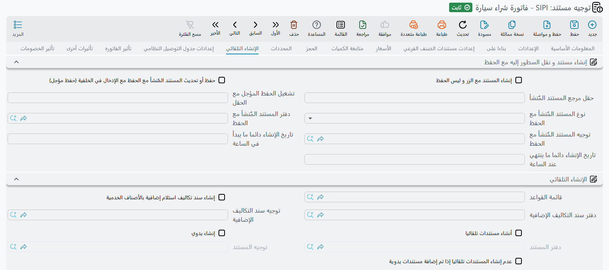

# الشحن والجمارك والتكلفة النهائية

السيارة التي تغادر ساحة المستورد بـ ٧٤٬٠٠٠ لا تصل الرياض وتكلفتها ٧٤٬٠٠٠. فثمة شحن بحري، وتخليص
جمركي، وشاحنة من الميناء. دفعت الصحراء **١٥٬٠٠٠** على شحنة فبراير، وإن لم تصل هذه الـ ١٥٬٠٠٠ إلى
السيارات الست فكل هامش يعلنه المعرض بعدها خاطئ بمقدار ٢٬٥٠٠ للسيارة.

وهذه الصفحة عن كيفية وصولها. والجواب المختصر أنها تستعمل آلية التكلفة النهائية المعيارية في المخزون،
وأنها لا تعمل إلا على
**[فاتورة شراء السيارة](/ar/modules/servicecenter/car-purchasing/car-purchase-invoice.md)**، وأنه لا
شيء فيها خاص بالسيارات إطلاقاً.

::: info الترخيص المطلوب
`srvcenter-subitems` لمستندات السيارات؛ أما آلية التكاليف الإضافية فمعيارية في المخزون.
:::

## لا حقول جمارك ولا شحن في سلسلة الشراء

ابدأ بالخيبة، فهي توفّر بحثاً طويلاً.

**لا مستند في سلسلة مشتريات السيارات يحمل حقل جمارك ولا حقل شحن ولا حقل تخليص.** لا الأمر، ولا
الفاتورة المبدئية، ولا الفاتورة، ولا المردود. ولا يوجد عمود «رسوم» ولا صفحة «تكلفة نهائية» تكتب فيها
مبلغاً.

::: info حقول الجمارك في ملف السيارة تسجّل الأوراق
تحمل صفحة *بيانات متابعة المستندات* في
[ملف السيارة](/ar/modules/servicecenter/cars-setup/car-master-file.md) رقم البيان الجمركي، وسداد
الجمارك، وتاريخ السداد،
ورقم الفسح وتاريخه، واسم الباخرة، والناقل. وكل واحد منها يُكتب باليد، لتُحفظ الأوراق على الهيكل الصحيح.

أما المبالغ التي تصل إلى تكلفة السيارة فتأتي من الآلية الموصوفة أدناه.
:::

## كيف تصل المصاريف إلى السيارات فعلاً

تُدخَل مصاريف الاستيراد **سطوراً بأصناف خدمية على فاتورة الشراء نفسها** التي تحمل السيارات، فتفرزها
الفاتورة إلى **سند تكاليف إستلام إضافية** يوزّعها على المركبات المستلمة.

والسلسلة خطوة خطوة:

1. **أنشئ أصناف المصروف.** كل مصروف تريد رسملته يحتاج صنفاً من نوع **خدمة**، مع ملء حقل **صنف
   المصروف** فيه — وهذا الحقل هو ما يميّز السطر الخدمي بوصفه تكلفة قابلة للرسملة لا مصروفاً عادياً.
   وللصحراء ثلاثة: شحن بحري، وتخليص جمركي، ونقل بري.
2. **اضبط [توجيه الفاتورة](/ar/modules/servicecenter/document-terms/servicecenter-terms-cars-and-other.md).**
   ثلاثة إعدادات تقوم بالعمل:
   - **إنشاء سند تكاليف استلام إضافية بالأصناف الخدمية** — المفتاح الرئيسي. ولا شيء يقع بدونه.
   - **دفتر سند التكاليف الإضافية** و**توجيه سند التكاليف الإضافية** — أين يُحفظ المستند المُنشأ. وإذا
     كان المفتاح الرئيسي مفعّلاً وفي الفاتورة سطور مصروفات وأحدهما فارغاً رُفضت الفاتورة بالرسالة
     «يرجى ملء دفتر وتوجيه التكاليف الإضافية في التوجيه {0}».
   - **توزيع التكلفة على الكمية الموردة بغض النظر عن الكمية بالفاتورة** — أساس التوزيع.
3. **ضع المصاريف على الفاتورة.** إلى جانب سطور السيارات الستة أضف سطراً لكل مصروف بأصناف الخدمة.
   يحمل كل منها مبلغاً ولا يحمل كمية سيارات.
4. **اعتمد.** تجمع الفاتورة السطور الخدمية التي أصنافها خدمية ولها صنف مصروف، وتنشئ **سند تكاليف
   إستلام إضافية** في الدفتر والتوجيه اللذين سميتهما، ناسخةً تلك السطور. ويظهر المرجع في حقل
   **سند التكاليف الإضافية** للقراءة فقط في رأس الفاتورة، ويُدرج المستند المُنشأ في صفحة
   **بنود مصروفات**.
5. **تنزل التكلفة لكل سيارة.** ولأن ملف السيارة محدد من محددات الصنف فإن تكلفة المخزون محفوظة على
   اقتران الصنف بالسيارة. فيصل المصروف الموزَّع إلى **كل هيكل بعينه** لا إلى الموديل فقط — وهذا ما
   يجعل هامش السيارة الواحدة رقماً ذا معنى.

وإن انتفى الشرط لاحقاً — حذفت السطور الخدمية أو رفعت علامة الخيار في التوجيه — حُذف المستند المُنشأ
عند إعادة المعالجة.

## المثال العملي

`SIPI-2026-021` في ١٠ فبراير ٢٠٢٦. ست سيارات بـ ٧٤٬٠٠٠، وثلاثة سطور خدمية:

| المصروف | المبلغ |
|---|---|
| شحن بحري | ٩٬٠٠٠ |
| تخليص جمركي | ٤٬٢٠٠ |
| نقل بري | ١٬٨٠٠ |
| **إجمالي التكلفة الإضافية** | **١٥٬٠٠٠** |

فتنشئ الفاتورة `RAC-2026-009` الذي يوزّع الـ ١٥٬٠٠٠ على السيارات الست بكمية الاستلام —
١٥٬٠٠٠ ÷ ٦ = **٢٬٥٠٠ للواحدة**.

> **التكلفة النهائية للسيارة = ٧٤٬٠٠٠ + ٢٬٥٠٠ = ٧٦٬٥٠٠.**

وهذا هو الرقم الذي يعرضه عمود **تكلفة الوحدة** للقراءة فقط في كل سطر بعد معالجة سند التكاليف
الإضافية، والمحفوظ في سطر تكلفة `CAR-000318`، والمحمَّل على تكلفة المبيعات حين
[تُباع السيارة](/ar/modules/servicecenter/car-sales/car-sales-invoice.md) آخر الأمر بـ ٨٧٬٠٠٠ —
فيكون مجمل الربح ١٠٬٥٠٠.

فاذكر ٧٦٬٥٠٠ حيثما ذُكرت تكلفة السيارة. هو الرقم، لا ٧٤٬٠٠٠.

## أين تذهب المحاسبة

نقل الـ ١٥٬٠٠٠ إلى السيارات يتم بقيدين: قيد من سند التكاليف الإضافية المُنشأ، وقيد من التوريد المخزني.
ولا يتقابل القيدان إلا إذا ضُبطت حساباتهما لتتطابق. أما توجيه فاتورة شراء السيارات فليس فيه أي ضبط
محاسبي لهذا الأمر: خيارات التكاليف الإضافية فيه تقتصر على إنشاء السند واختيار دفتره وتوجيهه.

**١. سند التكاليف الإضافية يسجّل المصروف.** كل سطر فيه منسوخ من سطر خدمي في الفاتورة، وحساباته تأتي
من **بند المصروف** الخاص بذلك السطر. فيجعل المدين الطرف المدين لبند المصروف، أو طرف **المدين** في
توجيه سند التكاليف الإضافية إن لم يكن لبند المصروف طرف مدين. ويجعل الدائن الطرف الدائن لبند المصروف،
وقد يكون حساباً محدداً أو المورد أو شركة الجمارك أو الشحن أو التأمين. وإن لم يكن لبند المصروف طرف
دائن استُخدم طرف **الدائن** في التوجيه. بنود المصروف الثلاثة عند الصحراء كلها تجعل المدين حساب
*وسيط مصاريف الاستيراد*.

**٢. التوريد المخزني يحمّل التكلفة على المخزون.** فاتورة الشراء تُدخل السيارات المخزن عن طريق توريد
مخزني مُنشأ، مسجَّل على **توجيه الأصناف المستلمة** المذكور في توجيه الفاتورة. وبعد توزيع الـ ١٥٬٠٠٠
على السيارات يُضاف إلى قيد هذا التوريد سطران آخران، يأتيان من مجموعة **التكاليف الإضافية** في توجيه
*التوريد المخزني* نفسه:

- **مدين التكاليف الإضافية** — إن تُرك فارغاً استُخدم طرف المدين الرئيسي للتوريد، وهو حساب المخزون.
- **دائن التكاليف الإضافية** — إن تُرك فارغاً استُخدم طرف الدائن الرئيسي للتوريد.

وإذا ضُبط *دائن التكاليف الإضافية* على حساب الوسيط نفسه كان القيد:

| الحساب | مدين | دائن |
|---|---|---|
| المخزون (٦ سيارات × ٢٬٥٠٠) | ١٥٬٠٠٠ | |
| وسيط مصاريف الاستيراد | | ١٥٬٠٠٠ |

فيعود حساب الوسيط إلى الصفر، ويحمل حساب المخزون كل سيارة بـ ٧٦٬٥٠٠.

**٣. البيع يحمّلها على تكلفة المبيعات.** عند بيع السيارة ينقل صرفها المخزني ٧٦٬٥٠٠ من المخزون إلى
تكلفة المبيعات، والتكلفة الإضافية داخلة فيها. ولا يحتاج هذا إلى أي ضبط إضافي.

::: warning ترك دائن التكاليف الإضافية فارغاً
إن كان *دائن التكاليف الإضافية* في توجيه التوريد المخزني فارغاً، جعل القيد الثاني الدائن طرف الدائن
الرئيسي للتوريد. ويظل المخزون يأخذ الـ ١٥٬٠٠٠. لكن ما لم يكن ذلك الطرف هو نفس الحساب الذي جعله سند
التكاليف الإضافية مديناً في القيد الأول، فلن يتقابل القيدان: يبقى على حساب القيد الأول ١٥٬٠٠٠ مدين،
ويبقى على طرف دائن التوريد ١٥٬٠٠٠ دائن زائد. فإما أن تضبط *دائن التكاليف الإضافية* على الحساب الذي
يجعله سند التكاليف الإضافية مديناً، وإما أن تجعل ذلك السند يجعل المدين حسابَ دائن التوريد.
:::

## المستندات الثلاثة الأخرى لا تضيف شيئاً

::: warning فاتورة الشراء وحدها تحمل التكلفة النهائية
**[أمر شراء السيارة](/ar/modules/servicecenter/car-purchasing/car-purchase-order.md)**
و**الفاتورة المبدئية**
و**[مردود مشتريات السيارة](/ar/modules/servicecenter/car-purchasing/car-purchase-return.md)** لا تحمل
مرجع تكلفة إضافية ولا تنشئ مستند تكاليف. ولا شيء فيها يرسمل شيئاً، والفاتورة المبدئية على وجه الخصوص **ليست** أساس توزيع —
فقيمتها لا تُوزَّع على شيء.

فإن وصل مصروف بعد تحرير فاتورة الشراء فضعه في سند تكاليف إستلام إضافية مباشرة على سند الاستلام نفسه.
ولا تتوقع أن يلتقطه مستند لاحق في سلسلة السيارات.
:::

## ملاحظتان عمليتان

**افحص عمود تكلفة الوحدة بعد معالجة الفاتورة.** فالتكلفة الإضافية تصل إلى السطر عبر مستند مُنشأ
يُعالج في الخلفية، فأعمدة التكلفة في الفاتورة ليست ذات معنى لحظة الحفظ. وإن ظلت تقرأ ٧٤٬٠٠٠ بعد
دقائق فالسبب المعتاد أن الخيار غير مفعّل في التوجيه، أو أن صنف الخدمة ينقصه صنف المصروف.

**اجعل الشحنة الواحدة في فاتورة واحدة.** فالتوزيع يجري على كمية الاستلام في الفاتورة التي تحمل
المصاريف. وتقسيم ست سيارات على فاتورتين ووضع الشحن كله على إحداهما يعطيك ثلاثاً بـ ٧٩٬٠٠٠ وثلاثاً بـ
٧٤٬٠٠٠ — وهو حسابياً ما طلبته، ونادراً ما يكون ما قصدته.

## رسائل قد تظهر لك

يرفع **سند تكاليف الاستلام الإضافية** المُنشَأ رسائل الرفض، فتظهر عند معالجة الفاتورة لا وأنت تكتب
فيها. وكل واحدة منها، بسببها وعلاجها، مذكورة في قسم «رسائل قد تظهر لك» من
[صفحة تكلفة المخزون](/ar/modules/supplychain/inventory-costing). وأكثرها وروداً على فاتورة السيارات
«لا توجد أصناف لتوزيع التكاليف الإضافية عليها»: تأكد أن الفاتورة تحمل سطور السيارات مع سطور المصروفات.
