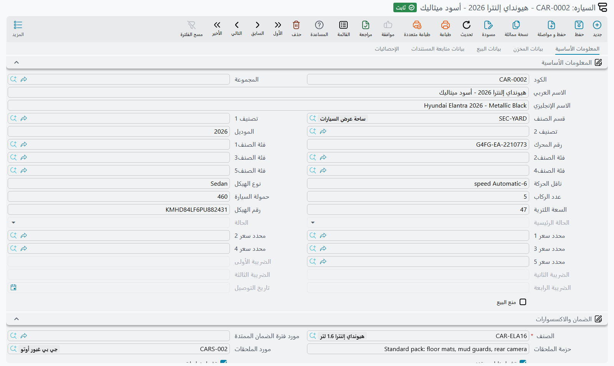

# إدارة معارض السيارات في نما

تدير شركة الصحراء للسيارات نشاطين على أرض واحدة. في جانب منها مركز الخدمة الذي يصلح سيارات الناس
جميعاً، وفي الجانب الآخر المعرض الذي يشتري سيارات ناوا من المستورد ويخزنها في الساحة ثم يبيعها. وهذا
النصف من التوثيق يتحدث عن المعرض.

والسيارة في المعرض شيء عسير على أي نظام أن يمسكه. هي مخزون: لها تكلفة، وتقف في مخزن، وتُباع فتُحمَّل
تكلفتها على تكلفة المبيعات كأي صنف آخر. لكنها ليست مخزوناً متماثلاً. فحين تشتري ليلى الحربي سيارة
ناوا رمال ٢٫٤ فهي لا تشتري «وحدة واحدة من الصنف `MDL-RIMAL24`»، بل تشتري **الهيكل
`NWA7R24C26K000318`** تحديداً — تلك التي عدادها على ١٢ كيلومتراً، والتي خرج فسحها الجمركي يوم
الثلاثاء، والواقفة في الموقع `A-14` ومفتاحها `K-318` في الخزانة. وكل سؤال يُسأل عن تلك السيارة —
أين هي، ولمن حُجزت، وهل عاد خطاب مرورها، وكم كلّفتنا فعلاً — سؤال عن الوحدة الفردية لا عن الموديل.

لذلك يمنح نما كل سيارة فعلية ملفاً مستقلاً بها، ويعلّقه على صنف المخزون العادي بوصفه **محدد صنف**.
فيبقى الصنف كما كان — ناوا رمال ٢٫٤، سطر واحد في ملف الأصناف، له سعر بيع ومجموعة — ويكون ملف السيارة
هو الوحدة الفردية تحته، وهو ما يشير إليه فعلياً سطر فاتورة الشراء أو سند الاستلام المخزني أو فاتورة
البيع.

::: info الترخيص المطلوب
`srvcenter-subitems`. ولا شيء في قائمة «سيارات» متاح في التركيب الأساسي.
:::

## جسر المصطلحات — اقرأ هذا قبل كل شيء

الشيء الواحد له اسمان، وستلقاهما كليهما في يومك الأول:

- في **القائمة** وعلى شاشته الخاصة اسمه **السيارة / Customer Car**.
- وفي نحو أربعين تسمية لخيارات الإعدادات و[توجيهات المستندات](/ar/modules/servicecenter/document-terms/servicecenter-terms-cars-and-other.md)
  اسمه **الصنف الفرعي / Sub Item**.

فـ *إنشاء صنف فرعي من السطر*، و*إعدادات حالة الصنف الفرعي الافتراضية*، و*سطور حركات حالة الصنف
الفرعي* — كلها تتحدث عن ملف السيارة. ولا توجد شاشة منفصلة اسمها «صنف فرعي» تبحث عنها. وسنسميه في هذه
الصفحات **ملف السيارة** في السرد، وننقل التسمية المعروضة على الشاشة كما هي كلما اقتبسنا حقلاً.

## ماذا يحمل ملف السيارة

سجل واحد لمركبة واحدة، يحمل:

- **الهوية** — رقم الهيكل، ورقم المحرك، والموديل (نص حر)، وناقل الحركة، ونوع الهيكل، وعدد الركاب،
  ومصنّفات السعر.
- **حزمة الضمان** — كتالوج، ودواسات، وعدة، ومفتاح احتياطي، وضمان، ومدة الضمان ومدة الضمان الممتد،
  ومن يقدمه.
- **موضعها الفعلي** — المخزن، والموقع، ورقم المفتاح، ورقم الموقع في الساحة، ورقم اللوحة، والممشى،
  وحالة الاستخدام، وبيانات الفحص قبل التسليم.
- **الأوراق** — رقم البيان الجمركي، وسداد الجمارك وتاريخه، ورقم الفسح الجمركي وتاريخه، واسم الباخرة،
  والناقل، ومجموعة مستندات الشركة المصنعة، ومجموعة مستندات التسجيل.
- **أثراً للقراءة فقط** — أي أمر شراء وفاتورة شراء وسند استلام وأمر بيع وفاتورة بيع وخطاب مرور
  ومندوب مسّها، وقائمة كاملة بتغيّرات الحالة.

وكل ذلك مشروح حقلاً حقلاً في
[ملف السيارة](/ar/modules/servicecenter/cars-setup/car-master-file.md).

## السجلّان منفصلان

يحتفظ نما بملفَّي مركبات **اثنين**، ولا رابط بينهما.

| | ملف السيارة | [ملف منتج الورشة](/ar/modules/servicecenter/workshop-setup/servicecenter-product-file.md) |
|---|---|---|
| القائمة | سيارات > ملفات السيارات | مركز خدمة > الملفات > منتج |
| ماهيته | وحدة مفردة من صنف مخزني | مركبة العميل بوصفها أصلاً تُخدم |
| يحمل | الهيكل، والجمارك، وموقع الساحة، وأختام البيع | تاريخ العداد، وعقد الصيانة، وسجل آخر صيانة |
| تستخدمه | مستندات الشراء والتوريد والتخصيص والبيع والتسليم | طلبات الخدمة والمقايسات وأوامر الشغل وتصاريح البوابة |
| الترخيص | `srvcenter-subitems` | `srvcenter` |
| قائمة الحالات | قائمتها الخاصة من ٢٠ قيمة، معرّفة بالكامل بالإعداد | قائمة أخرى خاصة بالورشة |

تبيع الصحراء `CAR-000318` لليلى في مارس، فإن أعادتها ليلى في سبتمبر لأول صيانة فتحت لها الورشة ملف
منتج **جديداً لا علاقة له بالأول**. ولا ينتقل شيء: لا رقم الهيكل، ولا حزمة الضمان، ولا تاريخ الشراء.

::: info السيارة المباعة والسيارة المخدومة سجلّان منفصلان
السجلّان منفصلان: فالورشة تعمل من ملف المنتج الخاص بها، وسجل المعرض يحمل البيعة.

فإن احتجت وصل الاثنين — ليُراجَع مثلاً تاريخ البيع عند مطالبة ضمان — فذلك مشروع إعداد عندك.
:::

## لا شيء في سلوك السيارة مبني مسبقاً

فاتورة الشراء لا تجعل السيارة «بالطريق»، وسند التوريد لا يجعلها «مخزون متاح»، وفاتورة البيع لا
تجعلها «مفوترة» في التركيب الافتراضي: فعدا **ما قبل المبدئي** التي تُختم حين ينشئ سطر مستند ملف
السيارة، كل حالة وكل انتقال مسموح ترسمه أنت، لكل صنف، في سجل **إعدادات حالة السيارة**. وكيفية الرسم
موضوع صفحة
[إعدادات حالة السيارة](/ar/modules/servicecenter/cars-setup/car-status-configurations.md).

## قبل أن يعمل أي من ذلك

::: danger نصف السيارات مُطفأ افتراضياً ويحتاج أربع خطوات إعداد منفصلة
لا يكفي أن تملك ترخيص `srvcenter-subitems`. فحتى تكتمل هذه الأربع لن تظهر ملفات السيارات أو لن
تُنشأ — وفي أشيع صور الفشل لا يُبلَّغ عن شيء إطلاقاً.

1. **لا بد من تشغيل خاصية الأصناف الفرعية.** خاصية المخزون `scSubItem`
   (*الأصناف الفرعية / Sub Items*) هي التي تُظهر أصلاً كل حقل متعلق بالسيارات: علامة *له صنف فرعي*
   على الصنف، وخانات إعدادات الصنف، وعمود **السيارة (Customer Car)** على سطور المستندات. وثمة برنامج
   ترقية **أضافها إلى قائمة «الخصائص الممنوعة» في مجموعة الإعدادات حين رُقّيت قواعد البيانات القديمة**،
   فهي على مثل ذلك التركيب مطفأة. احذفها من *الخصائص الممنوعة* قبل أن تبحث عن أي شيء آخر.
2. **لا بد من تعليم الصنف بأن له أصنافاً فرعية.** على صنف ناوا رمال ٢٫٤ ضع علامة *له صنف فرعي*.
   واحسم ذلك قبل أي حركة — فالعلامة تُقفل بمجرد وجود حركات على الصنف.
3. **لا بد أن يحمل الصنف سجل إعدادات حالة السيارة.** يُربط في *الصنف ▸ الإعدادات ▸ إعدادات حالة
   الصنف الفرعي*، ويرفض الإنشاء التلقائي أن يعمل بدونه فيفشل برسالة «الصنف {0} ليس له {1}». وانتبه
   إلى أن الرسالة تظهر على عمود **الصنف** في سطر المستند، وهو ما يرسل أكثر الناس للبحث في المكان
   الخطأ. والقاعدة كاملة في
   [إعدادات حالة السيارة](/ar/modules/servicecenter/cars-setup/car-status-configurations).
4. **لا بد أن تضيف عمودي رقم الهيكل والمحرك إلى شاشة الشراء عندك.** في التركيب الافتراضي لا يعرض أمر
   شراء سيارة ولا فاتورة مشتريات سيارة مبدئية ولا فاتورة شراء سيارة ولا مردود مشتريات سيارة رقم هيكل ولا
   رقم محرك ولا ناقل حركة ولا رقم مفتاح أو موقع، وسند توريد السيارة يعرض خانات حزمة الضمان الخمس فقط
   (وسند تجميع صنف فرعي هو شاشة الشراء الوحيدة التي فيها عمودا الهيكل والمحرك). فالمستندات التي تنشئ
   السيارات من سطورها ليس فيها — كما تُسلَّم — موضع يكتب فيه أحد رقم هيكل. أضف الأعمدة إلى جدول السطور
   بتعديل شاشة **قبل** أن تعتمد على الإنشاء التلقائي.
:::

وخيار مركز الخدمة **إعدادات حالة الصنف الفرعي الافتراضية / Default SubItem Configuration** لا يغني
عن الخطوة الثالثة: فهو يغذّي فلاتر حالات منتقي السيارة فقط — انظر
[إعدادات حالة السيارة](/ar/modules/servicecenter/cars-setup/car-status-configurations). ولا شيء
يتحقق من تفرّد رقم الهيكل كذلك؛ انظر
[ملف السيارة](/ar/modules/servicecenter/cars-setup/car-master-file).

## ماذا في قائمة «سيارات»

جذر القائمة في الإنجليزية مكتوب **`cars`** بحروف صغيرة — انقله كما هو حين تدلّ أحداً على موضعه. وفي
العربية **سيارات**. وتحته سبعة مجلدات:

| المجلد | بالإنجليزية | ما فيه |
|---|---|---|
| ملفات السيارات | Car Files | ملف السيارة، وإعدادات حالة السيارة، ومصنّفات أسعار البيع الخمسة، والعميل، والمعرض الخارجي، وشركة التأمين |
| [مشتريات السيارات](/ar/modules/servicecenter/car-purchasing/car-purchase-invoice.md) | Car Purchases | أمر الشراء، وفاتورة الشراء، والفاتورة المبدئية، ومردود المشتريات، وسند تجميع صنف فرعي |
| [مخازن السيارات](/ar/modules/servicecenter/car-purchasing/car-receipt.md) | Car Inventory | سند توريد السيارة وإلغاؤه، والتسليم النهائي للسيارة وإلغاؤه |
| [مبيعات السيارات](/ar/modules/servicecenter/car-sales/car-sales-cycle.md) | Car Sales | أمر البيع، وفاتورة البيع، وطلبات خطاب المرور وخطابات المرور مع إلغاءاتها، والمردود، والتخصيص، وطلب عرض الأسعار، وعرض الأسعار، واعتماد البيع، وفاتورة المبيعات المبدئية |
| إلغاء مبيعات سيارات | Car Sales Cancellation | إلغاء أمر بيع سيارة وإلغاء تخصيص سيارة |
| تقسيط سيارات | Car Installment | برامج التقسيط وشركات التمويل وعروض أسعار التقسيط |
| تأمين سيارات | Car Insurance | برامج التأمين، ووثائق تأمين العملاء، ومستندات الوثيقة التسعة، وفاتورة شراء التأمين ومردودها |

ويحمل مجلد «ملفات السيارات» ملفين رئيسيين يفاجئ موضعُهما الناس. فـ**شركة التأمين** فيه لا في
«تأمين سيارات»، وهي تابعة لهذا الترخيص — بمعنى أن عميلاً اشترى التأمين وحده لا يستطيع إنشاء واحدة.
و**المعرض الخارجي** هناك أيضاً.

## المعرض الخارجي (External Agency)

**معرض خارجي / External Agency** ملف أطراف صغير في **سيارات > ملفات السيارات**. يستطيع أن يحمل
ذمة وبيانات ضريبية كأي طرف آخر، ووُجد لتسجّل فيه الجهات الخارجية التي تتعامل معها — مكتب مرور، أو
مخلّص جمركي، أو مركز فحص.

ويستحق الأمر صراحة: **لا يشير إليه أي مستند في مركز الخدمة.** فلا يشارك في مسار سيارة ولا شراء ولا
بيع؛ وخارج الوحدة يُعرض حيث يمكن اختيار أي طرف، كاختياره ذمةً.

## إلى أين بعد ذلك

- [ملف السيارة](/ar/modules/servicecenter/cars-setup/car-master-file.md) — السجل نفسه صفحة صفحة، وأي
  الحقول يكتبها إنسان وأيها يكتبها مستند.
- [إعدادات حالة السيارة](/ar/modules/servicecenter/cars-setup/car-status-configurations.md) — كيف
  ترسم دورة الحياة، وقائمة الحالات كاملة، والقواعد التي تقرر قبول المستند أو رفضه.
- [أوامر شراء السيارات](/ar/modules/servicecenter/car-purchasing/car-purchase-order.md) — بداية سلسلة
  الشراء، وحيث تختار أكثر المواقع أن تُولد ملفات سياراتها.
