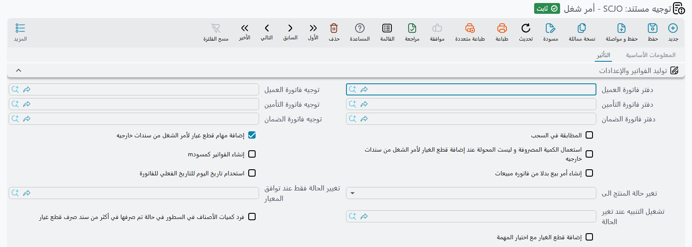

# توجيهات مستندات الورشة

يضم نصف الورشة من مركز الخدمة تسع عائلات توجيه، وهي تقسّم العمل بشكل مرتب: توجيه واحد مشترك يغطي
المستندات الصغيرة التي لا تفعل أكثر من تحريك حالة السيارة، ثم يحصل أمر الشغل وإغلاقه وتصريح البوابة
وسند التنفيذ والإصلاح الخارجي ومستندات قطع الغيار الثلاثة كلٌّ على دفتر قواعد خاص به.

تسير هذه الصفحة عليها بالترتيب الذي تضبطها به نسخة جديدة، مستخدمةً مسار ورشة شركة الصحراء للسيارات —
أمر الشغل `SCJO-2026-0417` لسيارة فهد العتيبي طراز سيف ١٫٦ — مثالًا معمولًا في كل موضع.

::: info الترخيص المطلوب
`srvcenter`
:::

## الكتلة التي تظهر في كل توجيه ورشة تقريبًا

قبل الشاشات المفردة، هناك كتلة تتكرر كثيرًا حتى يستحق الأمر تعلمها مرة واحدة.

**ثلاثي حالة السيارة.** يحمل كل توجيه ورشة تقريبًا ثلاثة حقول متجاورة:

| الخيار | التسمية بالإنجليزية | معرّف الحقل | ماذا يفعل |
|---|---|---|---|
| تغيير حالة الصنف إلى | Change Product Status To | `termConfig.changeProductStatusTo` | يكتب عند الاعتماد قيدًا لحالة السيارة ثم يعيد احتساب حالتها الحالية |
| تغيير الحالة فقط عند توافق المعيار | Change Status Only When Criteria Matches | `termConfig.changeStatusOnlyWhenCriteriaMatches` | يقيّد ما سبق بالمعايير، فلا تتحرك الحالة إلا للمستندات المطابقة |
| تشغيل التنبيه عند تغير الحالة | Notify On Status Change | `termConfig.notifyOnStatusChange` | يطلق تنبيهًا لكل سيارة تغيرت حالتها فعلًا |

بهذا يخبرك ملف السيارة أين هي الآن. تضبط شركة الصحراء *تغيير حالة الصنف إلى* = *داخل الورشة* في
التوجيه المستخدم لسند الفحص والاستلام، و*جاهزة للتسليم* في التوجيه المستخدم لإغلاق أمر الشغل، فتقرأ
شاشة السيارة بشكل صحيح طوال اليوم دون أن يكتب أحد حالة يدويًا.

وتُعاد الحالة بإعادة تشغيل القيود **بترتيب التاريخ** لا بالكتابة فوق السابق، فالمستند المؤرخ بأثر
رجعي يُدرج في وسط التاريخ لا في نهايته.

**لا إعدادات ضريبية في هذه التوجيهات.** لا تعرض شاشات التوجيه المشترك وتوجيه أمر الشغل وتوجيه إغلاق
أمر الشغل خيارات *خاضع للضريبة* و*سياسة الضريبة* و*يمكن تعديل الضريبة* و*السماح بتعديل ضريبة الفاتورة
في السطر*. ومن بين توجيهات الورشة لا تظهر هذه الخيارات إلا في توجيه الإصلاح الخارجي (أدناه).

::: tip ضريبة واحدة في سطور المهمات
تطبّق سطور عمالة الورشة ضريبة واحدة. فاجعل سياسات الضريبة المستخدمة عليها بضريبة واحدة — تستخدم شركة
الصحراء ضريبة قيمة مضافة ١٥٪ في كل مكان.
:::

## التوجيه المشترك لمستندات الورشة

عائلة توجيه واحدة تغطي سبعة مستندات دفعةً واحدة: [**طلب الخدمة**](/ar/modules/servicecenter/job-cycle/servicecenter-service-request.md) و[**المقايسة**](/ar/modules/servicecenter/job-cycle/servicecenter-job-estimation.md) و**تعديل المقايسة**
و**إضافة مهام إلى أمر الشغل** و**إيقاف خدمة** و**استكمال خدمة** و**سند الفحص والاستلام**.

الشاشة صغيرة، وعن قصد — فهذه المستندات تحرك ورقًا وحالة، لا مالًا. تحمل ثلاثي حالة السيارة
ومفتاحًا إضافيًا واحدًا:

**إضافة قطع الغيار عند اختيار المهمة** (`termConfig.addSparePartsWithTaskSelection`) — عند اختيار مهمة في المستند تُضاف قطع الغيار القياسية
للمهمة إلى جدول قطع الغيار تلقائيًا. وهذا الخيار متاح في طلب الخدمة والمقايسة وإضافة المهام إلى أمر
الشغل فقط.

وملاحظتان عن هذه العائلة: في **سند الفحص والاستلام** و**تعديل المقايسة** و**إيقاف خدمة** و**استكمال
خدمة** لا تعرض شاشة التوجيه سوى ثلاثي الحالة. وفي **إيقاف خدمة**
و**استكمال خدمة** يظهر حقل التوجيه لكنه غير مطلوب؛ يعمل المستندان بلا توجيه تمامًا.

## توجيه أمر الشغل

هذا أكثر توجيهات الوحدة ازدحامًا، لأن [أمر الشغل](/ar/modules/servicecenter/job-cycle/servicecenter-job-order.md) هو حيث يُخطَّط المال ومنه تُنشأ [الفواتير الثلاث](/ar/modules/servicecenter/job-cycle/servicecenter-job-order-invoicing.md).

### أزواج الفواتير الثلاثة

جوهر الموضوع. تحتاج أزرار الفوترة الثلاثة في أمر الشغل أن تعرف بأي دفتر وأي توجيه تبني الفاتورة:

| الزوج | معرّفات الحقول | يغذي |
|---|---|---|
| دفتر وتوجيه فاتورة العميل | `termConfig.customerInvBook` / `termConfig.customerInvTerm` | فاتورة العميل — `SINV-2026-3311` بقيمة ٦٩٥ في شركة الصحراء |
| دفتر وتوجيه فاتورة التأمين | `termConfig.insuranceInvBook` / `termConfig.insuranceInvTerm` | فاتورة التأمين — `SINV-2026-3313` بقيمة ٦٠ |
| دفتر وتوجيه فاتورة الضمان | `termConfig.warrantyInvBook` / `termConfig.warrantyInvTerm` | فاتورة الضمان — `SINV-2026-3312` بقيمة ٢٤٠٠ |

اترك زوجًا فارغًا ولن يجد زر ذلك الدافع ما يبني به. وثلاثة مفاتيح أخرى تشكّل ما يخرج:

- **حفظ الفواتير كمسودة** (`termConfig.saveInvoicesAsDraft`) — تصل الفاتورة المنشأة غير معتمدة ليراجعها أحد قبل أن تُنشئ قيدًا. مناسب
  حيث يسعّر مستشار الخدمة العمل ويعتمده قسم الحسابات.
- **إنشاء أوامر بيع لا فواتير** (`termConfig.generateSOrdersNotInvoices`) — ينتج أوامر بيع بدل الفواتير، لمن يفوتر من جانب المبيعات.
- **استخدام تاريخ اليوم لتاريخ استحقاق الفاتورة** (`termConfig.useTodayForInvoiceValueDate`) — يؤرخ الفاتورة بيوم إنشائها بدل حمل تاريخ أمر
  الشغل.

### سلوك قطع الغيار

أربعة خيارات تحدد العلاقة بين أمر الشغل ومستندات قطع الغيار:

| الخيار | التسمية بالإنجليزية | معرّف الحقل | الأثر |
|---|---|---|---|
| المطابقة في السحب | Restrict In Issuing | `termConfig.restrictInIssuing` | السطور المؤشَّرة فقط تخضع لحد «المصروف يتجاوز المخطط» |
| إضافة مهام قطع غيار لأمر الشغل من سندات خارجيه | Add Tasks And Materials to Job Order From Other Documents | `termConfig.addTasksAndMatsToJOFromOut` | تُعاد **بناء** جداول أمر الشغل من سندات الصرف والإرتجاع، وتُلغى فحوص الكميات المخططة كلها |
| استعمال الكمية المصروفة و ليست المحولة | Use Issued Qty not Transferred Qty | `termConfig.useIssuedNotTransferredQtyForAddedMats` | أي زوج من الكميات يغذي إعادة البناء تلك |
| فرد كميات الأصناف في السطور | Spread Items Quantity If It Is Issued In Different Material Issues | `termConfig.spreadItemsQtyIfItIsIssuedInDifferentMaterialIssues` | سطر في أمر الشغل لكل سطر صرف بدل سطر مجمّع لكل صنف |

الخياران الأولان مفترق طرق. مع إبقاء *إضافة مهام قطع غيار…* **مغلقًا** يبقى أمر الشغل خطة يلتزم بها
أمين المخزن — وهو إعداد شركة الصحراء، وهو ما تفترضه هذه المستندات. ومع **فتحه** يصير أمر الشغل سجلًا
لما صُرف فعلًا، وتتوقف كل فحوص الخطة عن السريان.

ويحمل التوجيه كذلك ثلاثي حالة السيارة و*إضافة قطع الغيار عند اختيار المهمة*.

## توجيه إغلاق أمر الشغل

[الإغلاق](/ar/modules/servicecenter/job-cycle/servicecenter-job-order-closing.md) هو حيث يهبط مال الورشة أخيرًا، ولتوجيهه ثلاث وظائف.

**أطراف القيد.** زوج مدين ودائن واحد (`termConfig.debit`، `termConfig.credit`). هذا هو القيد الذي يُنشئه الإغلاق.

::: warning قيمة العميل وحدها هي التي تصل إلى الأستاذ العام
تعرض شاشة الإغلاق أربعة صناديق مال: العميل والتأمين والضمان والداخلي. ويعرض إغلاق شركة الصحراء
`SCJOC-2026-0392` القيم ٦٩٥ و٦٠ و٢٤٠٠ و٦٠. والقيد الذي ينتجه يحمل **قيمة العميل فقط: ٦٩٥**، مدينًا
واحدًا ودائنًا واحدًا على الحسابات المضبوطة في هذا التوجيه.

يصل التأمين والضمان إلى المحاسبة لاحقًا عبر فاتورتيهما. أما الستون الداخلية فلا تصل إلى المحاسبة في
أي موضع. لا تضبط هذين الحسابين وأنت تتوقع ٣٢١٥ كاملة.
:::

**الصرف المخزني.** *دفتر الصرف* و*توجيه الصرف* (`termConfig.issueBook`، `termConfig.issueTerm`) يسميان دفتر وتوجيه **الصرف المخزني** الذي ينشئه
الإغلاق لقطع الغيار المستهلكة في العمل — `STI-2026-1188` في مثالنا، محمّلًا ١٦٦٨ من تكلفة المخزون.
اتركهما فارغين ولن يستهلك الإغلاق شيئًا من المخزن.

**حالات الرفض.** ثلاثة مفاتيح تقرر متى يُسمح بالإغلاق:

| الخيار | التسمية بالإنجليزية | معرّف الحقل | الأثر |
|---|---|---|---|
| السماح بإغلاق الأوامر الموقوفة | Allow Closing Suspended Orders | `termConfig.allowClosingSuspendedOrders` | يسمح بإغلاق أمر شغل موقوف |
| منع إغلاق أمر الشغل إذا لم يتم صرف الخامات بالكامل | Do Not Close Job Order If All Materials Are Not Issued | `termConfig.doNotCloseJobOrderIfAllMaterialsAreNotIssued` | يرفض الإغلاق ما دامت هناك قطعة مخططة لم تُصرف بالكامل |
| عدم اعتبار حالة سطور المهمات وقطع الغيار | Do Not Consider Job Order Operations Lines Status | `termConfig.doNotConsiderOperationsLinesStatus` | يغلق بصرف النظر عن كون سطور المهمات منتهية أم لا |

::: tip فحص الخامات يحسب لكل صنف لا لكل مهمة
خيار *منع إغلاق أمر الشغل إذا لم يتم صرف الخامات بالكامل* يجمع كل **صنف** على مستوى الأمر كله. فإن
خُطط خمسة لترات زيت على مهمة وصُرفت على مهمة أخرى، اعتُبر الفحص متحققًا. هو فحص اكتمال للكميات، لا
مطابقة لكل مهمة.
:::

ويحمل التوجيه — كالعادة — ثلاثي حالة السيارة.

## توجيه تصريح عبور البوابة — بوابة الإفراج المالي

[تصريح البوابة](/ar/modules/servicecenter/job-cycle/servicecenter-gate-pass.md) أنفع كتلة توجيه في الوحدة، وهو في الوقت نفسه أكثر مستنداتها إساءةً للفهم. لا علاقة له
بالحواجز ولا بالاتجاه ولا بوقت المرور. هو **فحص إفراج**: هل يُسمح لهذه السيارة بالخروج في ضوء ما
سُدِّد وما لم يُسدَّد؟

سبعة مفاتيح، في ثلاثة أزواج متماثلة ومفتاح مفرد:

| الخيار | التسمية بالإنجليزية | معرّف الحقل |
|---|---|---|
| السماح بعمل التصريح بدون أمر شغل | Allow Gate Pass Without Job Order | `termConfig.allowGatePassWithoutJobOrder` |
| السماح بعمل التصريح بدون فاتورة العميل | Allow Gate Pass Without Customer Invoice | `termConfig.allowGatePassWithoutCustomerInvoice` |
| السماح بعمل التصريح بدون دفع فاتورة العميل بالكامل | Allow Gate Pass Without Fully Paying The Customer Invoice | `termConfig.allowGatePassWithRemainingInCustomerInvoice` |
| السماح بعمل التصريح بدون فاتورة التأمين | Allow Gate Pass Without Insurance Invoice | `termConfig.allowGatePassWithoutInsuranceInvoice` |
| السماح بعمل التصريح بدون دفع فاتورة التأمين بالكامل | Allow Gate Pass Without Fully Paying The Insurance Invoice | `termConfig.allowGatePassWithRemainingInInsuranceInvoice` |
| السماح بعمل التصريح بدون فاتورة الضمان | Allow Gate Pass Without Warranty Invoice | `termConfig.allowGatePassWithoutWarrantyInvoice` |
| السماح بعمل التصريح بدون دفع فاتورة الضمان بالكامل | Allow Gate Pass Without Fully Paying The Warranty Invoice | `termConfig.allowGatePassWithRemainingInWarrantyInvoice` |

كل مفتاح هنا **سماح**، فالإعداد الصارم هو إغلاق السبعة. وهذا ما تستخدمه شركة الصحراء: لم يمكن إصدار
تصريح البوابة `SCGP-2026-0475` إلا بعد اعتماد فاتورة العميل **وسدادها بالكامل** — ٧٩٩٫٢٥ نقدًا من فهد
— وبعد وجود فاتورتي التأمين والضمان. أما مفتاحا سداد التأمين والضمان فيُتركان **مفتوحين**، لأن شركة
التأمين تستغرق أسابيع للسداد ولن يحتجز أحد السيارة طوال تلك المدة.

وثلاثي الحالة موجود هنا أيضًا، وهو الموضع الطبيعي لضبط حالة السيارة إلى *تم التسليم*.

## توجيه تنفيذ أمر الشغل

صغير، لكن فيه مصيدة.

| الخيار | التسمية بالإنجليزية | معرّف الحقل | الأثر |
|---|---|---|---|
| منع فتح اكثر من مهمة للفنى في نفس اليوم | Prevent Opening More Than One Unfinished Task | `termConfig.preventOpenMoreOneUnFinTask` | يرفض حفظًا يترك فنيًا واحدًا بمهمتين غير منتهيتين في نفس التاريخ |
| دفتر وتوجيه الإغلاق | Close Book / Close Term | `termConfig.closeBook` / `termConfig.closeTerm` | دفتر وتوجيه إغلاق أمر الشغل الذي ينتجه زر *إنشاء الإغلاق* |
| السماح بتداخل الوقت | Allow Time Overlap | `termConfig.allowTimeOverlap` | يسمح لفني واحد بفترات «من/إلى» متداخلة في سطرين. وإن لم يُعلَّم رُفض الحفظ عند تداخل الفترتين |

بالإضافة إلى ثلاثي حالة السيارة.

::: warning ترك التوجيه فارغًا يوقف هذا المستند بصمت
مستند تنفيذ أمر الشغل لا يشترط توجيهًا. اترك الحقل فارغًا ويُحفظ المستند بلا اعتراض — لكن فحص «مهمة
واحدة مفتوحة لكل فني» لا يعمل أبدًا، ولا يجد زر *إنشاء الإغلاق* دفترًا ولا توجيهًا يبني بهما. إن كان
أيٌّ من السلوكين يعنيك، فاجعل اختيار التوجيه جزءًا من الإجراء.
:::

## توجيه الإصلاح الخارجي

[الإصلاح الخارجي](/ar/modules/servicecenter/spare-parts/servicecenter-external-repair.md) فاتورة مورّد لعمل مُسنَد للخارج — أرسلت شركة الصحراء كمبروسر التكييف إلى الفيصل
لكهرباء السيارات لاختباره، بقيمة ٤٠٠ في المستند `SCER-2026-0061`.

ويحمل توجيهه كتلة حسابات الفاتورة القياسية: طرفا المدين والدائن (`termConfig.config.debit`،
`termConfig.config.credit`، ومعهما *إختصار القيود* `termConfig.config.shortenLedger`)، والنقدي، وخصم
السطر وخصم الفاتورة، وحسابات الخصم السبعة الإضافية، وحسابات الضرائب، وأربعة أزواج لمصاريف الخدمة
(`termConfig.serviceFees1Debit` … `termConfig.serviceFees4Credit`). وكل هذا يُقرأ فعلًا — فالإصلاح
الخارجي يُنشئ قيدًا حقيقيًا.

ومفتاح واحد يغيّر اتجاه القيد:

**تعمل مبيعات ليست مشتريات** (`termConfig.isSalesNotPurchase`) — مغلقًا، وهو الوضع الافتراضي، يسجل
**التزامًا** تجاه المورّد؛ ومفتوحًا يسجل مدينية بدلًا من ذلك، للحالات النادرة التي تؤدي فيها المنشأة
عملًا مُسنَدًا لغيرها عبر هذه الشاشة.

وبقية مجموعة **إعدادات التأثير العامة**، والمفاتيح في أعلى مجموعة **مصاريف الخدمة**، تعمل كما في أي
فاتورة مشتريات:

| الخيار | معرّف الحقل | ماذا يفعل |
|---|---|---|
| **عدم إختصار قيود مصروفات طرق الدفع** (Expand Payment Method Effect) | `termConfig.expandPaymentMethodEffect` | تُكتب قيود سطور الدفع كاملة — قيمة الدفع ومصروفات طريقة الدفع في سطرين منفصلين — بدل خصم المصروفات من سطر الدفع. |
| **خاضع للضريبة** (Taxable) | `termConfig.taxable` | يُنسخ إلى رأس المستند عند كل حفظ؛ ألغِ تعليمه في توجيه لا تحمل إصلاحاته ضريبة. |
| **يمكن تعديل الضريبة** (Modifiable Tax) | `termConfig.modifiableTax` | يُنسخ إلى الرأس عند كل حفظ؛ يسمح للمستخدم بتعديل الضريبة المحتسبة. |
| **سياسة الضريبة** (Tax Plan) | `termConfig.taxPlan` | سياسة ضريبة الرأس، تُنسخ إلى المستند عند كل حفظ — فتغييرها يغيّر ما يحتسبه الحفظ التالي لإصلاح خارجي قائم. |
| **السماح بتعديل ضريبة الفاتورة في السطر** (Allow Editing Header Tax In Details) | `termConfig.allowEditingHdrTaxInDetails` | يُنسخ إلى الرأس عند كل حفظ؛ يسمح لسطر بضريبة مختلفة عن الرأس. |
| **دفع الأقساط بالترتيب** (Pay Installments In Order) | `termConfig.payInstallmentsInOrder` | يجب سداد جدول أقساط الإصلاح بدءًا بأقدم قسط. وإن لم يُعلَّم أمكن سداد أي قسط في أي وقت. |
| **خصم مصاريف خدمة 1** … **خصم مصاريف خدمة 4** (Service Fees 1–4 Deduction) | `termConfig.serviceFees1Deduction` … `termConfig.serviceFees4Deduction` | تُعامَل مصاريف الخدمة تلك خصمًا من صافي المستند بدل إضافتها إليه، ويُعكس قيدها تبعًا لذلك. |
| **عدم إضافة التأثيرالمحاسبي لمصاريف الخدمة بدون الجانب المحاسبي** (Do Not Add Service Fees Effect Without Account Side) | `termConfig.doNotAddServiceFeesEffectWithoutAccSide` | سطر مصاريف الخدمة الذي يخلو طرفه المدين أو الدائن الخاص يُستبعد من القيد، بدل تسجيله على الطرفين الرئيسيين للتوجيه. |

وينتهي تبويب **تأثيرات الخصم** بجدول **تأثير سندات الدفع** (External Effects،
`termConfig.externalEffectLines`). يضيف كل سطر فيه زوج مدين/دائن إلى قيد الإصلاح نفسه عن كل مستند
دفع مسجَّل عليه — سطور الدفع التي تضيفها السندات إلى الإصلاح — بقيمة الدفع:

| العمود | معرّف الحقل | ماذا يفعل |
|---|---|---|
| **للنوع** (For Type) | `termConfig.externalEffectLines.forType` | يقصر السطر على مستندات الدفع من هذا النوع. الفراغ يعني كل الأنواع. |
| **يطبق عند توافق مستند الدفع مع المعيار** | `termConfig.externalEffectLines.applyWhenPaymentDocMatchesCriteria` | لا يُطبَّق السطر إلا على مستندات الدفع المطابقة لهذه المعايير. |
| **يطبق عند توافق مستند الدفع مع الاستعلام** | `termConfig.externalEffectLines.applyWhenPaymentDocMatchesQuery` | الفلتر نفسه مكتوبًا كاستعلام. |
| **مدين** / **دائن** | `termConfig.externalEffectLines.debit` / `termConfig.externalEffectLines.credit` | طرفا الزوج المضاف. |

::: warning قيمة الإصلاح الخارجي لا تصل إلى أمر الشغل أبدًا
تذهب الأربعمائة إلى الأستاذ العام على المورّد وحساب السطر، وتؤشّر المهام المغطاة بأنها *منتهية*.
لكنها **لا** تنضم إلى الـ٣٢١٥، ولا تظهر في أي من الفواتير الثلاث، ولا يوجد خيار في التوجيه يجعلها
تفعل. لاستردادها من العميل أضف قيمة مهمة أو قطعة على أمر الشغل يدويًا.
:::

## توجيهات مستندات قطع الغيار الثلاثة

يتشارك [صرف قطع الغيار](/ar/modules/servicecenter/spare-parts/servicecenter-spare-parts-issue.md) وإرتجاعها وطلب الصرف الشكل نفسه — إلا أن السطرين الأخيرين أدناه،
*عدم نسخ التفاصيل من أمر الشغل* و*استخدام أمر الشغل لمتابعة الكميات*، موجودان في توجيهي صرف قطع
الغيار وطلب الصرف فقط. أما توجيه إرتجاع قطع الغيار فلا يحملهما.

| الخيار | التسمية بالإنجليزية | معرّف الحقل | الأثر |
|---|---|---|---|
| دفتر المستند / توجيه المستند (الإنشاء) | Generation Book / Term | `termConfig.generationConfigurations.generationBook` / `termConfig.generationConfigurations.generationTerm` | دفتر وتوجيه **الصرف المخزني** المنشأ (في الصرف) أو **الاستلام المخزني** (في الإرتجاع). الفراغ يعني ألا يُنشأ مستند مخزني إطلاقًا، وحذف القائم منه |
| تحويل لا صرف | Transfer Not Issue | `termConfig.transferNotIssue` | يحوّل المستند كله من صرف/استلام إلى **تحويل مخزني** بين المخزن ومخزن التشغيل الخاص بأمر الشغل |
| دفتر التحويل المخزني / مستند التحويل المخزني | Transfer Book / Term | `termConfig.transferBook` / `termConfig.transferTerm` | دفتر وتوجيه ذلك التحويل |
| عدم نسخ التفاصيل من أمر الشغل | Do Not Copy Details From Job Order | `termConfig.doNotCopyDetailsOfFromDocfFromJobOrder` | يمنع نسخ قطع الغيار المخططة عند اختيار أمر الشغل |
| استخدام أمر الشغل لمتابعة الكميات | Use Job Order For Qty Tracking | `termConfig.useJobOrderForQtyTracking` | يعلّق كميات المنفذ والمتبقي على أمر الشغل بدل المستند المصدر |

*تحويل لا صرف* هو المفترق هنا. مغلقًا يصرف أمين المخزن القطع فتخرج من مخزن قطع الغيار — كما في
`SCRMI-2026-1902` الذي أنتج الصرف المخزني `STI-2026-1188` من `WH-PARTS`. ومفتوحًا تنتقل القطع إلى
مخزن التشغيل `WH-WIP` وتبقى في الدفاتر حتى يستهلكها العمل.

ولإيقاف الصرف أو الإرتجاع عن إنشاء مستنده المخزني **أفرغ دفتر الإنشاء وتوجيه الإنشاء** — أو دفتر
وتوجيه التحويل في وضع التحويل.

وطلب صرف قطع الغيار طلب ورقي يُبنى عليه سند الصرف لاحقًا: لا يحرك مخزونًا ولا يُنشئ قيدًا. وإعدادات
المخزون المعمول بها هي التي على توجيه الصرف نفسه.

---

للقواعد العامة خلف هذه الشاشات راجع [توجيهات المستندات في مركز
الخدمة](/ar/modules/servicecenter/document-terms/servicecenter-terms-basics.md). ولجانب المعرض راجع
[توجيهات مستندات السيارات والتأمين
والتأجير](/ar/modules/servicecenter/document-terms/servicecenter-terms-cars-and-other.md).
