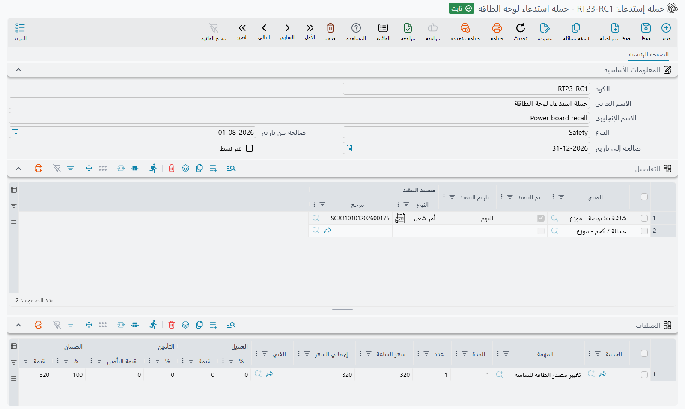

# حملات الاستدعاء (RecallCampaign)

حملة الاستدعاء هي قائمة المركبات التي يجب أن تعود إلى الورشة لإصلاح بعينه. يعلن المصنّع أن دفعة من
مضخات التوجيه معيبة، ويتسلّم الوكيل قائمة بأرقام الشاسيه، ويجب أن تُستبدل المضخة في كل سيارة منها قبل
أي صيانة أخرى. شاشة **حملة إستدعاء** تحفظ هذه القائمة، و[أمر الشغل](/ar/modules/servicecenter/job-cycle/servicecenter-job-order.md)
يستعملها بطريقتين: يرفض فتح عمل عادي على مركبة مدرجة فيها حتى يُعالَج الاستدعاء، ويشطب المركبة من
القائمة حين ينفّذ أمر شغل عمل الاستدعاء.

تجدها في **مركز خدمة ← الملفات ← حملة إستدعاء**.

::: info الترخيص المطلوب
`srvcenter`
:::

## شاشة الحملة

الرأس قصير:

| الحقل | English | الغرض |
|---|---|---|
| الكود، الاسم العربي، الاسم الإنجليزي | Code, Name1, Name2 | مرجع الحملة، مثل `RC-2026-PSP`، واسماها العربي والإنجليزي. |
| النوع | Type | نص حر لتصنيفك الخاص، مثل *سلامة* أو *نشرة خدمة*. لا يقرؤه شيء. |
| صالحه من تاريخ / صالحه إلي تاريخ | Valid From Date / Valid To Date | الفترة التي تمنع فيها الحملة أوامر الشغل. يجوز ترك أي طرف فارغاً، فتكون مفتوحة من جهته. |
| غير نشط | Inactive | فعّله لإيقاف الحملة دون حذفها. |

وتحته ثلاثة جداول.

جدول **التفاصيل** هو الأهم: سطر لكل مركبة، تختارها من [ملف المركبة](/ar/modules/servicecenter/workshop-setup/servicecenter-product-file.md).
أما الأعمدة الثلاثة الأخرى — **تم التنفيذ** و**تاريخ التنفيذ** و**مستند التنفيذ** — فيملؤها النظام لا
أنت. تبدأ فارغة (و«تم التنفيذ» غير مفعّل)، وتُختم حين ينفّذ أمر شغل عمل الاستدعاء.

جدولا **العمليات** و**قطع غيار** يصفان عمل الاستدعاء المعياري: الخدمات والمهام بساعاتها وأسعارها،
والقطع بكمياتها، وأعمدة التقسيم نفسها التي في أمر الشغل بين العميل والتأمين والضمان والشركة (واستدعاء
المصنّع يكون عادةً ضماناً بنسبة 100%). وتُملأ أسعار الوحدة وقيم الدافعين كما تُملأ في أمر الشغل. هذان
الجدولان مرجع لمهندس الاستقبال، ولا شيء ينسخهما إلى أمر الشغل، فأضف عمل الاستدعاء إلى أمر الشغل بنفسك.

ولا أثر آخر لحفظ الحملة: لا تحرّك مخزوناً ولا تُنشئ قيداً محاسبياً.

## ماذا تفعل الحملة بأمر الشغل

عند حفظ أمر الشغل واعتماده يبحث النظام عن الحملات التي تُدرج مركبة الأمر وما زالت تنتظرها. وتُحسب
الحملة إذا اجتمعت فيها كل هذه الشروط:

- أنها محفوظة ومعتمدة (الحملة المسودة لا تمنع شيئاً)؛
- أن **غير نشط** غير مفعّل؛
- أن تاريخ قيمة أمر الشغل يقع بين **صالحه من تاريخ** و**صالحه إلي تاريخ** (الطرف الفارغ لا يقيّد)؛
- أن سطر المركبة في الحملة لم يُختم بعد بـ **تم التنفيذ**.

فإن وُجدت حملة كهذه رُفض أمر الشغل بالرسالة:

«{0} موجود في حملة الإستدعاء {1}»

حيث `{0}` هي المركبة و`{1}` الحملة. وتحمل الرسالة رابطاً إلى سطر الحملة، فيفتحه مهندس الاستقبال مباشرة.

وأمامك طريقان، ولكل منهما معنى مختلف:

1. **أمر الشغل هذا هو عمل الاستدعاء.** اختر الحملة في حقل **حملة الإستدعاء** بأمر الشغل (في كتلة
   تفاصيل المركبة) وأضف عمليات الاستدعاء. عندها يُقبل أمر الشغل، ويختم اعتماده سطر المركبة في الحملة
   بأنه نُفّذ.
2. **جاء العميل لشيء آخر والاستدعاء يُعالَج على حدة** (أو رفضه العميل). فعّل **تجاهل التحقق من حملات
   الاستدعاء** في رأس أمر الشغل. فيُقبل الأمر ويبقى سطر الحملة مفتوحاً.

::: tip أوامر الشغل المسودة لا تُفحص
يجري الفحص عند الاعتماد. أمر الشغل المحفوظ مسودةً لا يُرفض؛ بل يُرفض حين يحاول أحدهم اعتماده.
:::

## كيف تُشطب المركبة من القائمة

حين يُعتمَد أمر شغل يسمّي حملة، يجد النظام سطر المركبة في تلك الحملة ويختمه: **تم التنفيذ** مفعّل،
و**تاريخ التنفيذ** = تاريخ قيمة أمر الشغل، و**مستند التنفيذ** = أمر الشغل. افتح الحملة فيصير جدول
التفاصيل تقرير متابعة — كل سطر لم يُختم بعد هو سيارة لم تحضر.

وحذف أمر الشغل ذاك يمسح الختم من جديد، فتعود المركبة إلى الانتظار.

والاعتماد نفسه يكتب الحملة في حقل **حملة الإستدعاء** بملف المركبة إن كان فارغاً. ومن بعدها يلتقط كل
طلب خدمة ومقايسة وأمر شغل جديد لتلك المركبة الحملةَ من ملف المركبة عند اختيارها. ولهذا لا يُرفض أبداً
أمر شغل لمركبة سبق أن مرّت باستدعاء، كما هو موضّح في
[ما يرفضه أمر الشغل](/ar/modules/servicecenter/job-cycle/servicecenter-job-order.md).

## مثال عملي

تتلقى شركة الصحراء للسيارات استدعاءً لمضخة التوجيه يشمل مركبتين: `SP-0054` و`SP-0055`.

1. ينشئ مدير الخدمة الحملة `RC-2026-PSP` بنوع *سلامة*، صالحة من 1 أغسطس إلى 31 ديسمبر، ويُدرج
   المركبتين في التفاصيل، ويضيف مهمة استبدال المضخة بساعة واحدة وضمان 100% في العمليات.
2. تصل `SP-0055` في 23 أكتوبر لتغيير الزيت. ينشئ مهندس الاستقبال أمر شغل لها، فيُرفض عند الاعتماد
   برسالة الاستدعاء التي تسمّي المركبة و`RC-2026-PSP`.
3. يختار المهندس `RC-2026-PSP` في حقل **حملة الإستدعاء** بأمر الشغل، ويضيف مهمة المضخة بضمان 100%
   بجوار تغيير الزيت، ثم يعتمده. فيُحفظ أمر الشغل، ويظهر سطر `SP-0055` في الحملة وعليه «تم التنفيذ»
   و23-10-2026 ورقم أمر الشغل.
4. يبقى `SP-0054` بلا ختم، فيعرف مدير الخدمة أي عميل يتصل به.
