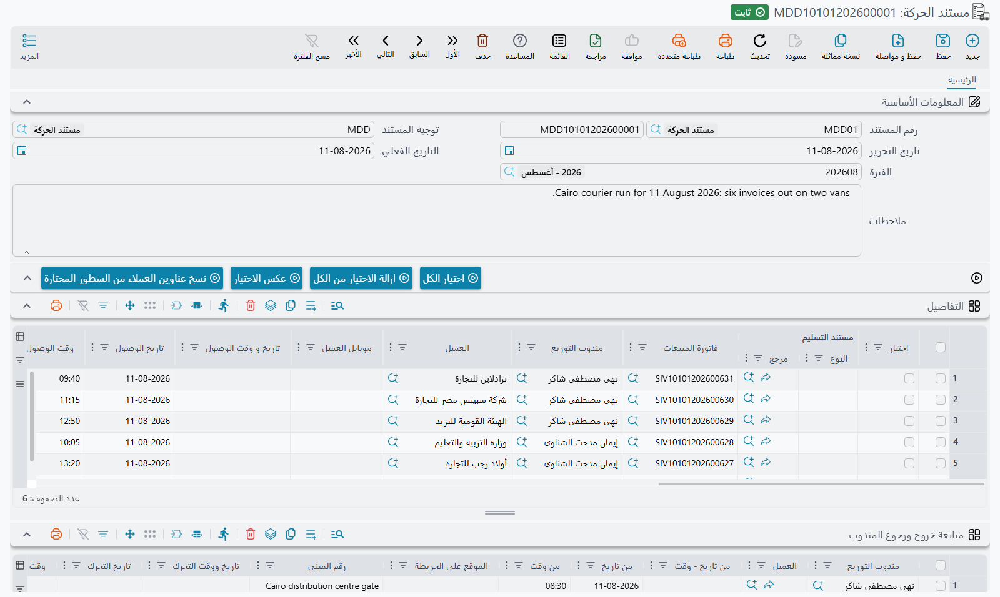

# التسليم عبر تطبيق المندوب

::: info الترخيص المطلوب
`srvcenter-mobile-delivery`. المستندات الثلاثة في هذا المجلد كلها مقيّدة به.
:::

::: danger هذه المستندات لا علاقة لها بالسيارات
اقرأ هذا قبل أي شيء آخر، فموضع المجلد داخل مركز الخدمة يجعل القراءة الخاطئة شبه حتمية.

**التسليم عبر تطبيق الجوال لا صلة له إطلاقاً بتسليم السيارات.** فهو ليس [تسليم السيارة النهائي](/ar/modules/servicecenter/car-sales/car-final-delivery.md)، ولا يسلّم سيارة مباعة لمشتريها، ولا يمسّ [سجل السيارات](/ar/modules/servicecenter/cars-setup/car-master-file.md)، ولا يوجد أي مسار برمجي يربط بينهما. سطر التسليم هنا يمكن أن يشير إلى فاتورة مبيعات أو مردود مبيعات أو مهمة عمل أو مستند استلام فاتورة — أما تسليم السيارة النهائي فليس خياراً أصلاً.

وحقيقته: **ورقة خط سير لمندوب يحمل بضاعة إلى العملاء**، تُدار من تطبيق Nama للتوصيل على الجوال. فإن كنت تبحث عن كيفية تسليم سيارة مباعة فذلك يخص [دورة بيع السيارات](/ar/modules/servicecenter/car-sales/car-sales-cycle.md)، وهذا هو المجلد الخطأ.
:::

## الغرض منه

تبيع شركة الصحراء للسيارات قطع الغيار من على البنك، وتشغّل كذلك سيارة صغيرة تنقل القطع إلى عملاء الأساطيل في أنحاء الرياض. وفي كل صباح على أحدهم أن يقرر أي فواتير الأمس تركب السيارة، وبأي ترتيب، وبأي صناديق وحافظات. وفي آخر اليوم على أحدهم أن يعرف أي وقفات تمّت فعلاً.

هذا هو عمل هذه الوحدة كله. تصل إليها من **مركز خدمة ← تطبيقات الجوال - مراكز الخدمة**، وتتكون من ثلاثة مستندات:

| المستند | English | ما هو |
|---|---|---|
| **مستند الحركة** | Mobile Delivery Document | ورقة خط سير مندوب واحد — قائمة وقفات يومه. |
| **مستند حركة مجمع** | Multi Mobile Delivery Document | مولّد مجمّع. يجمع الفواتير ومهام العمل ضمن نافذة تاريخ ووقت، وينتج ورقة خط سير لكل مجموعة. |
| **مستند استلام الفاتورة** | Invoice Receipt Document | ما استلمه العميل فعلاً مقابل فاتورة مبيعات مُسلَّمة، وما عاد من مواد التعبئة. |

يتناول الأولين [صفحة مستندات الحركة](/ar/modules/servicecenter/mobile-delivery/servicecenter-mobile-delivery-documents.md)، وللثالث [صفحته الخاصة](/ar/modules/servicecenter/mobile-delivery/servicecenter-invoice-receipt-document.md).

## ماذا تغيّر هذه المستندات

القليل جداً، وهذه هي الإجابة الصادقة.

- **لا أثر محاسبي.** لا مستند الحركة ولا المستند المجمع ينتج قيداً. ولا توجد حسابات في [توجيههما](/ar/modules/servicecenter/document-terms/servicecenter-terms-cars-and-other.md) لتملأها، ولا يصل شيء إلى الأستاذ عند الاعتماد.
- **لا أثر مخزني بذاته.** والمستند المجمع لا يحرّك مخزوناً على الإطلاق.
- **أثر حقيقي واحد.** يستطيع مستند الحركة أن ينشئ اختيارياً **سندات تحويل مخزني** تنقل أصناف التعبئة — صناديق وكراتين وحافظات — إلى مخزن المندوب نفسه، حتى يظهر ما في السيارة ضمن أرقام المخازن. ولا يحدث ذلك إلا حين يُضبط التوجيه لذلك، وتفصيله في صفحة مستندات الحركة.

وما عدا ذلك فتسجيل: أي وقفة تخص أي مندوب، ومتى وصل، وبأي حال انتهت الوقفة، وماذا قال المندوب عنها.

## يوم المندوب

مستند الحركة مكتوب لتطبيق جوال يحمله المندوب، لا لشاشة Nama. والمسار من جانب المندوب:

1. **يفتح المندوب التطبيق فيرى الوقفات.** تُسحب القائمة من سطور مستندات الحركة التي يكون المندوب فيها هو موظف المستخدم الحالي — أو التي لم يُسمَّ لها مندوب أصلاً — وتكون حالة التسليم فيها ما زالت مفتوحة (*مبدئي* أو *منقول* أو *العميل غير موجود*)، ويقع تاريخ قيمتها ضمن نافذة قريبة. وتُقصر السطور كذلك على شركة المندوب وفرعه كما في ملف موظفه؛ والسطر الذي لا شركة له ولا فرع يظهر للجميع. وتُعرض الوقفات التي ما زالت تنتظر في الفرع منفصلة عن الوقفات التي خرجت إلى الطريق.

   ::: info نافذة السحب قابلة للضبط
   النافذة هي الإعداد **عدد الأيام السابقة للبحث عن مستند حركة** (Previous Days Count To Limit Mob Deliver Document Search Period) في شاشة **إعدادات تطبيقات الهواتف المحمولة**. وإن تُرك فارغاً فهي **ثلاثة أيام**. فإن أبلغ مندوب أن وقفة الأمس مفقودة من التطبيق، فأول ما تفحصه هو تلك النافذة — ثم الشركة والفرع في ملف موظف المندوب.
   :::

2. **يُخرج المندوب الطلبات من الفرع.** عند مغادرة الفرع يختار المندوب الوقفات التي يأخذها ويسجّل التحرك. فتنتقل كل وقفة مختارة من *مبدئي* إلى **منقول**، وتأخذ هذا المندوب إن لم يكن لها مندوب، ويُضاف لها سطر خاص في جدول **متابعة خروج ورجوع المندوب** فيه **تاريخ ووقت التحرك** و**موقع التحرك** (موقع الهاتف). ولا يُنقل إلا ما ينتظر في الفرع؛ فالوقفة التي أخذها مندوب آخر، أو التي سُلّمت، أو عُلّمت *العميل غير موجود*، مرفوضة.

3. **عند كل وقفة يسجّل المندوب حضوره وانصرافه.** الحضور يكون لكل وقفة على حدة: يملأ وقت الحضور وموقعه في سطر تلك الوقفة في جدول *متابعة خروج ورجوع المندوب*، ويملأ الانصراف وقت المغادرة وموقعها في السطر نفسه. ويُرفض الحضور عند وقفة ما زالت تنتظر في الفرع، أو لم ينقلها هذا المندوب.

4. **يستطيع التطبيق إعادة ترتيب الوقفات.** يطلب المندوب ترتيب خط السير فتعود الوقفات بترتيب القيادة بدل الترتيب الذي كُتبت به.

5. **يسجّل المندوب ما حدث.** كل سطر يحمل **حالة تسليم** — *مبدئي* و*منقول* و*توصيل كلي* و*العميل غير موجود* — إضافةً إلى تاريخ ووقت الوصول، وعنوان العميل كما وجده، وملاحظات حرة، ورسالة صوتية. ولا تتحرك الحالة إلا إلى الأمام:

   | من | الحالات المسموح بها بعدها |
   |---|---|
   | *مبدئي* (ينتظر في الفرع) | *منقول*، *توصيل كلي*، *العميل غير موجود* |
   | *منقول* | *توصيل كلي*، *العميل غير موجود* |
   | *العميل غير موجود* | *منقول* (زيارة أخرى)، *توصيل كلي* |
   | *توصيل كلي* | لا شيء — هي نهائية |

   ولا يعود شيء إلى *مبدئي*.

6. **يستطيع المندوب إنشاء عمل من الطريق.** فبجانب تحديث الوقفات، يستطيع التطبيق إنشاء سند قبض بالنقدية المحصلة، ومردود مبيعات، وطلب صنف، وأمر بيع، ومهمة عمل، ومقترحاً أو شكوى. وهذه مستندات Nama عادية، وليست جزءاً من مستند الحركة نفسه.

::: warning تعديلات المندوب تتجاوز فحوص المستند
حين يكتب التطبيق حالة التسليم أو وقت الوصول أو العنوان أو الملاحظات أو الرسالة الصوتية على السطر، فإنه يكتبها **مباشرةً على السطر** — فلا يُفتح مستند الحركة للتعديل، ولا تعمل فحوصه، ولا يُعاد تطبيق آثاره.

وهذا سلوك متوقع لا خلل يُبلَّغ عنه، لكن على فريق الدعم معرفته لسببين. الأول أن التغييرات الآتية من التطبيق لا تظهر في سجل تعديلات المستند كما يظهر تغيير من شاشة Nama، فالقيمة التي تبدو بلا تفسير على سطر تكون في الغالب من المندوب. والثاني أن ما كان المستند سيفحصه عادةً عند الحفظ لا يُفحص لهذه الحقول ببساطة.
:::

### رسائل قد تظهر للمندوب

ليس لهذه الرسائل نص عربي؛ فهي تظهر بالإنجليزية على الهواتف العربية أيضاً.

| الرسالة | السبب | ما العمل |
|---|---|---|
| *The order of {0} has not left the branch yet* | حضور عند وقفة ما زالت *مبدئي*. | انقل الطلب أولاً، ثم سجّل الحضور. |
| *The courier {0} did not move the order of {1}* | حضور عند وقفة لم ينقلها هذا المندوب. | انقل الطلب، ثم سجّل الحضور. |
| *The courier {0} did not check in at the order of {1}* | انصراف من وقفة بلا حضور. | سجّل الحضور أولاً. |
| *The order of {0} belongs to the courier {1}* | حضور عند وقفة مندوب آخر. | اتركها لذلك المندوب، أو غيّر المندوب في مستند الحركة. |
| *The order of {0} was taken by the courier {1}* | نقل وقفة مندوب آخر. | كما سبق. |
| *The order of {0} is already {1}* | نقل وقفة سُلّمت أو عُلّمت *العميل غير موجود*. | سجّل حالتها بدلاً من ذلك؛ ووقفة *العميل غير موجود* تعود إلى الطريق بجعلها *منقول*. |
| *The order of {0} can not go from {1} to {2}* | تغيير حالة لا يسمح به الجدول أعلاه، كإعادة فتح وقفة مسلَّمة. | لا شيء من التطبيق؛ يصحح المشرف السطر في مستند الحركة. |

## العناوين تعود إلى ملف العميل

ثمة أمر واحد في مستند الحركة يتجاوز حدوده. يكتب المندوب العنوان كما وجده فعلاً — *«البوابة ٤، خلف المسجد»* — وفي شاشة الحركة إجراء ينسخ عناوين السطور المختارة **إلى ملفات العملاء الرئيسية**.

وهذا مقصود، وهو الطريقة التي ينظّف بها قسم التوصيل دفتر عناوينه تدريجياً. لكنه تعديل لملف رئيسي يُجرى من شاشة مستند، فتعامل معه على هذا الأساس: أثره ليس محصوراً في المستند، وسيمسّ كل مستند مستقبلي يُصدر لذلك العميل.

::: warning سطر واحد سيئ يوقف البقية
إذا كان مستلم أحد السطور المختارة جهةً لا تحمل بيانات اتصال، توقّف النسخ عندها — وتُتخطى بقية السطور المختارة بصمت بدل معالجتها. فبعد تشغيل الإجراء على تحديد كبير، تحقق بالعينة من أن العناوين التي توقعتها وصلت فعلاً.
:::

## اقرأ بعد ذلك

- [مستندات الحركة](/ar/modules/servicecenter/mobile-delivery/servicecenter-mobile-delivery-documents.md) — ورقة خط السير الواحدة والمولّد المجمّع، مع قواعد الإعداد التي تبقيهما صالحين للاستخدام.
- [مستند استلام الفاتورة](/ar/modules/servicecenter/mobile-delivery/servicecenter-invoice-receipt-document.md) — تسجيل ما استلمه العميل فعلاً وردّ قيمة النقص.
