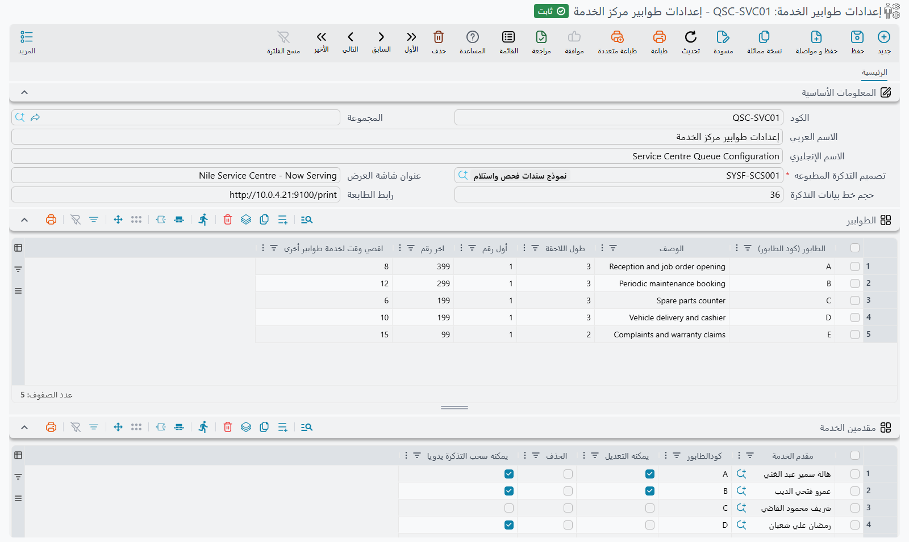

# كيف تعمل خدمة الطوابير

::: info الترخيص المطلوب
`srvcenter-service-queues`. ولا يتاح شيء مما في هذه الصفحات في التركيب الأساسي، والترخيص نفسه هو الذي
يفتح المنفذ الذي تتحدث إليه أجهزة الطوابير — فبدونه يرفض الخادم جهاز إصدار التذاكر وشاشة العرض ومحطات
مقدمي الخدمة جميعاً.
:::

في الساعة ٠٨:١٢ من صباح ٣ مارس ٢٠٢٦ يدخل فهد العتيبي صالة استقبال شركة الصحراء للسيارات بسيارته ناوا
سيف ١٫٦. يضغط زراً على جهاز لوحي صغير عند الباب فتخرج له قصاصة مكتوب عليها **`A014`**، فيجلس. وعلى
الحائط شاشة تعرض الأرقام التي تُخدَم الآن وعند أي مكتب، وبجانبها إعلان المعرض. وبعد دقائق يظهر
`A014` على تلك الشاشة أمام مكتب ماجد القحطاني، فيتوجه إليه فهد وتبدأ الزيارة — ومن هناك تمضي
[دورة العمل في الورشة](/ar/modules/servicecenter/job-cycle/servicecenter-job-cycle-overview.md) المعتادة.

هذه هي وحدة خدمة الطوابير كلها: تذكرة، وشاشة، ومستشار ينادي العميل التالي. وهي وحدة صغيرة قائمة بذاتها،
وتعمل من أولها إلى آخرها — وذلك غير معتاد في ميزة بهذا الطرف من النظام.

وتصل إلى سجليها من **مركز خدمة > خدمة الطوابير**.

## سجلان تعدّهما وثلاثة أدوار يخدمانها

كل ما تفعله الطوابير مدفوع بملفَّي رئيسيَّين اثنين لا ثالث لهما:

| السجل | English | ما يحمله |
|---|---|---|
| **إعدادات طوابير الخدمة** | Queue Service Configurations | كتاب القواعد: الطوابير نفسها، ومن يجوز له خدمة أي طابور، وإعلانات شاشة العرض، وتصميم التذكرة المطبوعة، ومسار اختياري لإصدار التذاكر ذاتياً. |
| **فرع خدمة طوابير** | Queue Service Branch | صالة الاستقبال الفعلية. تشير إلى إعدادات واحدة وتحدد وقت بداية يوم العمل. |

والإعدادات قابلة لإعادة الاستعمال — فقد تشترك عدة فروع في كتاب القواعد نفسه. ولدى الصحراء واحد من كل:
الإعدادات `QSC-01` *استقبال الرياض* والفرع `QSB-RUH`.

وحول هذين السجلين تدور **ثلاثة أدوار للأجهزة**. وليست ثلاثة منتجات ولا ثلاثة تراخيص، بل ثلاثة أوضاع
يسجّل بها تطبيق الطوابير نفسه حين يتصل بالخادم. وإعداد كاونتر استقبال معناه أن تقرر أي جهاز يؤدي أي دور:

- **جهاز إصدار التذاكر (Ticket Creator)** — اللوحي أو الكشك عند الباب، ووظيفته الوحيدة إصدار التذاكر
  وطباعتها. وتضع الصحراء واحداً عند مكتب الاستقبال يشغّله موظف الاستقبال، ويمكنها أن تضيف آخر ذاتي
  الخدمة في مواجهة العميل.
- **شاشة العرض (Screen)** — شاشة الحائط في صالة الانتظار. تعرض التذاكر الجاري تنفيذها وأول إعلان نشط
  حمّلته على الإعدادات، وتحمل العنوان الذي كتبته في **عنوان شاشة العرض**.
- **مقدم الخدمة (Service Provider)** — محطة المستشار أو المهندس، وهي التي تسحب العميل التالي. ويدخل
  المستشار برقم مهندس (من ١ إلى ١٢)، وبه تقول الشاشة *«التذكرة `A014` — المكتب ٣»*. ولا يمكن تسجيل
  الدخول برقم المهندس نفسه مرتين في وقت واحد، فلا يدّعي مستشاران المكتب الثالث معاً.

::: info تطبيق الطوابير ليس شاشة في نما
الكشك وشاشة الحائط ومحطة المستشار تطبيق واحد منفصل — تطبيق طوابير الخدمة — يتحدث إلى خادم النظام. وتثبيته
وتسجيل الدخول فيه واختيار دور كل جهاز موثَّقة في [تطبيق طوابير الخدمة](/ar/modules/mobile/mobile-service-queue-app.md)؛
أما هذه الصفحات فتغطي كل ما تعدّه في نما. وإذا لم يعرض جهاز شيئاً فالسؤال
واحد دائماً: هل يصل الجهاز إلى الخادم، وهل يحمل التركيب ترخيص `srvcenter-service-queues`؟
:::

## حياة التذكرة

### ١. إنشاؤها

للتذكرة ثلاث طرق في الوجود، وقد يستعملها الفرع الواحد جميعاً:

1. **من الكشك أو لوحي الاستقبال** — الطريق المعتاد. يختار المشغّل (أو العميل) الطابور، ويحدد العميل
   ورقم اللوحة إن أراد، فتصدر التذكرة وتُطبع.
2. **ذاتياً برقم الجوال** — يكتب العميل رقم جواله ورقم اللوحة، فيمشي الخادم في خطوات **إصدار التذاكر
   آلياً** المعرّفة في الإعدادات ليقرر: أيتعرّف على العميل ويضعه في الطابور المناسب، أم يعتذر له برسالة؟
   وهذا هو المسار الذاتي الموصوف في [صفحة الإعدادات](/ar/modules/servicecenter/service-queues/servicecenter-queue-configuration.md).
3. **يدوياً من شاشة الفرع** — يضيف المشرف تذكرة مباشرة من جدول **التذاكر اليومية (في الانتظار)** في
   سجل الفرع بإجراء **إضافة تذكرة**. وهو مفيد حين يتعطل جهاز أو يلزم إقحام عميل.

وكيفما أنشئت، تأخذ التذكرة الرقم التالي في طابورها، وكوداً مطبوعاً مثل `A014`، ووقت إنشاء، وكذلك
العميل ورقم اللوحة إن تَوفَّرا.

### ٢. انتظارها

تجلس التذكرة الآن في قائمة انتظار الفرع. وتراها في سجل الفرع تحت **التذاكر اليومية (في الانتظار)**،
وتراها على شاشة الحائط ضمن عدد المنتظرين.

### ٣. مناداتها

يضغط المستشار *التالي* في محطته (أو يسحب له المشرف التذكرة من شاشة الفرع)، فيختار الخادم التذكرة هكذا:

1. **من طال انتظاره يتقدم.** إذا كان للطابور **اقصي وقت لخدمة طوابير أخرى** وانتظرت التذكرة تلك الدقائق
   أو أكثر، قفزت إلى مقدمة قائمة انتظار الفرع كلها مهما كان حرفها — والأقدم أولاً. وتضع الصحراء ٢٠ دقيقة
   على الطابور `A`.
2. وإلا فالتذاكر تؤخذ **بترتيب حرف الطابور**، فـ `A` قبل `B`.
3. وداخل الحرف الواحد: **الأقدم أولاً**، ثم بترتيب رقم التذكرة.
4. ويجب أن تكون التذكرة المرشَّحة في طابور يجوز للمستشار خدمته بحسب جدول **مقدمين الخدمة** في الإعدادات.
   ومن تُرك **كودالطابور** فارغاً في سطره عُرضت عليه أول تذكرة منتظرة في **أي** طابور.

وثمة قاعدة أخرى مهمة عملياً: **سحب التذكرة التالية يُنهي ما كان مفتوحاً لدى المستشار.** فالمستشار لا
يخدم عميلين في وقت واحد، وإذا سحب ماجد تذكرة جديدة و`A014` ما تزال مفتوحة خُتمت `A014` منفَّذة في تلك
اللحظة.

### ٤. إغلاقها

يمكن إغلاق التذكرة صراحة — ينهي المستشار الزيارة، أو يخرج في آخر الوردية فيُغلق كل ما بقي مفتوحاً باسمه.
لكن الطريق الفعلي في العمل غير ذلك، وهو الأمر الوحيد في هذه الميزة الذي يفاجئ الجميع.

## التذكرة يغلقها أمر الشغل — لا طلب الخدمة

يستحق هذا أن يقال صريحاً لأن الظن الطبيعي عكسه.

**الطوابير غير مرتبطة بـ[طلب الخدمة](/ar/modules/servicecenter/job-cycle/servicecenter-service-request.md).** فطلب الخدمة هو دفتر المواعيد: حُجزت زيارة فهد على
`SCSR-2026-0881` قبلها بيومين، وذلك المستند لا يحمل أي حقول تذاكر.

والرابط في [**أمر الشغل**](/ar/modules/servicecenter/job-cycle/servicecenter-job-order.md). ففي مجموعته الأساسية حقلان — **فرع الخدمة** وكود التذكرة — وحين يحرر ماجد أمر
الشغل `SCJO-2026-0417` لسيارة فهد يختار الفرع `QSB-RUH` ثم يختار `A014` من قائمة اقتراحات. **وحين
يُعتمَد أمر الشغل تُختم التذكرة `A014` منفَّذة وتسقط من شاشة الحائط.**

فالتذكرة لا تُغلق حين ينصرف العميل من أمام المكتب، بل حين تُعتمَد الأوراق التي أنتجتها الزيارة. وقد
يكون ذلك بعد ساعة في يوم مزدحم، وتظل الشاشة تعرض التذكرة جارية حتى يحدث. وإن كان مستشاروك يحفظون أوامر
الشغل مسودات ويعتمدونها دفعة واحدة آخر اليوم فستظل شاشة الحائط خاطئة طوال اليوم — فاعتمد أمر الشغل عند
المكتب.

والرابط مشروح كاملاً، بما في ذلك ما يحدث عند إلغاء أمر الشغل لاحقاً، في
[صفحة الفروع](/ar/modules/servicecenter/service-queues/servicecenter-queue-branches.md).

## ترقيم التذاكر في فقرة واحدة

لكل طابور حرف وطول لاحقة. ويبدأ الترقيم من جديد عند **وقت بداية يوم العمل** في الفرع، و**أول عميل في
اليوم يأخذ الرقم ١** — يُطبع حرفاً يتلوه الرقم مكمَّلاً بالأصفار إلى طول اللاحقة، فمع طول لاحقة ٣ تكون
أول تذكرة في اليوم `A001` وتكون تذكرة فهد بعدها بقليل `A014`. و**اخر رقم** في الطابور سقف صارم: تجاوزه
يعني رفض إصدار التذكرة.

## الطباعة

قصاصة التذكرة [تقرير](/ar/modules/servicecenter/servicecenter-reports-and-forms.md). فالإعدادات تسمّي **تصميم التذكرة المطبوعه** — تعريف تقرير — وهو إلزامي: لا إعدادات
بلا تصميم. وعند إصدار التذكرة يُشغَّل ذلك التقرير على التذكرة الجديدة ويُمرَّر إليه **عدد المنتظرين في
الطابور نفسه**، وبه تستطيع القصاصة أن تطبع *«أمامك ٦ عملاء»*. وتعطي الإعدادات في **رابط الطابعة** عنوان الجهاز الذي يشغّل خادم الطباعة من نما (Nama Printing Server)
لطابعة الكاونتر، لتخرج القصاصة من طابعة الكاونتر لا من طابعة الخادم.

## ما لا تمسّه الطوابير

لا شيء هنا يُنشئ قيداً في الأستاذ، ولا شيء يحرّك مخزوناً، ولا شيء يولّد مستنداً. فالطوابير لا تزيد على أن
تؤشّر على أمر شغل قائم. والتذاكر نفسها ليست مستندات: لا دفتر لها ولا سلسلة أكواد مستندية ولا مسودة
واعتماد ولا توجيه. هي سطور خفيفة تراها وتضيفها وتعدّلها وتحذفها من سجل الفرع، لا أكثر.

## اقرأ بعد ذلك

- [إعدادات طوابير الخدمة](/ar/modules/servicecenter/service-queues/servicecenter-queue-configuration.md) — كتاب القواعد: الطوابير والترقيم، ومقدمو الخدمة وصلاحياتهم، والإعلانات، وخطوات الخدمة الذاتية.
- [فروع الطوابير وشاشة التشغيل](/ar/modules/servicecenter/service-queues/servicecenter-queue-branches.md) — سجل الفرع، ويوم الخدمة وإعادة الترقيم الليلية، وجداول التذاكر وإجراءاتها، والرابط مع أمر الشغل الذي يغلق التذكرة.
