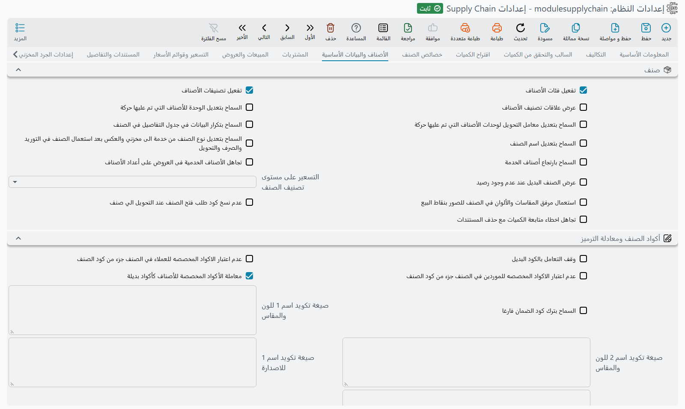

# إعدادات الأصناف والبيانات الرئيسية

تشرح هذه الصفحة تبويب **الأصناف والبيانات الرئيسية** — الإعدادات التي تؤثر على بطاقة الصنف، وأكواد الصنف وتكويدها، والبحث عن الأصناف (بما في ذلك متصفحات الأزرار والمستويات)، وعلاقات الصنف بالمخزن والموقع، وربط الأصناف بالعملاء والموردين.

## الأصناف

**تفعيل فئات الأصناف** `value.activateItemCategories` *(مفعّل افتراضيًا)* — يُظهر حقل فئة الصنف ليمكن تخصيص الأصناف للفئات. أوقفه لإخفائه عند عدم استخدامه.

**عرض علاقات تصنيف الأصناف** `value.showItemClassesRelations` — يُظهر جدول "العلاقات" في تصنيفات الأصناف، ليتيح لك تعريف روابط بين مستويات التصنيف (مثلاً لفلترة تصنيف بناءً على آخر).

**السماح بتعديل الوحدة للأصناف التي تم عليها حركة** `value.allowUpdateItemUOMInTrans` — يسمح بتغيير وحدة القياس الأساسية للصنف حتى بعد وجود حركات مخزنية عليه (مقفول عادةً لأنه يؤثر على التكلفة والكميات التاريخية). استخدمه فقط للتصحيحات الدقيقة.

**السماح بتعديل معامل التحويل لوحدات الأصناف التي تم عليها حركة** `value.allowUpdateRateToBaseInTrans` — يسمح بتغيير معامل تحويل الوحدة إلى الوحدة الأساسية بعد وجود حركات على الصنف. يؤثر على كيفية تحويل الكميات السابقة — استخدمه بحذر.

**السماح بتكرار البيانات في جدول التفاصيل في الصنف** `value.allowDuplicateItemDetails` — يسمح بتكرار الصفوف في جداول تفاصيل الصنف، التي يرفضها النظام عادةً.

**السماح بتعديل نوع الصنف من خدمة إلى مخزني والعكس بعد استعمال الصنف في التوريد والصرف والتحويل** `value.allowChangeItemTypeFromServiceToStockAndOppositeAfterUsingIt` — يسمح بتبديل نوع الصنف بين "خدمة" و"مخزني" حتى بعد استخدامه في المستندات المخزنية (محظور عادةً لأن النوع يحكم ما إذا كان الصنف يحمل أرصدة). استخدمه فقط لتصحيح صنف ذي نوع خاطئ.

**السماح بارتجاع أصناف الخدمة** `value.allowReceiptServiceItems` — يسمح بظهور أصناف الخدمة على مستندات التوريد/الارتجاع المخزني، المخصصة عادةً للأصناف المخزنية فقط.

**تجاهل الأصناف الخدمية في العروض على أعداد الأصناف** `value.doNotIncludeServiceItemsInItemsCountOffers` — يستبعد أصناف الخدمة من العروض المبنية على العدد، بحيث تُحتسب الأصناف المخزنية الفعلية فقط.

**عرض الصنف البديل عند عدم وجود رصيد** `value.showItemSubstituteIfNoQty` — عندما لا يكون للصنف المطلوب رصيد متاح، يُظهر النظام الصنف/الأصناف البديلة المعرّفة ليمكن بيع أو صرف بديل.

**التسعير على مستوى تصنيف الصنف** `value.priceByItemClass` — عند ضبطه على مستوى تصنيف معيّن، يُحدَّد السعر على مستوى **تصنيف الصنف** بدلاً من كل صنف على حدة — يقرأ النظام التصنيف المختار من كل صنف لإيجاد السعر المطبق. استخدمه عندما يتشارك تصنيف كامل سعرًا واحدًا.

**استعمال مرفق المقاسات والألوان في الصنف للصور بنقاط البيع** `value.useSizeAndColorAttachmentAsImageInPOS` — في نقاط البيع، يستخدم المرفق المعرّف على تركيبة المقاس/اللون للصنف كصورة المنتج المعروضة، بحيث يُظهر كل اختلاف صورته الخاصة.

**عدم نسخ كود طلب فتح الصنف عند التحويل إلى صنف** `value.doNotCopyCodeWhenConvertToItem` — عند تحويل طلب فتح صنف إلى صنف فعلي، لا يُنقل كود الطلب — يُسنَد كود جديد وفق قواعد تكويد الصنف نفسه.

**تجاهل أخطاء متابعة الكميات مع حذف المستندات** `value.ignoreQtyTrackingWhithDocumentDelete` — عند تفعيله لا يُرفض حذف مستند أبدًا بسبب خطأ في متابعة الكميات — «الكمية المسلمة ({0}) أكبر من كمية المستند الأصلي ({1})» أو «لا يمكن إضافة سطور يدويا إلى هذا المستند» — على المستند الذي أُنشئ منه. وتظل الكميات المسلَّمة في المستند المصدر تُنقَص بالسطور المحذوفة.

## أكواد الأصناف وصيغة التكويد

**وقف التعامل بالكود البديل** `value.stopUsingAltCodeInItems` — يوقف خاصية الكود البديل على الأصناف تمامًا، بحيث لا يُستخدم حقل الكود البديل في الإدخال أو البحث.

**عدم اعتبار الأكواد المخصصة للعملاء في الصنف جزء من كود الصنف** `value.neglectCustAssignedCodesInItem` — يتجاهل البحث عن الأصناف الأكواد التي يستخدمها العملاء للصنف، فلا تُعامَل كجزء من أكواد الصنف القابلة للبحث.

**عدم اعتبار الأكواد المخصصة للموردين في الصنف جزء من كود الصنف** `value.neglectSuppAssignedCodesInItem` — نفس الشيء بالنسبة لأكواد الأصناف المخصصة للموردين.

**معاملة الأكواد المخصصة للأصناف كأكواد بديلة** `value.useCustomItemCodesInItemSearch` *(مفعّل افتراضيًا)* — يتيح مطابقة الأكواد المخصصة للأصناف عند البحث/المسح عن صنف. أوقفه لقصر البحث على كود الصنف الرئيسي فقط.

**السماح بترك كود الضمان فارغا** `value.allowEmptyWarrantyCode` — يسمح بحفظ صنف/سطر بدون كود ضمان حيث يكون مطلوبًا عادةً. فعّله عندما تكون متابعة الضمان اختيارية.

**صيغة تكويد الصنف — اسم 1 / اسم 2 للون والمقاس، اسم 1 / اسم 2 للإصدارة** — صيغ نصية تُولّد تلقائيًا الاسم العربي (اسم 1) والاسم الإنجليزي (اسم 2) لسجلات تركيبات المقاس/اللون والإصدارات المُولّدة. اضبطها عند توليد الاختلافات تلقائيًا وترغب في تكوين أسمائها بصيغة. *(تنتمي هذه إلى إعداد تكويد الصنف المشترك.)*

| الاسم | معرّف الحقل |
| --- | --- |
| صيغة تكويد اسم 1 للون والمقاس | `value.info.itemCodingFormula.szName1Formula` |
| صيغة تكويد اسم 2 للون والمقاس | `value.info.itemCodingFormula.szName2Formula` |
| صيغة تكويد اسم 1 للإصدارة | `value.info.itemCodingFormula.rvName1Formula` |
| صيغة تكويد اسم 2 للإصدارة | `value.info.itemCodingFormula.rvName2Formula` |

## البحث عن الأصناف والأزرار

**السماح بالبحث عن الأصناف بمواصفات البار كود** `value.allowItemSearchByBarCodeSpecification` — يتيح تحليل باركود ممسوح عبر مواصفات باركود الأصناف المعرّفة عند البحث عن صنف، بحيث ينتج عن سلسلة ممسوحة واحدة كود الصنف بالإضافة إلى الخصائص/الكمية. مطلوب لكي تعمل [مواصفات باركود الأصناف](./item-barcode-specifications.md).

**البحث عن قسائم الأصناف مع إدخال كود الصنف في المبيعات** `value.searchForItemCouponsInSalesByItemCode` — في المبيعات، يؤدي إدخال كود الصنف أيضًا إلى البحث عن قسائم الأصناف المرتبطة بذلك الكود.

**عرض نافذة اختيار صنف إذا لم يكن الكود موجود (الأصناف التي تبدأ بنفس الكود)** `value.showItemSelectionDialogIfBarcodeDoesNotExist` — إذا لم يطابق الكود المُدخل/الممسوح تمامًا، تُفتح نافذة تعرض الأصناف التي يبدأ كودها *بنفس* القيمة المُدخلة، بدلاً من خطأ "غير موجود".

**عرض/ارتفاع زر الصنف** `value.itemButtonWidth`, `value.itemButtonHeight` — الحجم المعروض لأزرار الأصناف في البحث باللمس/الأزرار.

**عرض الأصناف على هيئة زرائر في المستوى الأخير للبحث** `value.showItemsAsButtonsInLastSearchLevel` — في متصفح الأصناف متعدد المستويات، يعرض المستوى الأخير الأصناف كأزرار قابلة للنقر بدلاً من قائمة — مفيد للاختيار باللمس.

**أقصى عدد يمكن عرضه من زرائر الصنف** `value.maxItemButtonsToShowInSearch` — يحدّ عدد أزرار الأصناف التي تُعرض في مستوى البحث بالأزرار، حتى لا تُربك القوائم الكبيرة جدًا الشاشة.

**فلترة المستوى الأول بمحددات المستخدم** `value.filterItemLevelLinesByUserDimensions` — يفلتر المستوى الأول للبحث عن الأصناف وفق محددات المستخدم الحالي (مثل فرعه/قطاعه)، بحيث يرى كل مستخدم الإدخالات ذات الصلة به فقط.

**مستويات الأصناف** `value.itemLevels` *(جدول)* — يعرّف هرمية البحث عن الأصناف متعددة المستويات (المفضلات). كل سطر يربط حتى خمسة مستويات: المستوى الأول يمكن أن يكون قسم/علامة/فئة صنف أو أي تصنيف صنف 1–10، والمستويات 2–5 قيم مستويات أصناف مفضلة. وهذا يقود منتقي الأصناف التدريجي/باللمس.

## المخزن والموقع

**تفعيل ربط الأصناف بالمخزن** `value.activateItemWarehouseRelation` — يفعّل علاقة معرّفة بين الأصناف والمخازن (أي الأصناف تنتمي إلى أي مخازن)، تُستخدم لفلترة تركيبات الصنف–المخزن والتحقق منها.

**يجب تحديد علاقة الأصناف بالمخازن** `value.itemRelationToWarehouseMustBeSpecified` *(مفعّل افتراضيًا)* — عند تفعيل علاقات الصنف–المخزن، يتطلب تعريف العلاقة صراحةً؛ ويُرفض الصنف الذي ليس له علاقة معرّفة بالمخزن.

**عدم إضافة الموقع إلى المخزن** `value.doNotAddLocatorToWarehouse` *(مفعّل افتراضيًا)* — يمنع النظام من الإضافة التلقائية لموقع مُستخدَم حديثًا إلى قائمة مواقع المخزن، مع إبقاء قوائم مواقع المخزن مضبوطة. أوقفه لتسجيل المواقع تلقائيًا أثناء استخدامها.

**السماح بتغيير سياسة استعمال المواقع إذا وجدت حركة على المخزن** `value.allowUpdateLocatorOfWarehouseInTrans` — يسمح بتغيير سياسة "استخدام المواقع" للمخزن حتى بعد وجود حركات مخزنية (مقفولة عادةً). استخدمه بحذر.

**السماح بتغيير شركة المخزن** `value.allowChangingWareHouseLegalEnt` — يسمح بتغيير الشركة المخصصة للمخزن (مقفولة عادةً لأنها تؤثر على ملكية ومحاسبة المخزون المحفوظ فيه). استخدمه للتصحيحات فقط.

**فلترة الموقع بناءً على الذمة / العميل** `value.filterLocatorBasedOnSubsidiary`, `value.filterLocatorBasedOnCustomer` — يفلتر قائمة المواقع على سطر المستند وفق ذمة السطر (الحساب) أو وفق عميل المستند، عندما تكون المواقع محجوزة لكل ذمة/عميل.

**تفعيل فلترة المواقع باستخدام ملفات تحديد تخزين الأصناف** `value.enableLocatorsFilteringByItemStorageAllocationFiles` — يفلتر المواقع المتاحة لصنف باستخدام ملفات تحديد تخزين مخصصة تعرّف أي الأصناف يمكن تخزينها في أي المواقع.

## ربط الأصناف بالعملاء والموردين

تقيّد هذه الإعدادات أي الأصناف يمكن بيعها لعميل أو شراؤها من مورد، عن طريق ربط الأصناف بالعملاء/الموردين والفلترة أو التحقق وفق ذلك.

**ربط الأصناف بالعملاء / الموردين في المستندات** `value.linkItemsToCustomers`, `value.linkItemsToSuppliers` — يفعّل رابطًا بين صنف وعميل واحد (مستندات البيع/الصرف) أو مورد واحد (مستندات الشراء)؛ وتُفلتر قائمة الأصناف إلى الأصناف المرتبطة بذلك الطرف.

**ربط الأصناف بعدة عملاء / موردين** `value.linkItemsToMultipleCustomers`, `value.linkItemsToMultipleSuppliers` — يوسّع الرابط بحيث يمكن ربط الصنف بعدة عملاء أو موردين بدلاً من واحد فقط. وتُسجَّل الروابط على [شاشتي ربط صنف بعميل وربط صنف بمورد](../item-maintenance.md) لا على الصنف نفسه، والربط بمجموعة العميل أو تصنيفه يُعدّ تطابقًا لكل عميل فيها.

**ربط الأصناف بعدة عملاء / موردين دون فراغات** `value.linkItemsToMultipleCustomersWithoutNulls`, `value.linkItemsToMultipleSuppliersWithoutNulls` — يحسّن خياري "عدة": الأصناف التي **لا** يوجد لها عملاء/موردون مرتبطون تُستبعد من القائمة المفلترة (تُعامَل على أنها "غير متاحة لأحد" بدلاً من "متاحة للجميع"). يعمل فقط مع خيار "عدة" المطابق مفعّلاً.

**التأكد من ربط الأصناف بالعملاء و الموردين عند الحفظ** `value.checkItemsRelatedToCustomersOrSuppliers` — يفرض الروابط وقت الحفظ: لا يمكن حفظ مستند يحتوي على صنف غير مرتبط بعميله/مورده (منع صارم، لا مجرد فلترة بحث).

**منع الحفظ في مستندات البيع والصرف المخزني إذا لم يكن مسموح للعميل** `value.doNotSaveIfCustomerNotAllowedToUseItem` — يمنع حفظ مستند بيع/صرف عندما لا يكون مسموحًا للعميل باستخدام أحد أصنافه.

**تفعيل علاقات الأصناف في المستندات التالية** `value.activateRelationshipsOfItemsInNextDocs` *(جدول)* — يسرد أنواع المستندات التي تُفرَض فيها علاقات الأصناف في المستندات اللاحقة. وحدها أنواع المستندات المضافة هنا تحترم العلاقات.
