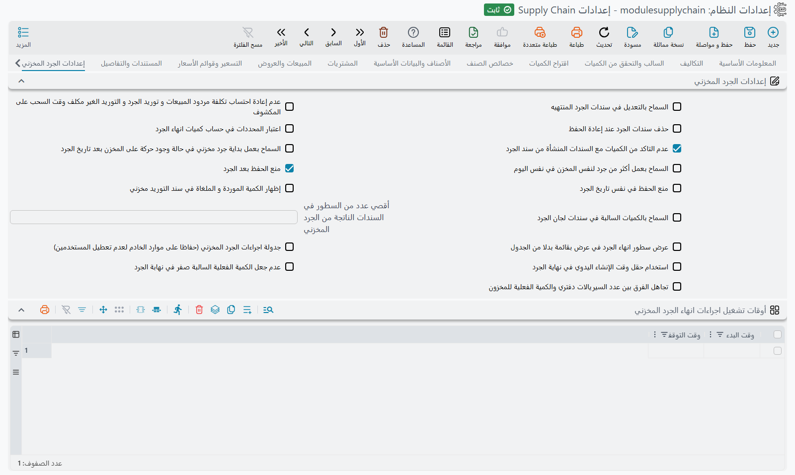

# إعدادات الجرد المخزني

تشرح هذه الصفحة تبويب **الجرد المخزني** — الإعدادات التي تحكم كيفية إدخال عمليات الجرد الفعلي والتحقق منها وإنهائها وتحويلها إلى سندات تسوية. أما عملية الجرد نفسها فموضحة في [دليل الجرد المخزني](../stock-taking.md).

**السماح بالتعديل في سندات الجرد المنتهية** `value.makeEndedSTakingDocsEditable` — في الوضع الطبيعي يكون سند إنهاء الجرد المنتهي مقفلاً ضد التعديل أو الحذف. وعند التفعيل يمكن تعديل أو حذف السندات المنتهية. ويُترك عادةً غير مفعّل لحماية عمليات الجرد التي تمت تسويتها.

**عدم إعادة احتساب تكلفة مردود المبيعات وتوريد الجرد والتوريد غير المكلّف وقت السحب على المكشوف** `value.calculateSalesReturnCostFromOverdraft` — عند التفعيل لا تُعاد تكلفة مردودات المبيعات وسندات توريد الجرد والتوريدات غير المكلّفة احتسابها من تغطية السحب على المكشوف أثناء معالجة التكلفة؛ بل تُترك التكلفة التي تحملها كما هي. وهو خيار خاص بمعالجة التكلفة لكنه يسكن هذا التبويب لا [تبويب التكلفة](./costing-configuration.md)، فهنا موضع البحث عنه. فعّله عندما تظل إعادة الحساب المدفوعة بالسحب على المكشوف تغيّر تكاليف تريدها كما أُدخلت.

**حذف سندات الجرد عند إعادة الحفظ** `value.deleteStockTakingReceipts` — يتحكم فيما يحدث لسندات التسوية التي أنشأها الجرد سابقاً عند إعادة حفظ سند إنهاء الجرد: عند التفعيل تُحذف السندات القديمة المُنشأة ويُعاد بناؤها؛ وعند إيقافه تُحفظ كما هي.

**اعتبار المحددات في حساب كميات إنهاء الجرد** `value.considerDimensionsInEndStockTaking` — عند التفعيل تُقسَّم مقارنة الكمية المتوقعة مقابل الفعلية في نهاية الجرد حسب محددات الصنف (اللون، المقاس، الموقع…)، بحيث تتم التسوية لكل محدد على حدة وليس لإجمالي الصنف فقط.

**عدم التأكد من الكميات مع السندات المنشأة من سند الجرد** `value.doNotCheckQuantitiesWithStockTaking` *(مفعّل في قواعد البيانات المنشأة حديثاً)* — عند التفعيل يُتجاوز التحقق من الكمية والسحب على المكشوف الذي يُجرى عادةً عند إنشاء سندات توريد وصرف التسوية من سند إنهاء الجرد، فتُنشأ هذه السندات حتى وإن كانت لتفشل في فحوص التوافر.

**السماح بعمل بداية جرد مخزني في حالة وجود حركة على المخزن بعد تاريخ الجرد** `value.allowStockTakingAfterIssueOrReceiptDate` — في الوضع الطبيعي لا يمكن بدء جرد على مخزن أو موقع توجد به بالفعل حركة بعد تاريخ بداية الجرد. وعند التفعيل يُرفع هذا القيد ويمكن بدء الجرد على أي حال.

**السماح بعمل أكثر من جرد لنفس المخزن في نفس اليوم** `value.allowMultipleStockTakingSameDayForSameWarehouse` — في الوضع الطبيعي يُرفض إنشاء بداية أو إنهاء جرد عند وجود جرد آخر لنفس المخزن في نفس اليوم، منعاً لجرد مخزون اليوم الواحد مرتين. وعند التفعيل يُتجاوز هذا التحقق من التكرار في نفس اليوم، فيمكنك تسجيل أكثر من جرد لنفس المخزن في نفس اليوم.

**منع الحفظ قبل الجرد** `value.preventSavingBeforeTaking` *(مفعّل افتراضياً)* — بعد إنهاء جرد لمخزن (أو موقع)، لا يمكن حفظ أو تعديل سندات التوريد والصرف المخزني فيه بتاريخ سابق لتاريخ الجرد. ويشمل ذلك سندات التوريد والصرف التي تنشئها الفواتير والتحويلات. التاريخ المعتمد هو تاريخ بدء آخر جرد منتهٍ. ونص الرفض: *Can not Update This Document because there is an ended stock taking on {0} for the warehouse {1}*. وتُستثنى سندات التسوية التي ينشئها سند إنهاء الجرد نفسه. اتركه مفعّلاً حتى لا تغيّر الحركات بتواريخ سابقة جرداً منتهياً.

**منع الحفظ في نفس تاريخ الجرد** `value.preventSavingOnTakingDate` — يعمل فقط مع الخيار السابق، ويمنع أيضاً السندات المؤرخة في يوم الجرد نفسه. وعند إيقافه يُحفظ السند المؤرخ في يوم الجرد بشكل طبيعي. إذا رُفض سند مؤرخ في يوم الجرد بالرسالة السابقة فهذا الإعداد هو السبب، والرسالة تشير إليه. ولا علاقة لحقل **اعتبار الحركات المخزنية في نفس يوم انهاء الجرد** في سند إنهاء الجرد بذلك، فهو يحدد فقط هل تُحسب حركات ذلك اليوم ضمن الكمية الدفترية.

**إظهار الكمية الموردة والملغاة في سند التوريد المخزني** `value.showReceivedAndCanceledQty` — يضيف عمودي الكمية الموردة (المستلمة) والملغاة إلى تصميم سند التوريد المخزني. *(خيار عرض — رغم وجوده في هذا التبويب فإنه يؤثر على شاشة التوريد المخزني.)*

**السماح بالكميات السالبة في سندات لجان الجرد** `value.allowNegativeQtiesTaking` — عند إيقافه تُرفض الكميات السالبة المُدخلة في تفاصيل الجرد. وعند التفعيل يُسمح بالكميات الفعلية السالبة — للحالات الخاصة فقط.

**أقصى عدد من السطور في السندات الناتجة من الجرد المخزني** `value.maxStockTakingLines` — يحدّ من عدد السطور في السندات الناتجة عن الجرد، بحيث تُقسَّم عمليات الجرد الكبيرة جداً على عدة سندات.

**عرض سطور إنهاء الجرد في عرض بقائمة بدلاً من الجدول** `value.useStockTakingListViewInsteadOfGrid` — يعرض سطور إنهاء الجرد في عرض قائمة أخف بدلاً من الجدول الكامل القابل للتعديل، وهو أفضل أداءً في عمليات الجرد الكبيرة جداً.

**جدولة إجراءات الجرد المخزني** `value.scheduleStockTakingActions` — عند التفعيل تُدرَج إجراءات إنهاء الجرد الثقيلة (تغيير الحالات، إنشاء التسويات) كمهام خلفية تعمل ضمن الأوقات المحددة أدناه، بدلاً من تشغيلها فورياً وإشغال الخادم. استخدمه في عمليات الجرد الكبيرة حتى لا تُبطّئ إجراءات الإنهاء النظام على الجميع.

**استخدام حقل وقت الإنشاء اليدوي في نهاية الجرد** `value.useManualCreationTimeInStockTaking` — عند التفعيل يستخدم سند إنهاء الجرد وقت إنشاء مُدخلاً يدوياً بدلاً من لحظة المعالجة، مما يؤثر على موضع التسويات الناتجة في الزمن.

**عدم جعل الكمية الفعلية السالبة صفراً في نهاية الجرد** `value.doNotMakeNegativeActualQtyZeroInTaking` — افتراضياً تُجعل الكمية الفعلية السالبة صفراً عند إنهاء الجرد. وعند التفعيل تُبقى الكمية الفعلية السالبة كما هي لتنساب إلى التسوية.

**تجاهل الفرق بين عدد السيريالات الدفترية والكمية الفعلية للمخزون** `value.ignoreDifferenceBetweenNumberOfDBSerialsAndActualStockQuantity` — بالنسبة للأصناف المتتبَّعة بالرقم المسلسل، يتحقق الجرد عادةً من تطابق عدد السيريالات المسجّلة مع الكمية الفعلية ويفصل غير المتطابق منها في سطور خاصة به. وعند التفعيل يُتجاوز هذا التحقق.

**أوقات تشغيل إجراءات إنهاء الجرد المخزني** `value.stockTakingActionsTime` *(جدول)* — أوقات (بداية/نهاية) يُسمح خلالها بتشغيل إجراءات الجرد المخزني المجدولة. يُستخدم مع *جدولة إجراءات الجرد المخزني* لحصر المعالجة الثقيلة في أوقات انخفاض الضغط.
