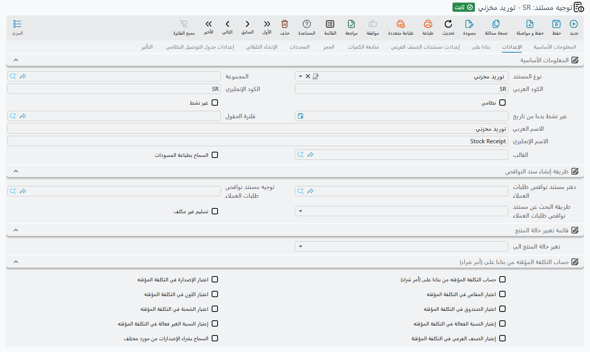

# خيارات خاصة بأنواع المستندات (Document-Specific)

معظم خيارات توجيه المستند مشتركة بين أنواع المستندات، وقد غطّتها الصفحات الأخرى (عام، بناءً على المستند، متابعة الكميات، الحجز والتسليم، الأسعار/الضرائب/الخصومات، الصنف الفرعي). تجمع هذه الصفحة الخيارات التي تظهر **فقط لأنواع مستندات معينة** — أي تلك التي تظهر على شاشة التوجيه بحسب **نوع المستند** الذي يستهدفه التوجيه.

::: info مكان الإعداد
افتح **توجيه المستند** (توجيه). تظهر الخيارات أدناه فقط عندما يكون **نوع المستند** للتوجيه أحد المستندات المذكورة في كل مجموعة.
:::

## التوريد المخزني (Stock Receipt)

*ينطبق على: التوريد المخزني (Stock Receipt).*

**قابل للإرجاع (Returnable)** `termConfig.config.returnable` — يجعل الأثر المحاسبي للتوريد أثر مردود حتى يُتحقَّق من جانب المورد/العميل وفقاً لذلك.

**حساب التكلفة المؤقتة بناءً على المستند (Calculate Temp Cost By From Doc)** `termConfig.calculateTempCostByFromDoc` — يستخدم تكلفة المستند المبني عليه كتكلفة مؤقتة للتوريد بدلاً من إعادة حسابها.

**السماح بشراء الإصدارات من مورد مختلف** `termConfig.allowRevsionPurchaseFromDifSupplier` — يسمح باستلام إصدار الصنف من مورد غير المورد الافتراضي لذلك الإصدار. وعنوانه على الشاشة الإنجليزية *Prevent Revsion Purchase From Different Supplier*، لكن تفعيله **يسمح** بالشراء ولا يمنعه.

**تسليم غير مكلف (Receipt Without Cost)** `termConfig.config.rwc` — يسمح بحفظ التوريد المخزني مستقلًا دون فاتورة وراءه: تدخل البضاعة المخزن توريدًا غير مكلف وتُكلَّف لاحقًا. وعند إلغاء التعليم يُرفض حفظ التوريد غير المبني على فاتورة بالرسالة
«المستند غير مرتبط بفاتورة».
ويُفحص الخيار كذلك عندما تحذف فاتورة مشتريات مبنية على مستند آخر توريدًا من جدول سنداتها المخزنية: فإن لم يكن الخيار معلَّمًا في توجيه ذلك التوريد رُفضت الفاتورة بالرسالة
«لا يمكن حذف سند التوريد {0} من سطور السندات المخزنية. يرجي التأكد من التعليم علي الاختيار توريد غير مكلف في توجيه التوريد {1}».

**عدم التجميع في الفواتير (Do Not Auto Collect In Invoices)** `termConfig.doNotAutoCollectInInvoices` — يعلِّم كل توريد يُحفظ بهذا التوجيه فيتخطاه زر **تجميع** في فاتورة المشتريات، ويظل ربطه بالفاتورة يدويًا ممكنًا. والخيار نفسه موجود في توجيه الصرف المخزني، حيث يُبقي سندات الصرف خارج **تجميع** فاتورة المبيعات.

تجعل مجموعة **اعتبار … في التكلفة (Consider … For Cost)** طبقة التكلفة/التقييم تميّز التوريدات حسب المحدد المختار، فتُحسَّب تكلفة الوحدات التي تختلف في ذلك المحدد فقط بشكل منفصل.

| الخيار | معرّف الحقل |
|---|---|
| اعتبار المراجعة في التكلفة (Consider Revision For Cost) | `termConfig.considerRevisionForCost` |
| اعتبار المقاس في التكلفة (Consider Size For Cost) | `termConfig.considerSizeForCost` |
| اعتبار اللون في التكلفة (Consider Color For Cost) | `termConfig.considerColorForCost` |
| اعتبار الصندوق في التكلفة (Consider Box For Cost) | `termConfig.considerBoxForCost` |
| اعتبار رقم اللوت في التكلفة (Consider Lot Id For Cost) | `termConfig.considerLotIdForCost` |
| اعتبار النسبة الفعّالة في التكلفة (Consider Active Percent For Cost) | `termConfig.considerActivePercentForCost` |
| اعتبار النسبة غير الفعّالة في التكلفة (Consider Inactive Percent For Cost) | `termConfig.considerInActivePercentForCost` |
| اعتبار الصنف الفرعي في التكلفة (Consider Sub Item For Cost) | `termConfig.considerSubItemForCost` |

## الصرف المخزني (Stock Issue)

*ينطبق على: الصرف المخزني (Stock Issue).*

**قابل للإرجاع (Returnable)** `termConfig.config.returnable` — يجعل الأثر المحاسبي للصرف أثر مردود؛ يُفحَص عند التحقق من جانب المورد/العميل في المستند.

**عدم التجميع في الفواتير (Do Not Auto Collect In Invoices)** `termConfig.doNotAutoCollectInInvoices` — يعلِّم كل صرف يُحفظ بهذا التوجيه فيتخطاه زر **تجميع** في فاتورة المبيعات، ويظل ربطه يدويًا ممكنًا.

## سند الافتتاح المخزني (Opening Stock)

*ينطبق على: سند افتتاح مخزني (Opening Stock Document).*

**السماح بالفترات العادية (Allow Normal Periods)** `termConfig.allowNormalPeriods` — يجب في العادة أن يقع سند الافتتاح المخزني في فترة مالية افتتاحية؛ فإن وقع في فترة *عادية* رُفض بالرسالة «لا يمكن إنشاء المستند في فترة عادية». علِّم هذا الخيار لقبول الفترات العادية أيضًا.

## طلب التحويل المخزني (Stock Transfer Request)

*ينطبق على: طلب تحويل مخزني (Stock Transfer Request).*

**الإستخدام مع التحصيل (use With Collect)** `termConfig.useWithCollect` — يجعل الطلب طلبًا مجمِّعًا: كل سطر تضيفه أو تعدّله يجب أن يذكر **طلب التحويل** الذي جاء منه، ويجب أن يكون لذلك الطلب نفس المخزن المحوَّل منه والمحوَّل إليه.

## طلب التحويل المخزني المجمع (Aggregated Stock Transfer Request)

*ينطبق على: طلب تحويل مخزني مجمع (Aggregated Stock Transfer Request).*

يُنشئ حفظ الطلب المجمع طلبات تحويل مخزني عادية من سطوره. يحمل التوجيه دفتر تلك الطلبات وتوجيهها، ويحدد طريقة توزيع السطور عليها. التفاصيل الكاملة في [تحريك المخزون بين المخازن](../moving-stock.md).

| الخيار | معرّف الحقل | ما يفعله |
|---|---|---|
| دفتر طلب التحويل المخزني (Stock transfer Request Book) | `termConfig.stockTransferReqBook` | دفتر الطلبات المنشأة. إلزامي. |
| توجيه طلب التحويل المخزني (Stock transfer Request Term) | `termConfig.stockTransferReqTerm` | توجيه الطلبات المنشأة. إلزامي. |
| تجميع من مخزن (Group by From Warehouse) | `termConfig.groupByFromWarehouse` | طلب منشأ واحد لكل مخزن مصدر. |
| تجميع إلى مخزن (Group by To Warehouse) | `termConfig.groupByToWarehouse` | طلب منشأ واحد لكل مخزن وجهة؛ ومع تعليم الاثنين، طلب لكل زوج. |
| أقصي عدد سطور لطلب التحويل المخزني المنشأ (Max Lines for Generated Stock Transfer Req) | `termConfig.maxLinesForGenStockTransReq` | يقسم المجموعة الأكبر إلى طلبات لا يزيد كل منها عن هذا العدد من السطور. الفارغ أو الصفر يعني بلا حد. |

## التحويل المخزني (Stock Transfer)

*ينطبق على: التحويل المخزني (Stock Transfer).*

**نوع التحويل (Transfer Type)** `termConfig.transferType` — يصنّف التحويل (مثل داخلي مقابل بين الفروع)، وهو ما يتحكم في آثاره.

**صلاحية عكس التحويل (Reverse Transfer Capability)** `termConfig.reverseTransferCapability` — الصلاحية الأمنية المطلوبة لعكس/إلغاء التحويل.

**نوع التحويل الداخلي (Internal Transfer Type)** `termConfig.internalTransferType` — تصنيف فرعي للتحويلات الداخلية يحكم المعالجة من مخزن إلى مخزن.

## المردودات (Returns)

*ينطبق على: مردود المبيعات ومردود المشتريات (Sales Return / Purchase Return).*

**نوع المردود (Return Type)** `termConfig.returnType` — يحدد نمط المردود، ويؤثر على التسعير والمعالجة المخزنية (مردود مبيعات).

**طريقة حساب الفاتورة (Invoice Calculation)** `termConfig.sourceInvoiceCalculation` — يتحكم في كيفية إعادة حساب القيم مقابل الفاتورة المصدر (تناسبي، بناءً على المستند، أو معاد الحساب).

**استخدام المستند المبني عليه لأعمار الديون (Use From Doc For Debt Ages)** `termConfig.useFromDocForDebitAges` — يستخدم تواريخ المستند الأصلي لتقادم الديون بدلاً من تاريخ المردود نفسه.

**السماح بإرجاع فواتير لم يُصرف منها (Allow Return Not Issued Invoices)** `termConfig.allowReturnNotIssuedInvoices` — يسمح بالإرجاع مقابل فواتير لم تُصرف بضاعتها من المخزن (مردود مبيعات).

**منع إرجاع الفاتورة إذا وُجدت أصناف مجانية (Prevent Return Invoice If Free Items Found)** `termConfig.preventReturnInvoiceIfFreeItemsFound` — يمنع إرجاع فاتورة تحتوي على أصناف مجانية/ترويجية (مردود مبيعات).

**إعادة إنشاء مستند مخزون الفاتورة عند حفظ فاتورة المردود (Recreate Invoice Stock Document With Return Invoice Saving)** `termConfig.recreateInvStockDocWithReturnInv` — يعيد إنشاء مستند مخزون الفاتورة الأصلية عند حفظ فاتورة المردود (مردود مشتريات).

## المردودات والإحلال — الكوبونات والدفع (Returns & Replacement — Coupons & Payment)

*ينطبق على: مردود المبيعات / مردود المشتريات / مردود مشتريات مركز الخدمة ومستندات طلباتها.*

**تعليم الكوبون المنشأ بفاتورة المردود كمستخدم (Mark Generated Coupon By Returned Invoice As Used)** `termConfig.markGeneratedCouponByReturnedInvoiceAsUsed` — يعلّم الكوبونات التي أنشأتها الفاتورة المرتجعة كمستخدمة لمنع إعادة استعمالها.

**منع إرجاع الفاتورة بكوبون منشأ مستخدم (Prevent Return Invoice With Used Generated Coupon)** `termConfig.preventReturnInvoiceWithUsedGeneratedCoupon` — يمنع إرجاع فاتورة استُخدم كوبونها المنشأ بالفعل.

**إضافة المردود إلى سندات دفع الفاتورة وخصم المتبقي (Add Return To Invoice Payment Docs and Decrease Remaining)** `termConfig.addReturnToInvoicePayment` — يضيف قيمة المردود إلى سندات دفع الفاتورة ويخفّض رصيدها المتبقي.

**سداد أقساط الفاتورة بفاتورة المردود (Payment Of Invoice Installments With Return Invoice)** `termConfig.allowPaymentOfInvoiceInstallementsWithReturn` — يسمح للمردود بسداد أقساط الفاتورة.

## إحلال المبيعات (Sales Replacement)

*ينطبق على: إحلال المبيعات (Sales Replacement) ومستندات طلبات الإحلال.*

**يجب وجود سطور بيع وسطور مردود (Must Have Sales And Return Lines)** `termConfig.mustHaveSalesAndReturnLines` — يشترط أن يحتوي مستند الإحلال على سطر بيع وسطر مردود معاً.

**منع الحفظ إذا لم يوجد الصنف المُحلَّل في المستند المبني عليه (Prevent Save If Replaced Item Not Exist In From Doc)** `termConfig.preventSaveIfReplacedItemNotExistInFromDoc` — يمنع الحفظ عند عدم العثور على الصنف المُحلَّل في المستند المبني عليه.

## الفواتير (Invoices)

*ينطبق على: فاتورة المبيعات وفاتورة المشتريات (Sales Invoice / Purchase Invoice) كما هو موضّح بجانب كل خيار.*

**يجب تطابق كمية الفاتورة مع المستند المخزني (Quantity Of Invoice Should Match Stock Document)** `termConfig.quantityOfInvoiceShouldMatchStockDocument` — يتحقق من تساوي كميات الفاتورة مع كميات المستند المخزني المرتبط (فاتورة مشتريات).

**توزيع التكلفة بناءً على كمية التوريد (Distribute Cost Based On Receipt Quantity)** `termConfig.distributeCostBasedOnReceiptQty` — يوزّع التكلفة الإضافية على السطور بترجيح الكمية المستلمة (فاتورة مشتريات).

**استخدام بضائع خارجية (Use External Wares)** `termConfig.useExtenalWares` — يعامل المخزون كبضائع خارجية/غير نظامية فيتخطى التحقق المخزني الداخلي (فاتورة/مردود مشتريات ومردود مبيعات).

**عن السنة السابقة (For Previous Year)** `termConfig.previousYear` — يعلّم الفاتورة بأنها تخص السنة المالية السابقة لأغراض المحاسبة والتقادم.

**آجل (Credit)** `termConfig.creditInvoice` — يعامل الفاتورة كفاتورة آجلة (بيع آجل).

**فرد مكونات الصنف المجمع مع الحفظ (Spread Assembly Components With Save)** `termConfig.spreadAssemblyComponentsWithSave` — للصنف الذي له **طريقة فرد مكونات الصنف المجمع**، يضيف حفظ مستند المبيعات مكونات تلك الطريقة سطورًا مجانية تحت سطر الصنف، ويُستبعد سطر الصنف نفسه من سند الصرف المنشأ، فيخرج المخزون على هيئة المكونات (مستندات المبيعات).

**فرد مكونات الصنف المجمع مع الإدخال (Spread Assembly Components With Insert)** `termConfig.spreadAssemblyComponentsWithInsert` — يضيف سطور المكونات على الشاشة تحت سطر الصنف بمجرد أن يحمل السطر الصنف والكمية معًا، فيرى المستخدم المكونات قبل الحفظ، ولا يعيد الحفظ فرد الصنف مرة ثانية. أبقِ خيار **…مع الحفظ** مفعّلًا أيضًا، فهو الذي يستبعد سطر الصنف نفسه من سند الصرف (مستندات المبيعات).

**حقل الصنف البديل للمكونات (Bom Alt Item Field)** `termConfig.bomAltItemField` — يحدد أحد أعمدة المراجع في السطر (مرجع 1–4) مكانًا لصنف بديل. فإذا احتوى ذلك العمود صنفًا، صار الأثر المخزني والتكلفة للسطر، في الصرف وفي الإرجاع، على ذلك الصنف بدلًا من صنف السطر، بمقاس السطر ولونه وإصداره. ويُقرأ الخيار من توجيه المستند نفسه، ثم من توجيهات المستندات الأعلى في سلسلة **بناءا على** (الفواتير).

تظهر مجموعة **الفاتورة الإلكترونية** في توجيهات فاتورة المبيعات ومردود المبيعات (ونسخها في مركز الخدمة والكرتون ونقاط البيع). يسمّي كل من الحقلين حقلًا في الفاتورة؛ وطريقة ملئهما وإرسالهما مشروحة في [الفاتورة الإلكترونية والإيصال الإلكتروني في مصر](/ar/modules/invoicing/egypt-einvoice-guide).

| الخيار | معرّف الحقل | ما يفعله |
|---|---|---|
| حقل الحساب البنكي في الفاتورة الإلكترونية (E-Invoice Bank Account Field) | `termConfig.eInvoiceBankAccountField` | الحقل المرجع في الفاتورة الذي يختار فيه المستخدم الحساب البنكي المُبلَّغ لمصلحة الضرائب. |
| حقل شروط الدفع في الفاتورة الإلكترونية (E-Invoice Payment Terms Field) | `termConfig.eInvoicePaymentTermsField` | الحقل النصي في الفاتورة الذي يكتب فيه المستخدم شروط الدفع المُبلَّغة لمصلحة الضرائب. |

## مستندات الإلغاء (Cancellation Documents)

*ينطبق على: مستند إلغاء الحجز ومستند إلغاء التسليم (Reservation Cancellation / Delivery Cancellation).*

**إعادة حفظ المستندات الأعلي من النوع (Re-commit Upper Document Of Type)** `termConfig.recommitUpperDocumentOfType` — بعد الإلغاء، يعيد حفظ المستند الأب/الأعلى من نوع الكيان المحدد.

**حذف السطر المبني على المستند إذا كانت الكمية المحجوزة صفراً (Remove Line With From Document If Reserved Quantity Is Zero)** `termConfig.removeLineWithFromDocIfReservedQtyIsZero` — يحذف السطر المرتبط بالمستند المبني عليه عندما تصبح كميته المحجوزة صفراً (إلغاء حجز).

## التجميع والتجميع المتعدد (Assembly / Multi-Assembly)

*ينطبق على: مستند التجميع (Assembly) والتجميع المتعدد (Multi-Assembly) كما هو موضّح بجانب كل خيار.*

**حساب كمية قائمة المكونات من المنتجات المصاحبة (Calculate BOM Qty From Co-Products)** `termConfig.calculateBOMQtyFromCoProducts` — يشتق كميات قائمة المكونات من كميات مخرجات المنتجات المصاحبة (تجميع).

**إعادة توزيع سطور الصرف عند تغيّر كمية المنتجات المصاحبة (Spread Issue Lines When Co-Products Qty Changed)** `termConfig.spreadIssueLinesWhenCoProductsQtyChanged` — يعيد توزيع سطور المواد المصروفة عند تغيّر كميات المنتجات المصاحبة (تجميع).

**استخدام التفاصيل المخططة في حساب التكلفة (Use Planned Details For Cost Calculation)** `termConfig.usePlannedDetailsForCostCalculation` — يستخدم التفاصيل المخططة (لا الفعلية) عند حساب التكلفة (تجميع).

**توزيع التكلفة بمتوسط سعر البيع (Distribute Cost By Avg Sales Price)** `termConfig.distributeCostByAvgSalesPrice` — يوزّع التكلفة المشتركة على المنتجات حسب متوسط سعر بيعها (تجميع).

**حساب المنتجات المصاحبة من قائمة تجميع الصنف المصروف (Calculate Co-Products From Issued Item Assembly BOM)** `termConfig.calculateCoProductsFromIssuedItemAssemblyBom` — يحسب المنتجات المصاحبة من قائمة تجميع الصنف المصروف (تجميع).

**السماح بصرف وتوريد نفس الصنف في مستند التجميع نفسه (Allow Issue And Receipt The Same Item In The Same Assembly Doc)** `termConfig.allowIssueAndReceiptTheSameItemInTheSameAssemblyDoc` — يسمح بصرف وتوريد نفس الصنف ضمن مستند تجميع واحد (تجميع).

**منع الحفظ إذا لم يكن المنتج المصاحب ضمن عمليات التجميع (Prevent Save If Co-Product Not In Assembly Operations)** `termConfig.preventSaveIfCoProdNotInAssemblyOperations` — يمنع الحفظ عندما لا يكون المنتج المصاحب جزءاً من عمليات التجميع (تجميع).

**توزيع التكلفة على سطر المنتج المصاحب المصدر فقط (Distribute Cost On Source Co-Product Line Only)** `termConfig.distributeCostOnSourceCoProdLineOnly` — يقصر توزيع التكلفة على سطر المنتج المصاحب المصدر (تجميع).

**منع الحفظ بدون أصناف مصروفة عند استخدام قائمة المكونات (Prevent Save Without Issued Items If Using BOM)** `termConfig.preventSaveWithoutIssuedItemsIfUsingBOM` — يمنع الحفظ بدون أصناف مصروفة عند استخدام طريقة تجميع بقائمة مكونات (تجميع).

**حساب متوسط سعر البيع من تكلفة صرف التفكيك (Calc Average Sales Price From Disassembly Issue Cost)** `termConfig.calcAverageSalesPriceFromDisAssemblyIssueCost` — يشتق متوسط سعر البيع من تكلفة صرف التفكيك (تجميع).

**عدم تأثير كمية الاستلام الفعلية على الكمية المسحوبة (Do Not Affect Issued Qty By Actual Receipt Qty)** `termConfig.doNotAffectDetailsQtyByActualReceiptQty` — في الوضع الافتراضي تُعاد كميات الأصناف المسحوبة (كميات التفاصيل) بناءً على كمية المنتج النهائي المستلمة فعليًا. وعند تفعيل هذا الخيار تبقى الكميات المسحوبة محسوبة من كمية التجميع، فلا يؤدي تعديل كمية الاستلام الفعلية إلى تغيير الكميات المسحوبة (تجميع).

**دفتر / توجيه صرف المنتج التام (Finished Product Issue Book / Term)** `termConfig.finishedProductIssueBook` / `termConfig.finishedProductIssueTerm` — عند ملء الاثنين، يُنشئ حفظ سند التجميع سند صرف ثانيًا يُخرج السطور المستلمة مباشرة من مخزن الاستلام. وإن تُرك أحدهما فارغًا لا يُنشأ هذا الصرف (تجميع). انظر [طلبات التجميع وسندات التجميع](../assembly-and-packaging/assembly-documents-and-requests.md).

**إنشاء مستند للسطور التي لها حالة (Create Document For Lines Which Have Status)** `termConfig.createDocLineWithStatus` — ينشئ مستندات التجميع فقط للسطور عند الحالة المختارة (تجميع متعدد).

**استخدام الكمية المطلوبة للمواد النهائية (Use Required Quantity For Final Materials)** `termConfig.useRequiredQtyForFinalMaterials` — يستخدم الكمية المطلوبة (المخططة) لاستهلاك المواد النهائية (تجميع متعدد).

**دفتر مستند التجميع (Assembly Document Book)** `termConfig.assemblyDocumentBook` — دفتر مستندات التجميع المُنشأة من التجميع المتعدد.

**توجيه مستند التجميع (Assembly Document Term)** `termConfig.assemblyDocumentTerm` — توجيه مستندات التجميع المُنشأة تلك.

**فرد سطور (بناءا على) إلى الأصناف الرئيسية (Spread From Document Lines To Main Items)** `termConfig.addFromDocLinesToMainItems` — ينسخ سطور مستند **بناءا على** إلى جدول **الأصناف الرئيسية** بدلًا من **التفاصيل**، وتتبع متابعة الكميات مقابل المصدر حينئذٍ سطور الأصناف الرئيسية (تجميع متعدد).

**فرد الأصناف المخزنية فقط من (بناءا على) (Spread Only Stock Items From Document)** `termConfig.spreadOnlyStockItemsFromDoc` — لا ينسخ من مستند **بناءا على** إلا الأصناف المخزنية، ويتجاوز سطور الخدمات (تجميع متعدد).

**حفظ كل سندات التجميع كمسودات (Save All Assembly Documents As Drafts)** `termConfig.saveAllAssemblyDocumentsAsDrafts` — يعلّم **الحفظ كمسودة** على كل السطور، فتُحفظ سندات التجميع المنشأة مسودات (تجميع متعدد). انظر [التجميع متعدد المستويات والتعبئة المجمّعة](../assembly-and-packaging/multi-level-and-aggregated-assembly.md).

## سند التعبئة المتعدد (Aggregated Packaging Document)

*ينطبق على: سند تعبئة متعدد (Aggregated Packaging Document).*

لتوجيهه تبويب **الإعدادات** وحده. وإلى جانب خيارات **بناءا على** المشتركة (التوافق، نسخ التفاصيل، الكميات المستوفاة، الربط مرة واحدة، العميل/المورد مطلوب)، يحمل دفاتر وتوجيهات المستندات التي ينشئها سند التعبئة والقيم الافتراضية لسطور الفرزة والهالك. القصة كاملة في [التجميع متعدد المستويات والتعبئة المجمّعة](../assembly-and-packaging/multi-level-and-aggregated-assembly.md).

| الخيار | معرّف الحقل | ما يفعله |
|---|---|---|
| دفتر / توجيه سند الصرف (Stock Issue Document Book / Term) | `termConfig.stockIssueDocBook` / `termConfig.stockIssueDocTerm` | دفتر وتوجيه سند الصرف المنشأ من جدول قطع الغيار. |
| دفتر / توجيه سند التوريد (Stock Receipt Document Book / Term) | `termConfig.stockReceiptDocBook` / `termConfig.stockReceiptDocTerm` | دفتر وتوجيه سند التوريد المنشأ من سطور الاستلام وسطور اليوم السابق والفرزة والهالك. |
| دفتر / توجيه سند التكاليف الإضافية (Additional Cost Document Book / Term) | `termConfig.additionalCostDocBook` / `termConfig.additionalCostDocTerm` | دفتر وتوجيه سند تكاليف الإستلام الإضافية المنشأ من سطور المصروفات. |
| حساب التكاليف الإضافية اليا مع الحفظ (Automatically Calculate Additional Costs) | `termConfig.autoCalcAddCosts` | يملأ سطور المصروفات عند الحفظ من أصناف المصروفات التي تُستخدم خامتها الرئيسية في السند. |
| بيانات الفرزة (Farza Dimensions — `termConfig.farzaDimensions`) | `termConfig.farzaDimensions.revisionId`، `termConfig.farzaDimensions.lotId`، `termConfig.farzaDimensions.box`، `termConfig.farzaDimensions.size`، `termConfig.farzaDimensions.color` | الإصدار والشحنة والصندوق والمقاس واللون الافتراضية لسطور الفرزة. تُستخدم كل قيمة فقط إذا كان الصنف يتتبع ذلك المحدد. |
| بيانات الهالك (Stale Dimensions — `termConfig.halekDimensions`) | `termConfig.halekDimensions.revisionId`، `termConfig.halekDimensions.lotId`، `termConfig.halekDimensions.box`، `termConfig.halekDimensions.size`، `termConfig.halekDimensions.color` | القيم الافتراضية نفسها لسطور الهالك التي تُنشأ عند الحفظ. |
| الإصدارات ذات التكلفة المثبتة (Fixed Cost Revisions) | `termConfig.fixedCostRevisions` (العمود `termConfig.fixedCostRevisions.dimensions.revisionId`) | سطر لكل إصدار؛ ويحصل جدول **التكاليف الثابتة** في السند على سطر لكل خامة رئيسية وإصدار مذكور. |

## أمر تشغيل الزجاج (Glass Job Order)

*ينطبق على: أمر تشغيل الزجاج (Glass Job Order).*

**فرض قائمة الأسعار (Force Price List)** `termConfig.forcePriceList` — يفرض أن تأتي أسعار السطور من قائمة أسعار.

**عدم التحقق من الأصناف التي ليس لها قائمة أسعار (Do Not Check Items Without Price List)** `termConfig.doNotCheckItemsWithoutPriceList` — يتخطى التحقق من وجوب أن يكون للأصناف بند في قائمة الأسعار.

**عدم فرض قائمة الأسعار عند وجود مستند مبيعات في المبني عليه (Do Not Force Price List When There Sales Doc In From Doc)** `termConfig.doNotForcePriceListWhenThereSalesDocInFromDoc` — يخفّف فرض قائمة الأسعار عندما يكون المستند المبني عليه مستند مبيعات.

**تجاهل السعر الحالي عند حساب الأسعار (Ignore Current Price When Calculating Prices)** `termConfig.ignoreCurrentPriceWhenCalculatingPrices` — يتجاهل الأسعار الموجودة أثناء إعادة الحساب.

**الاعتماد غير مطلوب (Approval Not Required)** `termConfig.approvalNotRequired` — يتخطى خطوة الاعتماد.

**الإنهاء غير مطلوب (Finish Not Required)** `termConfig.finishNotRequired` — يتخطى خطوة الإنهاء.

**دفتر الصرف المخزني (Stock Issue Book)** `termConfig.stockIssueBook` — دفتر الصرف المخزني المُنشأ من أمر التشغيل.

**توجيه الصرف المخزني (Stock Issue Term)** `termConfig.stockIssueTerm` — توجيه ذلك الصرف المخزني المُنشأ.

**له تأثير محاسبي (Has Accounting Effects)** `termConfig.hasAccountingEffects` — عند تفعيله يسجّل حفظ أمر الشغل القيد المحاسبي المضبوط في تبويب التأثير بالتوجيه، كما تفعل الفاتورة. وعند إلغائه لا يُسجَّل قيد، ويُلغى القيد المسجَّل سابقًا عند الحفظ التالي.

## التسليم الجزئي لأمر الشغل (Job Order Partial Delivery)

*ينطبق على: تسليم جزئي لأمر الشغل (Job Order Partial Delivery).*

**عدم نسخ السطور مع بناء على (Do Not Copy Lines With From Document)** `termConfig.doNotCopyLinesWithFromDoc` — اختيار أمر الشغل في التسليم الجزئي ينسخ عادةً سطور مكوناته بكمياتها غير المسلَّمة. وعند تفعيل الخيار يُؤخذ العميل وحده وتُترك السطور ليُدخلها المستخدم.

## تسليم/تنفيذ/إنهاء الأمر (Order Delivery / Execution / Finished)

*ينطبق على: تسليم الأمر (Order Delivery) وتنفيذ الأمر (Order Execution).*

**التعبئة التلقائية لأصناف الأمر (Automatic Fill Order Items)** `termConfig.automaticFillOrderItems` — يملأ سطور التسليم تلقائياً من أصناف الأمر (تسليم أمر).

**التسليم التلقائي (Automatic Delivery)** `termConfig.automaticFinished` — ينشئ مستند إنهاء الأمر تلقائياً عند التسليم (تسليم أمر).

**دفتر إنهاء الأمر (Order Finish Book)** `termConfig.finishBook` — دفتر مستند إنهاء الأمر المُنشأ.

**توجيه إنهاء الأمر (Order Finish Term)** `termConfig.finishTerm` — توجيه مستند إنهاء الأمر المُنشأ.

**مخزن الإنهاء (Finishing Warehouse)** `termConfig.finishingWarehouse` — المخزن المستخدم في خطوة الإنهاء.

**الدفع مع الفاتورة (Payment With Invoice)** `termConfig.paymentWithInvoice` — يلتقط الدفع مع فاتورة المبيعات المُنشأة.

**فاتورة مبيعات تلقائية (Automatic Sales Invoice)** `termConfig.automaticSalesInvoice` — ينشئ فاتورة مبيعات تلقائياً عند التسليم (باستخدام `termConfig.salesInvoiceBook` / `termConfig.salesInvoiceTerm`).

**نمط التكلفة (Cost Mode)** `termConfig.costMode` — يحدد كيفية حساب تكلفة التنفيذ (تنفيذ أمر).

**المخزن (Warehouse)** `termConfig.warehouse` — المخزن الذي يوضع على سند الصرف الذي ينشئه تنفيذ الأمر لخاماته؛ ويأتي دفتر الصرف وتوجيهه من مجموعة الإنشاء (تنفيذ أمر).

## مقارنة أسعار المشتريات (Purchase Price Comparing)

*ينطبق على: مقارنة أسعار مشتريات (Purchase Price Comparing).*

تتحكم مجموعة **أوامر الشراء** في إجراء **إنشاء أوامر شراء لأفضل الأسعار**، الذي ينشئ أمر شراء لكل مورد (وعملة) من السطور المعلَّم عليها **السعر الأفضل**. وتشغيله مرة أخرى يحدّث تلك الأوامر. انظر [رحلة الشراء](../purchasing-journey.md).

| الخيار | معرّف الحقل | ما يفعله |
|---|---|---|
| دفتر أمر الشراء (Purchase Order Book) | `termConfig.purchaseOrderBook` | دفتر الأوامر المنشأة. إلزامي: يُرفض الإجراء وهو فارغ بالرسالة «الحقل {0} الموجود في التوجية لا يمكن أن يكون فارغاً». |
| توجيه أمر الشراء (Purchase Order Term) | `termConfig.purchaseOrderTerm` | توجيه الأوامر المنشأة. إلزامي، بالرسالة نفسها. |
| نسخ تم النسخ من سند بالسطور إلى بناءا على في امر الشراء المنشأ (Copy Origin Doc From Lines To From Doc In Generated Purchase Order) | `termConfig.copyOriginDocToPurchaseOrderFromDoc` | يجعل **بناءا على** في الأمر المنشأ هو **تم النسخ من سند** في أول سطوره (عادةً عرض سعر المورد) بدلًا من سند المقارنة. |
| Purchase Order Fields Map | `termConfig.purchaseOrderFieldsMap` | حقول إضافية تُنسخ إلى كل أمر منشأ، مكتوبة على هيئة خريطة حقول. لا يوجد لهذا الحقل عنوان عربي فيظهر بالإنجليزية. |
| Run Fields Map on First Origin Doc from Details | `termConfig.runFieldsMapOnFirstOriginDocFromDetails` | يقرأ قيم المصدر في خريطة الحقول من **تم النسخ من سند** في أول سطر بدلًا من سند المقارنة. يظهر عنوانه بالإنجليزية كذلك. |

## بدء الجرد (Start Stock Taking)

*ينطبق على: بدء الجرد (Start Stock Taking).*

**استراتيجية الأصناف المفقودة (Missing Items Strategy)** `termConfig.missingItemsStrategy` — يتحكم في معالجة الأصناف الموجودة في المخزون والغائبة عن الجرد.

**حساب رصيد النظام (System Stock Calculation)** `termConfig.stockCalculation` — الطريقة المستخدمة لحساب رصيد النظام (الدفتري) للمقارنة.

**عرض الأصناف التي لها تفاصيل جرد فقط (Show Only Items That Have Stock Taking Details)** `termConfig.showOnlyItemsThatHaveStockTakingDetail` — يقصر قائمة الجرد على الأصناف التي لها سطر تفاصيل جرد بالفعل.

تستخدم مستندات تسوية المخزون المُنشأة هذه الدفاتر والتوجيهات:

| الخيار | معرّف الحقل |
|---|---|
| دفتر الصرف المخزني (Stock Issue Book) | `termConfig.issueBook` |
| توجيه الصرف المخزني (Stock Issue Term) | `termConfig.issueTerm` |
| دفتر التوريد المخزني (Stock Receipt Book) | `termConfig.receiptBook` |
| توجيه التوريد المخزني (Stock Receipt Term) | `termConfig.receiptTerm` |

## مراقبة/ضمان الجودة (Quality Control / Assurance)

*ينطبق على: مستند مراقبة الجودة ومستند ضمان الجودة (Quality Control / Quality Assurance).*

**استخدام تفاصيل المسار لأمر الإنتاج (Use Routing Details For Production Order)** `termConfig.useRoutingDetailsForProductionOrder` — يسحب تفاصيل المسار/العمليات من أمر الإنتاج المرتبط إلى مستند الجودة.

## تقطيع الأصناف (Item Cutting)

*ينطبق على: مستند تقطيع الأصناف (Item Cutting).*

**دفتر مستند التجميع المُنشأ (Generated Assembly Document Book)** `termConfig.generatedDocAssembBook` — دفتر مستند التجميع المُنشأ من مستند التقطيع.

**توجيه مستند التجميع المُنشأ (Generated Assembly Document Term)** `termConfig.generatedDocAssembTerm` — توجيه مستند التجميع المُنشأ ذاك.

## سند المعالجة (Processing Document)

*ينطبق على: سند معالجة (Processing Document).*

يُنشئ حفظ سند المعالجة سندي صرف وسند توريد، ويمكن أن تُنتج تكاليفه غير المباشرة قيدًا محاسبيًا. يسمّي التوجيه دفتر وتوجيه كل مستند منشأ وجانبي ذلك القيد. التفاصيل في [سندات المعالجة وماكينات التجميع](../assembly-and-packaging/processing-documents-and-machines.md).

| الخيار | معرّف الحقل | ما يفعله |
|---|---|---|
| دفتر / توجيه المواد الخام (مجموعة *المواد الخام*) | `termConfig.materialsIssueBook` / `termConfig.materialsIssueTerm` | دفتر وتوجيه سند الصرف المنشأ من جدول المواد الخام. |
| دفتر / توجيه المواد الخام المساعدة (مجموعة *المواد الخام المساعدة*) | `termConfig.indirectIssueBook` / `termConfig.indirectIssueTerm` | دفتر وتوجيه سند الصرف المنشأ من جدول المواد الخام المساعدة. في الواجهة الإنجليزية يحمل الحقلان العنوان نفسه؛ والثاني هو التوجيه. |
| دفتر / توجيه الأصناف المستلمة (مجموعة *المخرجات*) | `termConfig.receiptBook` / `termConfig.receiptTerm` | دفتر وتوجيه سند التوريد المنشأ من المخرجات. |
| مدين / دائن (تبويب التأثير) | `termConfig.feesDebit` / `termConfig.feesCredit` | جانبا قيد التكاليف غير المباشرة. لا يُسجَّل القيد إلا عند ضبط الاثنين. وكل منهما جانب محاسبي كامل؛ انظر تشريح الجانب المحاسبي في [إعدادات التأثيرات المحاسبية](./doc-term-accounting-effects.md). |

## مستندات الميزان (Weight Scale Documents)

لسلسلة الوزن خيارات دفاتر وتوجيهات خاصة في ثلاثة توجيهات. وصفحة [موازين الوزن](../weight-scale.md) تشرح العملية.

*طلب صرف مخزني (Stock Issue Request) — تبويب الإنشاء التلقائي، مجموعة الميزان:*

**دفتر / توجيه سند تحضير الميزان المنشأ (Generated Weight Scale Preparation Document Book / Term)** `termConfig.generatedWeightPreparationDocBook` / `termConfig.generatedWeightPreparationDocTerm` — عندما ترسل محطة الميزان وزن سطر من هذا الطلب ولا يوجد له سند تحضير بعد، يُنشئ النظام سند تحضير في هذا الدفتر والتوجيه.

*سند تحضير - الميزان (Weight Scale Preparation Document) — مجموعة تجميع الشحنات:*

**تجميع الشحنات من أقل كمية كافية وإلا فمن الكمية الأكبر (Collect Lots From Smallest Sufficient Quantity, Otherwise From Largest)** `termConfig.collectLotsByBestFitQty` — عند تجميع الشحنات لسطر، تؤخذ أولًا الشحنة ذات أقل كمية متاحة تكفي السطر كله؛ وإن لم تكفه شحنة واحدة، تؤخذ الشحنة الأكبر أولًا وتتكرر القاعدة للباقي. وبدونه تؤخذ الشحنات بالترتيب المعتاد.

*سند إنشاء سندات تحضير الميزان (Weight Scale Preparation Documents Generator) — تبويب الإنشاء التلقائي، مجموعة الميزان:*

| الخيار | معرّف الحقل | ما يفعله |
|---|---|---|
| دفتر / توجيه سند تحضير الميزان المنشأ (Generated Weight Scale Preparation Document Book / Term) | `termConfig.generatedWeightPreparationDocBook` / `termConfig.generatedWeightPreparationDocTerm` | دفتر وتوجيه سندات التحضير التي ينشئها المولِّد. |
| دفتر طلب الصرف (Stock Issue Request Book) | `termConfig.stockIssueReqBook` | يقصر إجراء **المستندات التي سيتم تجهيزها** على طلبات الصرف في هذا الدفتر، ما لم يحدد سند المولِّد دفترًا خاصًا به. |

## تكاليف الإستلام الإضافية ومصروفات الاعتماد (Receipt Additional Cost and LC Expense)

*ينطبق على: تكاليف إستلام إضافية (Receipt Additional Cost) وسند مصروفات الاعتماد المستندي (Expense Document).*

**عدم نسخ المعدل من رأس المستند الي السطور (Do Not Copy Rate From Header To Lines)** `termConfig.doNotCopyRateFromHeaderToLines` — تأخذ السطور التي بعملة رأس المستند معدل العملة من الرأس في كل حفظ عادةً. وعند تفعيل الخيار يحتفظ السطر الذي له معدل خاص بمعدله، ولا يأخذ معدل الرأس إلا السطر الخالي من المعدل.

## مطالبة عرض ما بعد البيع (Post-Sales Offer Claim)

*ينطبق على: مطالبة عرض ما بعد البيع (Post Sales Offer Claim).*

للتوجيه تبويب **التأثير** وحده وفيه حقلان. يشير كل منهما إلى سجل [جانب محاسبي](/ar/platform/shared-master-files/accounting-side-config) بدلًا من أن يحمل كتلة جانب محاسبي كاملة.

| الخيار | معرّف الحقل | ما يفعله |
|---|---|---|
| مدين (Debit) | `termConfig.debit` | الجانب المدين لقيد المطالبة. |
| دائن (Credit) | `termConfig.credit` | الجانب الدائن لقيد المطالبة. |

يصبح كل سطر في جدول **الفواتير** بالمطالبة سطر قيد بقيمة **قيمة التعويض**، بالعملة الرئيسية للشركة. ويمكن أن يأتي الحساب من العميل أو الصنف أو قسمه أو مجموعته. وإن تُرك الحقلان فارغين لا تسجّل المطالبة قيدًا؛ املأ الاثنين، فجانب واحد وحده لا يتوازن. والمطالبة نفسها موصوفة في [التسعير والعروض والكوبونات](../pricing-offers-and-coupons.md).
