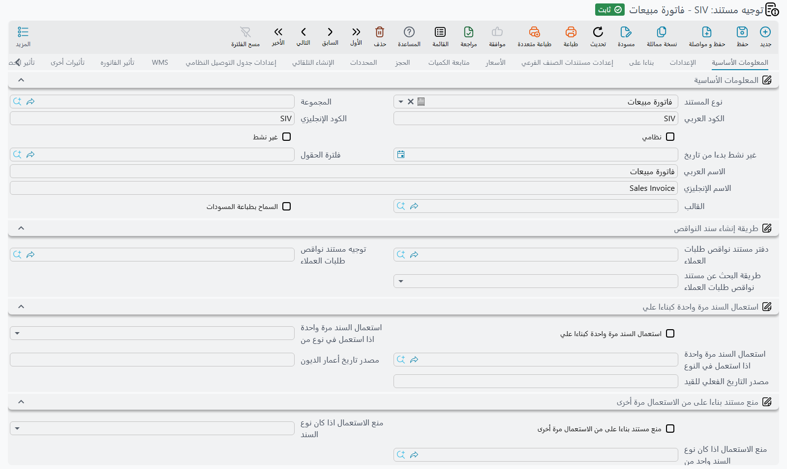

# إعدادات عامة (General)

**توجيه المستند** (Document Term) هو الآلية الرئيسية لتخصيص سلوك نوع المستند في نما — فنوع المستند الواحد يمكن أن يكون له عدة توجيهات، يشكّل كل منها تحققه وإنشاءه التلقائي وتسعيره وأثره المحاسبي وغير ذلك. يحمل تبويب **عام (General)** هوية التوجيه (الكود، الأسماء، نوع المستند الذي يستهدفه، حالة النشاط، علامة القالب، وفلترة الحقول) إضافة إلى عدد من المفاتيح العامة التي لا تنتمي إلى منطقة وظيفية واحدة.

أما بقية سلوك التوجيه فيعيش في التبويبات الأخرى — بناءً على (From-Document)، الصنف الفرعي (Sub-Item)، متابعة الكميات (Quantity Tracking)، الحجز والتسليم (Reservation & Delivery)، التسعير/الضرائب/الخصومات (Pricing/Taxes/Discounts)، المحددات (Dimensions)، الإنشاء التلقائي (Generation)، والآثار المحاسبية (Accounting Effects).

::: info مكان الإعداد
افتح **توجيه المستند** (توجيه) ثم تبويب **عام (General)**.
:::

## الهوية والبيانات الأساسية (Identity & Basic Information)

تعرّف هذه الحقول التوجيه وتحدد نوع المستند الذي يضبطه، وهي مشتركة في كل توجيهات سلسلة الإمداد تقريباً.

**نوع المستند (Document Type)** `documentType` — نوع الكيان الذي يضبطه هذا التوجيه (مثل StockReceipt). يحدد المجموعات الوظيفية والخيارات الخاصة بالمستند التي تظهر في بقية الشاشة. يظهر كعمود في القائمة وكحقل في المعايير.

**الكود / الكود البديل (Code / Alternative Code)** `code`, `altCode` — كود التوجيه المميِّز وكود بديل اختياري يُستخدم للبحث عنه.

**الاسم العربي / الاسم الإنجليزي (Name 1 / Name 2)** `name1`, `name2` — أسماء عرض التوجيه. `name1` هو الاسم العربي، و`name2` الاسم الإنجليزي.

**نظامي (System)** `systemBookOrTerm` — يجعل التوجيه نظامياً. والتوجيه النظامي لا يظهر في البحث في حقل التوجيه على المستندات، فلا يستطيع المستخدم اختياره يدويًا. يظهر كعمود في القائمة وكحقل في المعايير.

**غير نشط (Inactive)** `inActive` — يعطّل التوجيه بحيث لا يمكن اختياره على المستندات الجديدة. اقرنه بـ **غير نشط من تاريخ (Inactive From)** `termInfo.inActiveFrom` لتحديد التاريخ الذي يصبح فيه غير نشط.

**قالب (Template)** `template` — يجعل السجل قالباً يُنسخ عند إنشاء توجيهات جديدة، بدلاً من استخدامه مباشرة على المستندات.

**السماح بطباعة المسودات (Allow Printing Drafts)** `termInfo.allowPrintingDrafts` — يسمح بطباعة المستندات التي ما زالت مسودات (لم تُحفظ/تُعتمد بعد).

**فلترة الحقول (Field Filter)** `filters` — تحدد السجلات التي تعرضها حقول المرجع في كل مستند يستخدم هذا التوجيه، ولا تخفي حقولًا — راجع [فلترة الحقول بالمعايير](/ar/platform/field-filtering/field-filter-with-criteria).

## إنشاء مستند النواقص (Shortage Document Creation)

في فاتورة المبيعات، ينسخ الإجراء **إضافة السطر الحالي إلى مستند النواقص** (من قائمة المزيد) السطر المحدد إلى **مستند نواقص طلبات العملاء**، فيسجّل طلبًا لم تستطع الفاتورة تلبيته. ويجب ملء الخيارات الثلاثة التالية كلها حتى يعمل الإجراء.

**دفتر مستند نواقص طلبات العملاء (Customers Requests Shortage Book)** `termConfig.customersReqsShortageBook` — دفتر مستند النواقص.

**توجيه مستند نواقص طلبات العملاء (Customers Requests Shortage Term)** `termConfig.customersReqsShortageTerm` — توجيه مستند النواقص.

**طريقة البحث عن مستند نواقص طلبات العملاء (Suggest Customers Requests Shortages)** `termConfig.suggestCustomersReqsShortages` — كيف يجد الإجراء مستند نواقص قائمًا يضيف إليه السطر: **التاريخ فقط** (أول مستند نواقص بتاريخ يوم الفاتورة أو بعده)، أو **المستخدم فقط** (مستند أنشأه المستخدم الحالي أو بلا منشئ)، أو **التاريخ و المستخدم** (الشرطان معًا). وإن لم يُعثر على مستند، يُنشأ مستند جديد بهذا الدفتر وهذا التوجيه.

## حالة المنتج (Product Status)

**تغيير حالة المنتج إلى (Change Product Status To)** `termConfig.changeProductStatusTo` — يُستخدم حين يكون المستند منشأً بناءً على مستند من مراكز الخدمة يحمل منتجات (السيارات أو الأجهزة التي تُصان). فعند الحفظ يسجّل المستند قيد حالة منتج يضبط حالة تلك المنتجات على هذه القيمة، وحذف المستند يزيل القيد.

## الإلغاء (Cancellation)

**السماح بالإلغاء رغم وجود سندات مخزنية غير آلية (Allow Cancel Even If It Has Non-System Related Stock Documents)** `termConfig.allowCancelWithNonSystemRelatedStockDocs` — يسمح لـ[مستند إلغاء مستند](/ar/platform/documents-and-records/document-cancel-document) بإلغاء هذا المستند حتى عندما يكون بعض سنداته المخزنية غير منشأ آليًا بصورة نهائية (أُنشئ يدويًا، أو أُنشئ مسودة). وبدونه يُرفض الإلغاء بالرسالة «المستند {0} لا يمكن إلغاؤه ، لأن له سندات مخزنية مرتبطة ليست نظامية». يُطبَّق على **فاتورة البيع، ومرتجع البيع، وفاتورة الشراء، ومرتجع الشراء** فقط.

## سطور طلب الشراء المجمّع (Consolidated Purchase Request Lines)

**عدم توافق السطور مع سطور طلبات الشراء (Do Not Validate Lines With Purchase Req Lines)** `termConfig.doNotValidateLinesWithPurchaseReqLines` — يتخطى التحقق من تطابق سطور المستند مع سطور طلب الشراء الأصلي، مما يتيح تعديل السطور بحرية. يُطبَّق على **طلب الشراء المجمّع (Consolidated Purchase Request)** فقط.
