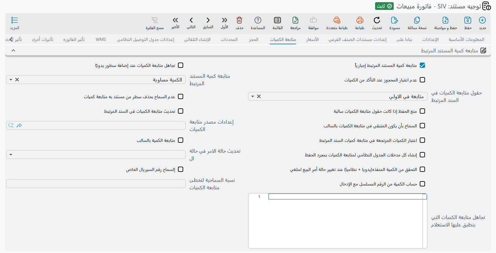

# إعدادات متابعة الكميات (Quantity Tracking)

تتحكم هذه الإعدادات في **متابعة الكميات** — وهو المحرك الذي يربط المستندات ببعضها ويسجّل ما تم تنفيذه من المستند المصدر عبر المستندات المُنشأة منه (مثل: كم نُفّذ من أمر البيع عن طريق الفوترة أو التوصيل). يحتفظ النظام بجدول متابعة للكميات المنفّذة مقابل المتبقية، ويتحقق من كل مستند جديد وفق السياسة التي تضبطها هنا.

::: info مكان الإعداد
افتح **توجيه المستند** (Document Term) ثم مجموعتي **متابعة الكميات** (Track Quantities) و**متابعة كمية المستند المرتبط** (Related Doc Track Quantity).
:::

::: tip سياستان واتجاهان
يُقرأ `trackInvoiceQuantity` من توجيه المستند **المصدر**: اضبطه في توجيه الأمر لتحدد كم يجوز للمستندات المُنشأة بناءً عليه أن تنفّذ منه. أما `relatedDocQtyPolicy` فيقع في توجيه المستند **اللاحق**، ولا يُستخدم إلا حين يكون **متابعة كمية المستند المرتبط إجبارياً** مفعّلًا فيه ويكون **تتبع الكميات** فارغًا في توجيه المستند المصدر.
:::

## متابعة كميات هذا المستند (Tracking This Document's Quantities)

تُخفى هذه المجموعة بالكامل عند تفعيل خيار إخفائها في إعدادات سلسلة الإمداد؛ وإلا فإنها تظهر لجميع توجيهات المستندات المخزنية.

**تتبع الكميات (Track Quantities)** `termConfig.trackInvoiceQuantity` — سياسة متابعة الكميات لمستندات هذا التوجيه، وتُطبَّق حين تُنشأ مستندات أخرى بناءً عليها: فتحدد هل يجوز لتلك المستندات مجتمعةً أن تنفّذ أكثر من كمية هذا المستند.

**حقول متابعة الكميات (Track Invoice Quantity Fields)** `termConfig.trackInvoiceQuantityFields` — يحدد أي حقل كمية (الكمية الأولى/الرئيسية أم الكمية الثانية) تُطبَّق عليه السياسة أعلاه.

**تحديث بيانات الكميات بالسطر (Update Qty at Save)** `termConfig.updateQtyOnSave` — يتحكم في أي قيم متابعة كميات السطر يجري تحديثها عند كل حفظ: كل القيم، أم القيم المتعلقة بالحجز فقط، أم لا شيء.

تقبل سياستا الكمية أعلاه القيم التالية:

| قيمة السياسة (`trackInvoiceQuantity` / `relatedDocQtyPolicy`) | التسمية | المعنى |
|---|---|---|
| `LessQuantity` | الكمية أقل | لا يجوز أن يتجاوز إجمالي الكمية المنفّذة الكمية المصدر (مضافًا إليها **نسبة السماحية لتخطي متابعة الكميات** في توجيه المستند اللاحق). |
| `SameQuantity` | الكمية مساوية | الحد نفسه كما في «الكمية أقل». |
| `MoreQuantity` | السماح بتخطي الكميات | يجوز أن يتجاوز إجمالي الكمية المنفّذة الكمية المصدر. |
| `None` | بدون | لا تُتابَع الكميات مقابل هذا المستند؛ ولا تُستخدم **متابعة كمية المستند المرتبط** في المستند اللاحق بدلًا منها. |

والحفظ الذي يدفع إجمالي الكمية المنفّذة لسطر مصدر فوق حدّه يُرفض بالرسالة «الكمية المسلمة ({0}) أكبر من كمية المستند الأصلي ({1})».

ويقبل محددا "حقول" أعلاه القيم التالية:

| محدد الحقل (`trackInvoiceQuantityFields` / `relatedDocQtyFields`) | المعنى |
|---|---|
| `TrackInFirst` | المتابعة على الكمية الأولى (الرئيسية). |
| `TrackInSecond` | المتابعة على الكمية الثانية. |

ويقبل `updateQtyOnSave`:

| القيمة | المعنى |
|---|---|
| `None` | عدم تحديث قيم المتابعة عند الحفظ. |
| `UpdateAll` | تحديث كل قيم متابعة السطر. |
| `UpdateForReservation` | تحديث القيم المتعلقة بالحجز فقط. |

## متابعة كميات المستندات المرتبطة (Tracking Related Documents' Quantities)

تُضاف هذه المجموعة لجميع توجيهات المستندات المخزنية. وتحكم كيفية متابعة المستند لكمياته مقابل المستند المرتبط (بناءً على/المصدر) — وكتابة الكمية المنفّذة فيه.

**متابعة كمية المستند المرتبط (Related Doc Qty Policy)** `termConfig.relatedDocQtyPolicy` — السياسة التي يطبّقها هذا المستند على مستنده المصدر حين يكون **متابعة كمية المستند المرتبط إجبارياً** مفعّلًا ويكون **تتبع الكميات** فارغًا في توجيه المستند المصدر. تستخدم نفس قيم `trackInvoiceQuantity`، وهي إلزامية عند تفعيل **متابعة كمية المستند المرتبط إجبارياً**.

**حقول متابعة الكميات في السند المرتبط (Related Doc Qty Fields)** `termConfig.relatedDocQtyFields` — يحدد أي حقل كمية (الأولى أم الثانية) يُتابَع في تلك الحالة.

**متابعة كمية المستند المرتبط إجبارياً (Force Qty)** `termConfig.forceTrackQtyOfRelatedDocs` — يتيح لهذا المستند متابعة كمياته مقابل مستند مصدر يكون **تتبع الكميات** فارغًا في توجيهه، باستخدام **متابعة كمية المستند المرتبط**. وحين يكون خيار سلاسل الإمداد **استخدام الجدول النظامي لمتابعة الكميات** مفعّلًا، لا يُنشئ المستند مدخلات متابعة الكميات إلا إذا كان هذا الخيار مفعّلًا في توجيهه.

**تجاهل متابعة الكميات عند إضافة سطور يدويًا (Ignore Track Qty When Adding Lines Manually)** `termConfig.ignoreTrackQtyWhenAddingLinesManually` — يتخطى التأكد من متابعة الكميات وتسجيلها للسطور التي يضيفها المستخدم يدويًا، بدلًا من السطور المسحوبة من مستند مرتبط.

**عدم اعتبار المحجوز عند التأكد من الكميات (Force Do Not Include Reserved With Qty Validation)** `termConfig.forceDoNotIncludeReserved` — عند التأكد من الكميات المتاحة/المتبقية، يستبعد الكمية المحجوزة بالفعل من الحساب.

**عدم السماح بحذف سطر من مستند به متابعة كميات (Do Not Allow Deleting Line In Track Quantity Documents)** `termConfig.doNotAllowDeletingLineInTrackQtyDocs` — يمنع حذف سطر بمجرد مشاركته في متابعة الكميات، حمايةً لسلامة قيم المنفّذ/المتبقي.

**منع الحفظ إذا كانت حقول متابعة الكميات سالبة (Prevent Saving If Qty Tracking Fields Negative)** `termConfig.preventSavingIfQtyTrackingFieldsNegative` — يمنع الحفظ عندما يصبح أي حقل كمية متابَعة سالبًا.

**تحديث متابعة الكميات في السند المرتبط (Update Track Qty In Related Doc)** `termConfig.updateTrackQtyInRelatedDoc` — عند الحفظ، يكتب الكمية المنفّذة في قيم متابعة المستند المرتبط/المصدر (مثل تعليم أمر البيع بأنه نُفّذ جزئيًا بالفوترة).

**السماح بأن يكون المتبقي في متابعة الكميات بالسالب (Allow Negative Remaining In Track Quantity)** `termConfig.allowNegativeRemainingInTrackQty` — يسمح بتجاوز التنفيذ: قد يصبح المتبقي (غير المنفّذ) من الكمية المتابَعة أقل من الصفر.

**إعدادات مصدر متابعة الكميات (Quantity Tracking Source Config File)** `termConfig.orderStatusQtyTrackConfig` — يشير إلى ملف **إعدادات مصدر متابعة الكميات** (`OrderStatusQtyTrackConfig`) الذي تحدد سطوره الكمية التي يمررها المستند إلى مستنده المصدر — راجع [سيناريوهات متخصصة](/ar/modules/supplychain/specialized-scenarios).

**متابعة الكمية بالسالب (Negate Quantity Tracking)** `termConfig.negativeQtyTrackValue` — يسجّل كمية المتابعة بإشارة سالبة، ويُستخدم لمستندات المرتجع / عكس الاتجاه.

**إنشاء كل مدخلات الجدول النظامي لمتابعة الكميات بمجرد الحفظ (Create All Track Entries With Save)** `termConfig.createTrackEntriesWithSave` — ينشئ كل مدخلات جدول متابعة الكميات النظامي فورًا عند الحفظ، بدلًا من إنشائها لاحقًا بإجراء آخر.

**تحديث حالة الأمر في حالة ال (Update Order Status In Case Of)** `termConfig.orderStatusWithQtyTrackType` — يختار أي حقل كمية متابَعة (الأول أم الثاني) يقود تحديث حالة الأمر تلقائيًا — مثل تغيير الحالة عند تنفيذ الكمية الأولى أو الثانية بالكامل. يستخدم قيم `TrackQuantityFields`.

**التحقق من الكمية المنفّذة (يدويًا + نظاميًا) عند تغيير حالة أمر البيع لملغي (Validate Satisfied Quantity (System + Manual) For Order Cancelled Status)** `termConfig.validateSatisfiedQtyWithCancelledOrderStatus` — عند ضبط الأمر على "ملغي"، يتحقق من اتساق الكمية المنفّذة — النظامية والمُدخلة يدويًا — قبل السماح بتغيير الحالة.

**نسبة السماحية لتخطي متابعة الكميات (Permitted Percentage Value To Skip Quantity Track Value)** `termConfig.permittedPercentageToSkipQtyTrackValue` — نسبة سماحية يجوز بها تجاوز الكمية المتابَعة أو تخطيها دون إطلاق خطأ تأكد من متابعة الكميات.

**متابعة الكميات للسطور التي ينطبق عليها الاستعلام (Track Quantity For Matched Lines With Query Applies)** `termConfig.trackQtyForLinesMatchingQuery` — يقصر متابعة الكميات على السطور المطابقة للاستعلام/الفلتر المحدد.

### المتابعة مع المرتجعات والسندات المخزنية

تنطبق هذه الخيارات على أنواع مستندات بعينها فقط.

**اعتبار الكميات المرتجعة في متابعة كميات السند المرتبط (Consider Returned Qty For Track Qty In Related Doc)** `termConfig.considerReturnQtyForTrackQtyInRelatedDoc` — يطرح الكميات المرتجعة عند حساب الكمية المنفّذة مقابل المستند المرتبط. متاح فقط لتوجيهات فاتورة المبيعات، وفاتورة مبيعات مركز الخدمة، وفاتورة المشتريات، وفاتورة مشتريات مركز الخدمة.

**خصم متابعة الكميات من كمية السند المخزني (Deducting Track Quantity From Stock Document Quantity)** `termConfig.deductTrackQtyFromStockDocQty` — يخصم الكمية المتابَعة من كمية السند المخزني المرتبط، لتجنّب الاحتساب المزدوج بين الفاتورة وإذن الاستلام. متاح فقط لتوجيهات فاتورة المشتريات وفاتورة مشتريات مركز الخدمة.

**السماح بمتابعة الكميات للسندات المنشأة نظاميًا (Allow Quantity Tracking for System Generated Documents)** `termConfig.allowTrackQtyForSysGeneratedDocs` — عندما يُنشئ النظام سند صرف مخزني أو إذن استلام تلقائيًا (سند مُنشأ بالكامل ناتج عن مسار مستند آخر)، فإنه يبقى عادةً خارج متابعة الكميات — إذ يفترض النظام أن المستند الأصلي قد تولّى المتابعة بالفعل. فعِّل هذا الخيار لإعادة هذه السندات المنشأة نظاميًا إلى المتابعة، فتُسجِّل وتتحقّق من كمياتها المنفّذة/المتبقية تمامًا كالسندات المُدخلة يدويًا. متاح فقط لتوجيهات سند الصرف المخزني وإذن الاستلام.

## معالجة المسلسل والمسلسل الخاص (Serial & Special-Serial Handling)

تحكم هذه الخيارات كيفية تفاعل أرقام المسلسل مع متابعة الكميات وإدخال كمية السطر.

**السماح برقم السيريال الخاص (Allow Special Serial Numbers)** `termConfig.allowSpecialSerialNumbers` — يسمح بأرقام مسلسل خاصة / غير قياسية في سياق متابعة الكميات.

**حساب الكمية من الرقم المسلسل مع الإدخال (Calculate Quantity From Serial With Data Entry)** `termConfig.calcQtyFromSerialWithEntry` — يشتق كمية السطر من عدد أرقام المسلسل المُدخلة أثناء الإدخال، فتبقى الكمية متوافقة مع المسلسلات المُسجَّلة.
