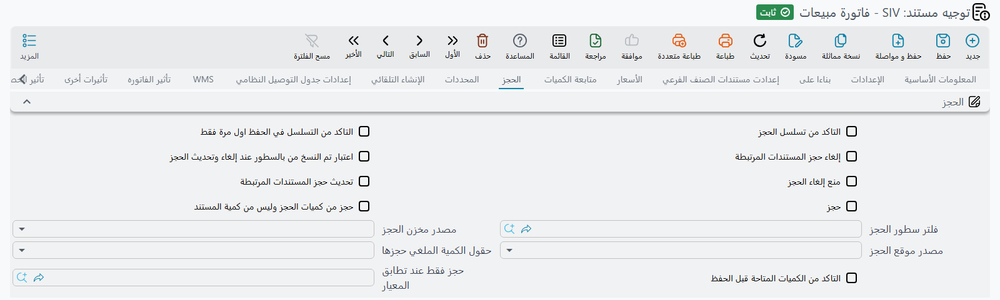

# الحجز ونظام التسليم (Reservation & Delivery System)

تتحكم هذه الإعدادات في كيفية **حجز** المستند للمخزون لسطوره، وفي كيفية مشاركته في **نظام التسليم** — الجدول النظامي الذي يتابع الأمر عبر الحجز والتحميل والتسليم النهائي. الحجز يحتجز المخزون لتنفيذ مستقبلي؛ ونظام التسليم يقود مسار "من الأمر إلى السائق".

::: info مكان الإعداد
افتح **توجيه المستند** (Document Term) ثم مجموعة **الحجز** (Reservation)، وصفحة **إعدادات جدول التوصيل النظامي** (Delivery System Table Configuration) المنفصلة.
:::

::: warning حقول الحجز لا تظهر لكل المستندات
حقول `reserve*` الأساسية أدناه **مستثناة** من `StockReceipt` و`StockIssue` ومستندات التحويل الثلاثة (`ReceiptStockTransfer` و`IssueStockTransfer` و`StockTransfer`). أما حقول كلمة سر التوصيل فتنطبق على **توجيهات مستند التوصيل فقط**.
:::

## سلوك الحجز (Reservation Behavior)

تُضاف هذه الخيارات الستة لجميع توجيهات المستندات المخزنية، وتحكم كيفية تسلسل الحجوزات وإلغائها وتحديثها عبر المستندات المرتبطة.

**التأكد من تسلسل الحجز (Check Reservation Sequentiality)** `termConfig.checkReservationSequentiality` — يفرض استهلاك الحجوزات أو إنشاءها بالتسلسل (ترتيب استخدام الحجز بأسلوب FIFO).

**التأكد من التسلسل في الحفظ أول مرة فقط (Check Reservation Sequentiality In First Save Only)** `termConfig.checkReservationSequentialityInFirstSaveOnly` — يقصر تأكد التسلسل أعلاه على أول حفظ للمستند فقط.

**إلغاء حجز المستندات المرتبطة (Cancel Reservation Of Related Docs)** `termConfig.cancelReservationOfRelatedDocs` — عند الحفظ/المعالجة، يلغي الحجز المحجوز بواسطة المستند المرتبط/المصدر — مثلًا، فوترة الأمر تفرج عن حجز ذلك الأمر.

**اعتبار "تم النسخ من" بالسطور عند إلغاء وتحديث الحجز (Consider Origin Document In Lines With Cancel/Update Reservation)** `termConfig.considerOriginDocInLinesWithCancelOrUpdateReservation` — عند إلغاء أو تحديث الحجوزات، يعتبر مستند المصدر (بناءً على/"تم النسخ من") على مستوى السطر بدلًا من الاكتفاء بربط الرأس.

**منع إلغاء الحجز (Prevent Cancel Reservation)** `termConfig.preventCancelReservation` — يرفض زر **إلغاء الحجز** اليدوي (قائمة المزيد) في مستندات هذا التوجيه، وكذلك مسار الكيان المجدول الذي يلغي الحجز باستعلام.

**تحديث حجز المستندات المرتبطة (Update Reservation Of Related Docs)** `termConfig.updateReservationOfRelatedDocs` — عند الحفظ، يحدّث (يعيد حساب) كميات الحجز المحجوزة بواسطة المستندات المرتبطة/المصدر.

## مصادر الحجز ومعاييره (Reservation Sources & Criteria)

هذه هي حقول `reserve*` الأساسية. تظهر لجميع توجيهات المستندات المخزنية **عدا** `StockReceipt` و`StockIssue` و`ReceiptStockTransfer` و`IssueStockTransfer` و`StockTransfer`.

**حجز (Reserve)** `termConfig.reserve` — المفتاح الرئيسي: هذا المستند يحجز المخزون لسطوره.

**حجز من كميات الحجز وليس من كمية المستند (Reserve From Reservation)** `termConfig.reserveFromReservationQty` — يحجز باستخدام حقل كمية الحجز المخصص بدلًا من كمية سطر المستند الرئيسية.

**فلتر سطور الحجز (Reservation Lines Criteria)** `termConfig.reservationCriteria` — فلتر معايير يحدد أي سطور تشارك في الحجز؛ فلا يُحجز إلا السطور المطابقة للمعايير.

**حجز فقط عند تطابق المعيار (Reserve Only When Criteria Is Matched)** `termConfig.reserveOnlyWhenCriteriaIsMatched` — لا يجري الحجز إلا عند تطابق المستند/السطر مع المعايير المحددة.

يحدد الحقلان التاليان مكان وضع الحجز — على المخزن/الموقع العادي بالسطر، أم على مخزن/موقع حجز مخصص.

| الخيار | معرّف الحقل | القيم |
|---|---|---|
| مصدر مخزن الحجز | `termConfig.reservationWarehouseSource` | `NormalWarehouse` / `ReservationWarehouse` |
| مصدر موقع الحجز | `termConfig.reservationLocatorSource` | `NormalLocator` / `ReservationLocator` |

**حقول الكمية الملغي حجزها (Reservation Satisfied Fields)** `termConfig.reservationSatisfiedFields` — يحدد أي حقل من حقول متابعة الكميات يُحتسب منفّذًا: فيحجز السطر كميته مطروحًا منها ما يُظهره ذلك الحقل منفّذًا (آليًا ويدويًا). يقبل `TrackInFirst` / `TrackInSecond`.

## التسلسل والتأكد من الإتاحة (Sequentiality & Availability Checks)

**التأكد من الكميات المتاحة قبل الحفظ (Check Available Quantities Before Save)** `termConfig.checkAvailableQties` — يتأكد من كميات المخزون المتاحة قبل السماح بالحفظ، مما يمنع المستند من حجز أكثر من المتاح.

**تحديث حالة الحجز في المستند المرتبط (Update Reservation Status In From Doc)** `termConfig.updateReservationStatusInFromDoc` — يحدّث حقل حالة الحجز في المستند المرتبط (المصدر). متاح فقط لتوجيهات `ReservationDocument`.

## جدول التوصيل النظامي (Delivery System Table)

تربط صفحة **إعدادات جدول التوصيل النظامي** ملفات الإعدادات التي تقود مسار التوصيل، وتتيح للحجز أن يسحب من جدول التوصيل النظامي بدلًا من مدخلات الحجز القياسية. تظهر الحقول الأربعة الأولى لجميع توجيهات المستندات المخزنية.

**مستند توصيل رئيسي (Root Delivery Document)** `termConfig.rootDeliveryDocument` — يعلّم نوع هذا المستند كجذر/أصل سلسلة متابعة نظام التوصيل.

**ملف إعدادات التوصيل (Delivery Configuration File)** `termConfig.deliveryConfiguration` — يربط ملف `DeliveryConfiguration` الذي يحكم كيفية إنتاج مدخلات نظام التوصيل ومتابعتها لهذا المستند.

**الحجز باستخدام جدول التوصيل النظامي (Reserve Using Delivery System Table)** `termConfig.useDelivSysEntriesForReserv` — يستخدم مدخلات جدول التوصيل النظامي كأساس للحجز، بدلًا من مدخلات الحجز القياسية.

**حجز من كمية جدول التوصيل النظامي (Reserve From Delivery System Table Quantity)** `termConfig.reserveFromDeliveryEntryQty` — يختار أي عمود كمية في جدول التوصيل النظامي يسحب منه الحجز:

| القيمة | عمود الكمية |
|---|---|
| `ReservationQuantity` | كمية الحجز |
| `DeliveryQuantity` | كمية التوصيل |
| `LoadingQuantity` | كمية التحميل |
| `Other1Quantity` | كمية أخرى 1 |
| `Other2Quantity` | كمية أخرى 2 |

**ملف إعدادات طابور التسليم (Delivery Queue Configuration)** `termConfig.deliveryQueueConfig` — يربط ملف `DeliveryQueueConfiguration` الذي يتحكم في كيفية تغذية هذا المستند لطابور تسليم الأوامر.

**منظمة التوصيل للسائقين (Delivery Organization File)** `termConfig.deliveryOrganization` — يربط إعدادات `DeliveryOrganization` للسائقين المستخدمة في توزيع التوصيلات وإسنادها.

### توجيهات مستند التوصيل فقط (Delivery Document Terms Only)

الحقول التالية تنطبق على **توجيهات مستند التوصيل فقط** وتقع في مجموعة «بناءً على» في التوجيه. وتنفّذ الحقول الثلاثة الأخيرة بوابة كلمة سر يجب تحقيقها قبل تعليم التوصيل كمُسلَّم؛ والمسار كله مشروح في [التسليم والتحميل](/ar/modules/supplychain/delivery-and-loading).

**تحديث حالة التوصيل في المستند المرتبط (Update Delivery Status In From Doc)** `termConfig.updateDeliveryStatusInFromDoc` — يكتب حالة توصيل كل سطر في سطره المصدر في المستند المرتبط.

**يجب تطابق كلمة السر حتى يمكن تعديل الحالة إلى تم التوصيل (Delivery State Requires Password)** `termConfig.deliveryStateRequiresPassword` — لا يمكن ضبط حالة التوصيل على **توصيل كلي** حتى تطابق **كلمة سر العميل** كلمة سر النظام في المستند.

**شكل كلمة سر النظام (System Password Pattern)** `termConfig.systemPasswordPattern` — أحرف كلمة السر المولّدة: `NumbersOnly` (أرقام فقط)، أو `LettersOnly` (حروف فقط)، أو `Both` (كلاهما). والفارغ يعني كلاهما.

**طول كلمة سر النظام (System Password Length)** `termConfig.systemPasswordLength` — عدد أحرف كلمة السر المولّدة. والفارغ يعني 4.
