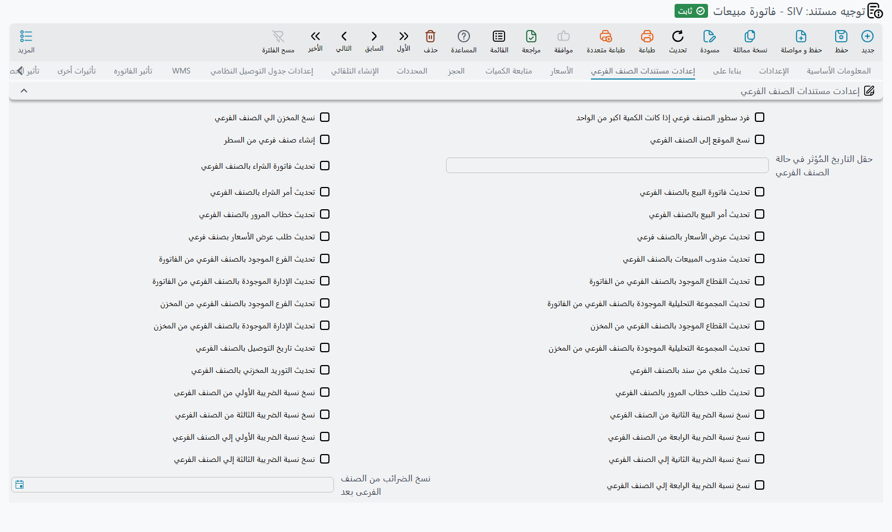

# إعدادات الصنف الفرعي (Sub-Item)

**الصنف الفرعي** (sub-item) هو وحدة فرعية متابَعة/مسلسلة من الصنف، يحمل مخزنه وموقعه وضرائبه وحالته الخاصة به، إضافة إلى روابط رجوع إلى المستندات التي أنشأته أو تعاملت معه. تتحكم الخيارات في هذا التبويب فيما يكتبه المستند من بيانات الرأس/السطر داخل سجل الصنف الفرعي، وكيف تُنسخ الضرائب إليه ومنه، وكيف يُفرد الصنف الفرعي ويُفلتر.

::: info مكان الإعداد
افتح **توجيه المستند** (توجيه) ثم تبويب **الصنف الفرعي (Sub-Item)**.
:::

## إنشاء وفرد الأصناف الفرعية (Creating & Spreading Sub-Items)

تتحكم هذه المفاتيح في عدد سجلات الصنف الفرعي التي يُنتجها السطر، ومن أين يأتي مخزنها/موقعها.

**فرد سطور الصنف الفرعي إذا كانت الكمية أكبر من الواحد (Spread Sub Item Lines If Qty Greater Than One)** `termConfig.spreadSubItemLinesIfQtyGreaterThanOne` — حين يُنشأ المستند بناءً على مستند آخر، يُقسَم السطر المنسوخ لصنف له صنف فرعي وكميته أكبر من الواحد إلى عدد من السطور بكمية 1 لكل منها، بحيث تُتابَع كل وحدة كصنف فرعي مستقل.

**إنشاء صنف فرعي من السطر (Create Sub Item From Line Information)** `termConfig.createSubItemFromLineInfo` — عند الحفظ، يحصل كل سطر لصنف له صنف فرعي على سجل صنف فرعي مملوء من بيانات السطر: سجل جديد إن لم يكن للسطر صنف فرعي، وإلا يُحدَّث صنفه الفرعي القائم. ويجب أن تحدد إعدادات حالة الصنف الفرعي للصنف **مجموعة الصنف الفرعي المُنشأ**، وإلا رُفض الحفظ.

**نسخ المخزن إلى الصنف الفرعي (Copy Warehouse To Sub Item)** `termConfig.copyWarehouseToSubItem` — عند الحفظ، يكتب مخزن وجهة السطر في سجل الصنف الفرعي لكل سطر.

**نسخ الموقع إلى الصنف الفرعي (Copy Locator To Sub Item)** `termConfig.copyLocatorToSubItem` — عند الحفظ، يكتب موقع وجهة السطر في سجل الصنف الفرعي لكل سطر.

## نسخ مراجع المستند إلى الصنف الفرعي (Copying Document References into the Sub-Item)

يقوم كل مفتاح أدناه بطبع **مرجع المستند الحالي** في الحقل المطابق له من سجل الصنف الفرعي عند تطبيق المستند (ويمسحه عند الإلغاء / إلغاء التطبيق). يبني هذا روابط الرجوع التي تتيح تتبع المستندات التي أنشأت كل صنف فرعي أو تعاملت معه.

| الخيار | معرّف الحقل |
|---|---|
| تحديث فاتورة الشراء بالصنف الفرعي (Update Purchase Invoice In Sub Item) | `termConfig.updatePurchaseInvoiceInSubItem` |
| تحديث فاتورة البيع بالصنف الفرعي (Update Sales Invoice In Sub Item) | `termConfig.updateSalesInvoiceInSubItem` |
| تحديث أمر الشراء بالصنف الفرعي (Update Purchase Order In Sub Item) | `termConfig.updatePurchaseOrderInSubItem` |
| تحديث أمر البيع بالصنف الفرعي (Update Sales Order In Sub Item) | `termConfig.updateSalesOrderInSubItem` |
| تحديث التوريد المخزني بالصنف الفرعي (Update Stock Receipt In Sub Item) | `termConfig.updateStockReceiptInSubItem` |
| تحديث خطاب المرور بالصنف الفرعي (Update Traffic Letter In Sub Item) | `termConfig.updateTrafficLetterInSubItem` |
| تحديث طلب خطاب المرور بالصنف الفرعي (Update Traffic Letter Request In Sub Item) | `termConfig.updateTrafficLetterReqInSubItem` |
| تحديث عرض الأسعار بالصنف فرعي (Update Sales Quotation In Sub Item) | `termConfig.updateSalesQuotationInSubItem` |
| تحديث طلب عرض الأسعار بصنف  فرعي (Update Sales Quotation Request In Sub Item) | `termConfig.updateSalesQuotationReqInSubItem` |

**تحديث مندوب المبيعات بالصنف الفرعي (Update Salesman In Sub Item)** `termConfig.updateSalesmanInSubItem` — يكتب مندوب مبيعات المستند في حقل المندوب بالصنف الفرعي. يسري فقط عندما يحمل نوع المستند مندوب مبيعات.

## نسخ المحددات إلى الصنف الفرعي (Copying Dimensions into the Sub-Item)

تنسخ هذه المفاتيح **المحددات** التحليلية — الفرع والقطاع والإدارة والمجموعة التحليلية — إلى سجل الصنف الفرعي. لكل محدد نسختان: واحدة تأخذ القيمة **من الفاتورة** (محدد المستند/السطر) وأخرى تأخذها **من المخزن** (محدد مخزن رأس المستند — **إلى مخزن** في التحويل المخزني). فعّل النسخة المطابقة للمكان الذي تحتفظ فيه بالمحدد.

**من الفاتورة** — تنسخ محدد المستند/السطر إلى الصنف الفرعي:

| الخيار | معرّف الحقل |
|---|---|
| تحديث الفرع الموجود بالصنف الفرعي من الفاتورة (Update Branch In Sub Item From Invoice) | `termConfig.updateBranchInSubItemFromInvoice` |
| تحديث القطاع الموجود بالصنف الفرعي من الفاتورة (Update Sector In Sub Item From Invoice) | `termConfig.updateSectorInSubItemFromInvoice` |
| تحديث الإدارة الموجودة بالصنف الفرعي من الفاتورة (Update Department In Sub Item From Invoice) | `termConfig.updateDepartmentInSubItemFromInvoice` |
| تحديث المجموعة التحليلية الموجودة بالصنف الفرعي من الفاتورة (Update Analysis Set In Sub Item From Invoice) | `termConfig.updateAnalysisSetInSubItemFromInvoice` |

**من المخزن** — تنسخ محدد مخزن المستند إلى الصنف الفرعي:

| الخيار | معرّف الحقل |
|---|---|
| تحديث الفرع الموجود بالصنف الفرعي من المخزن (Update Branch In Sub Item From Warehouse) | `termConfig.updateBranchInSubItemFromWarehouse` |
| تحديث القطاع الموجود بالصنف الفرعي من المخزن (Update Sector In Sub Item From Warehouse) | `termConfig.updateSectorInSubItemFromWarehouse` |
| تحديث الإدارة الموجودة بالصنف الفرعي من المخزن (Update Department In Sub Item From Warehouse) | `termConfig.updateDepartmentInSubItemFromWarehouse` |
| تحديث المجموعة التحليلية الموجودة بالصنف الفرعي من المخزن (Update Analysis Set In Sub Item From Warehouse) | `termConfig.updateAnalysisSetInSubItemFromWarehouse` |

## نسب الضرائب (Tax Percentages)

تنسخ هذه المفاتيح نسب الضرائب الأربع بين السطر وصنفه الفرعي، وتسري فقط على سطور الفواتير. عائلة **من الصنف الفرعي** تسحب النسبة المخزّنة من الصنف الفرعي إلى السطر؛ وعائلة **إلى الصنف الفرعي** تكتب نسبة السطر مرة أخرى في سجل الصنف الفرعي.

**من الصنف الفرعي إلى السطر:**

| الخيار | معرّف الحقل |
|---|---|
| نسخ نسبة الضريبة الأولى من الصنف الفرعي (Copy Tax 1 Percentage From Sub Item) | `termConfig.copyTax1PercentageFromSubItem` |
| نسخ نسبة الضريبة الثانية من الصنف الفرعي (Copy Tax 2 Percentage From Sub Item) | `termConfig.copyTax2PercentageFromSubItem` |
| نسخ نسبة الضريبة الثالثة من الصنف الفرعي (Copy Tax 3 Percentage From Sub Item) | `termConfig.copyTax3PercentageFromSubItem` |
| نسخ نسبة الضريبة الرابعة من الصنف الفرعي (Copy Tax 4 Percentage From Sub Item) | `termConfig.copyTax4PercentageFromSubItem` |

**من السطر إلى الصنف الفرعي:**

| الخيار | معرّف الحقل |
|---|---|
| نسخ نسبة الضريبة الأولى إلى الصنف الفرعي (Copy Tax 1 Percentage To Sub Item) | `termConfig.copyTax1PercentageToSubItem` |
| نسخ نسبة الضريبة الثانية إلى الصنف الفرعي (Copy Tax 2 Percentage To Sub Item) | `termConfig.copyTax2PercentageToSubItem` |
| نسخ نسبة الضريبة الثالثة إلى الصنف الفرعي (Copy Tax 3 Percentage To Sub Item) | `termConfig.copyTax3PercentageToSubItem` |
| نسخ نسبة الضريبة الرابعة إلى الصنف الفرعي (Copy Tax 4 Percentage To Sub Item) | `termConfig.copyTax4PercentageToSubItem` |

**نسخ الضرائب من الصنف الفرعي بعد (Copy Taxes From Sub Item After)** `termConfig.copyTaxesFromSubItemAfter` — تاريخ فاصل يحكم منطق نسخ الضرائب أعلاه. إذا ضُبط تاريخ وكان تاريخ قيمة المستند مساوياً له أو يسبقه، يُتخطى نسخ نسب الضرائب بالكامل؛ ولا يطبّق النسخ إلا المستندات المؤرخة بعد هذا التاريخ.

## متفرقات (Misc)

**حقل التاريخ المؤثر في حالة الصنف الفرعي (Sub-Item Status Value Date Field ID)** `termConfig.subItemStatusValueDateFieldId` — يحدد أي حقل في المستند يوفّر التاريخ المؤثر ("القيمة") المستخدم عند ترتيب وتطبيق قيود حالة الصنف الفرعي. إذا تُرك فارغاً، يُستخدم تاريخ قيمة المستند المعتاد.

**تحديث تاريخ التوصيل بالصنف الفرعي (Update Delivery Date In Sub Item)** `termConfig.updateDeliveryDateInSubItem` — عند الحفظ، يكتب التاريخ الفعلي للمستند في حقل تاريخ التوصيل بالصنف الفرعي.

**تحديث "ملغي من سند" بالصنف الفرعي (Update Cancelled By Doc In Sub Item)** `termConfig.updateCancelledByDoc` — يطبع مرجع المستند الحالي في حقل "ملغي من سند" بالصنف الفرعي، مسجّلاً المستند الذي ألغى/أبطل الصنف الفرعي.

**عدم فلترة الصنف الفرعي بالمتاح في بناءً على (Do Not Filter Sub-Items By From-Document Sub-Items)** `termConfig.doNotFilterSubItemsByFromDocSubItems` — عند بناء مستند **بناءً على** مستند مصدر، لا يقصر الأصناف الفرعية القابلة للاختيار على الموجودة في سطور المستند المصدر؛ ويُسمح بأي صنف فرعي مطابق.

**عدم نسخ بيانات السطر عند اختيار صنف فرعي موجود في بناءً على (Do Not Spread Line Data When Sub-Item Of From-Document Added)** `termConfig.doNotSpreadLineDataWhenSubItemOfFromDocAdded` — عند اختيار صنف فرعي موجود بالفعل في المستند المصدر، يتخطى فرد/نسخ بيانات سطر المستند المصدر على السطر الجديد.

**تجاهل تحقق إذا كان المردود يُرسل إلى مصلحة الضرائب في حالة إمكانية إرسال المستند في بناءً على (أو الفاتورة) (Ignore Validate If Return Should Be Sent To Tax Authority If Parent can be sent to Tax Authority)** `termConfig.ignoreValidateIfReturnShouldBeSentToTaxAuthority` — مستندات مردودات المبيعات فقط (مردود المبيعات، طلب مردود المبيعات، مردود مبيعات مراكز الخدمة). حين يكون المردود مما يُرسل إلى مصلحة الضرائب، يُفحص مستند «بناءً على» عادةً: فالمستند الذي لا يُرسل إلى الضرائب يُرفض بالرسالة «المستند {0} لا يمكن أن يكون في بناءً على للمستند {1}, حيث أن المستند {0} لا يُرسل إلى الضرائب والمستند {1} يُرسل للضرائب»، واختلاف إعدادات مصلحة الضرائب يُرفض بالرسالة «إعدادات مصلحة الضرائب {0} للمستند {1} و إعدادات مصلحة الضرائب {2} للمستند {3}, يجب أن يكون كلا المستندين لهم نفس إعدادات مصلحة الضرائب». وتفعيل هذا الخيار يتخطى الفحصين كليهما.
