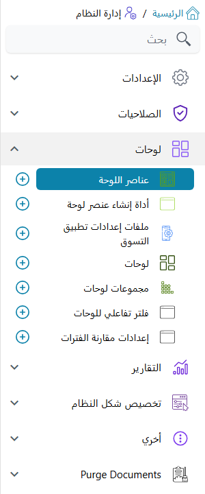

# قوائم وحدة BI وترخيصها وصلاحياتها

تجيب هذه الصفحة عن الأسئلة الثلاثة التي يسمعها الدعم الفني أولًا عن لوحات المعلومات: *أين أبنيها*، و*هل
نحتاج إلى ترخيص لها*، و*لماذا لا يرى هذا المستخدم ذلك المخطط*. لا توجد طبقة صلاحيات خاصة بوحدة BI تحتاج إلى
تعلّمها؛ فاللوحات سجلات عادية، تعاملها القائمة والترخيص وملف الصلاحيات كما تعامل أي شاشة أخرى، مع لمستين
خاصتين بوحدة BI في آخر الصفحة.

## أين توجد شاشات BI

كل ما يُستعمل في **بناء** اللوحات موجود في مجموعة واحدة من القائمة، *إدارة النظام ← لوحات*:

| الشاشة | مسار القائمة | ماذا تحفظ |
|---|---|---|
| **عنصر اللوحة** | إدارة النظام ← لوحات ← عنصر اللوحة | مخطط واحد أو جدول أو شريط بطاقات أو تقويم أو تقرير أو غيرها، مع استعلام SQL أو مصدر بيانات المعالج |
| **أداة إنشاء عنصر لوحة** | إدارة النظام ← لوحات ← أداة إنشاء عنصر لوحة | مصدر بيانات بلا SQL تستطيع العناصر استعماله بدلًا من الاستعلام |
| **لوحة** | إدارة النظام ← لوحات ← لوحة | الجدول الذي توزَّع عليه العناصر، أو لوحة ذات تبويبات تضم لوحات أخرى |
| **مجموعة لوحات** | إدارة النظام ← لوحات ← مجموعة لوحات | مجموعة مختارة من اللوحات، تُستعمل لوضعها في القائمة |
| **فلتر تفاعلي للوحات** | إدارة النظام ← لوحات ← فلتر تفاعلي للوحات | فلتر مشترك (الفرع، نطاق تاريخ، العميل…) يقسّم عدة عناصر معًا |
| **إعدادات مقارنة الفترات** | إدارة النظام ← لوحات ← إعدادات مقارنة الفترات | إعداد «هذه الفترة مقابل الفترة السابقة» الذي تستعمله عناصر المقارنة |

طريقة استعمال كل منها في [دليل وحدة BI](/ar/platform/bi/bi-module-guide).

## الترخيص

ليس لوحدة BI **ترخيص خاص بها**. الشاشات الست السابقة كلها تابعة للترخيص الأساسي `basic` الموجود في كل
تركيب. فكل نظام يستطيع بناء اللوحات وعرضها، واختفاء قائمة اللوحات ليس مسألة ترخيص أبدًا: افحص القائمة
وملف الصلاحيات بدلًا من ذلك.

يؤثر الترخيص فقط فيما *يعرضه* العنصر. فالعنصر استعلام، يقرأ الجداول التي يذكرها سواء كانت الوحدة التي تملؤها
مرخّصة أم لا؛ وكل ما في الأمر أنه لا يجد ما يعرضه إذا لم تُستعمل تلك الوحدة قط.

## كيف يصل المستخدم إلى اللوحة

يقابل المستخدم اللوحات في ثلاثة أماكن.

**الصفحة الرئيسية.** الصفحة التي يصل إليها المستخدم بعد الدخول تعرض لوحة واحدة: هي **اللوحة** المختارة في
**الإعدادات الافتراضية** في سجل المستخدم نفسه؛ فإن كانت فارغة، فـ**اللوحة** المختارة في **الإعدادات الافتراضية**
في ملف صلاحياته؛ وإن كانت الاثنتان فارغتين، لا تعرض الصفحة الرئيسية أي لوحة. لذلك، لتعطي فريقًا كاملًا اللوحة
الرئيسية نفسها، اخترها مرة واحدة في ملف صلاحياتهم، وغيّرها في سجل المستخدم للاستثناءات فقط.

**القائمة.** تفتح وصلة القائمة اللوحات بإحدى ثلاث طرق (التفاصيل في [كيف تُبنى القائمة](/ar/platform/menus/menu-structure)):

- وصلة من نوع **لوحة** تفتح لوحة واحدة؛
- وصلة من نوع **مجموعة لوحات** تسرد كل لوحة في مجموعة اللوحات وصلةً مستقلة؛
- وصلة من نوع **اللوحات الآلية** تسرد، كقوائم فرعية مستقلة، كل مجموعة لوحات مؤشَّر فيها **إضافة الي القائمة اّليا**.
  والقائمة التي تأتي مع النظام فيها وصلة من هذا النوع في مجلد رئيسي اسمه **لوحات**، فتظهر المجموعة المؤشَّر عليها هناك
  دون أن يعدّل أحد القائمة. الخطوات في قسم «مجموعات اللوحات» من [دليل وحدة BI](/ar/platform/bi/bi-module-guide).

**شاشة سجل.** يستطيع «تعديل شاشة» أن يضمّن لوحة في صفحة من أي شاشة، تتغذى بقيم السجل المفتوح (**لوحات
معلومات الصفحة**، انظر [شاشة التعديل في تعديل الشاشة](/ar/platform/screen-modifier/screen-modifier-edit-screen)).

إذا كانت وصلة لوحة مفقودة من قائمة شخص دون آخر، فهي مسألة قائمة لا مسألة BI: اتبع
[من يرى أي قائمة](/ar/platform/menus/menu-visibility).

## من يبني اللوحات ويعدّلها

الشاشات الست أنواع كيانات عادية، لذلك تقرر الصلاحيات الأساسية في [ملف الصلاحيات](/ar/platform/security/security-profiles)
من يفتحها ويضيف إليها ويعدّلها ويحذف منها. الإعداد المعتاد يعطي مصممي اللوحات صلاحية الإضافة والتعديل على الست
كلها، ويترك لغيرهم صلاحية المطالعة فقط، فيفتحون اللوحات دون أن يغيّروا استعلام عنصر أو تخطيط لوحة.

وصلاحية التعديل على **عنصر اللوحة** هي أيضًا ما يقرر هل يقرأ مساعد الذكاء الاصطناعي المتصل عبر MCP استعلام SQL
الذي نفّذه العنصر: لا يراه إلا إذا كان المستخدم الذي يدخل به يملك تعديل عناصر اللوحات (انظر قسم إنشاء اللوحات
بالذكاء الاصطناعي في [دليل وحدة BI](/ar/platform/bi/bi-module-guide)).

## إخفاء عنصر أو تبويب عن بعض المستخدمين

التحكم الأدق هو **صلاحية المطالعة** على مستوى السجل، وهي نفسها التي يحملها أي سجل (**المزيد ← تعديل الصلاحيات**؛
وطريقة عمل الصلاحيات في [أنواع الصلاحيات](/ar/admin/users-counter-and-security-capabilities)). وفي سجلات BI تعمل
هكذا:

- **على عنصر.** المستخدم الذي لا يملك صلاحية المطالعة الخاصة بالعنصر لا يصله ذلك العنصر ببساطة. تُرسم بقية اللوحة
  عاديًا ويبقى مكان العنصر فارغًا، دون أي رسالة. استعملها لتحتفظ مثلًا بمخطط هامش الربح في لوحة المبيعات للمديرين
  وحدهم، دون أن تبني لوحة ثانية لبقية الموظفين.
- **على لوحة فرعية داخل لوحة ذات تبويبات.** يبقى التبويب ظاهرًا، فيعرف المستخدم أن هناك شيئًا، لكن فتحه يعرض
  *You do not have permission to view this sub-dashboard.* بدلًا من العناصر. هذه الرسالة ليس لها نص عربي، فتظهر
  بالإنجليزية في الشاشات العربية أيضًا.

ومن يملك **صلاحية التعديل** للسجل يُعدّ مالكًا لصلاحية المطالعة أيضًا، فمن يُسمح لهم بتغيير العنصر يرونه دائمًا.

::: tip قيّد البيانات لا العنصر وحده
صلاحية المطالعة تقرر هل يرى المستخدم العنصر أصلًا، ولا تغيّر ما يرجعه استعلامه. فإذا كان على المستخدمين أن يروا
المخطط نفسه بأرقام فرعهم وحده، فاربط العنصر بفلتر تفاعلي للفرع أو صفِّ الاستعلام على المستخدم الحالي بدلًا من ذلك؛
انظر قسم الفلاتر المتقاطعة في [دليل وحدة BI](/ar/platform/bi/bi-module-guide).
:::
