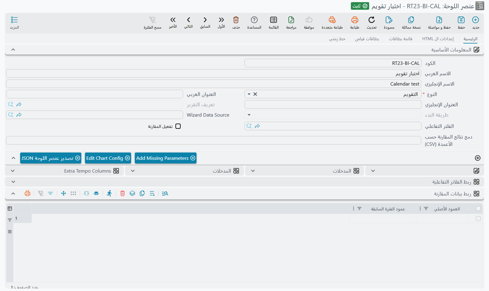
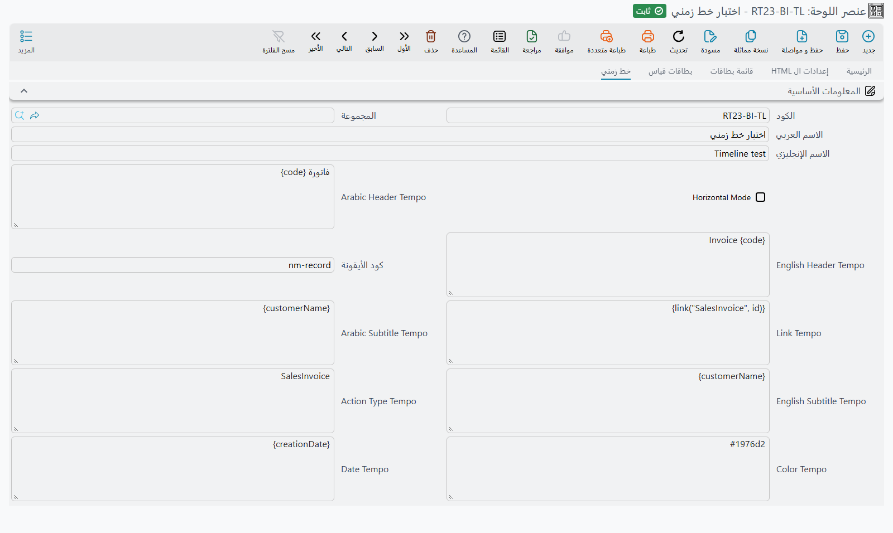
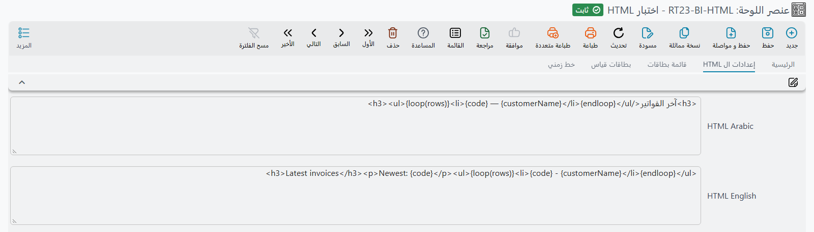
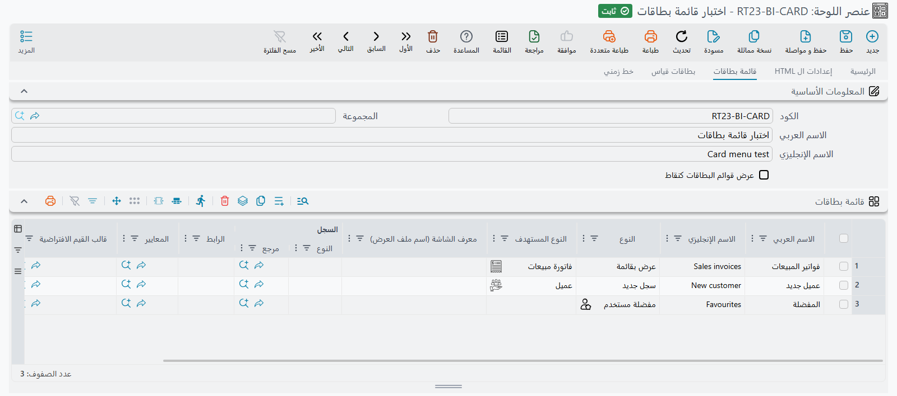

# مرجع BI — التقويم والخط الزمني والتقرير وعناصر أخرى

تُبنى معظم اللوحات من المخططات والجداول وبطاقات القياس، ولكل منها دليله. وتملأ سبعة أنواع أقدم من العناصر الفجوات
بينها: **التقويم** و**Resource View** لكل ما له بداية ونهاية، و**الخط الزمني** لسلسلة أحداث، و**التقرير** الذي
يشغّل تقريرًا مطبوعًا داخل اللوحة، و**HTML** لمحتوى حر يُبنى من استعلام، و**قائمة بطاقات** من أزرار الاختصار،
و**الزيارات الأخيرة** التي تعرض الشاشات التي يفتحها المستخدم أكثر من غيرها. تشرح هذه الصفحة متى يكون كل نوع هو
الاختيار الصحيح وكيف تملؤه.

تُنشأ الأنواع السبعة كلها في شاشة **عنصر اللوحة** (*إدارة النظام ← لوحات ← عنصر اللوحة*): اختر **النوع**، وأعطِ
العنصر **العنوان العربي** و**العنوان الإنجليزي**، ثم املأ الحقول التي يستعملها ذلك النوع. وتوضع على اللوحة مثل
أي عنصر آخر.

| النوع | استعمله لـ | يحتاج استعلامًا؟ |
|---|---|---|
| [التقويم (Calendar)](#ltqwym-Calendar) | المواعيد والزيارات والتسليمات وتواريخ الاستحقاق على تقويم شهري/أسبوعي/يومي | نعم |
| [Resource View](#Resource-View) | الشيء نفسه، بصف لكل شخص أو غرفة أو آلة | نعم |
| [الخط الزمني (Timeline)](#lkhT-lzmny-Timeline) | تاريخ قصير من الأحداث، الأحدث أو الأقدم أولًا | نعم |
| [التقرير (Report)](#ltqryr-Report) | تقرير موجود، معروض داخل اللوحة | لا |
| [HTML](#HTML) | نص حر أو قائمة تُبنى من صفوف الاستعلام | اختياري |
| [قائمة بطاقات (Card Menu)](#qym-bTqt-Card-Menu) | أزرار اختصار كبيرة إلى القوائم والسجلات الجديدة والتقارير واللوحات | لا |
| [الزيارات الأخيرة (Recent Visits)](#lzyrt-lkhyr-Recent-Visits) | الشاشات التي يفتحها هذا المستخدم أكثر من غيرها | لا |

::: info الخط الزمني وقائمة البطاقات والزيارات الأخيرة تحتاج الواجهة الجديدة
إذا فُتحت من الواجهة القديمة، تعرض هذه الأنواع الثلاثة رسالة بأن نوعها مدعوم في الواجهة الجديدة فقط، مع رابط يفتح
اللوحة نفسها هناك. أما التقويم وResource View والتقرير وHTML فتعمل في الواجهتين.
:::

## جدول المدخلات (Parameters)

يُضبط التقويم وResource View، وإعدادات الروابط في عدة أنواع أخرى، في جدول **المدخلات** في الصفحة الرئيسية من العنصر.
كل سطر يجمع اسم إعداد ثابتًا مع قيمة، وهي في العادة **اسم عمود في استعلامك**.

لا تكتب أسماء الإعدادات بنفسك. اختيار **النوع** يملأ الجدول بكل سطر يفهمه ذلك النوع، وعمود الاسم للقراءة فقط. فإن
غيّرت النوع أو أُفرغ الجدول، فاضغط **Add Missing Parameters** لتعود السطور: يضيف الناقص ويحتفظ بالقيم التي أدخلتها.
وفي عمود القيمة تقترح الشاشة أسماء أعمدة استعلامك أثناء الكتابة. والسطور التي لا تحتاجها تُترك فارغة.

تُطابق أسماء الأعمدة حرفيًا، فـ`fromDT` في الاستعلام و`FromDT` في الجدول لا يتطابقان.

## التقويم (Calendar)

يعرض **التقويم** كل صف من صفوف الاستعلام كمدخل على تقويم بعروض **شهر** و**أسبوع** و**يوم**، ويُفتح على الشهر
الحالي. استعمله كلما كان السؤال *متى*: زيارات الفنيين، ومواعيد التسليم، وحجوزات الإيجار، وتواريخ انتهاء العقود،
وطلبات الإجازات. والضغط على المدخل يفتح السجل الذي خلفه.

يرجع الاستعلام صفًا لكل مدخل. لقائمة مواعيد قد يكون:

```sql
SELECT s.id, 'SalesInvoice' entityType,
       s.code + ' ' + ISNULL(c.name2, '') title,
       CAST(s.creationDate AS datetime) fromDT,
       CAST(DATEADD(minute, 30, s.creationDate) AS datetime) toDT
FROM SalesInvoice s
LEFT JOIN Customer c ON c.id = s.customer_id
WHERE 1 = 1 /*AND-FILTERS*/
```

ثم املأ هذه السطور من جدول المدخلات بأسماء الأعمدة:

| الإعداد | ماذا تضع فيه |
|---|---|
| **Title** | العمود الذي يظهر نصه على المدخل |
| **FromDateTime** | العمود الذي يحمل تاريخ البداية ووقتها |
| **ToDateTime** | العمود الذي يحمل تاريخ النهاية ووقتها. إن تُرك فارغًا يأخذ كل مدخل المدة الافتراضية للتقويم |
| **LinkToType** و**LinkToID** | العمود الذي يحمل نوع الكيان (مثل `SalesInvoice`) والعمود الذي يحمل معرّف السجل. املأ الاثنين، فيفتح الضغطُ على المدخل ذلك السجل |
| **URL** | بدلًا من LinkToType/LinkToID: عمود يحمل عنوان ويب يُفتح عند الضغط على المدخل |
| **minTime** و**maxTime** | ليسا اسمي عمودين بل وقتين ثابتين، مثل `08:00:00` و`18:00:00`. يحدّان الساعات الظاهرة في عرضي الأسبوع واليوم. إن تُركا فارغين يظهر اليوم كله |

والسطور الباقية (**FromDate** و**ToDate** و**FromTime** و**ToTime**) طريقة أقدم لإعطاء البداية والنهاية في أعمدة
منفصلة. اتركها فارغة واستعمل سطري التاريخ والوقت.

::: tip حوّل التواريخ إلى `datetime`
أرجع البداية والنهاية كقيم `datetime`، كما يفعل المثال بـ`CAST(... AS datetime)`. والعمود الذي يحمل تاريخًا فقط، مثل
تاريخ قيمة المستند، يحتاج هذا التحويل ليصبح تاريخًا ووقتًا عند منتصف الليل.
:::

يأخذ الاستعلام الفلاتر التفاعلية عبر العلامة `/*AND-FILTERS*/` مثل أي عنصر آخر، فيضيّق فلتر الفرع أو نطاق التاريخ
في اللوحة التقويمَ أيضًا.



## Resource View

**Resource View** هو التقويم مقلوبًا على جنبه: صف لكل **مورد** (فني، غرفة، مركبة، آلة) والوقت يجري عرضًا، مع أزرار
**يوم** و**أسبوع** و**شهر**، ويُفتح على الشهر. استعمله حين يكون السؤال *من المشغول ومتى*، مثلًا لتجد فنيًا متفرغًا أو
غرفة محجوزة مرتين.

يأخذ كل إعدادات التقويم السابقة، وثلاثة خاصة به:

| الإعداد | ماذا تضع فيه |
|---|---|
| **ResourceID** | العمود الذي يميّز المورد، مثل كود الموظف. المدخلات ذات القيمة نفسها تتشارك صفًا. والصف الذي يكون ResourceID فيه فارغًا لا يوضع على أي مورد |
| **ResourceName** | العمود الذي يحمل الاسم الظاهر في بداية صف المورد |
| **ParentResourceID** | اختياري: قيمة ResourceID لأبٍ، لتجميع الموارد تحت صف عنوان، مثل الفنيين تحت فريقهم. يُظهر العنوان اسم الأب إذا كان الأب نفسه موردًا في الاستعلام، وإلا أظهر قيمة ResourceID الخاصة به |

```sql
SELECT s.id, 'SalesInvoice' entityType, s.code title,
       CAST(s.creationDate AS datetime) fromDT,
       CAST(DATEADD(hour, 2, s.creationDate) AS datetime) toDT,
       c.code customerCode, c.name2 customerName
FROM SalesInvoice s
JOIN Customer c ON c.id = s.customer_id
WHERE 1 = 1 /*AND-FILTERS*/
```

هنا **ResourceID** هو `customerCode` و**ResourceName** هو `customerName`، فيأخذ كل عميل صفه الخاص. ضع جداولك مكانها:
المهم صف لكل حجز، عليه كود المورد واسمه.

## الخط الزمني (Timeline)

يرسم **الخط الزمني** صفوف الاستعلام كسلسلة أحداث، لكل حدث عنوان وتاريخه ووقته وسطر نص قصير وأيقونة. استعمله لقصة تُروى
بالترتيب، مثل آخر عشر فواتير في اليوم، أو مراحل مشروع، أو آخر التغييرات على حساب عميل. ويعرض الصفوف بالترتيب الذي
يرجعها به الاستعلام، فاختم الاستعلام بالـ`ORDER BY` الذي تريده.

لا يستعمل الخط الزمني جدول المدخلات. إعداداته في تبويب **خط زمني** من العنصر، وكل منها قالب [Tempo](/ar/admin/tempo):
اكتب اسم عمود بين قوسين معقوفين، `{code}`، لتستعمل قيمة ذلك العمود في كل صف.

| الحقل | ماذا يفعل |
|---|---|
| **Horizontal Mode** | مؤشَّرًا تجري الأحداث عرضًا في صف؛ وغير مؤشَّر تجري طولًا |
| **Arabic Header Tempo** / **English Header Tempo** | عنوان كل حدث. وإذا كان للحدث رابط، صار العنوان هو الرابط |
| **Arabic Subtitle Tempo** / **English Subtitle Tempo** | السطر الذي تحت العنوان |
| **Date Tempo** | تاريخ الحدث ووقته، وهو في العادة العمود وحده: `{creationDate}` |
| **Action Type Tempo** | تسمية قصيرة تظهر تحت التاريخ. الاسم المعروف في النظام يُترجم، فيظهر `SalesInvoice` كـ*فاتورة مبيعات* |
| **كود الأيقونة** | الأيقونة داخل دائرة الحدث: اسم أيقونة Material مثل `receipt`، أو `{iconColumn}` لاختيارها لكل صف |
| **Color Tempo** | اللون خلف الأيقونة، مثل `#1976d2` أو `{colorColumn}` |
| **Link Tempo** | إلى أين يقود العنوان. القالب `{link("SalesInvoice", id)}` يفتح السجل الذي معرّفه في العمود `id` |

مثال عملي لآخر الفواتير:

```sql
SELECT TOP 10 s.id, s.code, c.name2 customerName,
       CAST(s.creationDate AS datetime) creationDate
FROM SalesInvoice s
LEFT JOIN Customer c ON c.id = s.customer_id
WHERE 1 = 1 /*AND-FILTERS*/
ORDER BY s.creationDate DESC
```

مع **Arabic Header Tempo** `فاتورة {code}`، و**Arabic Subtitle Tempo** `{customerName}`، و**Date Tempo**
`{creationDate}`، و**Action Type Tempo** `SalesInvoice`، و**Link Tempo** `{link("SalesInvoice", id)}`.

::: warning يجب أن يعطي Date Tempo تاريخًا ووقتًا
يجب أن تُقرأ القيمة كتاريخ يتبعه وقت. والعمود الذي يحمل تاريخًا فقط يوقف العنصر برسالة تبدأ بـ
*Error preparing chart: java.text.ParseException: Unparseable date*
وحوّله في الاستعلام، `CAST(valueDate AS datetime)`، كما يفعل المثال.
:::



## التقرير (Report)

يشغّل عنصر **التقرير** تقريرًا موجودًا داخل اللوحة، فالتقرير الذي يفتحه الموظفون كل صباح يجلس بجانب المخططات بدلًا من
نافذة منفصلة. ولا يحتاج استعلامًا:

| الحقل | ماذا تضع فيه |
|---|---|
| **تعريف التقرير** | التقرير المطلوب تشغيله |
| **طريقة البدء** | **مباشر** يشغّل التقرير بمجرد فتح اللوحة ويعرض النتيجة. **طلب مدخلات** يعرض نموذج مدخلات التقرير داخل العنصر؛ يملؤه المستخدم ويشغّل التقرير من هناك |

الحقلان مفعّلان فقط ما دام **النوع** تقريرًا، واختيار نوع آخر يفرّغهما.

اختر **مباشر** لتقرير كل مدخلاته لها قيم افتراضية معقولة، مثل موقف النقدية اليوم. واختر **طلب مدخلات** حين يحتاج كل
مستخدم أن يختار شيئًا أولًا، مثل عميل أو فترة. وفي الحالتين أعطِ العنصر ارتفاعًا كافيًا، فالتقرير يحتاج مساحة أكبر من
المخطط.

## HTML

يعرض عنصر **HTML** محتوى تكتبه بنفسك، يُبنى من صفوف استعلامه. استعمله حين يكون المخطط أكثر من اللازم والجدول أقل من
اللازم: جملة تقول *«23 طلبًا تنتظر الشحن، أقدمها منذ الأحد»*، أو قائمة قصيرة بالمهام المتأخرة، أو فقرة تعليمات فيها
أرقام حية.

يُكتب المحتوى في تبويب **إعدادات ال HTML** من العنصر، في **HTML Arabic** و**HTML English** (يرى كل مستخدم ما يوافق
لغته). وكلاهما قالب [Tempo](/ar/admin/tempo) يعمل على نتيجة الاستعلام:

- `{columnName}` يعطي قيمة ذلك العمود من **الصف الأول**؛
- `{loop(rows)} … {endloop}` يكرر ما بينهما مرة **لكل صف**.

مثلًا، مع الاستعلام

```sql
SELECT TOP 5 s.code, c.name2 customerName
FROM SalesInvoice s
LEFT JOIN Customer c ON c.id = s.customer_id
WHERE 1 = 1 /*AND-FILTERS*/
ORDER BY s.creationDate DESC
```

يعرض القالب

```html
<h3>آخر الفواتير</h3>
<p>الأحدث: {code}</p>
<ul>{loop(rows)}<li>{code} — {customerName}</li>{endloop}</ul>
```

عنوانًا، ورقم أحدث فاتورة، وقائمة بالخمس كلها.

لهذا النوع سطر واحد في جدول المدخلات، **HTMLOpenInIFrame**. إن تُرك `false` يوضع الـHTML مباشرة داخل اللوحة ويأخذ
نمط النص الخاص بها. وإن صار `true` يُعرض في إطار مستقل خاص به، وهذا يناسب صفحة كاملة لها أنماطها.

::: tip HTML أم كتلة نص؟
لعنوان أو فقرة ثابتة بلا أرقام، استعمل عنصر **كتلة نص** بدلًا منه: له محرر نصوص منسقة ولا يحتاج استعلامًا. واستعمل
HTML حين يأتي المحتوى من البيانات. انظر [TextBlock](/ar/platform/bi/bi-module-technical-reference#9b-Widget-TextBlock).
:::



## قائمة بطاقات (Card Menu)

**قائمة البطاقات** مجموعة من أزرار الاختصار الكبيرة، زر لكل سطر في جدولها. ضعها في اللوحة الرئيسية لقسم ما، فتصبح
الشاشات التي يستعملها الفريق كل يوم على بعد ضغطة من الأرقام التي يراقبها: *أمر بيع جديد*، *العملاء*، *تسليمات اليوم*،
تقارير *المبيعات*.

لا تحتاج استعلامًا. سطورها في تبويب **قائمة بطاقات** من العنصر، وكل سطر يعمل مثل وصلة القائمة:

| العمود | ماذا تضع فيه |
|---|---|
| الاسم العربي والإنجليزي | نص الزر في كل لغة |
| **النوع** وأعمدة الهدف | ما يفتحه الزر، تمامًا كوصلة القائمة: قائمة، أو سجل جديد (مع **قالب القيم الافتراضية** اختياريًا)، أو سجل واحد، أو تقرير، أو لوحة، أو رابط. انظر [كيف تُبنى القائمة](/ar/platform/menus/menu-structure) |
| **كود الأيقونة** | اسم أيقونة Material. إن تُرك فارغًا تُختار أيقونة حسب النوع |
| **اللون** | لون خلفية الزر. ويصير النص أبيض أو أسود ليبقى مقروءًا |

أربعة أنواع تحوّل السطر الواحد إلى عدة أزرار: **مفضلة مستخدم** تصير زرًا لكل عنصر في مفضلة المستخدم الحالي، و**كل
التقارير** زرًا لكل مجموعة تقارير، و**مجموعة لوحات** زرًا لكل لوحة في المجموعة، و**اللوحات الآلية** زرًا لكل لوحة في
كل مجموعة آلية.

أشّر على **عرض قوائم البطاقات كنقاط** لترسم الأزرار كقائمة عمودية ضيقة بدلًا من شبكة بطاقات، وهذا يناسب عمودًا جانبيًا
في اللوحة.

تأخذ قائمة البطاقات ارتفاعها من أزرارها، فالارتفاع الذي تعطيها إياه في اللوحة لا يُستعمل.



## الزيارات الأخيرة (Recent Visits)

يعرض عنصر **الزيارات الأخيرة** الشاشات التي فتحها المستخدم أكثر من غيرها، مجمّعة تحت آخر يوم استعمل فيه النظام، واليوم
الذي قبله، والأيام الأقدم. كل بطاقة تذكر الشاشة أو السجل، وتبيّن تقريبًا عدد مرات فتحه، وتعيد فتحه بضغطة واحدة. وحين
تكثر الشاشات المفتوحة ثلاث مرات أو أكثر، تُستبعد التي فُتحت مرة أو مرتين فقط لتبقى القائمة قصيرة. وفتح سجل جديد فارغ
لا يُحسب. إنها قائمة اختصارات شخصية تبني نفسها، ولذلك ترافق قائمة البطاقات جيدًا في اللوحة الرئيسية.

لا يوجد ما يُضبط: اختر النوع، وضعه على اللوحة، فيمتلئ مع عمل المستخدم. وعنوانه دائمًا *الزيارات الأخيرة*.

تُحفظ القائمة في المتصفح لا في الخادم. فهي تتبع المتصفح لا المستخدم: من يدخل من جهاز جديد يبدأ بقائمة فارغة، ومن
يتشاركون متصفحًا واحدًا يرون قائمة مشتركة واحدة. ومسح بيانات الموقع في المتصفح يفرغها.

ومثل قائمة البطاقات، يأخذ ارتفاعه من محتواه.
