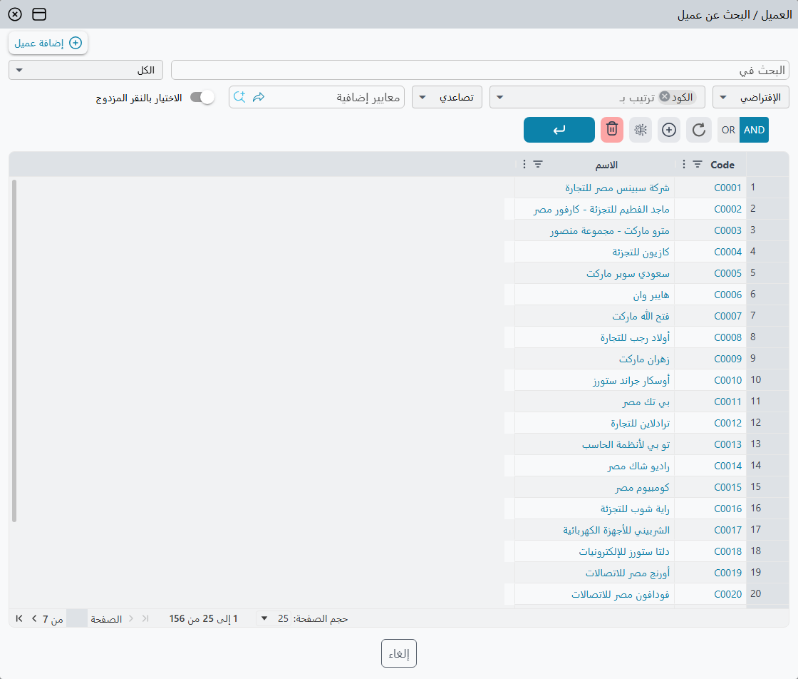
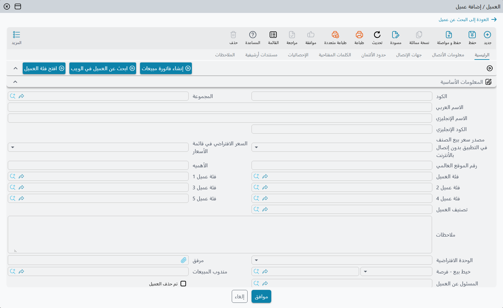

# الإنشاء السريع والتعديل السريع من حقل مرجع

أنت في منتصف فاتورة مبيعات حين يتبين أن العميل غير موجود بعد. ترك الفاتورة لفتح شاشة العملاء، ثم حفظ العميل والعودة، يضيّع الوقت وقد يضيع ما كتبته. ولكل حقل مرجع — الحقول التي تشير إلى سجل آخر، مثل العميل والصنف والمخزن والدفتر — طريق مختصر: نافذة منبثقة تبحث عن السجل، أو تنشئ سجلاً جديداً، أو تعدّل السجل المختار، ثم تضع النتيجة في الحقل مباشرة.

## فتح النافذة

| الطريقة | ما يُفتح |
|---|---|
| العدسة في آخر الحقل، أو **F4** | صفحة البحث في النافذة. |
| السهم الصغير الذي يظهر في آخر الحقل **الفارغ** | سجل جديد مباشرة (الإنشاء السريع). |
| **F8** | سجل جديد مباشرة، حتى لو كان في الحقل قيمة. |
| **F7**، أو النقر على العدسة مع **Alt** | السجل المختار مفتوحاً للتعديل مباشرة (التعديل السريع). وإن كان الحقل فارغاً فسجل جديد. |
| **F6**، أو النقر على العدسة مع **Ctrl** | بلا نافذة: يُفتح السجل المختار — أو سجل جديد إن كان الحقل فارغاً — في تبويب جديد في المتصفح. |

ويعرض الوقوف بالفأرة على العدسة هذه المفاتيح للتذكير. والقائمة الكاملة لاختصارات لوحة المفاتيح في [اختصارات لوحة المفاتيح](/ar/platform/everyday-tools/shortcuts).

## البحث

تعرض صفحة البحث السجلات التي يقبلها الحقل، مفلترة سلفاً بما كان الحقل نفسه سيعرضه — المحددات والفلاتر والمعايير نفسها التي تسري عند الكتابة في الحقل. اكتب في خانة **البحث في** لتضييق القائمة أكثر، ثم اختر سطراً واضغط **موافق**.

وفوق القائمة زرّان:

- **إضافة** *(نوع السجل)* — يحوّل النافذة إلى سجل جديد فارغ. ولا يظهر إلا لمن يُسمح له بإنشاء هذا النوع من السجلات.
- **تعديل** *(السجل المختار)* — ينتقل إلى السجل الموجود في الحقل. ولا يظهر إلا حين يكون في الحقل قيمة ويكون المستخدم مسموحاً له بتعديل هذا النوع.

## الإنشاء السريع: سجل جديد داخل النافذة

تعرض النافذة شاشة السجل نفسها، فالعميل الذي يُنشأ من هنا هو العميل نفسه، بالحقول الإلزامية نفسها والفحوص نفسها، كما لو أُنشئ من شاشة العملاء. وتُستبعد بعض الأجزاء التي لا معنى لها في نافذة منبثقة.

1. املأ الحقول كما تفعل في الشاشة الكاملة.
2. اضغط **موافق**. يُحفظ السجل، ويُختار في الحقل الذي جئت منه — إن كان ذلك الحقل قابلاً للتعديل.
3. وللعودة إلى القائمة دون حفظ اضغط **العودة إلى** *البحث عن …* في أعلى النافذة. ويسألك النظام قبل أن يتخلص من أي شيء كتبته.

وحين يكون السجل الجديد دفتراً أو توجيهاً أو مجموعة أو تصنيفاً فُتح من حقل في مستند، يملأ نما النوع الذي يتبع له بنفسه: فالدفتر الذي يُنشأ من حقل **الدفتر** في فاتورة مبيعات يكون دفتر فاتورة مبيعات من البداية.

وبعض الحقول تذهب أبعد من ذلك فتملأ السجل الجديد من الشاشة التي جئت منها. فالورقة المالية التي تُنشأ من سطر في سند صرف تبدأ بطرف السند ومبلغه، ونتيجة التحليل التي تُنشأ من سطر في طلب تحليل تبدأ بالمريض والدخول. ولا يضيف المستخدم إلا الناقص.

::: tip تشكيل النافذة المنبثقة
تستعمل النافذة تخطيط الشاشة المعتاد للسجل. ولتعطيها تخطيطاً أقصر خاصاً بها — الحقول الخمسة التي يحتاجها الكاشير لإضافة عميل مثلاً — أنشئ تعديل شاشة لهذا النوع من السجلات وفعّل فيه **For Quick Creator View**. راجع [تعديل الشاشات](/ar/platform/screen-modifier/screen-modifier-overview).
:::

## التعديل السريع: تغيير السجل المختار

التعديل السريع هو النافذة نفسها مفتوحة على السجل الموجود في الحقل. صحّح رقم هاتف العميل أو وصف الصنف، واضغط **موافق**، فيُحفظ السجل ويبقى مختاراً في الحقل. وإن فشل السجل المحفوظ في أحد الفحوص تبقى النافذة مفتوحة وفيها الخطأ، تماماً كما في الشاشة الكاملة.

وعنوان النافذة يقول دائماً أين أنت: الحقل الذي جئت منه، ثم *البحث عن* أو *إضافة* أو *تعديل* والسجل. والأزرار أعلى النافذة تكبّرها أو تغلقها، و**Esc** يغلقها أيضاً بعد أن يسألك إن كانت هناك تغييرات غير محفوظة.

## اختيار عدة سجلات في جدول

في عمود داخل جدول — عمود الصنف في سطور فاتورة مثلاً — تسمح صفحة البحث باختيار عدة سجلات دفعة واحدة، والعمود **#** في بداية كل سطر يحدد عدد السطور التي يُنتجها كل سجل. وكتابة رقم في **#** تختار السطر أيضاً.

| الزر | ما يفعله |
|---|---|
| **موافق** | يضع أول سجل مختار في السطر الحالي والبقية في السطور التي تليه — مستعملاً السطور الموجودة ومضيفاً سطوراً جديدة حين تنتهي — ثم يغلق النافذة. |
| **إدراج** | مثل **موافق**، لكن النافذة تبقى مفتوحة لاختيار المزيد. |
| **إدراج بالنهاية** | يضيف السجلات المختارة سطوراً جديدة في آخر الجدول، ويكرر كل سجل بالعدد المكتوب في **#**. وتبقى النافذة مفتوحة. |
| **إدراج بالنهاية مع الترتيب** | يضيف كل سجل مختار مرة واحدة في آخر الجدول، بترتيب الأرقام المكتوبة في **#**. وتبقى النافذة مفتوحة. |

وبعد كل إدراج تؤكد رسالة عدد السطور المضافة:

«تم إضافة {0} من السطور بنجاح»

## فتح سجل من لوحة المعلومات

الرسم البياني في لوحة المعلومات الذي ترتبط نقاطه بسجل يمكن أن يفتح السجل الذي نُقر عليه في نافذة منبثقة من النوع نفسه، ليُراجع أو يُصحَّح دون مغادرة اللوحة. والنقر مع **Ctrl** يفتحه في تبويب جديد بدلاً من ذلك.
