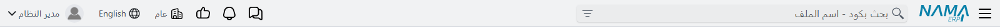
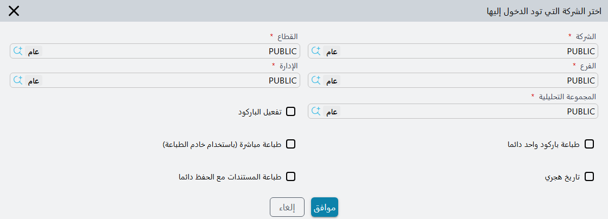
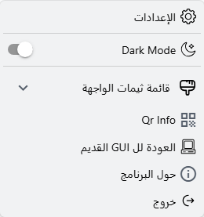

# الشريط العلوي وقائمة المستخدم

الشريط الممتد أعلى كل شاشة هو الجزء الوحيد في نما الذي لا يتغير وأنت تنتقل بين الموديولات. ومعظمه بوابة إلى شيء موثَّق في مكان آخر — خانة البحث، وجرس التنبيهات، وقائمة الموافقات — لكن ثلاثة أشياء لا توجد إلا هنا: **مبدّل المحددات** الذي يغيّر الشركة أو الفرع الذي تعمل عليه، و**مفتاح اللغة**، و**قائمة المستخدم** تحت اسمك، وفيها صفحتك وكلمة السر وتفضيلات العرض الخاصة بك.

## ما الموجود على الشريط

من طرف إلى طرف:

| العنصر | ما يفعله |
|---|---|
| زر القائمة ☰ | يفتح القائمة الجانبية ويغلقها. |
| شعار نما | انقر عليه بالزر الأيمن لتفتح **حول البرنامج** — الإصدارة وتاريخ الإصدار وتفاصيل الترخيص وتاريخ انتهاء عقد الصيانة. |
| خانة البحث | تجد الشاشات والسجلات والحقول من أي مكان، ويقفز إليها **Ctrl + K**. راجع [البحث من الشريط العلوي](/ar/platform/everyday-tools/global-search). |
| شارة الصيانة | لا تظهر إلا حين يقترب عقد الصيانة من نهايته (برتقالية) أو بعد انتهائه (حمراء). راجع [الترخيص، ولماذا تغيب شاشة أو حقل](/ar/getting-started/licensing). |
| أيقونة التقدّم | تظهر ومعها عدد ما دامت إجراءات بدأتها أنت تعمل في الخلفية. انقرها لترى إلى أين وصل كل منها. |
| المساعد الذكي | يظهر حين يكون موديول الذكاء الاصطناعي مرخّصاً ومسموحاً لك باستعماله. راجع [المساعد الذكي داخل النظام](/ar/modules/ai/ai-assistant). |
| المحادثات | تظهر حين يكون مسموحاً لك باستعمال المحادثات الداخلية. راجع [الرسائل المجمعة ورسائل واتساب والمحادثات الداخلية](/ar/platform/notifications/bulk-messages-whatsapp-and-chat). |
| جرس التنويهات | أحدث تنبيهاتك غير المقروءة، والإعلانات العامة أثناء سريانها. **تحديد التنبيهات الظاهرة كمقروء** يمسح الظاهر منها، و**الإطلاع على كل التنبيهات** يفتح القائمة كاملة. راجع [التنبيهات](/ar/platform/notifications/) و[الإعلانات العامة](/ar/platform/notifications/general-announcements). |
| جرس الموافقات | السجلات التي تنتظر موافقتك، ومعها **الإطلاع على كل الموافقات** للقائمة كاملة. راجع [نظام الموافقات](/ar/platform/approvals/approvals-system). |
| مبدّل المحددات | اسم الشركة التي دخلت عليها. انقره لتغيّر الشركة أو الفرع أو الإدارة أو القطاع أو المجموعة التحليلية — راجع ما يلي. |
| مفتاح اللغة | يُكتب عليه **English** في الواجهة العربية و**عربي** في الإنجليزية. |
| اسمك وصورتك | يفتحان قائمة المستخدم — راجع ما يلي. |

وعلى الهاتف لا يتسع الشريط لكل هذا، فتنتقل خانة البحث وشارة الصيانة ومبدّل المحددات ومفتاح اللغة وقائمة المستخدم إلى لوحة تنزلق إلى الأسفل حين تلمس صورتك في طرف الشريط، وتغلقها بلمس ✕.

## تغيير الشركة أو الفرع أو الإدارة

كل سجل تنشئه يُختم بمحددات جلستك — الشركة والقطاع والفرع والإدارة والمجموعة التحليلية التي دخلت عليها — والقوائم التي تفتحها تُفلتر بها. والمستخدم الذي يخدم فرعين لا يحتاج إلى الخروج والدخول من جديد ليتنقل بينهما: فمبدّل المحددات في الشريط العلوي يغيّر الجلسة في مكانها.

1. انقر اسم الشركة في الشريط العلوي (يظهر عليه التلميح **محددات الدخول**).
2. تُفتح نافذة **اختر الشركة التي تود الدخول إليها** وفيها قيمك الحالية: **الشركة** و**القطاع** و**الفرع** و**الإدارة** و**المجموعة التحليلية**.
3. غيّر ما تحتاجه واضغط **موافق**.

وكل ما تفعله بعد **موافق** يستعمل القيم الجديدة: تُختم بها السجلات الجديدة، وتُفلتر بها القوائم وحقول البحث. وحقول البحث داخل هذه النافذة تعرض ما تسمح به محددات **سجل المستخدم** نفسه، ولهذا لا يرى المستخدم المقيَّد بفرع جدة في سجله فرعَ الرياض في القائمة.

وحين يكون **منع تعديل محددات الدخول** مفعّلاً في سجل المستخدم، فيجب أن تكون كل قيمة مذكورة في سجله — في محددات الدخول الأساسية أو في أي سطر من جدول محددات الدخول. ويجوز أن تأتي القيم من سطور مختلفة؛ أما القيمة التي لا تظهر في أي سطر فتُرفض بالرسالة «معلومات الدخول غير صحيحة. فضلاً حاول الدخول مرة أخرى». وطريقة تعريف هذه المجموعات في [الصلاحيات على مستوى السجلات](/ar/platform/security/record-level-security).

وفي النافذة نفسها بعض المفاتيح الشخصية التي تخص الجلسة لا شاشة بعينها:

| المفتاح | ما يغيّره |
|---|---|
| **تفعيل الباركود** | للإدخال بقارئ الباركود. في سطور الأصناف يأخذ كل كود يُقرأ كمية 1 وينتقل المؤشر إلى السطر التالي جاهزاً للقراءة التالية. |
| **طباعة مباشرة (باستخدام خادم الطباعة)** | تذهب الطباعة مباشرة إلى الطابعة عبر خادم الطباعة بدل فتح نافذة الطباعة. |
| **تاريخ هجري** | تُعرض حقول التاريخ بالتاريخ الهجري. |
| **طباعة المستندات مع الحفظ دائما** | يُطبع المستند عند حفظه أول مرة، كما يحدث حين يكون خيار الطباعة مع الحفظ مفعّلاً في دفتره. |

## تغيير اللغة

انقر **English** (أو **عربي** في الواجهة الإنجليزية). تُعاد الصفحة كلها باللغة الأخرى وتعود إلى الشاشة التي كنت عليها. ولأنها إعادة تحميل، احفظ السجل الذي تعدّله أولاً.

## قائمة المستخدم

انقر اسمك أو صورتك لتفتحها.

| العنصر | ما يفعله |
|---|---|
| **الإعدادات** | يفتح إعداداتك الشخصية في نافذة — راجع القسم التالي. والنقر مع Ctrl يفتحها في تبويب جديد بدلاً من ذلك. |
| **Dark Mode** | يبدّل الواجهة بين الفاتح والداكن (اسمه بالإنجليزية في الواجهة العربية أيضاً). |
| **قائمة ثيمات الواجهة** | لاختيار أحد الثيمات، وفي آخرها **تعديل الثيم الخاص بي**. راجع [الثيمات](/ar/platform/everyday-tools/ui-themes). |
| **Qr Info** | يعرض رمز QR لإعداد تطبيقات نما للموبايل على هذا الخادم — عنوان الخادم وكود المستخدم — مع روابط التطبيقات على Google Play وApp Store. ولا يحمل الرمز **رمز الادمن** (Default Admin Pin) من إعدادات التطبيقات إلا إذا عرضه مسؤول (المستخدم `admin` أو مستخدم عليه **Treat As Admin**). أما رمز أي مستخدم آخر فمسحه يترك رمز الادمن على الهاتف كما هو، والهاتف الجديد لا يأخذ رمزاً، فيمسح المسؤول رمزه هو على الهاتف أو يضبط الرمز على الهاتف نفسه. ويظهر اسمه بالإنجليزية في اللغتين. |
| **العودة لل GUI القديم** | يفتح الشاشة التي أنت عليها في الواجهة القديمة، في تبويب جديد. |
| **حول البرنامج** | نافذة «حول البرنامج» نفسها التي يفتحها النقر الأيمن على الشعار. |
| **خروج** | ينهي جلستك. |

### الإعدادات

في نافذة **الإعدادات** خمسة تبويبات على جانبها.

**صفحة المستخدم** تعرض كودك واسمك العربي والإنجليزي، وصورتك فوقها. والزر الصغير على الصورة يرفع صورة جديدة أو يزيلها — وهي الصورة التي تظهر بجوار اسمك في الشريط العلوي. أما الأسماء والكود فيغيّرها مدير النظام في سجل المستخدم.

**تعديل بيانات الاتصال** يغيّر ثلاثة أشياء في سجل المستخدم الخاص بك:

- **إيميل المستخدم** — عنوان بريدك الإلكتروني.
- **باسورد الإيميل** — كلمة سر ذلك البريد. وحين يُملأ الاثنان تخرج المستندات والتقارير التي ترسلها بالبريد من نما من عنوانك أنت بدل حساب الإرسال العام للشركة.
- **الموبايل** — رقم هاتفك المحمول.

**تغيير كلمة المرور** يغيّر كلمة سر الدخول: اكتب كلمة السر التي تستعملها الآن في **كلمة المرور الحالية**، ثم الجديدة في **كلمة المرور** ومرة أخرى في **تأكيد كلمة المرور**، واضغط **حفظ**. وتُرفض كلمة السر الحالية إن كانت خاطئة أو فارغة، فلا تكفي جلسة مفتوحة تُركت دون رقابة للاستيلاء على الحساب. ونافذة تغيير كلمة السر في الواجهة القديمة تطلب كلمة السر الحالية بالطريقة نفسها. ويجب أن تستوفي كلمة السر سياسة كلمات السر في الشركة (راجع [الأمان وتسجيل الدخول](/ar/platform/global-config/global-config-security))، وبعد التغيير الناجح يخرجك النظام لتدخل بها من جديد. ومن يدخل عبر LDAP أو Active Directory يغيّر كلمة سره هناك لا في نما.

**تفضيلات الواجهة** تحمل إعدادات العرض، وهي تسري في هذا المتصفح على هذا الجهاز فقط — فالمستخدم نفسه على كمبيوتر آخر يبدأ من القيم الافتراضية:

- **تفضيلات عامة** — **وضع المسافات** (عادي أو مضغوط أو فائق الضغط)، و**Dark Mode**، و**شريط التنقل والقائمة الجانبية داكنة**، و**إظهار ألوان أيقونات القائمة**.
- **تفضيلات الشاشات** — **Horizontal Mode** (العنوان والحقل في صف واحد)، و**Quad Layout** (أربعة حقول في الصف)، و**عناوين شريط الأدوات** (عناوين تحت أيقونات شريط الأدوات). و**معاينة الشاشة** بجوارها تعرض أثر كل مفتاح على شاشة نموذجية وأنت تغيّره.
- **المؤثرات الصوتية** — صوت، أو لا صوت، للتنبيهات والموافقات ورسائل المحادثة وانتهاء المهام في الخلفية.
- **قائمة ثيمات الواجهة** — بطاقات الثيمات الموصوفة في [الثيمات](/ar/platform/everyday-tools/ui-themes).

**حول البرنامج** يكرر معلومات نافذة «حول البرنامج».

## رسائل قد تظهر لك

| الرسالة | السبب | ما العمل |
|---|---|---|
| «كلمة المرور الحالية غير صحيحة» | خانة **كلمة المرور الحالية** فارغة أو لا تطابق كلمة السر التي دخلت بها. | اكتب كلمة السر التي تستعملها الآن. وإن نسيتها فاطلب من المسؤول تعيين كلمة جديدة من سجل المستخدم الخاص بك. |
| «كلمة المرور الجديدة لا تطابق تأكيد كلمة المرور» | خانتا كلمة السر مختلفتان. | اكتب الكلمة نفسها في الخانتين. |
| «كلمة المرور الجديد مطابقة للحالية. يرجى استعمال كلمة مرور مختلفة.» | الشركة تمنع إعادة استعمال كلمة السر الحالية. | اختر كلمة سر مختلفة. |
| «طول كلمة المرور يجب ان يكون اكبر من او يساوي {0}» | كلمة السر أقصر مما تسمح به السياسة. | استعمل على الأقل عدد الحروف المذكور. |
| «يجب أن تحتوي كلمة المرور علي الأقل علي {0} من الحروف» | حروف أقل من المطلوب. | أضف حروفاً. |
| «يجب ان تحتوي كلمة المرور علي الأقل علي {0} من الحروف الرقمية» | أرقام أقل من المطلوب. | أضف أرقاماً. |
| «يجب أن تحتوي كلمة المرور علي الأقل علي {0} من العلامات أو الحروف الخاصة » | رموز أقل من المطلوب. | أضف رموزاً مثل `@` أو `#`. |
| «يجب أن تحتوي كلمة المرور علي حالة الحروف الكبيرة والصغيرة» | السياسة تشترط حروفاً كبيرة وصغيرة معاً. | امزج الحروف الكبيرة والصغيرة. |
| *Changing password is not supported for LDAP users* (بالإنجليزية فقط) | دخولك يُتحقَّق منه عبر LDAP أو Active Directory. | غيّر كلمة السر في دليل الشركة. |
