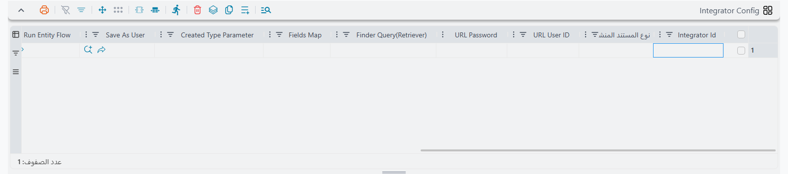

# التكامل مع الأنظمة الخارجية والروابط العامة

كل ما في هذه الشاشة تقريباً يغيّر سلوك نما بالنسبة لمستخدم مسجّل دخوله بالفعل. ثلاثة جداول تفعل شيئاً مختلفاً: تفتح باباً على العالم الخارجي.

اثنان منها يتيحان لنظام خارجي — متجر إلكتروني، شركة شحن، تطبيق موبايل — أن يدفع بيانات إلى نما عبر عنوان ويب مسمّى، دون أن يجلس أحد أمام شاشة. والثالث ينشر مستنداً إلى الخارج، فيتمكن العميل من فتح رابط في رسالة نصية، أو مسح رمز QR مطبوع على الفاتورة، وتنزيل نسخته الخاصة بصيغة PDF دون أي تسجيل دخول إلى نما.

ولأن الثلاثة يمكن الوصول إليها من خارج شبكتك، فإن أعمدة التحقق من الهوية فيها ليست تفصيلاً شكلياً. اقرأ هذه الصفحة بتمعّن قبل أن تملأ أياً منها.

## Integrator Config — إعدادات المتكاملات

متجر إلكتروني يستقبل طلباً في الثانية صباحاً. لن يقوم أحد بإدخاله يدوياً في نما. ما تحتاجه هو عنوان يستطيع برنامج المتجر أن يستدعيه ويمرر إليه بيانات الطلب، فيظهر أمر البيع في نما فوراً — وإذا أعاد المتجر الاستدعاء لأن المحاولة الأولى انقطعت، فأنت تريد تحديث نفس الطلب لا إنشاء نسخة ثانية منه.

هذا العنوان هو ما يعرّفه السطر في هذا الجدول. تعطي المنفذ اسماً، وتحدد نوع السجل الذي ينشئه، وتصف كيف تُسقط القيم الواردة على حقول السجل، ثم تسلّم العنوان الناتج لمن يكتب البرنامج المستدعي.

| العمود | ماذا يفعل |
|---|---|
| Integrator Id | **إلزامي.** اسم المنفذ. يظهر داخل العنوان الذي يستدعيه النظام الخارجي، ولذلك يجب أن يكون فريداً على مستوى النظام كله. |
| Save As User | مستخدم نما الذي يُحفظ السجل باسمه. كل ما يفعله المنفذ يتم بصلاحيات هذا المستخدم. |
| URL User ID | اسم المستخدم الذي يجب أن يرسله المستدعي داخل العنوان. |
| URL Password | كلمة السر التي يجب أن يرسلها المستدعي داخل العنوان. |
| Authenticate From URL User and Pass | المستدعي يرسل بيانات دخول نما حقيقية داخل العنوان بدلاً من استعمال العمودين السابقين. |
| Authenticate From Session | المستدعي مسجّل دخوله بالفعل إلى نما في نفس المتصفح، وتُستعمل تلك الجلسة. |
| Integrator URL | يملؤه النظام. هذا هو العنوان الذي تسلّمه للنظام الخارجي. |
| Response Fields (CSV - write mode) | حقول السجل المحفوظ التي تُعاد إلى المستدعي، مفصولة بفواصل. |
| نوع المستند المنشأ (Created Type) | نوع السجل الذي ينشئه المنفذ — أمر بيع، عميل، صرف مخزني، وهكذا. |
| Created Type Parameter | قيمة إضافية تُمرَّر مع النوع، حين لا يكفي النوع وحده لتحديد ما يُبنى. |
| Finder Query(Retriever) | استعلام يبحث عن سجل قائم يطابق البيانات الواردة. |
| Fields Map | يصف كيف تُسقط القيم الواردة على حقول السجل. |
| Response Template (Tempo) | يصوغ الرد المُعاد إلى المستدعي، ويُكتب بلغة Tempo. |
| إغلاق نافذة المتصفح بعد الانتهاء (Close Browser Window) | للمنافذ التي تُفتح في تبويب متصفح: يغلق التبويب عند انتهاء الاستدعاء. |
| Run Entity Flow | يسلّم البيانات الواردة إلى مسار كيان بدلاً من ملء الحقول مباشرة. |
| Export Integrator | يجعل السطر منفذاً يُصدّر البيانات إلى الخارج بدلاً من استقبالها. |
| Create Only (No-Updates) | يُسمح للمنفذ بإنشاء سجل جديد فقط، ويُمنع من المساس بسجل قائم. |

### العمودان اللذان يحددان هل الاستدعاء مرتين آمن

**Finder Query(Retriever)** هو أهم عمود هنا على الإطلاق. بدونه يكون كل استدعاء سجلاً جديداً: يعيد المتجر المحاولة مرة واحدة فتجد أمري بيع متطابقين. ومعه يبحث المنفذ أولاً عن سجل قائم يطابق البيانات الواردة — نفس رقم طلب المتجر، نفس مرجع العميل — ويحدّث ذلك السجل بدلاً من إنشاء غيره. استعلام بحث مكتوب جيداً هو ما يجعل المنفذ آمناً للاستدعاء مراراً وتكراراً، وهو ما يحدث فعلاً في اللحظة التي تتعثر فيها الشبكة.

**Create Only (No-Updates)** يفرض السلوك المعاكس، وهو اختيار مقصود لا اختصار. عند تأشيره يرفض المنفذ المساس بأي سجل قائم: إما ينشئ شيئاً جديداً أو يفشل. استعمله حيث يجب اعتبار الاستدعاء المكرر خطأً لا تصحيحاً — منفذ يسجل المتحصلات الواردة مثلاً، حيث الكتابة الصامتة فوق متحصل الأمس أسوأ بكثير من رسالة خطأ.

### ملء الحقول، أو تشغيل مسار كيان

**Fields Map** هو الطريقة المعتادة لوصف معنى البيانات الواردة: هذه القيمة من المستدعي تذهب إلى حقل العميل، وتلك إلى الكمية في السطر الأول، وهكذا.

**Run Entity Flow** لحين يكون العمل أكثر من مجرد ملء حقول — حين تحتاج البيانات الواردة إلى بحث أو تحويل أو توزيع على عدة سجلات أو تحقق مقابل شيء آخر أولاً. عندها يسلّم المنفذ البيانات إلى مسار كيان ويترك المسار يؤدي العمل. راجع [مقدمة عن مسارات الكيان](/ar/platform/entity-flows/introduction-to-entity-flows) لمعرفة كيف تُكتب المسارات.

**Response Fields (CSV - write mode)** و**Response Template (Tempo)** يصوغان ما يستلمه المستدعي في المقابل. الأول هو النسخة البسيطة: اكتب حقول السجل المحفوظ التي تريد إعادتها مفصولة بفواصل — عادةً الكود والمعرّف الداخلي، ليخزّن المتجر رقم مستند نما مقابل طلبه الخاص. والثاني هو النسخة الكاملة، ويُكتب بلغة Tempo، لحين يتوقع المستدعي رداً بصيغة معينة.

**إغلاق نافذة المتصفح بعد الانتهاء** لا يعني إلا المنافذ التي يفتحها شخص في تبويب متصفح بدلاً من أن يستدعيها برنامج في الخلفية — رابط في صفحة داخلية يشغّل إجراءً مثلاً. عند انتهاء الاستدعاء يغلق التبويب نفسه بدلاً من ترك صفحة فارغة.

### العنوان الذي يستعمله المستدعي

بعد حفظ السطر يعرض عمود **Integrator URL** العنوان، مبنياً من اسم المنفذ وبيانات الدخول التي أدخلتها. وهذه صيغته:

```
https://<عنوان الخادم لديك>/erp/integrator?integrator=<Integrator Id>&user=<URL User ID>&pass=<URL Password>&authenticate=[true/false]&mode=[read/write]
```

القيمة `mode=read` تطلب بيانات من المنفذ، وما عداها يكتب. والعنوان الذي يبنيه النظام لك قالب باسم خادم موضوع كمثال — استبدله بالعنوان الحقيقي لخادمك قبل تسليمه.

::: warning قواعد تفرضها الشاشة عند الحفظ
**يجب أن يكون Integrator Id فريداً على مستوى النظام كله.** لا داخل هذا الجدول فقط، ولا داخل هذا السجل فقط — الفحص يشمل كل أسطر تكوين المتكاملات وكل أسطر متكاملات الاستيراد في كل السجلات في قاعدة البيانات. وإذا كان الاسم مستعملاً في أي مكان، يُرفض الحفظ.

**اختر أسلوب تحقق واحداً والتزم به.** إما أن تملأ **Save As User** و**URL User ID** و**URL Password** معاً — وعندها تصبح الثلاثة إلزامية — أو تؤشر **Authenticate From URL User and Pass** أو **Authenticate From Session** وتترك الثلاثة فارغة. الخلط بين الأسلوبين مرفوض عند الحفظ.

**يجب أن يكون Fields Map فارغاً عند استعمال Run Entity Flow.** اختر أحدهما: إما أن يملأ المنفذ الحقول من خريطة، وإما أن يسلّم كل شيء إلى مسار كيان. وملء الاثنين معاً مرفوض.
:::



## Import Integrators — متكاملات الاستيراد

هذا هو التوأم ذو الطابع الاستيرادي للجدول السابق. فبدلاً من قيم سجل واحد، يرسل المستدعي **ملفاً** — حمولة JSON أو ورقة إكسل — ويمرره المنفذ على استيراد السجلات المعتاد في نما. مورّد ينشر قائمة أسعار كل ليلة؛ شركة شحن ترسل حالات التسليم اليومية في ملف؛ نظام فرع يرفع دفعة من نتائج الجرد. ولا يفتح أحد شاشة الاستيراد.

الأعمدة الثمانية الأولى هي نفسها في الجدول السابق وتتصرف بنفس الطريقة: اسم المنفذ، وبيانات الدخول، والعنوان المولَّد، والحقول المُعادة. والمضاف هو كل ما تسأل عنه شاشة الاستيراد عادةً.

| العمود | ماذا يفعل |
|---|---|
| Integrator Id | **إلزامي.** اسم المنفذ، فريد على مستوى النظام كله. |
| URL User ID / URL Password | بيانات الدخول التي يرسلها المستدعي داخل العنوان. |
| Save As User | مستخدم نما الذي تُحفظ السجلات المستوردة باسمه. |
| Authenticate From URL User and Pass / Authenticate From Session | أسلوبا التحقق البديلان، كما سبق. |
| Integrator URL | يملؤه النظام — العنوان الذي تسلّمه للنظام الخارجي. |
| Response Fields (CSV - write mode) | حقول كل سجل محفوظ التي تُعاد. وإذا تُرك فارغاً يُعاد الكود والمعرّف الداخلي. |
| نوع الاستيراد (Importing Type) | **إلزامي.** JSON أو إكسل — الصيغة التي سيرسلها المستدعي. |
| إضافة (Add) | يُسمح بإنشاء سجلات جديدة. |
| تحديث (Update) | يُسمح بتحديث السجلات القائمة. |
| تجاهل مراجع السجلات الغير موجودة (Ignore not found references) | المرجع الذي يتعذر إيجاده يُترك فارغاً بدلاً من إفشال السطر كله. |
| المتابعة عند حدوث خطأ (Continue On Errors) | يُتخطى السطر الخاطئ ويستكمل باقي الملف. |
| حذف المسافات الزائدة (Trim Extra Spaces) | تُزال المسافات الزائدة حول القيم الواردة. |
| الحفظ كمسودة (Save As Draft) | تُحفظ النتيجة كمسودة لمراجعتها بدلاً من اعتمادها. |
| استعمال محددات المستخدم اثناء الاستيراد (Use User Dimensions While Importing) | تُطبَّق محددات المستخدم المستورِد على السجلات المستوردة. |

هذه المفاتيح السبعة هي بالضبط الخيارات التي تضعها شاشة الاستيراد أمام الشخص — لكنها هنا مثبَّتة مسبقاً، فلا يحتاج النظام الخارجي إلى إرسالها ولا يستطيع أن يخطئ فيها. وأسرع طريق لفهم ما يفعله كل منها فعلاً هو قراءة توثيق الاستيراد أولاً ثم العودة إلى هنا: [استيراد السجلات](/ar/platform/import-export/importing-records) يغطي الأساسيات، و[الاستيراد المتقدم للسجلات](/ar/platform/import-export/advanced-record-import) يغطي الحالات الأصعب مثل المراجع غير الموجودة والفشل الجزئي.

اثنان منها يستحقان لحظة تفكير قبل التأشير. **المتابعة عند حدوث خطأ** يحدد هل يُفسد سطر واحد خاطئ ملفاً من ألفي سطر أم يُبلَّغ عنه ويُتخطى؛ ففي قائمة أسعار ليلية يكون التخطي هو الصواب غالباً، أما في دفعة من المستندات المالية فالتوقف الكامل أأمن. و**الحفظ كمسودة** يحوّل المنفذ إلى اقتراح لا قرار — تصل السجلات إلى نما لكنها تنتظر إنساناً قبل أن يُعتد بها. وهو الإعداد الذي تلجأ إليه ما دمت في طور بناء الثقة بتكامل جديد.

::: tip متكامل يبدو صحيحاً لكن النظام لا يجده
لا يُلتقط السطر إلا إذا كان عمود **غير نشط** يحمل قيمة صريحة تعني «لا». والسطر الذي أُنشئ قبل أن تبدأ هذه الشاشة بتتبع هذا العمود قد لا يحمل فيه شيئاً أصلاً، فيُبلِّغ المنفذ بأن لا متكامل مطابقاً — بينما السطر أمامك على الشاشة يبدو صحيحاً تماماً.

والعلاج يستغرق ثوانٍ: افتح السجل واحفظه مرة واحدة فيُملأ العمود. فإذا بدا تكوين ما صحيحاً ولم يُعثر عليه، أعد حفظ السجل قبل أن تبحث في أي شيء آخر.
:::

## Invoice Retriever Lines — سطور استرجاع الفواتير

عميل يريد فاتورته. ليس لديه حساب في نما ولن يكون. يمكنك أن ترسل له ملف PDF بالبريد، لكن عندها يجب أن يولّده أحد ويرفقه، وإذا صُححت الفاتورة بعد ذلك فإن النسخة في بريد العميل تصبح خاطئة في صمت.

هذا الجدول يحوّل نموذج طباعة إلى عنوان ويب عام. ضع ذلك العنوان في رسالة نصية أو بريد إلكتروني أو خلف رمز QR على الفاتورة المطبوعة، فيفتح العميل مستنده الخاص بصيغة PDF لحظة اتباعه — بلا تسجيل دخول ولا مرفقات ولا وسيط.

| العمود | ماذا يفعل |
|---|---|
| طباعة بنموذج الطباعة المعرف بالنظام (Print Using System Defined Printing Form) | طباعة كل مستند بالنموذج الذي يختاره النظام له عند طباعته من شاشته، بدلاً من نموذج واحد ثابت. واترك **تعريف التقرير** فارغاً عند تفعيله. |
| تعريف التقرير (Report Definition) | نموذج الطباعة الذي يُشغَّل عند فتح الرابط. إلزامي إلا إذا كان السطر يطبع بنموذج الطباعة المعرف بالنظام، ويجب أن يبقى فارغاً في تلك الحالة. |
| Save Files In Folder | **إلزامي.** المجلد على الخادم الذي تُحفظ فيه الملفات المولَّدة. |
| URL Prefix | كلمة داخل العنوان تختار هذا السطر، ليتمكن نظام واحد من نشر أنواع متعددة من المستندات. |
| الصيغة (Output Format) | PDF أو DOCX أو ODS أو ODT أو XLSX. وPDF هو الاختيار المعقول لأي شيء يفتحه عميل. |
| Do Not Cache | إعادة توليد الملف عند كل زيارة بدلاً من تقديم النسخة المخزنة. |
| النوع (Entity Type) | يقصر سطر نموذج النظام على مستندات هذا النوع. ويجب أن يبقى فارغاً في السطر الذي له تعريف تقرير. |
| قائمة الأنواع (Entity Type List) | يقصر سطر نموذج النظام على المستندات التي يقع نوعها في هذه القائمة. ويجب أن يبقى فارغاً في السطر الذي له تعريف تقرير. املأ أحدهما أو كليهما أو لا شيء: فمع الاثنين يُقبل المستند الذي يطابق أيهما، ومع تركهما فارغين يخدم السطر كل الأنواع. |

### الطباعة بنموذج الطباعة المعرف بالنظام

بدون هذا الخيار يحتاج كل نوع مستند تنشره إلى تعريف تقرير خاص به وسطر خاص به، مع أن النموذج نفسه يطبع ذلك المستند من شاشته أصلاً. فعّل **طباعة بنموذج الطباعة المعرف بالنظام** فيخدمها سطر واحد كلها: عند فتح الرابط يحمّل النظام المستند ويختار نموذجه تماماً كما يفعل زر الطباعة — حسب نوع الكيان والدفتر والتوجيه وتصنيف المستند والمحددات ومعايير النموذج — ثم يطبعه بصيغة السطر.

ويأتي اختلافان عن الطباعة من الشاشة من أن الرابط لا يحمل مستخدماً مسجّل الدخول:

- النموذج المقصور على مستخدم أو مجموعة مستخدمين أو ملف صلاحيات لا يُختار أبداً، وكذلك النموذج المقصور على قائمة. فيحصل المستند على نموذجه العام.
- المستندات المسودة تخضع لقواعد طباعة المسودات نفسها التي يخضع لها زر الطباعة. فحيث لا يُسمح بطباعة المسودات يرفضها الرابط حتى يُعتمد المستند.

وإن لم يطابق المستندَ أيُّ نموذج، يجيب الرابط برسالة خطأ بدلاً من الملف.

### قصر السطر على أنواع كيانات معينة

يمنع **النوع** و**قائمة الأنواع** سطرَ نموذج النظام من خدمة مستندات لم يُقصد لها. ولا يُسمح بهما إلا في هذا النوع من الأسطر: فالسطر الذي له تعريف تقرير لا يخدم أصلاً إلا المستندات التي صُمم نموذجه لها.

والسطر يُختار ببادئته ثم بنوع المستند: إن لم يقبل أول سطر تطابق بادئته نوعَ المستند، جُرّب السطر المطابق التالي. ولذلك يمكن أن يشترك سطران في بادئة واحدة — سطر نموذج النظام مقصور على الأنواع التي تنشرها، يليه سطر يشغّل نموذجاً ثابتاً لكل ما يصل غيرها على ذلك العنوان.

املأ أحد هذين العمودين دائماً في سطر نموذج النظام. فبدونهما سيطبع أي مستند وُلّد رابطه يوماً — ومنها مستندات الرواتب وشؤون الموظفين.

### التخزين المؤقت، ومتى تُعطّله

في المرة الأولى التي يفتح فيها أحد الرابط، يُشغَّل النموذج وتُخزَّن النتيجة في المجلد الذي حددته. وكل زيارة لاحقة تُقدَّم من ذلك الملف المخزَّن، ولذلك يظل الرابط سريعاً حتى لو كان التقرير ثقيلاً. لكن هذا يعني أيضاً أن المستند مجمَّد: فإذا صُححت الفاتورة الأسبوع القادم، يظل العميل يرى النسخة المولَّدة عند النقرة الأولى. (وحذف الملف من المجلد يدوياً يجبر النظام على إعادة توليده.)

**Do Not Cache** يزيل هذا التجميد. يُشغَّل النموذج عند كل طلب، فيرى العميل دائماً الحالة الراهنة للمستند. وهو أبطأ ويحمّل الخادم عملاً حقيقياً في كل مرة يُفتح فيها الرابط — وهي المقايضة الصحيحة لمستند ما زال قابلاً للتغير مثل كشف حساب جارٍ، والخاطئة لفاتورة نهائية قد يفتحها آلاف العملاء.

### العنوان العام

العنوان هو خادمك، ثم `/r/`، ثم معرّف يشير إلى مستند بعينه. وكل سجل في نما يستطيع إنتاج ذلك المعرّف عند الطلب، وتدرجه أنت في الرابط عبر المتغير `{retrieverFileId}` عند كتابة تنبيه. وأبسط صورة له:

```
https://<عنوان الخادم لديك>/erp/r/{retrieverFileId}
```

وإضافة امتداد للملف تجعل المتصفحات تتعامل مع التنزيل بصورة أفضل، ويمكن أن يرافق المعرّفَ كودُ المستند نفسه بعد نقطة إن أردت ظهوره في العنوان — فكل ما يلي أول نقطة يُهمَل عند تحليل الرابط:

```
https://<عنوان الخادم لديك>/erp/r/{retrieverFileId}.pdf
https://<عنوان الخادم لديك>/erp/r/{retrieverFileId}.{code}.pdf
```

ولا بد أن يأتي الكود **بعد نقطة لا بعد شرطة مائلة**: فالخادم يقرأ آخر مقطع في المسار على أنه المعرّف، ولذلك تجعله الصورة `…/{retrieverFileId}/{code}.pdf` يقرأ كود المستند بدلاً من المعرّف فلا يُفتح الرابط أبداً. والملف المحفوظ يحمل كود المستند في الحالتين.

وإذا كان للسطر **URL Prefix** — وليكن `invoices` — تسبق تلك الكلمة المعرّف:

```
https://<عنوان الخادم لديك>/erp/r/invoices/{retrieverFileId}
```

هذه البادئة هي ما يتيح لنظام واحد نشر أكثر من نوع من المستندات: سطر ببادئة `invoices` يشغّل نموذج الفاتورة، وآخر ببادئة `receipts` يشغّل نموذج الإيصال، ولكلٍّ عنوانه. ويصل الرابط إلى العميل في تنبيه عادي — رسالة نصية أو بريد إلكتروني يحمل نصه المتغير `{retrieverFileId}`، مثلًا:

```
Thanks for visiting us, view your invoice by clicking on this link:
https://<your server>/erp/r/{retrieverFileId}
```

ويشرح [نظام التنبيهات في نما](/ar/platform/notifications/notifications-system) كيف يُعدّ هذا التنبيه.

::: warning ترتيب الأسطر مهم، والبادئة الفارغة تبتلع كل شيء
تُطابَق الأسطر **بالترتيب الذي تظهر به في الجدول**، ويفوز أول سطر تطابق بادئته العنوان الوارد. والسطر ذو **URL Prefix** الفارغ يطابق كل عنوان بلا استثناء.

لذلك إن استعملت واحداً كهذا فضعه **في آخر الجدول**. فالسطر بلا بادئة إن جلس فوق سطري `invoices` و`receipts` سيجيب عن كل طلب كان موجهاً إليهما، وسيستلم كل عميل نفس نوع المستند مهما كان الرابط الذي اتبعه.
:::

والنماذج التي تشغّلها هذه الأسطر نماذج طباعة عادية، تُصمَّم وتُصان في مكانها المعتاد — راجع [دليل Jasper Reports الشامل](/ar/platform/reports/reports-guide) — أما إعدادات الطباعة والإخراج العامة على مستوى الخادم فتجدها في [التقارير والطباعة](/ar/platform/global-config/global-config-reports).

## ملاحظة أمنية

كل جدول آخر في هذه الشاشة يعدّل ما يراه مستخدم مسجّل دخوله. أما هذه الثلاثة فتنشئ مسارات دخول وخروج تتجاوز شاشة الدخول تماماً، وهو ما يغيّر ثمن الخطأ.

الحساب المذكور في **Save As User** هو الذي يؤدي العمل فعلاً — هو الذي ينشئ أوامر البيع، وهو الذي يعتمد السجلات المستوردة. فإن كان هذا الحساب حساب مدير نظام، فإن كل من يعرف اسم المستخدم وكلمة السر الخاصين بالمنفذ يستطيع أن يفعل كل ما يفعله مدير النظام. امنح حسابات التكامل ملف حماية يسمح بالسجلات التي يمسّها التكامل فقط ولا شيء غيرها، واستعمل حساباً مختلفاً لكل تكامل حتى لا تفتح كلمة سر واحدة مسربة كل الأبواب.

والمنطق نفسه ينطبق على روابط الفواتير. فهي عامة عن قصد: كل من يملك العنوان يستطيع تنزيل ذلك المستند دون تسجيل دخول. وهذا هو المقصود من الميزة، وهو مقبول لفاتورة العميل نفسه — لكن من الجدير تذكّره عند اختيار النماذج التي تنشرها، لأن العنوان هو الشيء الوحيد الفاصل بين المستند وبين كل من يحيل إليه العميل رسالته. والسطر الذي يطبع بنموذج الطباعة المعرف بالنظام ينشر كل نوع يقبله، فحدد له **النوع** أو **قائمة الأنواع**.

صفحة [نظرة عامة على نظام الصلاحيات](/ar/platform/security/security-overview) تشرح كيف تُبنى الصلاحيات، وصفحة [ملف الصلاحيات](/ar/platform/security/security-profiles) هي المكان الذي يُبنى فيه الحساب المقيَّد فعلياً.

الجداول الثلاثة يطبقها الخادم، فتسري التغييرات بمجرد حفظ السجل — دون إعادة تشغيل ودون أي زر يُضغط.

## الإعدادات في هذه الصفحة

كل جدول وعمود تغطيه هذه الصفحة باسمه الظاهر على الشاشة باللغتين، لتجد الإعداد بالاسم الذي تراه. ويشير العمود الأخير إلى القسم الذي يشرحه. أما أعمدة النطاق (للنوع، قائمة الأنواع، الحقل وما يشبهها) فهي واحدة في كل الجداول ومدرجة في [صفحة النظرة العامة](/ar/platform/fields-and-entities-settings/fields-settings-overview).

| الاسم العربي | الاسم الإنجليزي | معرّف الحقل | المعنى |
|---|---|---|---|
| Integrator Config | Integrator Config | `integratorConfig` | [Integrator Config](#Integrator-Config----aaddt-lmtkmlt) |
| Integrator Id | Integrator Id | `integratorConfig.integratorId` | [Integrator Config](#Integrator-Config----aaddt-lmtkmlt) |
| نوع المستند المنشأ | Created Type | `integratorConfig.createdType` | [Integrator Config](#Integrator-Config----aaddt-lmtkmlt) |
| URL User ID | URL User ID | `integratorConfig.urlUserId` | [Integrator Config](#Integrator-Config----aaddt-lmtkmlt) |
| URL Password | URL Password | `integratorConfig.urlPassword` | [Integrator Config](#Integrator-Config----aaddt-lmtkmlt) |
| Finder Query(Retriever) | Finder Query(Retriever) | `integratorConfig.finderQuery` | [Integrator Config](#Integrator-Config----aaddt-lmtkmlt) |
| Fields Map | Fields Map | `integratorConfig.fieldsMap` | [Integrator Config](#Integrator-Config----aaddt-lmtkmlt) |
| Created Type Parameter | Created Type Parameter | `integratorConfig.createdTypeParam` | [Integrator Config](#Integrator-Config----aaddt-lmtkmlt) |
| Save As User | Save As User | `integratorConfig.saveAsUser` | [Integrator Config](#Integrator-Config----aaddt-lmtkmlt) |
| Run Entity Flow | Run Entity Flow | `integratorConfig.runEntityFlow` | [Integrator Config](#Integrator-Config----aaddt-lmtkmlt) |
| Export Integrator | Export Integrator | `integratorConfig.exportIntegrator` | [Integrator Config](#Integrator-Config----aaddt-lmtkmlt) |
| Create Only (No-Updates) | Create Only (No-Updates) | `integratorConfig.createOnly` | [Integrator Config](#Integrator-Config----aaddt-lmtkmlt) |
| Authenticate From URL User and Pass | Authenticate From URL User and Pass | `integratorConfig.authenticateFromURL` | [Integrator Config](#Integrator-Config----aaddt-lmtkmlt) |
| Authenticate From Session | Authenticate From Session | `integratorConfig.authenticateFromSession` | [Integrator Config](#Integrator-Config----aaddt-lmtkmlt) |
| Integrator URL | Integrator URL | `integratorConfig.integratorUrl` | [Integrator Config](#Integrator-Config----aaddt-lmtkmlt) |
| Response Fields (CSV - write mode) | Response Fields (CSV - write mode) | `integratorConfig.responseFields` | [Integrator Config](#Integrator-Config----aaddt-lmtkmlt) |
| Response Template (Tempo) | Response Template (Tempo) | `integratorConfig.responseTemplate` | [Integrator Config](#Integrator-Config----aaddt-lmtkmlt) |
| Import Integrators | Import Integrators | `importIntegratorLines` | [Import Integrators](#Import-Integrators----mtkmlt-lstyrd) |
| Integrator Id | Integrator Id | `importIntegratorLines.integratorId` | [Import Integrators](#Import-Integrators----mtkmlt-lstyrd) |
| URL User ID | URL User ID | `importIntegratorLines.urlUserId` | [Import Integrators](#Import-Integrators----mtkmlt-lstyrd) |
| URL Password | URL Password | `importIntegratorLines.urlPassword` | [Import Integrators](#Import-Integrators----mtkmlt-lstyrd) |
| Save As User | Save As User | `importIntegratorLines.saveAsUser` | [Import Integrators](#Import-Integrators----mtkmlt-lstyrd) |
| Authenticate From URL User and Pass | Authenticate From URL User and Pass | `importIntegratorLines.authenticateFromURL` | [Import Integrators](#Import-Integrators----mtkmlt-lstyrd) |
| Authenticate From Session | Authenticate From Session | `importIntegratorLines.authenticateFromSession` | [Import Integrators](#Import-Integrators----mtkmlt-lstyrd) |
| نوع الاستيراد | Importing Type | `importIntegratorLines.importingType` | [Import Integrators](#Import-Integrators----mtkmlt-lstyrd) |
| إضافة | Add | `importIntegratorLines.addRecord` | [Import Integrators](#Import-Integrators----mtkmlt-lstyrd) |
| تحديث | Update | `importIntegratorLines.updateRecord` | [Import Integrators](#Import-Integrators----mtkmlt-lstyrd) |
| تجاهل مراجع السجلات الغير موجودة | Ignore not found references | `importIntegratorLines.ignoreUnfoundRefs` | [Import Integrators](#Import-Integrators----mtkmlt-lstyrd) |
| المتابعة عند حدوث خطأ | Continue On Errors | `importIntegratorLines.continueOnErrors` | [Import Integrators](#Import-Integrators----mtkmlt-lstyrd) |
| حذف المسافات الزائدة | Trim Extra Spaces | `importIntegratorLines.trimExtraSpaces` | [Import Integrators](#Import-Integrators----mtkmlt-lstyrd) |
| الحفظ كمسودة | Save As Draft | `importIntegratorLines.saveAsDraft` | [Import Integrators](#Import-Integrators----mtkmlt-lstyrd) |
| استعمال محددات المستخدم اثناء الاستيراد | Use User Dimensions While Importing | `importIntegratorLines.useUserDimensions` | [Import Integrators](#Import-Integrators----mtkmlt-lstyrd) |
| Integrator URL | Integrator URL | `importIntegratorLines.integratorUrl` | [Import Integrators](#Import-Integrators----mtkmlt-lstyrd) |
| Response Fields (CSV - write mode) | Response Fields (CSV - write mode) | `importIntegratorLines.responseFields` | [Import Integrators](#Import-Integrators----mtkmlt-lstyrd) |
| Invoice Retriever Lines | Invoice Retriever Lines | `invoiceRetrieverLines` | [Invoice Retriever Lines](#Invoice-Retriever-Lines----sTwr-strjaa-lfwtyr) |
| طباعة بنموذج الطباعة المعرف بالنظام | Print Using System Defined Printing Form | `invoiceRetrieverLines.printUsingSystemForm` | [Invoice Retriever Lines](#Invoice-Retriever-Lines----sTwr-strjaa-lfwtyr) |
| تعريف التقرير | Report Definition | `invoiceRetrieverLines.reportDefinition` | [Invoice Retriever Lines](#Invoice-Retriever-Lines----sTwr-strjaa-lfwtyr) |
| النوع | Entity Type | `invoiceRetrieverLines.entityType` | [Invoice Retriever Lines](#Invoice-Retriever-Lines----sTwr-strjaa-lfwtyr) |
| قائمة الأنواع | Entity Type List | `invoiceRetrieverLines.entityTypeList` | [Invoice Retriever Lines](#Invoice-Retriever-Lines----sTwr-strjaa-lfwtyr) |
| الصيغة | Output Format | `invoiceRetrieverLines.outputFormat` | [Invoice Retriever Lines](#Invoice-Retriever-Lines----sTwr-strjaa-lfwtyr) |
| Save Files In Folder | Save Files In Folder | `invoiceRetrieverLines.saveFilesInFolder` | [Invoice Retriever Lines](#Invoice-Retriever-Lines----sTwr-strjaa-lfwtyr) |
| URL Prefix | URL Prefix | `invoiceRetrieverLines.urlPrefix` | [Invoice Retriever Lines](#Invoice-Retriever-Lines----sTwr-strjaa-lfwtyr) |
| Do Not Cache | Do Not Cache | `invoiceRetrieverLines.doNotCache` | [Invoice Retriever Lines](#Invoice-Retriever-Lines----sTwr-strjaa-lfwtyr) |

## صفحات ذات صلة

- [أعدادات الحقول و الشاشات — كيف تعمل](/ar/platform/fields-and-entities-settings/fields-settings-overview) — الشاشة التي تعيش فيها هذه الجداول، وكيف تُطابَق أسطرها.
- [استيراد السجلات](/ar/platform/import-export/importing-records) — الاستيراد التفاعلي الذي يثبّت جدول متكاملات الاستيراد خياراته مسبقاً.
- [الاستيراد المتقدم للسجلات](/ar/platform/import-export/advanced-record-import) — المراجع غير الموجودة والفشل الجزئي وحالات الاستيراد الأصعب.
- [تصدير السجلات](/ar/platform/import-export/exporting-records) — الاتجاه الآخر، وصيغ الملفات التي سيُرسَل بها المتكامل.
- [مقدمة عن مسارات الكيان](/ar/platform/entity-flows/introduction-to-entity-flows) — للمنافذ التي تشغّل مسار كيان بدلاً من ملء الحقول.
- [استيراد البيانات من إكسل أو الاستعلامات](/ar/platform/entity-flows/excel-and-sql-import-by-entity-flow) — البديل المجدول على الخادم حين لا يحتاج أي طرف خارجي إلى الاستدعاء.
- [نظام التنبيهات في نما](/ar/platform/notifications/notifications-system) — كيف تُرسَل الرسالة التي تحمل ذلك الرابط.
- [دليل Jasper Reports الشامل](/ar/platform/reports/reports-guide) — تصميم النموذج الذي يشغّله سطر استرجاع الفواتير.
- [نظرة عامة على نظام الصلاحيات](/ar/platform/security/security-overview) — ما يجب وما لا يجب السماح به لحساب التكامل.
