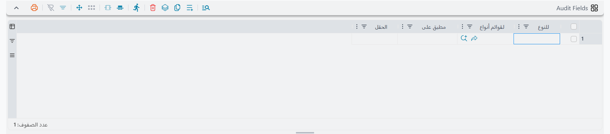

# سلوك السجلات وكتل الشاشة

معظم شاشة **أعدادات الحقول و الشاشات** يدور حول حقل واحد بعينه: كيف يُرسم، وما الذي يُسمح بكتابته فيه، ومن أين تأتي قائمة اختياراته. أما الجداول الخمسة في هذه الصفحة فتتراجع خطوة إلى الوراء وتتعامل مع السجل كله. فهي تقرر ما الذي يبقى حين تُؤخذ من السجل **نسخة مماثلة**، وما الذي يُتابَع بالتفصيل حين يُعدَّل، وأي اللوحات الإضافية تظهر على شاشته، ومن الذي يصلح أن يكون مستلماً حين يُرسَل بالبريد الإلكتروني.

وكل جدول أدناه يبدأ بأعمدة النطاق نفسها — **للنوع** و**قائمة الأنواع** / **لقوائم أنواع** و**مطبق على** — وهي التي تحدد *أي* الشاشات يصلها السطر، وشرحها كاملاً في [صفحة النظرة العامة](/ar/platform/fields-and-entities-settings/fields-settings-overview). والجداول هنا تعيدها باختصار ثم تركّز على ما ينفرد به كل جدول.

## Clear On Duplicate

حين يأخذ المستخدم من سجل نسخة مماثلة، يُنسخ كل شيء. وهذا بالضبط ما يريده في العميل والسطور والتوجيه والمحددات، بل هو الغرض كله من النسخ. لكنه بالضبط ما لا يريده في رقم المستند نفسه، ولا في مرجعه الخارجي، ولا في حالة اعتماده، ولا في تاريخ التسليم — فيضطر عندئذ إلى البحث عن كل قيمة من هذه القيم ومسحها بيده قبل أن يحفظ النسخة. وتفوته واحدة، فإذا مستندان يدّعيان المرجع نفسه لدى المورد.

وجدول **Clear On Duplicate** يعدّد الحقول التي تُمسح في النسخة، حتى يبدأ المستخدم من سجل جديد حقاً لا من سجل قديم يكاد يكون صحيحاً.

خذ فاتورة خدمات متكررة تُحرَّر للعميل نفسه كل شهر. يفتح المستخدم فاتورة الشهر الماضي ويضغط **نسخة مماثلة**. وهو يريد أن ينتقل العميل وسطور الخدمة والأسعار كما هي دون مساس، لكن المرجع الخارجي لدى المورد وتاريخ التسليم يخصّان الشهر الماضي ولا يصح انتقالهما. ويكفي لذلك سطران بالنوع = فاتورة مبيعات، أحدهما على حقل المرجع الخارجي والآخر على تاريخ التسليم: فتأتي النسخة وهذان الحقلان فارغان وكل ما عداهما مملوء سلفاً.

| العمود | ماذا يفعل |
|---|---|
| للنوع (For Type) | نوع الكيان الواحد الذي ينطبق عليه السطر، فاتورة المبيعات مثلاً. |
| قائمة الأنواع (Entity List) | قائمة مسماة من أنواع الكيانات، فيغطي السطر الواحد عدة أنواع. |
| مطبق على (Applicable For) | فئة عريضة بدل تسمية نوع بعينه: `AllScreens` أو `Documents` أو `MasterFiles`. |
| الحقل (On Field) | معرّف الحقل المراد مسحه في النسخة، مثل `remarks` أو `details.deliveryDate`. |

::: warning السطر لا بد له من نطاق
خلافاً لأغلب جداول هذه الشاشة، لا يجوز ترك سطر Clear On Duplicate مفتوحاً تماماً. فلا بد أن يُملأ واحد على الأقل من **للنوع** أو **قائمة الأنواع** أو **مطبق على**، والشاشة ترفض حفظ سطر تُركت فيه الخانات الثلاث فارغة. فإن كنت تريد فعلاً مسح الحقل في كل مكان، فاستعمل **مطبق على** = `AllScreens` بدل ترك الخانات الثلاث خالية.

ولا يجتمع **مطبق على** مع الخانتين الأخريين: فإما أن تملأ **مطبق على** وحده، وإما **للنوع** و/أو **قائمة الأنواع**. والسطر الذي يجمعهما يُرفض بالرسالة:

«لا يمكنك ملء الحقل {0}، {1} و{2} معاً، إما أن تملأ {0} فقط أو {1} و{2}»

والقاعدة نفسها تسري على جداول Audit Fields و**إضافة النقاش إلى** و**إضافة المستندات المرتبطة إلى** أدناه.
:::

والمسح يجريه الخادم لحظة إنشاء النسخة، فالتغيير هنا يسري بمجرد حفظ السجل. فلا شيء يُحدَّث ولا جلسة تُعاد.

::: tip المستندات المتكررة
إن كان المستخدمون يأخذون نسخة مماثلة من المستند نفسه شهراً بعد شهر، فيحسن أن تقرأ أيضاً [المستندات المتكررة](/ar/platform/automation-and-rules/recurring-documents) — فالمستند الذي يُولَّد وفق جدول زمني قد يكون أنسب لهم من نسخة تُصنع باليد، والميزتان تعملان جنباً إلى جنب بلا مشكلة.
:::

## Audit Fields

يحتفظ نظام نما أصلاً بتاريخ إصدارات لكل سجل، فتستطيع دائماً أن ترى أن **شيئاً ما** قد تغيّر ومن الذي حفظه. وهذا يكفي في معظم الحقول ولا يكفي البتة في الحقول التي تحمل مالاً. فحين ينتقل حد ائتمان عميل من 50,000 إلى 250,000، لا تكون عبارة «عُدِّل السجل يوم الثلاثاء» جواباً — إنما تحتاج إلى القيمة القديمة والقيمة الجديدة والمستخدم والوقت، متجاورة.

وجدول **Audit Fields** يشغّل هذه المتابعة التفصيلية لحقول تسميها بعينها. فمتى أُدرج حقل هنا، كُتب كل تغيير يقع عليه في سجل المتابعة التفصيلي الخاص بالسجل، والذي يُفتح من السجل نفسه، مبيّناً ما كانت عليه القيمة وما صارت إليه ومن غيّرها ومتى. استعمله في الحقول القليلة ذات الأثر التجاري: حد الائتمان، وسعر البيع، ونسبة الخصم، وشرط السداد، وعلامة إيقاف التعامل مع العميل.

وأبقِ القائمة قصيرة. فالمتابعة التفصيلية ليست مجانية، ومئة حقل متابَع في مستند كثير الحركة تنتج سجلاً لن يقرأه أحد أبداً.

| العمود | ماذا يفعل |
|---|---|
| لقوائم أنواع (For Type List) | قائمة مسماة من أنواع الكيانات، فيغطي السطر الواحد عدة أنواع. |
| للنوع (For Type) | نوع الكيان الواحد الذي ينطبق عليه السطر، العميل مثلاً. |
| الحقل (On Field) | معرّف الحقل المراد متابعته تفصيلياً، مثل `creditLimit` أو `details.price`. |

::: tip سمِّ النوع في عمود النوع
في هذا الجدول بالذات، سمِّ نوع الكيان في **للنوع**، أو اسرد الأنواع في **لقوائم أنواع**.
:::

وهذا الجدول يطبّقه الخادم، فيسري لحظة الحفظ. فأول تعديل يقع بعد ذلك على حقل متابَع يُسجَّل تفصيلياً، أما التعديلات التي وقعت قبل إضافة السطر فلا، لأن التفصيل لم يكن يُلتقط وقتها أصلاً.

::: info أين تظهر فائدة سجل المتابعة
تتزاوج المتابعة التفصيلية طبيعياً مع الموضعين الآخرين اللذين يحسم فيهما سؤال «من غيّر ماذا» الخلاف: [المراجعة وإلغاء المراجعة](/ar/platform/governance/revise-and-unrevise)، حيث يُسحب مستند مُعالَج ويُعدَّل، و[نظام الاعتمادات](/ar/platform/approvals/approvals-system)، حيث قد تتغير قيمة بعد أن يكون أحدهم قد اعتمدها بالفعل.
:::

## إضافة النقاش إلى (Add Discussion To)

الأسئلة عن المستند تُطرح عادةً في البريد الإلكتروني، أو في مجموعة محادثة، أو بالمشي إلى مكتب أحدهم — ولا شيء من ذلك يترك أثراً على المستند. وبعد ستة أشهر لا يستطيع أحد أن يقول لماذا مُنح ذلك الخصم. ولوحة النقاش تعالج هذا بتعليق محادثة متسلسلة على السجل نفسه، فيسكن السؤال والجواب حيث يسكن المستند.

وبعض الشاشات تحمل هذه اللوحة أصلاً، وجدول **إضافة النقاش إلى** يضيفها إلى الشاشات التي لا تحملها: أمر شراء، أو أمر تشغيل، أو ملف عميل، أو ما يكثر جدال مستخدميك حوله.

والسطر يسمّي نوع الكيان، والصفحة (التبويب) التي تُضاف إليها اللوحة، وموضعها في تلك الصفحة. فمثلاً: النوع = أمر شراء، إضافة إلى صفحة = تبويب الملاحظات في الشاشة، وإضافة في متروكة فارغة — فتستقر المحادثة أسفل التبويب الذي يفتحه مستخدموك بالفعل حين يريدون خلفية المستند. والتبويب الذي فيه لوحة نقاش أصلاً لا تُضاف إليه لوحة ثانية.

| العمود | ماذا يفعل |
|---|---|
| لقوائم أنواع (For Type List) | قائمة مسماة من أنواع الكيانات، فيغطي السطر الواحد عدة أنواع. |
| للنوع (For Type) | نوع الكيان الواحد الذي ينطبق عليه السطر، أمر الشراء مثلاً. |
| مطبق على (Applicable For) | فئة عريضة: `AllScreens` أو `Documents` أو `MasterFiles`. |
| إضافة إلى صفحة (Add To Page) | اسم التبويب الذي تُضاف إليه اللوحة. والشاشة التي ليس فيها تبويب بهذا الاسم تأخذ اللوحة في تبويبها الأول. وشاشة الجوال وشاشة الإنشاء السريع تأخذان اللوحة أيضاً بالقاعدة نفسها. |
| إضافة في (Insert At) | موضع اللوحة بين كتل ذلك التبويب: `1` يجعلها الأولى، و`2` الثانية، وهكذا. وإن تُرك فارغاً أو كان أكبر من عدد كتل التبويب، وُضعت اللوحة في آخره. |

والسطر الذي تُركت فيه **للنوع** و**لقوائم أنواع** و**مطبق على** كلها فارغة ينطبق على كل شاشات التحرير.

::: tip سمِّ الصفحة دائماً
ترك **إضافة إلى صفحة** فارغاً لا يعني «التبويب الافتراضي»، بل يعني **كل** تبويبات الشاشة، بما فيها شاشة الجوال وشاشة الإنشاء السريع. ولوحة نقاش مكررة على ثمانية تبويبات ليست ما قصده أحد. فحدّد اسم صفحة ما لم تكن تريد اللوحة في كل مكان فعلاً.
:::

## إضافة المستندات المرتبطة إلى (Add Related Documents To)

لوحة المستندات المرتبطة تجيب عن السؤال المتكرر الآخر: ماذا خرج من هذا السجل؟ فهي قائمة قابلة للطي عنوانها **المستندات المرتبطة**، تعرض كل سجل حقله **بناءً على** هو السجل المعروض — ففي أمر البيع تظهر الفواتير التي صُنعت منه، وفي الفاتورة يظهر المرتجع الذي صُنع منها — فيتنقل المستخدم في السلسلة نزولاً دون أن يعود إلى القائمة ويبحث من جديد.

وجدول **إضافة المستندات المرتبطة إلى** يعمل تماماً كجدول النقاش: أعمدة النطاق نفسها، وعمودا **إضافة إلى صفحة** و**إضافة في** نفسهما، والمزلق نفسه إن تركت اسم الصفحة فارغاً. والتبويب الذي فيه القائمة أصلاً لا تُضاف إليه قائمة ثانية. وضع اللوحة في التبويب الذي يبحث فيه المستخدمون عن السياق، وهو عادةً التبويب الأول من المستند، فتظهر السلسلة بمجرد فتح السجل.

| العمود | ماذا يفعل |
|---|---|
| لقوائم أنواع (For Type List) | قائمة مسماة من أنواع الكيانات، فيغطي السطر الواحد عدة أنواع. |
| للنوع (For Type) | نوع الكيان الواحد الذي ينطبق عليه السطر، فاتورة المبيعات مثلاً. |
| مطبق على (Applicable For) | فئة عريضة: `AllScreens` أو `Documents` أو `MasterFiles`. |
| إضافة إلى صفحة (Add To Page) | اسم التبويب الذي تُضاف إليه اللوحة. وتركه فارغاً يضيف اللوحة إلى كل التبويبات. |
| إضافة في (Insert At) | موضع اللوحة بين كتل ذلك التبويب، كما في جدول النقاش. وإن تُرك فارغاً وُضعت اللوحة في آخره. |

::: warning هذان الجدولان يحتاجان إعادة تشغيل الخادم
لوحتا النقاش والمستندات المرتبطة هما الاستثناء عن كل ما في هذه الشاشة. فهما لا تُقرآن من جديد في كل مرة، وإنما تُخزَّنان مؤقتاً مع تخطيطات الشاشات، وهذا المخزون **لا** يُحدَّث تلقائياً. فبعد أن تضيف أو تعدّل سطراً في أي من الجدولين، لن تظهر اللوحة — مهما خرج المستخدم من النظام وعاد — حتى **يُعاد تشغيل الخادم**. فخطّط للتغيير في نافذة إعادة تشغيل، ولا تُضيّع فترة بعد الظهر في تشخيص سطر صحيح تماماً.
:::

## أنواع المراجع في نافذة إرسال بريد إلكتروني (Email Send To Types)

حين يرسل المستخدم مستنداً أو تقريراً بالبريد الإلكتروني من داخل نما، لا تطلب منه نافذة الإرسال أن يكتب عنواناً، بل تعطيه خانات مستلمين يختار منها سجلات، ويُؤخذ العنوان من السجل الذي يختاره. وكل خانة مستلم تعرض أصلاً نوعين من السجلات: الموظفين والعملاء. وقد يحتاج مستند الشراء إلى الموردين، وتقرير التكاليف إلى المندوبين.

وهذا الجدول يضيف تلك الأنواع الزائدة. فكل سطر يسمّي خانة مستلم واحدة في نافذة الإرسال — `to1` و`to2` و`to3` لخانات «إلى» الثلاث، و`cc1` و`cc2` و`cc3` لخانات «نسخة إلى» الثلاث — ويسمّي حتى خمسة أنواع كيانات يُسمح للخانة بالاختيار منها فوق الموظفين والعملاء. وليس في الجدول عمود **للنوع**: فالسطر ينطبق على تلك الخانة في كل نافذة إرسال من نوعه، أياً كان السجل أو التقرير المُرسَل.

| العمود | ماذا يفعل |
|---|---|
| نوع الإرسال (Send Type) | هل ينطبق السطر على نافذة التقارير (`SendReport`) أم على النافذة التي ترسل النموذج المطبوع لسجل من شاشته أو من قائمته (`SendForm`). وتركه فارغاً يطبّق السطر على الاثنتين. |
| الحقل (On Field) | خانة المستلم التي تُضبَط: `to1` أو `to2` أو `to3` أو `cc1` أو `cc2` أو `cc3`. |
| النوع 1 (Type 1) | نوع كيان يُسمح للخانة بالاختيار منه، العميل مثلاً. |
| النوع 2 (Type 2) | نوع كيان مسموح ثانٍ. |
| النوع 3 (Type 3) | نوع كيان مسموح ثالث. |
| النوع 4 (Type 4) | نوع كيان مسموح رابع. |
| النوع 5 (Type 5) | نوع كيان مسموح خامس. |

وخمسة أنواع في السطر ليست هي الحد الأقصى، لأن سطور الخانة الواحدة ذات **نوع الإرسال** الواحد **تتجمع** ولا يلغي أحدها الآخر. فإن احتجت إلى ستة أنواع زائدة في الخانة نفسها، فاكتب سطراً ثانياً للخانة نفسها ونوع الإرسال نفسه بالأنواع الزائدة، فتعرضها النافذة جميعاً.

ووجود عمود **نوع الإرسال** سببه أن النافذتين يستعملهما أناس مختلفون لأغراض مختلفة. فالتقارير تذهب غالباً إلى المديرين، والنماذج المطبوعة تذهب غالباً إلى العميل أو المورد المذكور في المستند. ووضع `SendReport` في سطر و`SendForm` في سطر آخر يتيح لكل نافذة أن تعرض قائمة قصيرة معقولة بدل قائمة واحدة طويلة يضطر الجميع إلى تجاوزها. وأعطِ الخانة الواحدة إما سطوراً فيها نوع إرسال وإما سطوراً بلا نوع إرسال، لا الاثنين معاً.

::: warning لا بد من الخروج وإعادة الدخول
هذا الجدول يطبّقه المتصفح لا الخادم. وبعد حفظ تغييراتك، يظل المستخدم الذي دخل بالفعل يرى قائمة المستلمين القديمة حتى **يخرج من النظام ويدخل مرة أخرى** (أو يُحدّث الصفحة تحديثاً كاملاً). فجرّب سطرك في جلسة جديدة قبل أن تحكم بأنه لا يعمل.
:::

## الإعدادات في هذه الصفحة

كل جدول وعمود تغطيه هذه الصفحة باسمه الظاهر على الشاشة باللغتين، لتجد الإعداد بالاسم الذي تراه. ويشير العمود الأخير إلى القسم الذي يشرحه. أما أعمدة النطاق (للنوع، قائمة الأنواع، الحقل وما يشبهها) فهي واحدة في كل الجداول ومدرجة في [صفحة النظرة العامة](/ar/platform/fields-and-entities-settings/fields-settings-overview).

| الاسم العربي | الاسم الإنجليزي | معرّف الحقل | المعنى |
|---|---|---|---|
| Clear On Duplicate | Clear On Duplicate | `lines` | [Clear On Duplicate](#Clear-On-Duplicate) |
| Audit Fields | Audit Fields | `auditFields` | [Audit Fields](#Audit-Fields) |
| إضافة النقاش إلى | Add Discussion To | `addDiscussionTo` | [إضافة النقاش إلى (Add Discussion To)](#Df-lnqsh-l-Add-Discussion-To) |
| إضافة إلى صفحة | Add To Page | `addDiscussionTo.addToPage` | [إضافة النقاش إلى (Add Discussion To)](#Df-lnqsh-l-Add-Discussion-To) |
| إضافة في | Insert At | `addDiscussionTo.insertAt` | [إضافة النقاش إلى (Add Discussion To)](#Df-lnqsh-l-Add-Discussion-To) |
| إضافة المستندات المرتبطة إلى | Add Related Documents To | `addRelatedDocumentsTo` | [إضافة المستندات المرتبطة إلى (Add Related Documents To)](#Df-lmstndt-lmrtbT-l-Add-Related-Documents-To) |
| إضافة إلى صفحة | Add To Page | `addRelatedDocumentsTo.addToPage` | [إضافة المستندات المرتبطة إلى (Add Related Documents To)](#Df-lmstndt-lmrtbT-l-Add-Related-Documents-To) |
| إضافة في | Insert At | `addRelatedDocumentsTo.insertAt` | [إضافة المستندات المرتبطة إلى (Add Related Documents To)](#Df-lmstndt-lmrtbT-l-Add-Related-Documents-To) |
| أنواع المراجع في نافذة إرسال بريد إلكتروني | Email Send To Types | `emailSendToTypes` | [أنواع المراجع في نافذة إرسال بريد إلكتروني (Email Send To Types)](#nwaa-lmrjaa-fy-nfdh-rsl-bryd-lktrwny-Email-Send-To-Types) |
| نوع الإرسال | Send Type | `emailSendToTypes.sendType` | [أنواع المراجع في نافذة إرسال بريد إلكتروني (Email Send To Types)](#nwaa-lmrjaa-fy-nfdh-rsl-bryd-lktrwny-Email-Send-To-Types) |
| النوع 1 | Type 1 | `emailSendToTypes.entityType1` | [أنواع المراجع في نافذة إرسال بريد إلكتروني (Email Send To Types)](#nwaa-lmrjaa-fy-nfdh-rsl-bryd-lktrwny-Email-Send-To-Types) |
| النوع 2 | Type 2 | `emailSendToTypes.entityType2` | [أنواع المراجع في نافذة إرسال بريد إلكتروني (Email Send To Types)](#nwaa-lmrjaa-fy-nfdh-rsl-bryd-lktrwny-Email-Send-To-Types) |
| النوع 3 | Type 3 | `emailSendToTypes.entityType3` | [أنواع المراجع في نافذة إرسال بريد إلكتروني (Email Send To Types)](#nwaa-lmrjaa-fy-nfdh-rsl-bryd-lktrwny-Email-Send-To-Types) |
| النوع 4 | Type 4 | `emailSendToTypes.entityType4` | [أنواع المراجع في نافذة إرسال بريد إلكتروني (Email Send To Types)](#nwaa-lmrjaa-fy-nfdh-rsl-bryd-lktrwny-Email-Send-To-Types) |
| النوع 5 | Type 5 | `emailSendToTypes.entityType5` | [أنواع المراجع في نافذة إرسال بريد إلكتروني (Email Send To Types)](#nwaa-lmrjaa-fy-nfdh-rsl-bryd-lktrwny-Email-Send-To-Types) |

## صفحات ذات صلة

- [إعدادات الحقول والكيانات — نظرة عامة](/ar/platform/fields-and-entities-settings/fields-settings-overview) — أعمدة النطاق وترتيب البحث وكيف تنتظم الشاشة كلها.
- [مراجع الحقول والبحث فيها](/ar/platform/fields-and-entities-settings/fields-settings-reference-lookups) — الصفحة الشقيقة عن كيفية بحث حقول المرجع عن السجلات وعرضها.
- [محرر الشاشات — تعديل شاشة التحرير](/ar/platform/screen-modifier/screen-modifier-edit-screen) — أداة ترتيب كل ما عدا ذلك في شاشة التحرير، ومنها التبويبات التي تُوضع فيها لوحتا النقاش والمستندات المرتبطة.
- [نظام الإشعارات في نما](/ar/platform/notifications/notifications-system) — الطريق الآخر الذي يصل به السجل إلى الشخص، والرفيق الطبيعي للوحة النقاش وللإرسال بالبريد معاً.
- [المراجعة وإلغاء المراجعة](/ar/platform/governance/revise-and-unrevise) — سحب مستند مُعالَج لتعديله، وهو الموضع الذي تظهر فيه فائدة سجل المتابعة التفصيلي.
- [نظام الاعتمادات](/ar/platform/approvals/approvals-system) — حالة الاعتماد مرشح تقليدي لجدول Clear On Duplicate، ومرشح تقليدي للمتابعة التفصيلية.
- [المستندات المتكررة](/ar/platform/automation-and-rules/recurring-documents) — توليد المستند وفق جدول زمني بدل أخذ نسخة مماثلة من مستند الشهر الماضي باليد.
- [دليل تقارير Jasper الشامل](/ar/platform/reports/reports-guide) — التقارير التي يضبط جدول أنواع المراجع نافذة إرسالها.
