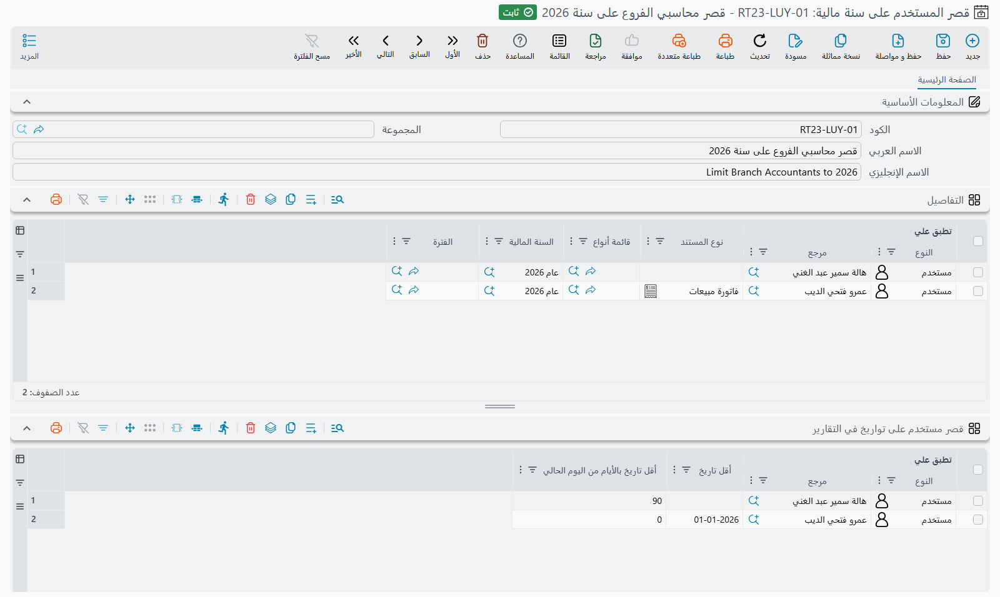

# قصر المستخدم على سنة مالية (Limit User To Year)

تتيح هذه الميزة قصر المستخدمين على سنوات مالية وفترات محددة: فشاشات قوائم المستندات لا تعرض لهم إلا مستندات السنوات أو الفترات المسموح لهم بها، والتقارير لا تبدأ قبل أقل تاريخ تحدده.

## الوصول للشاشة

**المسار**: إدارة النظام ← الصلاحيات ← قصر المستخدم على سنة مالية

## نظرة عامة

تُستخدم شاشة "قصر المستخدم على سنة مالية" للتحكم في:

1. **تقييد المستندات**: إخفاء المستندات الواقعة خارج السنوات المالية أو الفترات المسموحة من شاشات قوائم المستندات لدى المستخدم. والتقييد يفلتر القوائم فقط، ولا يمنع المستخدم من إنشاء مستند.
2. **تقييد التقارير**: تحديد أقل تاريخ يمكن للمستخدم استخدامه في التقارير

## التفاصيل (Details)

### حقول تقييد السنوات والفترات

| الحقل | الوصف |
|-------|-------|
| **تطبق على (Apply To)** | الجهة التي سيُطبق عليها التقييد: مستخدم، مجموعة مستخدمين، ملف صلاحيات، أو موظف |
| **نوع المستند (Document Type)** | نوع المستند المراد تقييده (اختياري) |
| **قائمة أنواع (Type List)** | قائمة أنواع مستندات مُعرّفة مسبقاً لتقييدها دفعة واحدة (اختياري) |
| **السنة المالية (Fiscal Year)** | السنة المالية المسموح للمستخدم بالعمل عليها |
| **الفترة (Fiscal Period)** | الفترة المسموح بها (اختياري). السطر الذي فيه فترة يسمح بتلك الفترة بدلًا من سنتها. |

### سلوك تقييد السنوات والفترات

- إذا تركت حقلي "نوع المستند" و"قائمة أنواع" فارغين، سيُطبق التقييد على **جميع أنواع المستندات**
- يمكن إضافة عدة سطور لنفس الجهة للسماح بعدة سنوات مالية
- التقييد **تراكمي**: راجع قسم **أولوية التطبيق** أدناه
- إذا اجتمعت للمستخدم سطور سنوات وسطور فترات، فلا بد أن يطابق المستند الاثنين معًا: أن تكون سنته المالية من السنوات المسموحة **و**فترته من الفترات المسموحة

## قصر مستخدم على تواريخ في التقارير (Limit User to Dates In Reports)

### حقول تقييد التواريخ

| الحقل | الوصف |
|-------|-------|
| **تطبق على (Apply To)** | الجهة التي سيُطبق عليها التقييد |
| **أقل تاريخ (Min Date)** | أقل تاريخ ثابت يمكن للمستخدم اختياره في التقارير |
| **أقل تاريخ بالأيام من اليوم الحالي (Min Date From Today (Days))** | عدد الأيام قبل اليوم الحالي كحد أدنى للتاريخ (قيمة متحركة) |

### سلوك تقييد التواريخ

- إذا مُلئ "أقل تاريخ بالأيام من اليوم الحالي" برقم غير الصفر، فإنه يأخذ الأولوية على "أقل تاريخ" ويُحسب التاريخ من اليوم
- اجعل لكل جهة سطرًا واحدًا. فإن كان للجهة نفسها عدة سطور تواريخ، لا يُستعمل منها إلا سطر واحد
- إذا انطبقت على المستخدم عدة جهات، فراجع قسم **أولوية التطبيق** أدناه



## كيف يعمل النظام

### 1. تقييد قوائم المستندات (List Views)

عند عرض قائمة مستندات (مثل قائمة الفواتير)، يقوم النظام تلقائياً بـ:

```
1. التحقق من نوع المستند
2. البحث عن تقييدات المستخدم الحالي (مباشرة أو عبر المجموعة/ملف الصلاحيات/الموظف)
3. إضافة فلتر تلقائي على السنة المالية و/أو الفترة
```

::: tip ملاحظة
المستخدم لن يرى المستندات في السنوات غير المسموحة له، حتى لو كان لديه صلاحية على نوع المستند نفسه.
:::

### 2. تقييد أسئلة التقارير (Report Questions)

عند تشغيل تقرير، يقوم النظام بـ:

- **حقول التاريخ**: رفع تاريخ "من" الذي يسبق أقل تاريخ مسموح إلى ذلك التاريخ
- **حقول السنة المالية**: إذا كانت السنة المختارة فارغة أو تبدأ قبل أقدم سنة مسموحة، يستبدل بها أقدم سنة مسموحة (السنة المسموحة ذات أبكر تاريخ بداية). ولا تُحتسب هنا إلا السطور التي تركت "نوع المستند" و"قائمة أنواع" فارغين، والمدخل الذي يحتوي اسمه على `to` ولا يحتوي على `from` يُترك كما هو
- **حقول الفترة**: القاعدة نفسها، مع الفترات المسموحة

::: warning "إلى تاريخ" يُعرف بالاسم لا بالمعنى
مدخل "إلى تاريخ" لا بد أن يُترك كما هو وإلا انهارت الفترة، والنظام يحدد أي المدخلات هي كذلك من **اسم** المدخل نفسه: المدخل يُستثنى إذا كان اسمه يحتوي على `to` ولا يحتوي على `from` (بغض النظر عن حالة الأحرف)، أو إذا كان اسمه `tdate` بالضبط. فـ `toDate` و`dateTo` و`ToDocDate` مستثناة، و`fromDate` يُرفع كما ينبغي.

أما مدخل "إلى تاريخ" باسم آخر — `endDate` أو `until` أو `dueDate` — فلا ينطبق عليه شيء من ذلك، فيُرفع كأنه "من تاريخ"، وتنقلب الفترة رأساً على عقب، فيخرج التقرير فارغاً للمستخدم المقيَّد وصحيحاً لغيره. وهناك استثناءان: مدخل التاريخ المعرَّف كقائمة اختيار متعدد لا يُمس إطلاقاً، ويستطيع كاتب التقرير أن يضيف `ignoreMinDates` = `true` على المدخل ليستثنيه وحده. وللتفصيل راجع قسم **حين يغيّر النظام إجابة المستخدم** في [دليل Jasper Reports الشامل](/ar/platform/reports/reports-guide).
:::

## أمثلة عملية

### مثال 1: تقييد محاسب على السنة الحالية فقط

1. أنشئ سجل جديد في شاشة "قصر المستخدم على سنة مالية"
2. في جدول التفاصيل:
   - **تطبق على**: اختر المستخدم المراد تقييده
   - **السنة المالية**: اختر السنة المالية الحالية (مثال: 2024)
3. احفظ السجل

**النتيجة**: المستخدم لن يستطيع رؤية مستندات السنوات السابقة في أي قائمة.

### مثال 2: تقييد مجموعة على آخر 90 يوم في التقارير

1. أنشئ سجل جديد
2. في جدول "قصر مستخدم على تواريخ في التقارير":
   - **تطبق على**: اختر مجموعة المستخدمين
   - **أقل تاريخ بالأيام من اليوم الحالي**: 90
3. احفظ السجل

**النتيجة**: أي تقرير يشغله مستخدم من هذه المجموعة، سيكون تاريخ "من" على الأقل 90 يوم قبل اليوم.

## أولوية التطبيق

قد يصل التقييد إلى المستخدم من أربعة مصادر: سطر للمستخدم نفسه، ولمجموعته، ولملف صلاحياته، وللموظف المرتبط به.

- **السنوات والفترات المالية** من المصادر الأربعة **تُجمع** معًا: فيحصل المستخدم على اتحاد (Union) كل السنوات والفترات المسموحة.
- **تواريخ التقارير** لا تُجمع بهذه الطريقة. فسطر التاريخ الخاص بالمستخدم نفسه يُعمل به وحده. ولا يأخذ النظام أحدث (أكبر) تاريخ من سطور المجموعة وملف الصلاحيات والموظف إلا إذا لم يوجد ذلك السطر.

## ملاحظات فنية

### التخزين المؤقت (Caching)

- يتم تخزين بيانات التقييدات مؤقتاً في الذاكرة لتحسين الأداء
- يتم مسح التخزين المؤقت تلقائياً عند أي تغيير في سجلات "قصر المستخدم على سنة مالية"

### التأثير على الأداء

- التقييدات تُضاف كفلاتر SQL على قوائم المستندات
- لا يوجد تأثير ملحوظ على الأداء في الاستخدام العادي
