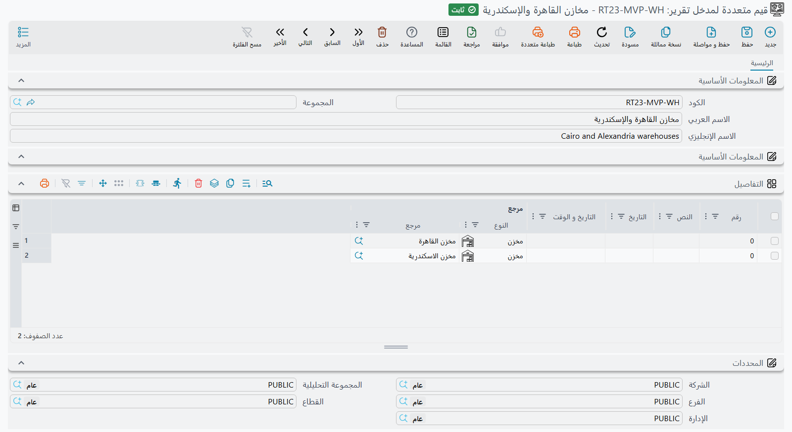

# قيم متعددة لمدخل تقرير (Multi Value Report Parameter)

سجل **قيم متعددة لمدخل تقرير** قائمة قيم محفوظة — أربعة مخازن، أو ثلاثة فروع، أو بضعة تواريخ —
تسلّمها مهمة مجدولة لمدخل تقرير يقبل أكثر من قيمة.

## لماذا وُجد

حين يشغّل شخص تقريرًا، يتيح له المدخل المعرَّف كقائمة أن يختار ما يشاء من القيم في نموذج المدخلات:
خمسة موظفين، أو كل الفروع إلا اثنين. أما كيف يُعِدّ مصمم التقرير ذلك، وما الأدوات التي تظهر للمستخدم،
فمشروح في قسم «مدخلات التحديد المتعدد (القوائم)» من [دليل التقارير](/ar/platform/reports/reports-guide).

أما [المهمة المجدولة](/ar/platform/automation-and-rules/scheduled-tasks) فليس فيها من يختار شيئًا.
كل سطر في جدول **Params** فيها يحمل إجابات تشغيلة واحدة للتقرير، بخانة لكل مدخل، وعمود **Ref** في
الخانة يحمل سجلًا واحدًا. فإذا أردت أن يعمل التقرير لمخازن القاهرة والإسكندرية وطنطا والمنصورة معًا،
تحفظ هذه المخازن الأربعة مرة واحدة في سجل قيم متعددة لمدخل تقرير، وتضع هذا السجل الواحد في الخانة.

## الشاشة

افتح **الأساسيات ← الإعدادات ← قيم متعددة لمدخل تقرير**. إلى جانب الكود والاسمين العربي والإنجليزي،
الشاشة جدول **التفاصيل** واحد، بسطر لكل قيمة. في كل سطر خمسة أعمدة — **رقم** و**النص** و**التاريخ**
و**التاريخ و الوقت** و**مرجع** — ولا يقرأ التقرير منها إلا العمود الذي يناسب نوع المدخل الذي يُمرَّر إليه:

| مدخل التقرير… | العمود المقروء من كل سطر |
|---|---|
| سجل (مخزن، فرع، موظف…) | **مرجع** |
| تاريخ | **التاريخ** |
| تاريخ ووقت | **التاريخ و الوقت** |
| وقت | **التاريخ و الوقت** (جزء الوقت منه) |
| رقم صحيح أو عشري | **رقم** |
| نعم/لا | **النص**، تكتب فيه `true` أو `false` |
| نص، أو أي نوع آخر | **النص** |

بقية الأعمدة تُتجاهل، فاملأ العمود الصحيح في كل سطر. والسجل الواحد يخدم نوعًا واحدًا من القيم: اجعل
«مخازن الدلتا» و«التواريخ الأسبوعية» سجلين منفصلين، لا سجلًا واحدًا بأسطر مختلطة.

## استخدامه في مهمة مجدولة

1. أنشئ السجل — وليكن **مخازن الدلتا** — بأربعة أسطر يحمل عمود **مرجع** فيها المخازن الأربعة.
2. افتح المهمة المجدولة، من نوع **تقرير بمدخلات** (يُرسل بالبريد الإلكتروني) أو **تقرير بمدخلات (طباعة)**، واختر تقريرها.
3. في سطر من جدول **Params**، اختر مدخل المخزن في عمود **Param ID** لإحدى الخانات. فإذا كان التقرير
   يعرّف هذا المدخل كقائمة، يتحول عمود **Ref** في الخانة إلى قيم متعددة لمدخل تقرير من تلقاء نفسه.
4. اختر **مخازن الدلتا** في **Ref**.

كل تشغيلة لهذا السطر تمرّر الآن المخازن الأربعة دفعة واحدة، تمامًا كأن مستخدمًا اختارها في النموذج.

تُقرأ القيم من السجل في كل مرة تعمل فيها المهمة، ولا تُنسخ إلى المهمة. أضف مخزنًا خامسًا إلى
**مخازن الدلتا** فيدخل المخزن الجديد في كل سطر مهمة يشير إلى السجل بدءًا من تشغيلته التالية — وهذا
مريح حين تغذّي القائمة نفسها عشر مهام، وجدير بالتذكر قبل أن تعدّل سجلًا تشاركه مهام أخرى.

::: tip القيمة الواحدة تكفي أيضًا
مدخل القائمة لا يشترط سجل قيم متعددة. ضع مخزنًا واحدًا في **Ref** فيستلم التقرير قائمة من قيمة واحدة.
:::

## أدوات الذكاء الاصطناعي المبنية على تقرير

[الأداة المبنية على تقرير](/ar/modules/ai/ai-tool-definitions) تملأ مدخلاتها من نوع **Fill Manually**
بالطريقة نفسها التي تملأ بها المهمة المجدولة خاناتها، فسجل قيم متعددة لمدخل تقرير يوضع في عمود
**مرجع** لسطر كهذا يصل إلى مدخل القائمة بكل قيمه.
