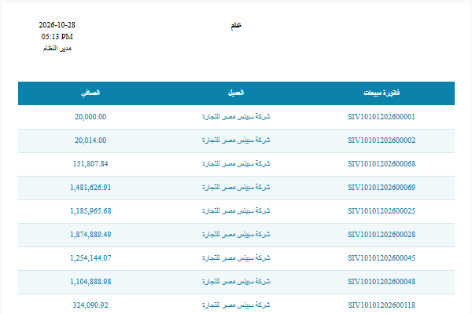
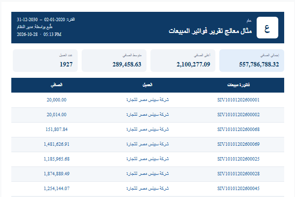
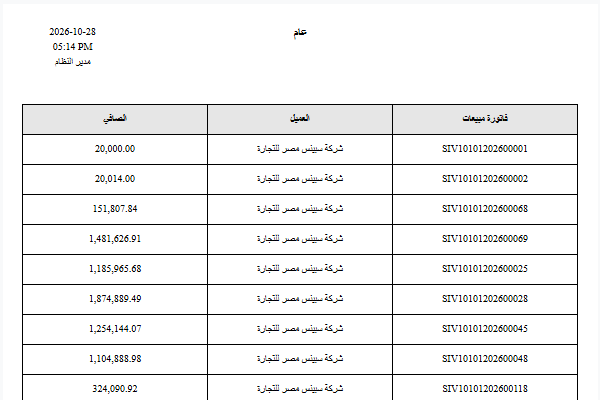
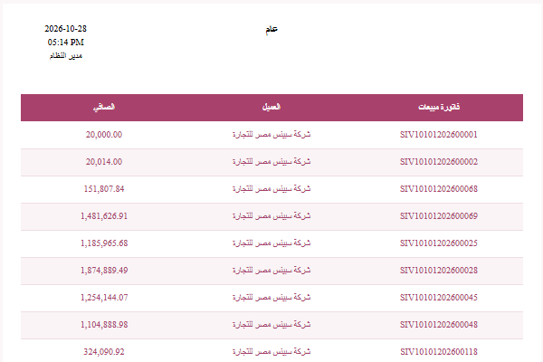
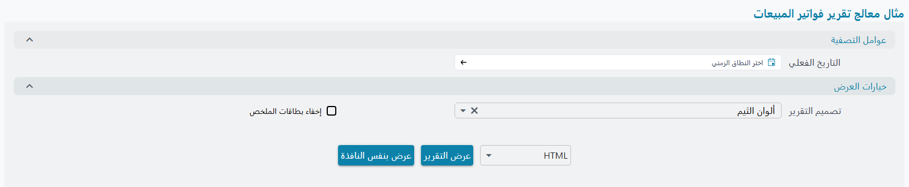
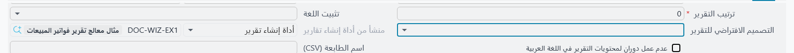
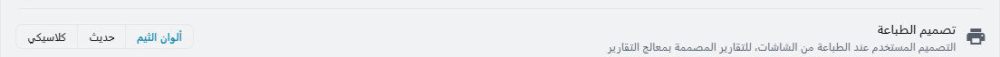
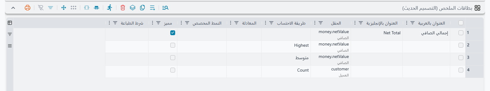
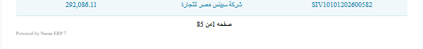

# تصاميم التقارير: ألوان الثيم والحديث والكلاسيكي

التقرير المبني بأداة إنشاء التقارير يمكن أن يُطبع بثلاثة أشكال، والقارئ هو من يختار الشكل عند تشغيل التقرير دون أن يعدّل أحد التقرير نفسه. تقرير فواتير المبيعات نفسه يمكن أن يخرج بألوان ثيم الشاشة الذي يعمل عليه المستخدم، أو بشكل حديث فيه شريط علوي وبطاقات ملخص، أو تماماً كما كان يُطبع دائماً.

التصميم يغيّر شكل التقرير: الألوان والخطوط والشريط العلوي والبطاقات. ولا يغيّر الأرقام أبداً، فالاستعلام نفسه يعمل وتخرج السطور والإجماليات نفسها في كل تصميم.

## التصاميم الثلاثة

| التصميم | ما يحصل عليه القارئ |
|---|---|
| **ألوان الثيم** (الافتراضي) | عناوين الأعمدة ملوّنة باللون الرئيسي لثيم شاشة المستخدم، والسطور تتبادل بين الأبيض ودرجة فاتحة من اللون نفسه، والإجماليات بخلفية فاتحة وفوقها خط أعرض. و**بطاقات الملخص** فوق الجدول مباشرة، ملوّنة باللون نفسه. |
| **حديث** | شريط كحلي في أعلى التقرير فيه شعار الشركة وعنوان التقرير والفترة ومن طبعه، وتحته **بطاقات الملخص**، ثم جدول كحلي. ألوانه ثابتة ولا تتبع الثيم. |
| **كلاسيكي** | التقرير كما كانت الأداة تبنيه دائماً: عناوين أعمدة رمادية وحدود سوداء وألوانك أنت، و**بطاقات الملخص** باللون الرمادي فوق الجدول مباشرة. اختره عندما يجب أن يبقى شكل التقرير كما كان. |

### ألوان الثيم تتبع الشاشة

يأخذ تصميم **ألوان الثيم** لونه من الثيم الذي يعمل عليه المستخدم لحظة تشغيل التقرير. فالمستخدم على الثيم **الوردي** يحصل على تقرير وردي، والمستخدم على الثيم الافتراضي يحصل على أزرق نما:

بعض التفاصيل التي يحسن معرفتها:

- **الوضع الداكن لا يجعل التقرير داكناً.** التقرير معدّ للورق، فيُطبع دائماً على خلفية بيضاء ويستخدم لون الثيم في الوضع الفاتح، حتى لو كانت الشاشة داكنة.
- **لون الثيم الفاتح جداً يأتي بنص داكن.** إذا كان لون العناوين باهتاً لا يُقرأ عليه النص الأبيض، يصبح نص العناوين داكناً تلقائياً.
- **تغيير الثيم والنتيجة مفتوحة.** النتيجة المفتوحة تحتفظ بالألوان التي شُغّلت بها. والضغط على **تطبيق** في اللوحة الجانبية دون تغيير شيء آخر لا يعيد تشغيل التقرير، لأن المدخلات لم تتغير. اضغط **إعادة تشغيل التقرير بنفس المدخلات [F5]** (زر ▷ في عارض التقرير) أو F5 مباشرة، فيعمل التقرير من جديد بالألوان الجديدة.
- **التشغيل الذي لا يأتي من الواجهة الجديدة** يستخدم أزرق نما: الواجهة القديمة، والمهام المجدولة، ومسارات الكيانات التي ترفق تقريراً أو تطبعه.

لاختيار الثيم راجع [الثيمات](/ar/platform/everyday-tools/ui-themes).

## اختيار التصميم عند تشغيل التقرير

كل تقرير من أداة إنشاء التقارير يسأل عن التصميم في قسم من شاشة المدخلات اسمه **خيارات العرض**. هذا القسم مطويّ ويأتي دائماً في الآخر بعد كل مجموعات المدخلات الأخرى، حتى لا يزاحم المدخلات التي يملؤها الناس كل يوم. افتحه عندما تريد غير التصميم الافتراضي:

- **تصميم التقرير**: **ألوان الثيم** أو **حديث** أو **كلاسيكي**. إذا تُرك فارغاً يُطبع التقرير بألوان الثيم. ويتذكّر هذا المدخل آخر اختيار لكل مستخدم، فمن يفضّل التصميم الحديث يختاره مرة واحدة.
- **إخفاء بطاقات الملخص**: يظهر فقط إذا كان للتقرير بطاقات ملخص (انظر [بطاقات الملخص](#bTqt-lmlkhS)). علّمه لطباعة التقرير بدون البطاقات، في أي تصميم. المساحة التي كانت تشغلها تُزال، فلا تبقى فجوة فارغة.

### تحديد تصميم افتراضي للتقرير

التصميم الذي يبدأ به التقرير هو حقل **التصميم الافتراضي للتقرير**. تجده في صفحة **الرئيسية** في **أداة إنشاء تقرير** و**أداة إنشاء نموذج طباعة** و**تعريف تقرير**:

أثره يختلف بحسب ما يُطبع:

- **في التقرير** يحدد الحقل فقط الإجابة التي يبدأ بها مدخل **تصميم التقرير**. ويبقى للقارئ أن يختار تصميماً آخر، ومن شغّل التقرير قبل ذلك يرى آخر اختيار له.
- **في نموذج الطباعة أو القائمة المطبوعة** لا توجد شاشة مدخلات، فالحقل هو الذي يحدد التصميم، ويتقدّم على تفضيل **تصميم الطباعة** لكل مستخدم (الموضّح أدناه). استخدمه عندما يجب أن يخرج النموذج بالشكل نفسه أياً كان من يطبعه، مثل فاتورة ضريبية يجب أن تُطبع دائماً بالتصميم الكلاسيكي.

حدد الحقل في الأداة نفسها لا في تعريف التقرير الناتج عنها. فالأداة تنسخ قيمتها إلى التقرير عند كل حفظ، والقيمة المكتوبة في تعريف التقرير وحده تُستبدل في المرة التالية التي تُحفظ فيها الأداة.

## الطباعة من الشاشة

عندما يضغط المستخدم **طباعة** في فاتورة مبيعات، أو يطبع قائمة، لا يُسأل عن التصميم. يُؤخذ التصميم من:

1. حقل **التصميم الافتراضي للتقرير** في النموذج نفسه إذا كان محدداً.
2. وإلا فمن اختيار المستخدم في **الإعدادات ← تفضيلات الواجهة ← تفضيلات عامة ← تصميم الطباعة**:

ومثل باقي تفضيلات الواجهة، **تصميم الطباعة** خاص بالمتصفح لا بالمستخدم، فالمستخدم نفسه على كمبيوتر آخر يبدأ من **ألوان الثيم** من جديد.

### ألوان مناسبة للطباعة في النماذج

النموذج يذهب إلى الطابعة، وكثيراً عدة مرات في اليوم، لذلك لا تستخدم النماذج الخلفيات الملوّنة الكاملة التي يستخدمها التقرير على الشاشة. في النموذج أو القائمة المطبوعة يطبع تصميما **ألوان الثيم** و**حديث**:

- العناوين بدرجة فاتحة جداً من اللون ونص داكن،
- السطور على خلفية بيضاء،
- اللون في الخطوط بين السطور وفوق الإجماليات فقط.

فتبقى الصفحة بلون الثيم أو بكحلي التصميم الحديث دون استهلاك كثير من الحبر. أما **كلاسيكي** فيطبع النموذج كما صُمّم تماماً.

النماذج التي تتغير:

- **النماذج المبنية بأداة إنشاء نموذج طباعة**: جدول السطور وجزء رأس النموذج (العميل والتواريخ ومربعات الإجماليات) يأخذان التصاميم معاً. في جزء الرأس تأخذ العناوين الدرجة الفاتحة مثل عناوين الأعمدة، وتُطبع القيم على الأبيض بخط رفيع تحتها. ويبقى الترتيب كما أعطيته، والحدود التي وضعتها على الجزء تبقى بلون التصميم، والعنوان أو القيمة التي لها تنسيق تقرير خاص تحتفظ به.
- **النماذج المكتوبة يدوياً** التي فُعّلت فيها التصاميم. انظر [التقارير والنماذج المكتوبة يدوياً](#ltqryr-wlnmdhj-lmktwb-ydwyan).

الشريط العلوي وبطاقات الملخص للتقارير فقط، والتصميم **حديث** في النموذج يعني الألوان الكحلية لا الشريط.

## بطاقات الملخص

بطاقات الملخص هي المربعات التي تظهر في أعلى التقرير، وتعرض للقارئ أهم الإجماليات قبل أن يقرأ أي سطر: إجمالي المبيعات، وأكبر فاتورة، وعدد العملاء. تُطبع في كل التصاميم، وفي الصفحة الأولى فقط، وفقط إذا عرّفها التقرير. في التصميم **حديث** تكون تحت الشريط العلوي، وفي **ألوان الثيم** و**كلاسيكي** تكون تحت رأس التقرير نفسه، فوق الجدول مباشرة.

تعرّفها في جدول **بطاقات الملخص** في صفحة **تصميم الصفحة** في أداة إنشاء تقرير، وكل سطر فيه بطاقة:

| العمود | عمله |
|---|---|
| **العنوان بالعربية**، **العنوان بالإنجليزية** | الاسم المكتوب على البطاقة. إذا تُرك الاثنان فارغين تسمّي الأداة البطاقة من اسم العمود وطريقة الاحتساب: *إجمالي الصافي*، *أعلى الصافي*، *عدد العميل*. |
| **الحقل** | حقل التقرير الذي تتحدث عنه البطاقة، ويجب أن يكون من حقول التقرير. |
| **طريقة الاحتساب** | **المجموع (Sum)** أو **Count** (العدد) أو **Distinct Count** (العدد بدون تكرار) أو **متوسط (Average)** أو **Highest** (الأعلى) أو **Lowest** (الأدنى)، على كل سطور التقرير. الفارغ يعني المجموع. المجموع والمتوسط يحتاجان حقلاً رقمياً، والباقي يصلح لأي حقل. **Count** يعدّ السطور التي فيها قيمة للحقل، و**Distinct Count** يعدّ قيمه المختلفة، مثل عدد العملاء. |
| **المعادلة** | معادلة Jasper لقيمة لا يعطيها الحقل وطريقة الاحتساب، مثل `$V{REPORT_COUNT}` (عدد السطور) أو قيمة مدخل. إذا مُلئت تُستخدم بدلاً من **الحقل** و**طريقة الاحتساب**. |
| **النمط المخصص** | تنسيق الرقم، مثل `#,##0`. الفارغ يعني تنسيق الحقل نفسه، فيظهر المبلغ كما يظهر في عموده. |
| **مميز** | يطبع البطاقة بخلفية زرقاء لتلفت النظر. الأفضل بطاقة مميزة واحدة، والعادة أن تكون الأولى. |
| **شرط الطباعة** | شرط لهذه البطاقة وحدها، مثل `$P{showProfit}`. استخدم فيه المدخلات لا الإجماليات، لأن البطاقات تُطبع في أعلى التقرير قبل أن يُعرف أي إجمالي. |

السطور الأربعة في الصورة تعطي البطاقات الأربع في مثال التصميم الحديث أعلاه: **إجمالي الصافي** مميزة، ثم أعلى فاتورة ومتوسط الفاتورة (كل سطر في هذا التقرير فاتورة)، ثم *عدد العميل*. هذه البطاقة الأخيرة تعدّ السطور التي فيها عميل، فتعطي عدد الفواتير لا عدد العملاء. والبطاقة نفسها بطريقة **Distinct Count** تعطي عدد العملاء.

ما تتوقعه منها:

- **لا سطور، لا بطاقات.** التقرير الذي جدوله فارغ لا تظهر فيه بطاقات ولا مدخل **إخفاء بطاقات الملخص**، وينتقل من رأسه إلى الجدول مباشرة.
- **لكل تصميم ألوانه.** في الحديث تكون البطاقات رمادية فاتحة وأرقامها كحلية، وفي ألوان الثيم تأخذ درجة فاتحة من لون الثيم وأرقامها بدرجته الداكنة، وفي الكلاسيكي تكون رمادية وأرقامها سوداء. والبطاقة المميزة أغمق بدرجة.
- **كل البطاقات في صف واحد.** أربع بطاقات تملأ العرض بشكل مرتب، وأكثر من أربع تجعل كل بطاقة أضيق وتصغّر القيم لتناسبها.
- **البطاقات المخفية لا تترك فجوة.** إذا كان شرط طباعة بطاقة غير متحقق تُترك تلك البطاقة وحدها. وإذا لم يتحقق شرط أي منها، أو علّم القارئ **إخفاء بطاقات الملخص**، يختفي صف البطاقات كله ويصعد الجدول مكانه.

### ماذا تضع على البطاقة

البطاقة تُقرأ قبل الجدول، فالرقم الخاطئ عليها يضلل أكثر من سطر خاطئ. قبل إضافة بطاقة تأكد من:

- **أنها تطابق الجدول.** بطاقة **المجموع** تُحسب على السطور نفسها التي في التقرير، فتساوي إجمالي العمود في الملخص. اختر عموداً يعرض التقرير إجماليه أصلاً.
- **أن الرقم يُجمع.** المبالغ والكميات تُجمع. أما الأرصدة ورصيد المخزون والأسعار والنسب فلا تُجمع: استخدم **Highest** أو **Lowest**، أو لا تضع بطاقة.
- **عملة واحدة.** إذا كانت السطور بعملات مختلفة فمجموع مبلغ المستند لا معنى له. استخدم المبلغ بالعملة المحلية إن كان في التقرير، أو اترك البطاقة.
- **Count يعدّ السطور.** في تقرير كل سطر فيه فاتورة، *عدد العميل* هو عدد الفواتير. وفي تقرير كل سطر فيه سطر فاتورة، *عدد فاتورة المبيعات* هو عدد السطور. ولعدّ العملاء أو الفواتير نفسها استخدم **Distinct Count**.
- **المتوسط متوسط السطر.** هو متوسط الفاتورة إذا كان السطر فاتورة، ومتوسط السطر إذا كان السطر سطر فاتورة.
- **العنوان يقول ما هو**، مثل *صافي المبيعات* أو *العملاء*. والعنوان التلقائي لا يكفي في الغالب.
- **من بطاقتين إلى أربع.** واجعل الرقم الأهم في التقرير هو البطاقة المميزة.
- **راجعها مرة.** شغّل التقرير لفترة قصيرة وقارن كل بطاقة بالجدول.

## سطر "Powered by"

كل تقرير مبني بأداة إنشاء تقرير وكل نموذج مبني بأداة إنشاء نموذج طباعة ينتهي في كل صفحة بسطر رمادي صغير في أسفل الصفحة: **Powered by** ثم اسم البرنامج، مثل *Powered by Nama ERP 7*. وفي النسخ التي تحمل علامة تجارية أخرى يظهر اسمها هي. والسطر رابط: الضغط عليه في ملف PDF أو على الشاشة يفتح موقع البرنامج.

يُطبع في كل التصاميم بما فيها الكلاسيكي، ويبقى بالإنجليزية في التقارير العربية أيضاً. الأداة تضيفه تلقائياً، ولا يوجد إعداد لإزالته حالياً. ويمكن للتقرير المكتوب يدوياً أن يعرض السطر نفسه بدالتي `NamaRep` الموضّحتين في [التقارير والنماذج المكتوبة يدوياً](#ltqryr-wlnmdhj-lmktwb-ydwyan).

## ما يحتفظ بشكله

التصاميم تعيد تلوين الجدول: عناوين الأعمدة والسطور وسطور المجموعات والإجماليات. وبعض الأشياء تبقى كما هي في كل تصميم:

- **العمود الذي له [تنسيق تقرير](/ar/platform/reports/report-styles)** يحتفظ بتنسيقه. فإذا لوّنت عموداً عن قصد لا يكتب التصميم فوق اختيارك. أما العمود بلا تنسيق، أو بتلوين الأداة سطراً بسطر، فيتبع التصميم.
- **الخطوط التي اخترتها** تظهر في كل تصميم، وفي ألوان الثيم والحديث تُرسم خطوطاً رفيعة بلون التصميم:
  - **خطوط رأسية** و**خطوط أفقية** في سطر الحقل تضيف خطوطاً على جوانب ذلك العمود، في عنوانه وسطوره وإجماليه.
  - **Border Line Preset** في صفحة **تصميم الصفحة** يحدد خطوط سطور الجدول بدلاً من خط التصميم تحت كل سطر: **None** لا يرسم خطوطاً، و**خطوط خارجية فقط** يرسم الجانبين الخارجيين، و**خطوط داخلية فقط** يرسم الخطوط بين السطور والأعمدة.
  - الخط السميك فوق الإجماليات يبقى في كل الأحوال.
- **مكونات الرأس** التي أضفتها (الفلاتر والنصوص المخصصة والصور) تبقى تُطبع. وفي التصميم الحديث يحل الشريط العلوي محل عنوان التقرير والشعار والتاريخ والوقت والمستخدم واسم الشركة إذا كانت موضوعة في الصفحة الأولى فقط، فلا تظهر مرتين.
- **تقارير الجداول المحورية (Crosstab)** لا يتغير شكلها.

## التقارير الموجودة قبل التصاميم

يحصل تقرير الأداة على التصاميم وجدول البطاقات وسطر Powered by في المرة التالية التي تُحفظ فيها أداته، وحتى ذلك الحين يُطبع كما كان. والحفظ دون أي تغيير لا يعيد بناء التقرير، فغيّر شيئاً صغيراً واحفظ، ثم أرجعه إذا احتجت. والأمر نفسه ينطبق على النماذج المبنية بأداة إنشاء نموذج طباعة.

## التقارير والنماذج المكتوبة يدوياً

التقرير أو النموذج الذي كُتب ملف `.jrxml` الخاص به يدوياً، لا بأداة، يُطبع كما كُتب. ويمكن أن يحصل على التصاميم الثلاثة نفسها بـ**التفعيل**: يضيف من يصون الملف بعض العلامات، وعند حفظ الملف في شاشة **تعريف تقرير** يضيف النظام الباقي بنفسه: مدخل **تصميم التقرير**، ومدخلات الألوان، وإعدادات الألوان والخطوط على الخلايا المعلَّمة.

الخطوات باختصار:

1. **فعّل التصاميم في التقرير.** أضف خاصية واحدة إلى التقرير: `<property name="nama-design" value="true"/>`. وتغيير القيمة إلى `false` يوقف التصاميم دون حذف العلامات.
2. **علّم خلايا الجدول.** في `reportElement` كل خلية أضف `<property name="nama-design-role" value="..."/>` بأحد هذه الأدوار:

   | الدور | ضعه على | في ألوان الثيم والحديث |
   |---|---|---|
   | `header` | عناوين الأعمدة | خلفية بلون التصميم ونص فاتح وبلا حدود |
   | `row` | خلايا التفاصيل | سطور متبادلة تحت كل منها خط رفيع، وخلايا الروابط بلون الروابط |
   | `total` | إجماليات الملخص ورأس المجموعة وتذييلها | خلفية فاتحة ولون عريض وخط أعرض في الأعلى |

   علّم كل خلايا السطر بما فيها الفارغة، وإلا ظهرت فجوات في التلوين. واجعل الخلية `mode="Opaque"` إذا كان يجب أن تظهر خلفيتها. تحتفظ الخلايا بخطوطها وأحجامها ومحاذاتها، وفي **كلاسيكي** تُطبع كل خلية كما كُتبت تماماً. ولرسم خطوطك أنت في ألوان الثيم والحديث أضف أيضاً إلى الخلية `<property name="nama-design-lines" value="left,right"/>` بأي من `top` و`left` و`bottom` و`right`.
3. **التقارير الفرعية.** فعّل التقرير الرئيسي وملف التقرير الفرعي كليهما، وعندها يمرر التقرير الرئيسي التصميم المختار وألوانه إلى التقرير الفرعي تلقائياً. والتقرير الفرعي الذي لم يُفعَّل تقريره الرئيسي يبقى كلاسيكياً.
4. **بطاقات الملخص (اختياري).** ارسم البطاقات بنفسك داخل `frame` عليه الدور `cards`، والمعتاد أن يكون في شريط العنوان (Title). يجعل النظام هذا الإطار يُطبع في التصميم الحديث فقط وما دام **إخفاء بطاقات الملخص** غير معلَّم، ويضيف هذا المدخل. وإذا كان للإطار شرط طباعة خاص به فيجب أن يتحقق هو أيضاً. وحتى لا يترك إخفاء البطاقات فجوة، لا تضع أي شيء آخر في صفوف الإطار، واجعل القيم `evaluationTime="Report"` لأن شريط العنوان يُطبع قبل قراءة أي سطر.
5. **سطر Powered by (مستحسن).** أضف حقل نص في أسفل تذييل الصفحة بالتعبير `NamaRep.poweredBy()` وبرابط إلى `NamaRep.appUrl()`. انظر [موقع البرنامج نفسه](/ar/platform/reports/reports-namarep-reference#mwqaa-lbrnmj-nfsh).

الأسماء `reportDesign` و`hideSummaryCards` و`reportDisplayOptions` و`reportThemeColor` وكل اسم مدخل يبدأ بـ`design` محجوزة لهذه الآلية، فلا تستخدمها لمدخلات خاصة بك.

للتحقق من النتيجة احفظ التقرير في شاشة تعريف تقرير، وفيها تظهر أي أخطاء في العلامات. ثم شغّله بالتصميم **كلاسيكي**: يجب أن يبدو كما كان تماماً، وإلا فهناك علامة على عنصر خاطئ. ثم شغّله بـ**ألوان الثيم** و**حديث** باللغتين، والنسخة العربية تُعكس كالمعتاد.

::: tip مهارة جاهزة لمساعدات الذكاء الاصطناعي
الخطوات كاملة، مع مقاطع `.jrxml` جاهزة لكل علامة ولإطار البطاقات ولسطر Powered by، منشورة كمهارة للذكاء الاصطناعي: **[مهارة تصاميم التقارير](https://docs.namasoft.com/skills/report-design.md)** (ملف Markdown خام). أعطها لـ Claude Code أو لأي مساعد برمجة يعدّل تقاريرك. وفي النسخة المحلية من التوثيق الملف نفسه هو `docs/public/skills/report-design.md`.
:::

## رسائل قد تظهر لك

| الرسالة | السبب | ما العمل |
|---|---|---|
| «بطاقة الملخص {0} تحتاج إلى حقل أو تعبير» | السطر {0} في جدول بطاقات الملخص ليس فيه **حقل** ولا **معادلة**. | املأ أحدهما أو احذف السطر. |
| «الحقل {0} في بطاقة الملخص {1} ليس من حقول التقرير» | البطاقة تذكر حقلاً لا يقرؤه التقرير. | اختر حقلاً من أعمدة التقرير، أو أضفه عموداً مخفياً. |
| «بطاقة الملخص {0} تجمع أو تحسب متوسط الحقل {1} وهو ليس رقما» | المجموع والمتوسط يحتاجان أرقاماً، والحقل نص أو تاريخ أو مرجع. | اختر العدد أو الأعلى أو الأدنى، أو حقلاً رقمياً. |
| «توجد عناصر عليها الخاصية nama-design-role لكن التقرير لا يفعّل الخاصية nama-design» | تقرير مكتوب يدوياً فيه علامات على الخلايا لكنه غير مفعَّل. | أضف `nama-design` = `true` إلى التقرير (الخطوة 1 أعلاه). |
| «التقرير يفعّل الخاصية nama-design لكن لا يوجد به أي عنصر عليه الخاصية nama-design-role ولا أي تقرير فرعي» | التقرير مفعَّل لكن لا شيء فيه يمكن تلوينه. | علّم الخلايا، أو احذف الخاصية. |
| «قيمة nama-design-role غير معروفة {0} على العنصر في الموضع x {1} و y {2}، استخدم header أو row أو total أو cards» | علامة قيمتها غير الأدوار الأربعة، وغالباً خطأ كتابة مثل `head` أو `totals`. | صحّح العلامة في ذلك الموضع. |

## انظر أيضاً

- [دليل أداة إنشاء التقارير](/ar/platform/reports/report-wizard-guide)
- [أداة إنشاء نماذج الطباعة](/ar/platform/reports/printing-form-wizard-guide)
- [تنسيقات التقارير](/ar/platform/reports/report-styles)
- [الثيمات](/ar/platform/everyday-tools/ui-themes)
