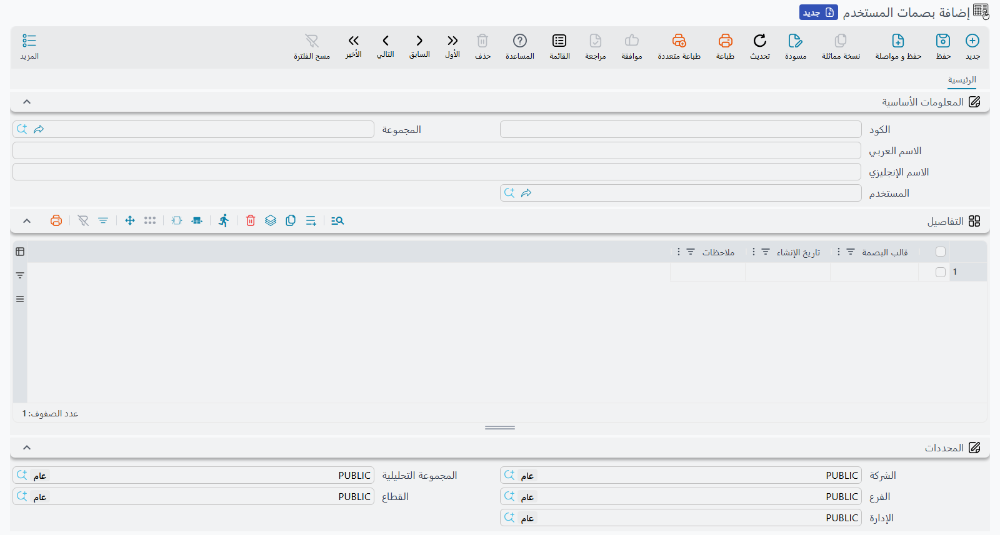

# بصمات المستخدم (UserFingerprint)

سجل **بصمات المستخدم** يحفظ البصمات التي سجّلها مستخدم واحد ليدخل بها إلى نقاط البيع. الكاشير لا يرى هذه الشاشة أبداً — فالبصمة تُسجَّل على جهاز نقطة البيع نفسه — لكن كل بصمة تُؤخذ على أي جهاز تنتهي إلى هنا، وهنا ينظر مدير النظام ليعرف من لديه بصمات مسجّلة، أو ليسحب بصمة من أحد.

**المسار**: الأساسيات ← المستندات ← بصمات المستخدم

::: info تستعملها نقاط البيع فقط
الجزء الوحيد من نما الذي يقرأ هذه السجلات اليوم هو برنامج نقاط البيع على الكمبيوتر: شاشة الدخول، ونافذة فك القفل، ونافذة الصلاحيات الأمنية. أما أجهزة بصمة الحضور فتحفظ البصمات داخل الجهاز نفسه وترسل إلى نما الحركات لا البصمات (راجع [أجهزة البصمة](/ar/modules/hr/attendance/attendance-machines))، وتحقّق تطبيق الموبايل بالبصمة أو الوجه يقوم به الهاتف نفسه.
:::

## كيف ينشأ السجل

لا أحد ينشئ هذه السجلات يدوياً. وتمر حياة السجل بهذه الخطوات:

1. مشرف لديه صلاحية **إمكانية تسجيل بصمة إصبع الموظفين** يفتح **تسجيل بصمة إصبع** على جهاز نقطة البيع، ويختار مستخدماً، ويطلب منه وضع إصبعه على القارئ أربع مرات. الإجراء كاملاً — القارئ ومفتاح التفعيل في إعدادات نقاط البيع والصلاحية — موجود في [تسجيل الدخول بالبصمة في نقاط البيع](/ar/modules/pos/pos-fingerprint-login).
2. يحتفظ الجهاز **بسجل واحد لكل مستخدم**. أول بصمة تنشئ السجل، وكل بصمة بعدها للمستخدم نفسه تُضاف إليه سطراً جديداً. ويتكوّن كوده من المعرّف الداخلي للمستخدم متبوعاً بـ `-POS-Fingerprint`.
3. يرسل الجهاز السجل إلى الخادم فوراً إن كان متصلاً، أو مع الإرسال الدوري التالي إن لم يكن. ويحفظه الخادم بمحددات الجهاز نفسه — الشركة والفرع وغيرهما.
4. ومن الخادم يعود السجل إلى أجهزة نقاط البيع كأي ملف رئيسي تنزّله نقاط البيع، فالكاشير الذي سُجّلت بصمته على الجهاز 1 يستطيع الدخول على الجهاز 2 بمجرد أن يستلم ذلك الجهاز التغيير.

## ما تعرضه الشاشة

| الحقل | ما يحمله |
|---|---|
| **الكود** والاسمان العربي والإنجليزي | هوية السجل. الكود هو الذي أنشأه الجهاز، والاسمان فارغان عادةً. |
| **المستخدم** (user) | المستخدم الذي تُدخِل هذه البصمات باسمه. |
| جدول **التفاصيل** (details) | سطر لكل بصمة مسجّلة. |
| ↳ **قالب البصمة** (fingerprintTemplate) | البصمة محفوظة في صورة نص مشفّر طويل. هو الملخص الرياضي الذي يستخرجه القارئ من الإصبع وليس صورة له، ولا يمكن كتابته أو تعديله. |
| ↳ **تاريخ الإنشاء** (creationDate) | وقت تسجيل البصمة. |
| ↳ **ملاحظات** (remarks) | الملاحظة التي كُتبت عند التسجيل، مثل «السبابة اليمنى». |
| المحددات | مأخوذة من الجهاز الذي أرسل السجل. |

ولأن قالب البصمة لا يأتي إلا من قارئ، فلا يمكن إضافة بصمة من هذه الشاشة. البصمة الجديدة تُسجَّل دائماً على جهاز نقطة البيع.

## حذف بصمة

هناك طريقتان، وكلتاهما تصل إلى كل الأجهزة:

- **على جهاز نقطة البيع** — افتح تسجيل بصمة إصبع، واختر المستخدم، واضغط ✕ بجوار البصمة. يرسل الجهاز السجل بعد الحذف إلى الخادم.
- **على هذه الشاشة** — احذف سطر البصمة من جدول **التفاصيل** واحفظ، أو احذف السجل كله لتزيل كل بصمات ذلك المستخدم. يُوضع التغيير في طابور الأجهزة، ويُسقط كل جهاز البصمة عند تنزيله التغييرات في المرة التالية.

وحين يترك موظف العمل، فحذف سجله هنا هو أسرع طريقة للتأكد من أن أي جهاز لن يُدخله بالبصمة. أما اسم المستخدم وكلمة السر فأمر آخر يُعالَج في سجل المستخدم — راجع [المستخدمون وتسجيل الدخول](/ar/platform/security/users-and-login).

::: tip السجل المُراجَع مغلق أمام الأجهزة أيضاً
مراجعة سجل بصمات المستخدم تقفله أمام أجهزة نقاط البيع كما تقفله أمام بقية المستخدمين. فالجهاز الذي يحاول إرسال بصمة جديدة أو محذوفة لذلك المستخدم يُرفض بهذه الرسالة، وليس لها نص عربي فتظهر بالإنجليزية في اللغتين:

*"The document {0} was revised, please unrevise it on the main system"*

ألغِ مراجعة السجل على الخادم، ثم سجّل البصمة أو احذفها من جديد.
:::
