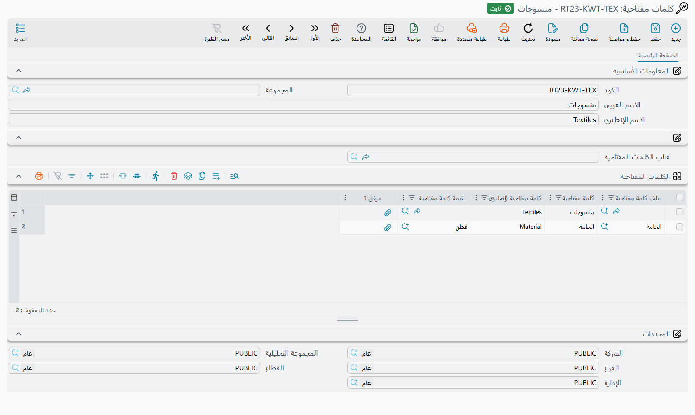

# الكلمات المفتاحية وقوالبها (Keyword Templates)

الكلمات المفتاحية وسوم وصفية تلحقها بصنف أو عميل — «قطن»، «جودة تصدير»، «تشكيلة رمضان»، «جملة
فقط» — حتى تستطيع القوائم والتقارير أن تنتقي كل سجل يحمل وسمًا معيّنًا. وسجل **كلمات مفتاحية** (القالب)
مجموعة جاهزة من هذه الوسوم: تختاره على الصنف فتُنسخ كلماته إلى الصنف في خطوة واحدة بدلًا من كتابتها
سطرًا سطرًا.

الكلمات المفتاحية لا تفعل شيئًا بذاتها؛ فهي لا تغيّر سعرًا ولا رصيدًا ولا قيدًا. قيمتها في التصفية:
تستطيع قائمة أو تقرير أن يقتصر على السجلات التي تتضمن كلماتها المفتاحية كلمة أو قيمة معيّنة.

## أين توجد الكلمات المفتاحية

لكل من **صنف** و**عميل** صفحة **الكلمات المفتاحية**. (وفي [طلب فتح صنف](/ar/modules/supplychain/item-maintenance)
حقل **كلمات مفتاحية** وجدول الكلمات المفتاحية نفسهما، وتُنسخ أسطره إلى الصنف الذي يُنشأ من الطلب.) وفي الصفحة:

- **كلمات مفتاحية** — اختر قالبًا لتُنسخ كلماته (انظر أدناه).
- **عكس حالة حذف السطور** — يقلب **حذف مع الحفظ** في كل الأسطر دفعة واحدة.
- جدول الكلمات المفتاحية، بسطر لكل كلمة:

| العمود | ما يحمله |
|---|---|
| **حذف مع الحفظ** (Delete With Save) | أشّره ليُحذف السطر عند حفظ السجل. |
| **ملف كلمة مفتاحية** (Key Word File) | اختياري: نوع الكلمة التي يسجلها السطر، مثل *الخامة* أو *الموسم*. |
| **كلمة مفتاحية(عربي)** / **كلمة مفتاحية (إنجليزي)** | الكلمة نفسها بالعربية والإنجليزية. |
| **قيمة كلمة مفتاحية** (Key Word Value) | في الصنف فقط: قيمة ملف الكلمة لهذا الصنف، مثل *قطن*. |
| **الوزن النسبى** (Relative weight) | رقم يمكنك تسجيله مع الكلمة. لا شيء في النظام يرتّب أو يفاضل به. |

## كلمات حرة وكلمات منظَّمة

يُستعمل السطر بطريقتين.

**الكلمة الحرة** نص فقط: اترك **ملف كلمة مفتاحية** فارغًا واكتب الكلمة بالعربية والإنجليزية بنفسك —
*تصدير* / *Export*.

**الكلمة المنظَّمة** تسجّل صفة وقيمتها. سمِّ الصفة في **ملف كلمة مفتاحية** والقيمة في **قيمة كلمة
مفتاحية**: *الخامة* = *قطن*. وعند حفظ السجل يملأ النظام عمودي الكلمة العربية والإنجليزية من اسمي ملف
الكلمة المفتاحية نفسه، مستبدلًا ما كُتب فيهما. فيصبح عمود الكلمة في السطر المحفوظ *الخامة*، وتبقى القيمة
المحددة في **قيمة كلمة مفتاحية**.

تحتاج الكلمات المنظَّمة إلى ملفين صغيرين، كلاهما في **المخازن ← الملفات**:

- **ملف كلمة مفتاحية** — الصفة: كود، واسماها العربي والإنجليزي، وجدول **القيم المسموح بها** الذي
  يسرد القيم التي يمكن أن تأخذها (لكل منها كلمة عربية وكلمة إنجليزية و**قيمة كلمة مفتاحية**).
- **قيمة كلمة مفتاحية** — قيمة واحدة، مع حقل اختياري **الكلمة المفتاحية** (Parent Key Word) يسمّي ملف
  الكلمة الذي تنتمي إليه.

في سطر الصنف، يعرض منتقي **قيمة كلمة مفتاحية** القيم المسرودة في **القيم المسموح بها** لملف الكلمة
المختار. فإذا كان هذا الجدول فارغًا عرض القيم التي حقل **الكلمة المفتاحية** فيها هو ذلك الملف، ومعها
القيم التي ليس لها ملف أصلًا.

## قوالب الكلمات المفتاحية

القالب ملف في **المخازن ← الملفات ← كلمات مفتاحية**. إلى جانب الكود والاسمين فيه حقل **المجموعة
الأعلي** (Parent) وجدول **الكلمات المفتاحية** بالأعمدة نفسها — **ملف كلمة مفتاحية**، والكلمة بالعربية
والإنجليزية، و**قيمة كلمة مفتاحية** — إضافة إلى **مرفق 1** الذي يبقى في القالب ولا يُنسخ.

تكوّن القوالب شجرة عبر **المجموعة الأعلي**: قالب *منسوجات* تحته *قمصان* و*بناطيل*. واختيار قالب على
صنف أو عميل ينسخ كلمات الفرع الذي ينتمي إليه كله:

1. كل قالب أعلاه، من الأعلى نزولًا،
2. القالب نفسه،
3. كل قالب تحته، على أي عمق.

فاختيار *منسوجات* يجلب كلمات *قمصان* و*بناطيل* أيضًا، واختيار *قمصان* يجلب *منسوجات* و*قمصان* دون
*بناطيل*.

وما يحدث للجدول:

- الكلمات **تُضاف** ولا تُحذف أبدًا. واختيار قالب ثانٍ لاحقًا يضيف كلماته إلى الموجودة.
- **سطر واحد لكل كلمة.** إذا حمل قالبان في الفرع الكلمة نفسها نُسخت الأولى فقط. ولأن كلمة السطر المنظَّم
  هي اسم ملف كلمته، فهذا يعني أيضًا سطرًا واحدًا لكل ملف كلمة: الفرع الذي يسرد *الخامة* مرتين بقيمتين
  مختلفتين لا يساهم إلا بالأولى.
- الأسطر التي ليس فيها كلمة تُحذف من الجدول عند اختيار قالب.

ولإزالة كلمات، أشّر **حذف مع الحفظ** في أسطرها (أو اضغط **عكس حالة حذف السطور** لتأشيرها كلها أو
إلغاء تأشيرها) ثم احفظ.

## الوصول إلى السجلات بالكلمة المفتاحية

لأن الكلمات المفتاحية أسطر عادية في السجل، تستطيع أي قائمة أو معايير أو تقرير التصفية بها — مثلًا
الأصناف التي تحمل أسطرها **قيمة كلمة مفتاحية** *قطن*، أو العملاء الذين لهم الكلمة الإنجليزية *Export*.
