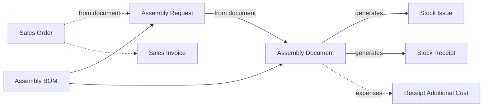

# Production on Assembly Documents

A perfume house fills 200 bottles of a custom scent for a hotel chain on a Tuesday afternoon. Six litres
of oil, two of alcohol, 200 bottles, 200 caps and 200 gift boxes go in; 200 boxed bottles come out. There
is no routing, no work centre and nothing waiting half-finished between stations. It is one recipe and
one step, and the only hard questions are which components left the shelf and what each bottle now
costs.

That is the job of the assembly screens. They are the "light manufacturing" inside the inventory module:
a recipe, a document that takes the components out of stock and puts the product in, and a cost that
moves from the first to the second. This page walks through how companies run their production that way.

## Who this fits

- A business that makes a product from a known recipe in **one step**: blending and filling, packing and
  repacking, kits and gift sets, printing jobs, kitchens and food preparation, steel fabrication, and
  engineered equipment built to order. Nobody needs to track work centres or work in progress.
- Across Nama installations, about **1 in 4** companies produce on assembly documents at least once a
  month. Factories are not the only ones: about 2 in 3 manufacturers work this way, and so do about 1 in
  4 distributors and 2 in 5 retailers that blend, pack or bundle what they sell.
- It usually runs alongside a selling scenario, either
  [Direct-Invoice Trading](/business-scenarios/scenario-direct-invoice-trading) or
  [Order-to-Cash Distribution](/business-scenarios/scenario-order-to-cash-distribution). Companies that
  buy their components abroad add the [Importer](/business-scenarios/scenario-importer-landed-cost)
  flow, and shops that pack in the back room combine it with a
  [Retail Chain with Point of Sale](/business-scenarios/scenario-retail-chain-pos).
- About 1 in 7 of these companies also run the [Full Manufacturing Cycle](/business-scenarios/scenario-full-manufacturing)
  for their staged products, and keep assembly for the simple ones.

## What you need

::: info Required licences
`supplychain-assembly`, `supplychain-inventory`; add `supplychain-sales` when production follows a sales order.
:::

- [Assembly & Packaging](/modules/supplychain/assembly-and-packaging/): the recipes and the assembly
  documents, all under **Inventory → Assembly Documents**.
- [Supply Chain](/modules/supplychain/): the warehouses, the stock issues and receipts the assembly
  generates, and the costing that values them.
- [Sales](/modules/supplychain/sales-journey): the sales order and invoice, when you assemble to order.
- [Payroll](/modules/hr/payroll/): about 3 in 5 of these companies also pay their workers in Nama. The
  workers' time reaches the product cost through the assembly's expense lines, described below.

## The document flow

The solid line in the middle is the whole flow at most companies: an Assembly BOM and an Assembly
Document. The dotted parts are for assembling to an order. Here is the hotel's order from start to finish.

1. **The sales order.** The hotel chain orders 200 boxed bottles. Sales records a **Sales Order** for
   them at the agreed price.
2. **The plan.** Production raises an **Assembly Request** with the sales order in **From Document**,
   picks the scent's **Assembly BOM** (the recipe) and sets the quantity to 200. Every component line is
   recalculated from the per-bottle recipe: 30 ml of oil per bottle becomes 6 litres. The request moves
   no stock. If its term has **Reserve** ticked on the **Reservation** tab, it reserves the components so
   that nobody else sells them in the meantime.
3. **The components reach the filling room.** If they are kept in another store, a **Stock Transfer**
   moves them to the production warehouse first. That is an ordinary transfer that the storekeeper makes
   by hand. The request does not create it.
4. **The assembly.** On the day, the supervisor creates the **Assembly Document** with the request in
   **From Document**, corrects a line if a different lot of oil was used, and adds two lines on the
   **Expense items** tab: filling labour at 2.00 a bottle and the filling line's electricity.
5. **What saving creates.** The assembly document never touches stock itself. On save it generates a
   **Stock Issue** for the components, out of the issue warehouse, and a **Stock Receipt** for the 200
   bottles, into the receipt warehouse. Because it has expense lines, it also generates a **Receipt
   Additional Cost**. All three are listed in its **Stock Documents** grid. Editing the assembly updates
   them, and deleting it deletes them.
6. **The cost.** The documents are processed in the background as business requests, and the receipt is
   costed once the issue's cost is known. Components that cost 9,000 plus 600 of expenses give a bottle
   cost of 48.00.
7. **The sale.** Sales invoices the hotel from the sales order. The bottles leave stock at 48.00 each,
   through the invoice or its stock issue, depending on your sales terms, and the money is collected as
   on any other sale. See [The Sales Journey](/modules/supplychain/sales-journey).

Selling from stock follows the same flow without the dotted parts: the supervisor creates the assembly
document straight from the BOM, and the product is sold from the shelf.

## Setting it up, in order

1. **Items and units.** Create the components and the finished items. The BOM's unit must be one of the
   finished item's primary or secondary units, and each component's unit one of its primary units, so
   get the units right first. See [Understanding Items](/modules/supplychain/understanding-items) and
   [Units of Measure](/modules/supplychain/units-of-measure).
2. **Warehouses.** Decide where components are issued from and where finished goods are received. Many
   companies keep a separate production store. See
   [Warehouses and Locators](/modules/supplychain/warehouses-and-locators).
3. **Assembly BOMs.** Write one recipe per finished item, with its default issue and receipt warehouses
   and any co-products. Use **Components** for interchangeable parts and a **Packaging Method File** for
   cartons and labels. See
   [Assembly BOMs, Components & Packaging Methods](/modules/supplychain/assembly-and-packaging/assembly-boms-and-components).
4. **Expense items for labour and overheads.** Create an expense item for each cost you want inside the
   product cost: labour, energy, machine time. Where the same expenses apply every time, set up
   **Assembly Process Files** so the lines are calculated for you. See
   [Expense items and assembly process files](/modules/supplychain/assembly-and-packaging/assembly-documents-and-requests#Expense-items-and-assembly-process-files).
5. **The assembly term.** On the term's **Effect** tab, fill the issue and receipt books and terms, which
   are required, and the **Additional Cost Document Book** and **Term**, which are needed as soon as a
   document has expense lines. Review the cost-split options there too. See
   [The term's Effect tab](/modules/supplychain/assembly-and-packaging/assembly-documents-and-requests#The-terms-Effect-tab).
6. **The request term,** if you plan with requests: decide whether it reserves the components.
7. **Sales terms,** if you assemble to order: the sales order and the invoice, and which of them moves
   the stock. See [The Sales Journey](/modules/supplychain/sales-journey).

## Settings and tools most companies use

- **Additional costs.** About 2 in 3 of these companies use additional-cost documents. On an assembly,
  the expense lines become a Receipt Additional Cost by themselves. See
  [Additional Costs on Receipts](/modules/supplychain/inventory-costing#Additional-Costs-on-Receipts-ReceiptAdditionalCost).
- **Purchase orders.** About 7 in 10 buy their components on purchase orders. See
  [The Purchasing Journey](/modules/supplychain/purchasing-journey).
- **Payroll.** About 3 in 5 run payroll in Nama. See [Payroll](/modules/hr/payroll/).
- **Full manufacturing next to assembly.** About 1 in 7 also run production orders for their staged
  products. See the [Manufacturing module](/modules/manufacturing/).

## Variations

**Batches and multi-level products.** The **Multi Assembly Document** handles a product whose components
are themselves assembled, or several products at once. It follows the **Sub Assembly BOM** links down the
recipe tree and generates one Assembly Document per line, and it can be filled from a sales order. With
**Change Details Status To Create Assembly Documents By Level**, it builds the deepest level first and
moves up only when that level's stock is in. See
[Multi-Level and Aggregated Assembly](/modules/supplychain/assembly-and-packaging/multi-level-and-aggregated-assembly).

**Packing lines and machine runs.** A packing line that turns bulk material into cartons on pallets all
day records the day in one **Aggregated Packaging Document**, with sorted grades and waste. Work that is
better described by the machine than by the recipe, such as a mill with its consumables and hourly
cost, goes on a **Processing Document** that starts from an **Assembly Machine**. See
[Processing Documents & Assembly Machines](/modules/supplychain/assembly-and-packaging/processing-documents-and-machines).

**Kits sold, not built.** A gift set that is only ever sold, and never kept assembled on the shelf, does
not need an assembly document at all. Give the item a **Disassembly Bom Components Spread Method**, and
tick **Spread Assembly Components With Save** on the sales term. Saving the sale then adds the kit's
components under its line, and stock leaves as the components. See
[Document-Specific Options](/modules/supplychain/document-terms/doc-term-document-specific#Invoices).

**Made to order through a request.** The Assembly Document's **From Document** accepts an assembly
request, another assembly document or an item cutting document, and it does not accept a sales order. An
order therefore reaches production through an Assembly Request, as in the walk-through above, or
through a Multi Assembly Document.

**Taking products apart.** The same Assembly Document disassembles: with **Calculate CoProducts From
Issued Item Assembly BOM** on the term, you issue the finished item and its parts are received back. See
[Disassembly](/modules/supplychain/assembly-and-packaging/assembly-documents-and-requests#Disassembly).

## Decisions to make before go-live

- **Assembly or full manufacturing.** Assembly is one step. When you need routings, work centres,
  quantities waiting between stages, rework, and an order that is closed and costed at the end, that is
  the [Full Manufacturing Cycle](/business-scenarios/scenario-full-manufacturing). Some companies keep
  BOM and routing records in the Manufacturing module and still produce through assembly documents.
  That is a legitimate choice, not a half-done setup.
- **How labour and overheads get into the cost.** Type them on the Expense items tab, calculate them from
  the expense items' rates, or let Assembly Process Files add them. If you choose none of these, the
  product carries only the cost of its components.
- **Per-unit recipe or typed totals.** By default the issued quantities are the recipe multiplied by the
  quantity assembled. If your people type the total of each component, switch on **Do Not Multiply
  Quantities In Assembly Doc** in the
  [Supply Chain configuration](/modules/supplychain/configuration/documents-and-details-configuration).
- **One issue warehouse or several.** A header **Issue Warehouse** is written onto every issued line on
  save. If components come from several stores, leave it empty, or move the components to one store
  first.
- **How cost splits between co-products.** By quantity, by average sales price, a fixed amount, or no
  cost at all, set per line. Decide before the first by-product is received. See
  [How the cost is split](/modules/supplychain/assembly-and-packaging/assembly-documents-and-requests#How-the-cost-is-split).
- **A request step or not.** Requests suit companies that plan and reserve ahead, or assemble to order.
  Companies that produce as stock runs low usually go straight to the Assembly Document.

## Where to read next

1. [Assembly & Packaging](/modules/supplychain/assembly-and-packaging/): the landing page and the
   screens at a glance.
2. [Assembly BOMs, Components & Packaging Methods](/modules/supplychain/assembly-and-packaging/assembly-boms-and-components)
3. [Assembly Requests & Assembly Documents](/modules/supplychain/assembly-and-packaging/assembly-documents-and-requests)
4. [Multi-Level and Aggregated Assembly](/modules/supplychain/assembly-and-packaging/multi-level-and-aggregated-assembly)
5. [Processing Documents & Assembly Machines](/modules/supplychain/assembly-and-packaging/processing-documents-and-machines)
6. [Inventory Costing & Revaluation](/modules/supplychain/inventory-costing)
7. [Manufacturing Module Overview](/modules/manufacturing/manufacturing-overview): the next step up.
