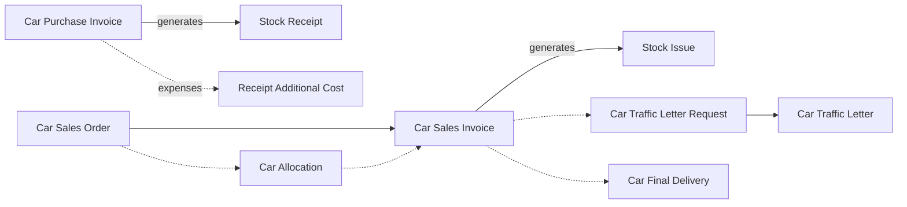
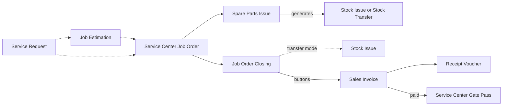

# Car Dealer and Service Centre

A dealer lands six cars of one model from the importer at 74,000 each, plus 15,000 of freight and customs
for the shipment. Each car is sold to a named customer, by chassis number, with a deposit, a payment plan,
a traffic letter for the plates and a hand-over date. Two years later the same car comes back to the
dealer's workshop for its service, and the bill is split between the owner, the insurer and the warranty
programme.

Nothing about that fits a bag-of-cement inventory. Every car has to be followed as an individual object,
and every repair is a job with its own labour, parts and payers. The Service Center module covers both
halves, the showroom and the workshop, and many groups run them side by side. This page walks through
both chains.

## Who this fits

- **Car dealers** who buy and sell vehicles one by one, by chassis number, with registration steps and
  often a financed sale. **Workshops** that bill labour and parts per job, sometimes to an insurer or a
  warranty programme.
- Across Nama installations, about **1 in 16** companies work this way. Dealers are about 1 in 25 and
  workshops about 1 in 30, and the two are often in the same group.
- The cars usually arrive through the
  [Importer: Landed Cost and Letters of Credit](/business-scenarios/scenario-importer-landed-cost)
  flow. The showroom and the workshop are often separate companies in a
  [Multi-Company Group](/business-scenarios/scenario-multi-company-group), and the spare-parts counter
  sells like [Direct-Invoice Trading](/business-scenarios/scenario-direct-invoice-trading).

## What you need

::: info Required licences
`srvcenter` (the workshop), `srvcenter-subitems` (the cars); `srvcenter-insurance-and-installments` (optional, for insurance and financing); `crm` (follow-up calls and questionnaires); `supplychain-sales`, `supplychain-inventory`, `supplychain-purchases`; `accounting-loans` (credit facilities for stock financing) and `accounting-lgt` at some companies.
:::

- [Service Center](/modules/servicecenter/): the car purchase and sales chains, the car file and status
  configuration, and the workshop's job-order cycle.
- [Supply Chain](/modules/supplychain/): the stock issues, receipts and transfers that the car and
  workshop documents generate, and the spare-parts store.
- [CRM](/modules/crm/crm-overview): follow-up calls and customer satisfaction questionnaires.
- [Banks and cheques](/modules/accounting/banks-and-cheques/cheques-financial-papers): the post-dated
  cheques that most dealers collect.

## The document flow

The two halves have their own chains. A car record ties them together, because the car that was sold
is the car that comes back for service.

### Selling a car

1. **The cars arrive.** The **Car Purchase Invoice** for the six cars, one chassis per line, creates a
   car record for each line when its term has **Create Sub Item From Line Information** on. It generates
   the **Stock Receipt** that brings the cars into stock. Freight and customs go on the same invoice as
   service-item lines, and the invoice spins them off into a **Receipt Additional Cost** that spreads
   the 15,000 over the six cars. Each chassis lands at 76,500.
2. **The deal.** A customer agrees a price of 87,000. The **Car Sales Order** records the car, the
   price, the sale type, the payment schedule and a 5,000 booking deposit in **Reservation Value**. When
   the term fills the reservation-value accounts, that deposit is the only journal entry anywhere
   before the invoice.
3. **The chassis is pinned (optional).** A **Car Allocation** stamps the customer, branch and salesperson
   onto the chassis. It records who the car is promised to. The car's status configuration, or the car's
   **Prevent Sales** flag, is what actually stops a second sale.
4. **The sale.** The **Car Sales Invoice**, built on the order through **From Document**, is the point of
   no return: revenue, tax, the receivable, the cost of sales and the **Stock Issue** that takes the car
   out of the showroom. From the invoice's billing page, **Generate Receipt Voucher** collects the
   remaining value, or **Generate Receipt Voucher For Selected Payments** collects only the instalments
   you tick. After the invoice, the only way back is a **Car Sales Return**.
5. **The plates.** A **Car Traffic Letter Request**, built on the order or the invoice, and then the
   **Car Traffic Letter** produce the registration paperwork. Neither creates a journal entry.
6. **The hand-over.** The **Car Final Delivery** records the hand-over. Its term has no generation book
   or term, so it moves no stock: the invoice already did.

Every one of these documents writes a status line on the car record, but only where the model's **Car
Status Configuration** says so. The car's **Statistics** tab shows the whole trail.

### Servicing a car

1. **The booking.** A **Service Request** reserves hours in a work centre for the visit. It is optional,
   and so is the **Job Estimation** that prices the work for the customer.
2. **The job.** The **Service Center Job Order** is created with the estimation, or the request, in
   **From Document**. It plans the tasks and the parts, and every line carries the split between the
   customer, insurance, warranty and internal shares. The job order creates no journal entry and moves no
   stock.
3. **The parts.** The storekeeper issues parts against the job order on a **Spare Parts Issue**. Its term
   decides the mode. In issue mode it generates a **Stock Issue** straight away. With **Transfer Not Issue**
   it generates a **Stock Transfer** into the job order's work-in-progress store, and the parts stay in
   stock until the closing. Unused parts come back on a **Spare Parts Return**.
4. **The closing.** The **Job Order Closing** totals the four shares, creates a journal entry for the
   customer share, and generates a **Stock Issue** for the parts transferred to the work-in-progress
   store less what was returned. The job order becomes **Closed**.
5. **The invoices.** The **Create Customer Invoice**, **Create Insurance Invoice** and **Create Warranty
   Invoice** buttons on the closed job order each produce a **Sales Invoice** for one payer's share. The
   internal share is never invoiced. The customer pays by **Receipt Voucher** or on the invoice.
6. **The release.** The **Service Center Gate Pass** is refused until the required invoices exist, and,
   unless its term allows otherwise, until they are paid. Then the car leaves.
7. **The follow-up.** Many workshops log a follow-up call or send a satisfaction questionnaire after each
   job. See [CRM Questionnaires](/modules/crm/questionnaires/crm-questionnaires).

## Setting it up, in order

1. **Save the Service Center settings once,** and settle the service price strategy. Several documents
   read that record. See
   [Setting Up a Service Center](/modules/servicecenter/servicecenter-getting-started).
2. **Brands, models and the workshop catalogue.** Set up the brands, models and categories, then the work
   centres, tasks and services. The model drives labour times, rates and service intervals. See
   [Brands and models](/modules/servicecenter/workshop-setup/servicecenter-brands-and-models) and
   [Work centres](/modules/servicecenter/workshop-setup/servicecenter-work-centers).
3. **Turn car tracking on.** Remove the Sub Items feature from the prevented features, tick **Has Sub
   Item** and attach a **Car Status Configuration** to each vehicle item, and add the chassis and engine
   columns to the purchase screens. All three are needed. See
   [The Car Dealership in Nama](/modules/servicecenter/cars-setup/servicecenter-cars-overview).
4. **Draw the car's lifecycle.** Write the status configuration's updater lines and movement lines
   together, so that every document you use moves the car to a status the movements allow. See
   [Car Status Configurations](/modules/servicecenter/cars-setup/car-status-configurations).
5. **Books and terms for each step.** Switch on car creation for exactly one purchase document, stock
   generation for exactly one of the receipt and the purchase invoice and for exactly one of the sales
   invoice and the final delivery, and landed cost on the purchase invoice. On the workshop side, fill
   the invoice books on the job order term, the issue book and the accounts on the closing term, the
   generation or transfer book on the spare-parts terms, and the checks on the gate pass term. See
   [Document Terms in Service Center](/modules/servicecenter/document-terms/servicecenter-terms-basics).
6. **The workshop stores.** Set up the spare-parts warehouse, and a work-in-progress store if parts are
   transferred to the job. See
   [Parts on a Job Order](/modules/servicecenter/spare-parts/servicecenter-spare-parts-overview).
7. **Capacity.** Commit a loading table for each work centre, so that service requests can be booked
   against it. See [Setting Up a Service Center](/modules/servicecenter/servicecenter-getting-started).
8. **CRM questionnaire templates,** if you survey customers after each job. List the screens that should
   carry the **Create Questionair** action in the CRM settings. See
   [CRM Questionnaires](/modules/crm/questionnaires/crm-questionnaires).

## Settings and tools most companies use

- **CRM.** About 7 in 10 of these companies use CRM, compared with about 1 in 8 overall. See
  [CRM](/modules/crm/crm-overview).
- **Locators.** About 6 in 7 track where in the yard or store a car or a part sits. See
  [Warehouses and Locators](/modules/supplychain/warehouses-and-locators).
- **Post-dated cheques.** About 4 in 5 collect instalments by cheque. See
  [Cheques and Financial Papers](/modules/accounting/banks-and-cheques/cheques-financial-papers).
- **Approvals.** All of them run approval cycles on their documents. See
  [Approvals](/platform/approvals/approvals-system).
- **The car file.** The car record is the most-edited screen in this scenario. Plates, customs papers
  and many other details are typed there by hand. See
  [The Car File](/modules/servicecenter/cars-setup/car-master-file).
- **Stock financing.** Some dealers finance their stock through bank credit facilities. See
  [Credit Facilities](/modules/accounting/bank-facilities/credit-facilities).

## Variations

**The receipt moves the stock.** Some dealers bring cars into stock with the **Car Receipt** when they
physically arrive, and keep the purchase invoice for the money. That works as long as only one of the
two terms generates. Leave the invoice's generation off, and use **Collect** and **Apply** on the
invoice's Related Documents tab. See
[Receiving Cars into the Showroom](/modules/servicecenter/car-purchasing/car-receipt).

**Financed sales and insurance.** With `srvcenter-insurance-and-installments`, the sales order carries a
financing block with the instalment programme and the finance company, and an insurance policy can be
sold with the car. See
[Finance Companies and Instalment Programmes](/modules/servicecenter/car-installments/car-installment-programs)
and [Selling Insurance with a Car](/modules/servicecenter/car-insurance/car-insurance-overview).

**Quotations and approvals first.** Showrooms that quote formally add the **Car Sales Quotation
Request**, the **Car Sales Quotation** and an internal **Car Sales Approval** before the order. All three
are records only. See [The Car Sales Cycle](/modules/servicecenter/car-sales/car-sales-cycle).

**Undoing a step.** Every step before the invoice can be undone by deleting the document or by its
cancellation document: the allocation, the sales order, the traffic letters, the final delivery and the
receipt each have one. See
[Cancellation Documents](/modules/servicecenter/car-sales/car-cancellation-documents).

**Sales orders instead of invoices.** Workshops that bill through their ordinary sales process tick
**Generate Sales Orders Not Invoices** on the job order's term. The three buttons then produce sales
orders. See [Invoicing a Job Order](/modules/servicecenter/job-cycle/servicecenter-job-order-invoicing).

**Insurance and warranty work.** When an insurer or a warranty programme pays part of a repair, the
payer split on each line produces up to three invoices. Only the warranty and insurance invoices carry
those shares into the ledger. See
[Who Pays for What](/modules/servicecenter/job-cycle/servicecenter-payer-split).

## Decisions to make before go-live

- **Which document creates the car record.** Switch it on for exactly one document type in the purchase
  chain, and never on a return. Two documents with the flag either rewrite the car or create a duplicate,
  and nothing checks that a chassis number is unique.
- **Which document moves the car in and out of stock.** Choose the receipt or the purchase invoice on the
  way in, and the sales invoice or the final delivery on the way out. Configure both and the same car is
  received, or issued, twice.
- **The car's lifecycle.** No lifecycle ships with the product. Without a status configuration the
  documents still save but change nothing on the car. Draw it before the first purchase.
- **Where the money is recorded.** The booking deposit goes on the sales order. The instalments are
  scheduled on the order and the invoice and collected by receipt vouchers generated from the invoice.
  Agree this with finance before the first deposit.
- **How parts leave the store.** Issue them straight out on the Spare Parts Issue, or transfer them to the
  job's work-in-progress store and let the closing issue what was consumed. Decide before the first job.
- **How strict the gate pass is.** Each of its seven checks is a term option. Decide which invoices must
  exist, and which must be paid, before a car may leave.
- **How estimates are used.** Many workshops treat the Job Estimation as a quoting tool that is revised
  freely while the customer decides. Decide whether every job order must come from one.

## Where to read next

1. [Service Center](/modules/servicecenter/servicecenter-overview) and
   [Setting Up a Service Center](/modules/servicecenter/servicecenter-getting-started)
2. [The Car Dealership in Nama](/modules/servicecenter/cars-setup/servicecenter-cars-overview),
   [The Car File](/modules/servicecenter/cars-setup/car-master-file) and
   [Car Status Configurations](/modules/servicecenter/cars-setup/car-status-configurations)
3. [The Car Purchase Invoice](/modules/servicecenter/car-purchasing/car-purchase-invoice) and
   [Freight, Customs and Landed Cost](/modules/servicecenter/car-purchasing/car-landed-cost)
4. [The Car Sales Cycle](/modules/servicecenter/car-sales/car-sales-cycle),
   [Car Sales Orders and Approvals](/modules/servicecenter/car-sales/car-sales-order),
   [Traffic Letters](/modules/servicecenter/car-sales/car-traffic-letters) and
   [Handing the Car Over](/modules/servicecenter/car-sales/car-final-delivery)
5. [Job Order Cycle Overview](/modules/servicecenter/job-cycle/servicecenter-job-cycle-overview),
   [Service Requests](/modules/servicecenter/job-cycle/servicecenter-service-request) and
   [Job Estimations](/modules/servicecenter/job-cycle/servicecenter-job-estimation)
6. [Parts on a Job Order](/modules/servicecenter/spare-parts/servicecenter-spare-parts-overview),
   [Invoicing a Job Order](/modules/servicecenter/job-cycle/servicecenter-job-order-invoicing) and
   [Gate Pass](/modules/servicecenter/job-cycle/servicecenter-gate-pass)
7. [CRM Questionnaires](/modules/crm/questionnaires/crm-questionnaires) and
   [CRM Calls](/modules/crm/activities/crm-calls)
