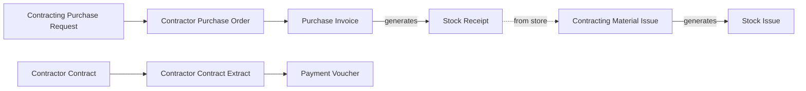
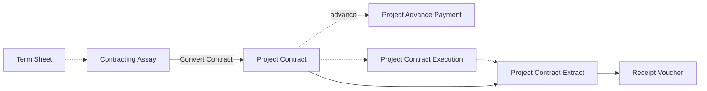

# Contracting Company

A contractor is building a 230,000 residential tower. Every week the site asks for steel and blocks, a
blockwork subcontractor sends his monthly extract, forty day labourers are paid from the foreman's
sheet, and once a month the company bills the owner for the work finished so far. Management asks
two questions about all of this: *what has this project cost so far*, and *how much of it have we
billed*. The contracting flow exists so that every purchase, every wage and every extract lands on
the right project, and ideally on the right line of its bill of quantities, without anyone sorting
it out at month end.

Nama supports three depths of the same business. Some contractors only tag their spending with the
project. Many run the cost side inside the Contracting module. Some also bill the owner from it. This
page walks through all three, so you can pick the one that fits and grow into the next later.

## Who this fits

- Building, civil, finishing, electromechanical and infrastructure contractors: project-based work
  with site purchasing, subcontractors and a large site workforce. Across Nama installations, about
  1 in 10 companies are contractors.
- About 3 in 5 contractors use the Contracting module, mostly for the cost side. About 3 in 10 also
  bill the project owner through project extracts. About 2 in 5 cost their projects on dimensions
  alone and never open the module.
- Contractors usually combine this page with
  [Multi-Company Group](/business-scenarios/scenario-multi-company-group), when each large project or
  joint venture is its own company, and with
  [Service Company and Finance-Only Use](/business-scenarios/scenario-service-and-finance-only) for
  the head-office books. A contractor that builds its own units for sale also reads
  [Real Estate Developer](/business-scenarios/scenario-real-estate-developer).

## What you need

::: info Required licences
`contracting` (and `contracting-qc` for the site quality screens), `supplychain-inventory`,
`supplychain-purchases`, `fixedassets`, `humanresource-payroll`, `basic-mobile-ess` for attendance
from the phone, `accounting-banks`, and `accounting-lgt` for tender and performance guarantees.
:::

The *dimensions only* tier needs none of the Contracting licences: `accounting`, the supply chain
licences and payroll are enough.

- [Contracting](/modules/contracting/): projects, contracts, extracts, budgets and project cost.
- [Supply Chain](/modules/supplychain/): site warehouses, purchase invoices and stock receipts.
- [Accounting](/modules/accounting/): payment requests and vouchers, miscellaneous invoices,
  cheques and letters of guarantee.
- [Human Resources](/modules/hr/): payroll for the site and office staff.
- [Fixed Assets](/modules/fixedassets/): cranes, mixers and vehicles, and their depreciation.
- [Mobile](/modules/mobile/): attendance check-in from the site.

## The document flow

The cost side, when it runs inside the Contracting module:

The owner side, for contractors that also bill the owner from the module:

Follow one month on the tower, at the full depth:

1. **The site asks for steel.** The site engineer raises a **Contracting Purchase Request** for four
   tonnes of rebar against the concrete term of the project contract. The request books nothing; it
   records what the site needs and for which term.
2. **The buyer orders it.** A **Contractor Purchase Order** is created from the request. It adds the four tonnes to the term's ordered
   quantity on the contract, and books no money.
3. **The supplier is invoiced.** There is no contracting purchase invoice: the order is invoiced on
   the ordinary **Purchase Invoice**, which settles the supplier side. The steel enters the site
   warehouse on a **Stock Receipt**, generated from the invoice or received first and collected into
   it.
4. **The steel is used.** When the bar leaves the store for the pour, a **Contracting Material Issue**
   against the concrete term generates the **Stock Issue** that moves the stock, and puts the
   inventory cost of the steel on the project. This is the moment the material becomes project cost.
5. **Services and hire.** Things that are never stocked (crane hire, site electricity, a permit) go on
   a **Misc Contracting Invoice**, whose lines carry the term code and put their cost on the project.
6. **Day labour.** The foreman's sheet of casual workers becomes a **Daily Labor Book**, which books
   the wages and puts them on the project as workers' cost. Staff on payroll reach the project
   separately, through the salary documents and the employee cost distribution.
7. **The subcontractor bills.** The blockwork subcontractor works under a **Contractor Contract**.
   His monthly **Contractor Contract Extract** certifies 800 m², deducts retention and a slice of his
   advance, and books the cost and the payable. A **Payment Voucher** pays him.
8. **The owner is billed.** On the owner side, the **Project Contract** (often converted from a
   **Contracting Assay** built on a **Term Sheet**) holds the priced terms. Signing it books nothing.
   An optional **Project Contract Execution** records the quantities done this month, and the
   **Project Contract Extract** bills them: revenue, tax, retention withheld and advance recovered.
   The owner's **Receipt Voucher** settles it.

The rule behind both diagrams: contracts book nothing, extracts book everything. The details are in
the [Contracting overview](/modules/contracting/contracting-overview).

## Setting it up, in order

1. **One project record per site, with its dimension.** Create the
   [contracting project](/modules/contracting/setup/contracting-projects), an
   [analysis set](/platform/shared-master-files/dimensions-and-composite-dimensions) for it, a site
   warehouse where material is stored on site, and
   [document books](/platform/documents-and-records/document-books) if each project numbers its own
   documents. The analysis set is what every report filters on, so it comes first even at the
   *dimensions only* depth.
2. **The standard terms, with their accounts.** Each
   [standard term](/modules/contracting/setup/contracting-standard-terms) carries the accounts its
   share of an extract is booked on. Without them an extract has nothing to book.
3. **Conditions and contract templates.** Retention, advance recovery and penalties are
   [conditions](/modules/contracting/setup/contracting-conditions); bundle the usual ones so nobody
   re-keys them per contract.
4. **Contractors.** Register each [subcontractor](/modules/contracting/setup/contracting-contractors-and-consultants),
   and decide once whether he is linked to a supplier record, so that his balance shows in one place.
5. **The document terms (توجيه), checked one by one.** Every contracting document that books
   something takes its accounts and its generated documents from its term: the extracts, the
   material issue (which needs the book and term of the stock issue it generates), the Daily Labor
   Book and the misc contracting invoice. Review each term's accounting effects on a test document
   before go-live. See [Contracting document terms](/modules/contracting/document-terms/contracting-terms-basics).
6. **Site users.** Give site engineers a [security profile](/platform/security/security-profiles)
   that only raises requests (purchase requests, material issue requests, payment requests), and let
   buyers and accountants convert them.
7. **People.** Set up payroll per site and, where attendance is taken from the phone, the
   [mobile self-service](/modules/mobile/mobile-hr-self-service) attendance zones.

## Settings and tools most companies use

- **Payroll.** About 3 in 5 contractors run payroll in Nama, against about 2 in 5 companies overall.
  See [Human Resources](/modules/hr/).
- **Mobile attendance.** About a third take attendance from the phone, twice the share seen
  elsewhere. See [Employee self-service](/modules/mobile/mobile-hr-self-service).
- **Fixed assets.** About half keep their plant and vehicles in the fixed assets module, and
  depreciation can land on project cost. See [How project cost is built](/modules/contracting/costs/contracting-cost-model).
- **Payment requests.** About 2 in 5 route site spending through a payment request before the
  voucher, against about 1 in 5 overall. See [Receipt and payment vouchers](/modules/accounting/money-in-and-out/receipts-and-payments).
- **Analysis sets.** About 3 in 5 tag documents with an analysis set per project. See
  [Dimensions](/platform/shared-master-files/dimensions-and-composite-dimensions).
- **Many warehouses and many books.** About half keep 20 or more warehouses, typically one per site,
  and hundreds of [document books](/platform/documents-and-records/document-books) are normal when
  each project numbers its own documents.
- **Letters of guarantee.** About 1 in 5 track tender and performance guarantees. See
  [Letters of guarantee](/modules/accounting/bank-facilities/letters-of-guarantee).

## Variations

**Dimensions only.** The project is an analysis set, and nothing more. Site purchases go on ordinary
purchase invoices into the site warehouse, services on a
[Miscellaneous Invoice](/modules/accounting/money-in-and-out/misc-purchasing), and petty spending on a
Payment Request that the cashier turns into a Payment Voucher; every one of them carries the
project's analysis set. Cost per project comes from the ledger filtered by that analysis set. It is
quick to start, and it answers "what did the project cost", though not "what did this term cost".

**Cost side in the module.** The flow in the first diagram. Project cost builds up term by term from
material issues, misc contracting invoices, the Daily Labor Book, subcontractor extracts and the
distributed cost of staff and plant, and the contract's terms grid shows actual cost against
contract value at any moment. See [How project cost is built](/modules/contracting/costs/contracting-cost-model),
[purchasing](/modules/contracting/costs/contracting-purchasing),
[project materials](/modules/contracting/costs/contracting-project-materials),
[daily labour](/modules/contracting/costs/contracting-daily-labour) and
[miscellaneous spend](/modules/contracting/costs/contracting-misc-spend).

**Owner billing outside the module.** Some contractors run the cost side in the module but bill the
owner on an ordinary Proforma Sales Invoice and Sales Invoice, tagged with the project's analysis
set. That works, but the owner's retention, advance recovery and cumulative billed quantities then
live outside the contract, so the [project extract](/modules/contracting/project-contracting/contracting-project-extracts)
is the better fit once billing follows a bill of quantities.

**Tendering.** Contractors who bid build a [Term Sheet](/modules/contracting/setup/contracting-term-sheets),
price it on a [Contracting Assay](/modules/contracting/project-contracting/contracting-assays) or a
contracting offer, analyse each term's planned cost on
[term analysis cards](/modules/contracting/setup/contracting-term-analysis-cards), and convert the
winning bid into the project contract. All of this is optional; a contract can be typed directly.

## Decisions to make before go-live

- **How much of the module to adopt.** Dimensions only, the cost side, or the full owner cycle. The
  depths build on each other: the analysis set stays useful at every depth, and owner billing can be
  added once the cost side is running.
- **Analysis set or contracting project, or both.** Even at the full depth, keep the analysis set per
  project: the ledger and every non-contracting report filter on it.
- **Stocked material or direct cost.** Material that sits in a warehouse goes through the purchase
  pair and reaches the project when it is issued. Anything that is never stocked goes on the misc
  contracting invoice. Decide which items are which before the first order.
- **Term code required or optional.** A cost line without a term code saves and books correctly but
  never reaches the project's cost. Make the term code mandatory on the material and purchasing terms
  unless you deliberately need blank lines.
- **Who raises and who converts.** Limited site users who only raise requests, with buyers and
  accountants converting them, keep site purchasing under control without slowing the site down.
- **Casual labour or payroll.** Day labourers paid from the foreman's sheet go on the Daily Labor
  Book; staff on payroll reach project cost through the employee cost distribution. Pick one route
  for each kind of worker.

## Where to read next

1. [Contracting overview](/modules/contracting/contracting-overview)
2. [Contracting configuration](/modules/contracting/contracting-configuration)
3. [Contracting projects](/modules/contracting/setup/contracting-projects) and
   [standard terms](/modules/contracting/setup/contracting-standard-terms)
4. [How project cost is built](/modules/contracting/costs/contracting-cost-model)
5. [Contracting purchase requests and orders](/modules/contracting/costs/contracting-purchasing) and
   [issuing material to a project](/modules/contracting/costs/contracting-project-materials)
6. [The subcontractor cycle](/modules/contracting/contractor-contracting/contracting-contractor-cycle) and
   [subcontractor extracts](/modules/contracting/contractor-contracting/contracting-contractor-extracts)
7. [The project contracting cycle](/modules/contracting/project-contracting/contracting-owner-cycle) and
   [project extracts](/modules/contracting/project-contracting/contracting-project-extracts)
8. [Miscellaneous purchasing](/modules/accounting/money-in-and-out/misc-purchasing) and
   [receipt and payment vouchers](/modules/accounting/money-in-and-out/receipts-and-payments)
