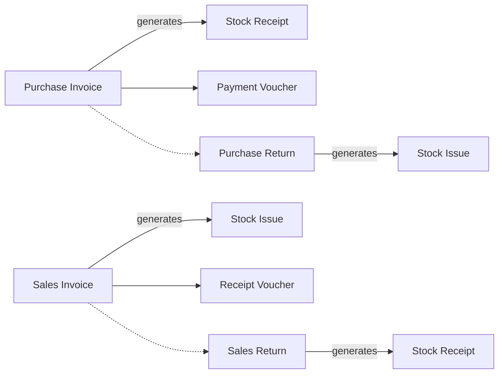

# Direct-Invoice Trading

A paint shop buys 500 tins from its supplier on one purchase invoice, and that afternoon a painter walks in, takes 12 tins and pays at the counter. Nobody wrote a quotation or an order, and nobody in the warehouse typed a stock issue: the invoice *is* the sale, and the goods leave with it. This page shows how Nama is set up for a business that sells this way, where each invoice carries its own stock movement and its own payment.

## Who this fits

- Traders, shops, distributors with walk-in or regular customers, workshops and small wholesalers whose sale is decided and delivered on the spot. Buying mirrors selling: the supplier's invoice is what brings the goods in.
- Across Nama installations, nearly 2 in 5 companies work this way. They invoice every month, and their orders and quotations together come to less than a tenth of their invoices.
- It is the starting point for most other selling styles. When the price has to be negotiated first, add [Quotation-Led Selling](/business-scenarios/scenario-quotation-led-selling); when account customers order ahead and are delivered later, see [Order-to-Cash Distribution](/business-scenarios/scenario-order-to-cash-distribution); when the goods come from abroad, add [Importer: Landed Cost and Letters of Credit](/business-scenarios/scenario-importer-landed-cost). A busy counter with many registers usually moves to [Retail Chain with Point of Sale](/business-scenarios/scenario-retail-chain-pos).

## What you need

::: info Required licences
`accounting`, `supplychain-sales`, `supplychain-purchases`, `supplychain-inventory`. Often also `accounting-banks` (cheques and bank transfers) and `basic-tax-e-invoice` (electronic invoicing).
:::

- [Supply Chain](/modules/supplychain/) holds the items, warehouses, invoices, returns and the stock documents they generate.
- [Accounting & Banks](/modules/accounting/) holds the chart of accounts, the cash safes, receipt and payment vouchers and, with the banks licence, cheques.
- [Invoicing](/modules/invoicing/) covers price lists and offers, discounts and tax, and electronic invoicing where your tax authority requires it.

## The document flow

Follow the paint shop through one month:

1. **Buying.** The supplier delivers 500 tins with an invoice. The buyer enters a **Purchase Invoice**. Because its term has **Generate Document(s)** switched on, saving it creates a **Stock Receipt** for the 500 tins in the invoice's warehouse, so the stock and its cost arrive with the invoice. Nobody opens the Stock Receipt screen.
2. **Paying the supplier.** When the shop pays, **Generate payment voucher** on the saved purchase invoice creates a **Payment Voucher** against the supplier for the invoice's remaining value.
3. **Selling.** The painter takes 12 tins. The cashier enters a **Sales Invoice** for the painter. Its term generates the **Stock Issue** when it is saved, so the 12 tins leave the warehouse, the cost of goods sold is recorded, and the revenue and tax entries are made in the same step.
4. **Taking the money.** The painter pays at the counter, and the cashier records it on the invoice's **Payment Lines** grid (cash, card, coupon or terminal). An account customer who pays later gets a **Receipt Voucher** instead: **Generate Receipt Voucher** on the invoice creates one for the remaining value, or finance raises it later and fills its **Invoices** tab with **Collect Vouchers**.
5. **A return.** Two tins were the wrong shade. The cashier enters a **Sales Return** and picks the original invoice in the line's **Invoice** column, so the customer is credited the price actually paid and cannot return more than was sold. The return's term generates the **Stock Receipt** that brings the tins back.
6. **Sending goods back.** Ten tins arrived damaged, so the buyer enters a **Purchase Return** against the supplier. It generates a **Stock Issue** that takes them out of stock.

The whole month uses no order, no quotation and no hand-typed stock document. Each invoice and return carries its own stock movement.

## Setting it up, in order

1. **Run the setup wizard and settle the chart of accounts.** The wizard creates the document books, terms and settings that match your answers, and the chart decides where every entry lands. See [Wizard File](/admin/wizard-file) and [Chart of Accounts](/modules/accounting/ledger-setup/chart-of-accounts).
2. **Create the warehouses**, one for each place where stock is kept and counted, with locators if you need shelf positions. See [Warehouses & Locators](/modules/supplychain/warehouses-and-locators).
3. **Import the items, their units and the price lists.** Units and the item type are hard to change once stock has moved, so get them right first. See [Understanding Inventory Items](/modules/supplychain/understanding-items), [Pricing and Offers Management Guide](/modules/invoicing/pricing-and-offers-guide) and [Importing Records](/platform/import-export/importing-records).
4. **Import the customers and suppliers**, with their accounts, price list and payment period. See [Customers, Suppliers and Other Parties](/platform/shared-master-files/customers-suppliers-and-parties).
5. **Enter the opening stock** with an **Opening Stock Document** per warehouse. Its term generates the Stock Receipt that brings the quantities in, and it belongs in the opening period. See [Opening Stock Document](/modules/supplychain/receiving-stock#Opening-Stock-Document-OpeningStockDocument).
6. **Set the document books and the terms that generate the stock documents.** On the Sales Invoice, Purchase Invoice, Sales Return and Purchase Return terms, switch on **Generate Document(s)** and name the **Generation Book** and **Generation Term** of the stock document to create. See [Document Books](/platform/documents-and-records/document-books) and [Generation & Dimensions Configuration](/modules/supplychain/document-terms/doc-term-generation-and-dimensions#Generation).
7. **Create the cash safes and bank accounts** that receipts and payments go through. See [Accounts Bags, Safes & Partners](/modules/accounting/ledger-setup/accounts-bags-safes-and-partners) and [Banks, Bank Accounts & Transfers](/modules/accounting/banks-and-cheques/banks-and-bank-accounts).
8. **Create the users and their security profiles**, so that cashiers sell and collect while buyers buy. See [Security Profile](/platform/security/security-profiles).

## Settings and tools most companies use

- **Sales returns**: about 4 in 5 companies in this scenario issue them, nearly always against the original invoice. See [Returns and Replacements](/modules/supplychain/sales-journey#Returns-and-Replacements).
- **The Opening Stock Document**: about 2 in 3 have used it to bring their stock in at go-live. See [Receiving Stock](/modules/supplychain/receiving-stock).
- **Price lists**: about half price their sales through price lists rather than typing prices on each line. When no list applies, **Use Last Sales Price** can reuse what the customer was last charged. See [Pricing & Price Lists Configuration](/modules/supplychain/configuration/pricing-and-price-lists).
- **A voucher generated from the invoice** is a common chain on both sides: **Generate Receipt Voucher** on the sales invoice and **Generate payment voucher** on the purchase invoice. See [Linking Payment Vouchers to Invoices](/modules/invoicing/payment-entries).
- **Cheques**, where customers pay by post-dated cheque, are handled on the receipt voucher's **Financial Papers** tab. See [Cheques & Financial Papers](/modules/accounting/banks-and-cheques/cheques-financial-papers).

## Variations

**Receive first, invoice later.** Some companies take the goods in on a **Stock Receipt** when the truck arrives and enter the supplier's invoice days later. The invoice is then built from the receipts with **Collect** and **Apply Receipts** rather than generating a new receipt. The same pair works on the sales side for goods issued before they are billed. See [Collect and Apply](/modules/supplychain/the-document-screen#Collect-and-Apply-the-Two-Halves-of-One-Job) and [The Purchasing Journey](/modules/supplychain/purchasing-journey#In-practice).

**Invoice by hand, issue on demand.** A term can leave **Generate Document(s)** off. The invoice is then saved without stock, and **Create Inventory Doc.** on the invoice generates the Stock Issue (or Stock Receipt) when the warehouse is ready to act. This suits a shop where the office invoices and the warehouse confirms what actually went out.

**A cashier drawer.** Where one person collects many small amounts a day, the [cashier shift](/modules/accounting/money-in-and-out/cashier-shifts) adds an Open Shift, simplified cashier vouchers and a Close Shift that counts the drawer.

## Decisions to make before go-live

- **Which document moves the stock.** Decide per term whether the invoice generates its stock document, and keep to that choice. A Stock Issue typed by hand for goods that a generating invoice also covers, and not collected into that invoice, takes the goods out twice. If both habits must live side by side, switch on **Do Not Generate Documents Automatically If Manual Documents Are Found** on the invoice term: an invoice that already has stock documents in its grid then generates nothing.
- **Walk-in customers.** Either keep one cash customer for anonymous counter sales, or create the customer at the counter. The second gives you a name and a phone number for every sale, but some retailers end up with tens of thousands of customers, so plan how their codes are built.
- **Payment on the invoice or on a voucher.** Counter sales are simplest on the invoice's **Payment Lines**. Account customers who pay later, or pay several invoices at once, need receipt vouchers. Decide which customers get which.
- **Returns that come back, and returns that do not.** Use a return term that generates the Stock Receipt when goods physically come back, and a separate term or a credit note when only the price is adjusted. See [Credit & Debit Notes](/modules/accounting/money-in-and-out/credit-and-debit-notes).
- **Credit control.** The customer file records a credit limit, but saving an invoice does not check it. If you need invoices to stop at the limit, build the rule with [Criteria Based Validation](/platform/governance/criteria-based-validation#Block-a-sale-that-exceeds-the-customers-credit-limit).

## Where to read next

1. [The Sales Journey](/modules/supplychain/sales-journey)
2. [The Purchasing Journey](/modules/supplychain/purchasing-journey)
3. [Generation & Dimensions Configuration](/modules/supplychain/document-terms/doc-term-generation-and-dimensions)
4. [Issuing Stock](/modules/supplychain/issuing-stock) and [Receiving Stock](/modules/supplychain/receiving-stock)
5. [Receipt & Payment Vouchers](/modules/accounting/money-in-and-out/receipts-and-payments)
6. [Linking Payment Vouchers to Invoices](/modules/invoicing/payment-entries)
7. [Understanding Inventory Items](/modules/supplychain/understanding-items)
