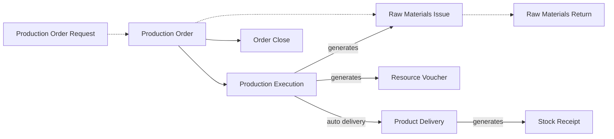

# Full Manufacturing Cycle

A paint factory makes 5,000 litres of white emulsion in one batch. The batch is mixed, ground, tinted and
filled over two days. The raw materials are released to the mixing floor in the morning, the batch waits
at the grinding mills overnight, and 40 litres fail the colour check at tinting and go back for rework.
When it is all over, the factory needs to know what one litre actually cost, and why that is more than
the recipe said.

A single assembly document cannot tell that story. It needs an order that plans the work, records that
follow the batch from stage to stage, and a close at the end that gathers every cost and settles it on
the product. That is the full manufacturing cycle, and this page walks through how factories run it in Nama.

## Who this fits

- A factory with **staged production**: products that pass through several operations at different work
  centres, with quantities waiting, rejected or scrapped between them, raw materials released to the
  floor, and an order that is closed and costed when it is done. Paints and chemicals, moulded plastic
  and metal parts, mattresses and furniture, cartons and steel are typical.
- Across Nama installations, about **1 in 12** companies run the full cycle, which is about half of all
  the manufacturers.
- The same factory often makes its simpler products on assembly documents. See
  [Production on Assembly Documents](/business-scenarios/scenario-assembly-production).
- Factories sell through [Order-to-Cash Distribution](/business-scenarios/scenario-order-to-cash-distribution),
  often buy their raw materials as an [Importer](/business-scenarios/scenario-importer-landed-cost), and
  are frequently one company in a [Multi-Company Group](/business-scenarios/scenario-multi-company-group)
  next to a trading arm.

## What you need

::: info Required licences
`manufacturing`, plus `manufacturing-mrp`, `manufacturing-molds` or `manufacturing-crtn-pln` where they apply; `supplychain-inventory`, `supplychain-purchases`; `supplychain-qc-qa` for quality documents; `humanresource-payroll` for the people side.
:::

- [Manufacturing](/modules/manufacturing/): BOMs, routings, work centres, production orders,
  execution, raw materials issue and return, product delivery, order close and costing.
- [Supply Chain](/modules/supplychain/): the warehouses and the stock issues and receipts that the
  manufacturing documents generate, plus purchasing of the raw materials.
- [Quality Control](/modules/supplychain/quality-control): checklists and quality documents generated
  by the execution.
- [Payroll](/modules/hr/payroll/): about 2 in 3 of these factories pay their workers in Nama.

## The document flow

The order is the plan, the executions record what happened, the issues and deliveries move the stock,
and the Order Close settles the cost. Here is the paint batch from start to finish.

1. **The request (optional).** Planning raises a **Production Order Request** for 5,000 litres. It goes
   through approval, and the **Production Order** is created against it. The order's **Production Order
   Request** field points back, so each document can be traced to the other.
2. **The order.** The planner picks the item, and the order copies in its **BOM** and **Routing**: the
   components multiplied up to 5,000 litres, and the four operations, mixing (10), grinding (20),
   tinting (30) and filling (40). If the production order term names a raw material issue request book
   and term, saving the order also creates a **Raw material issue request**, so the store sees what to
   prepare. The planner presses **Start Production Order** and saves: the order is now **In Progress**,
   and its component and routing lines are frozen.
3. **Raw materials leave the store.** A **Raw Materials Issue** charges material to the order. The
   order is the one required field. The storekeeper can raise it from the order, using **Issue For
   Finished Product Quantity** to scale the BOM, or the execution generates it for components that are
   issued with execution. Its term generates the **Stock Issue** that actually reduces stock.
4. **Work moves through the stages.** Each **Production Execution** records quantities moving from one
   operation to the next. At tinting, 4,960 litres move on and 40 litres move to **Rejected**. A later
   execution sends those 40 litres back to grinding, and they come through again. Committing an execution
   generates what its term asks for: raw materials issues, **Resource Vouchers** for labour and machine
   time, and quality documents for operations that have a checklist.
5. **The paint reaches the warehouse.** With **Automatic Product Delivery** on the execution's term, the
   line that moves quantity into the last operation creates a **Product Delivery**. The delivery always
   generates a **Stock Receipt** for the finished paint and any co-products.
6. **Leftovers come back.** 120 kg of pigment was not used. A **Raw Materials Return** against the order
   puts it back into stock through the stock receipt it generates, and takes it out of the order's cost.
7. **The order is closed.** An **Order Close** voucher gathers every material issue, return and resource
   voucher for the order, adds overheads from the order's overhead type, and revalues the product
   deliveries at the actual unit cost. The deliveries' entries follow the new cost, and the order becomes
   **Closed**. From then on, documents that work on it are refused.
8. **The sale.** The paint is sold from stock at its closed cost, through whichever
   [selling scenario](/business-scenarios/) the company uses.

## Setting it up, in order

1. **Items.** Create raw materials, intermediates and finished products, with their units and costing
   settings. See [Understanding Items](/modules/supplychain/understanding-items).
2. **Work centres and standard operations.** These say where the work happens, what it consumes and at
   what rate. Routings point to them. See
   [Work Centers and Standard Operations](/modules/manufacturing/manufacturing-work-centers).
3. **BOMs.** These say what one unit of each product consumes. Build the lower levels before the
   products that use them. See [Bill of Materials](/modules/manufacturing/manufacturing-bom).
4. **Routings.** These list the operations each product passes through and the resources each step uses.
   See [Routings](/modules/manufacturing/manufacturing-routing).
5. **Manufacturing settings.** These are database-wide options for orders, issues, returns and execution.
   See [Manufacturing Settings](/modules/manufacturing/manufacturing-configuration).
6. **Document terms.** These hold most of the real behaviour: what the production order requires and
   allows, whether it raises an issue request, what each execution generates, whether delivery is
   automatic, and the stock documents behind issues, returns and deliveries. Fill every generation book
   and term your process will use. See
   [Production Order and Planning Document Terms](/modules/manufacturing/document-terms/mfg-terms-production-orders),
   [Execution and Delivery Document Terms](/modules/manufacturing/document-terms/mfg-terms-execution-and-delivery)
   and [Raw Material Document Terms](/modules/manufacturing/document-terms/mfg-terms-materials).
7. **Production warehouses.** Set up the raw-material stores and the finished-goods stores that the
   issues and deliveries use. See [Warehouses and Locators](/modules/supplychain/warehouses-and-locators).
8. **Costing.** Set up the overhead types, and decide on standard prices and cost per batch, before the
   first order is closed. See [Production Costing](/modules/manufacturing/production-costing) and
   [Costing, Resource and Mold Document Terms](/modules/manufacturing/document-terms/mfg-terms-costing).

## Settings and tools most companies use

- **The core trio.** Every factory on this cycle records executions, raw materials issues and product
  deliveries. See [Production Execution](/modules/manufacturing/production-execution) and
  [Issuing and Returning Raw Materials](/modules/manufacturing/raw-material-issue).
- **Closing orders.** About 2 in 3 close their orders with the Order Close voucher. See
  [Production Costing](/modules/manufacturing/production-costing).
- **Raw materials returns.** About 1 in 3 record material coming back from the floor. See
  [Issuing and Returning Raw Materials](/modules/manufacturing/raw-material-issue).
- **Item requests.** About 2 in 3 raise item requests to buy their raw materials. See
  [The Purchasing Journey](/modules/supplychain/purchasing-journey).
- **Quality control.** About 1 in 4 generate quality documents from production. See
  [Quality Control](/modules/supplychain/quality-control).
- **Payroll.** About 2 in 3 pay their workers in Nama. See [Payroll](/modules/hr/payroll/).

## Variations

**Aggregated production orders.** A factory that plans a day or a week at a time collects its
requirements on an **Aggregated Production Order**. It can collect open production order requests, or
be built from a sales order or sales invoice in **From Document**, and it creates one production order
per line. A work centre that runs several orders together can then execute them in one go by selecting
the aggregated order on the execution. See
[Production Orders](/modules/manufacturing/production-orders#Aggregated-Production-Orders-for-Batch-Planning).

**Made to order.** A production order's **From Document** accepts a production order request, an MRP
document, an aggregated production order or a carton material plan. It does not accept a sales order.
A customer's order therefore reaches the factory through an aggregated production order built on it,
through MRP collecting it as demand, or through a production order the planner raises by hand for that
job.

**Planning with MRP.** With `manufacturing-mrp`, the MRP document collects demand, nets it against stock
and proposes production and purchase lines that it then generates. Few factories use it. Most plan by
hand or with aggregated orders. See
[Material Requirements Planning](/modules/manufacturing/material-requirements-planning).

**A request step for raw materials.** Instead of issuing directly, the production order term can raise a
**Raw material issue request** with every order, and stores that weigh what they hand over can turn
weighed request lines into the issue. See
[Raw Material Document Terms](/modules/manufacturing/document-terms/mfg-terms-materials).

**Moulds, cartons and offcuts.** Moulded-parts factories track their tools with
[Manufacturing Molds](/modules/manufacturing/manufacturing-molds). Corrugated-carton plants use
[Carton Manufacturing](/modules/manufacturing/carton-manufacturing-overview). Offcuts that still have
value go back into stock on a [Scrap Receipt](/modules/manufacturing/scrap-receipt).

## Decisions to make before go-live

- **One order at a time, or aggregated orders.** Some factories run a strict order → executions → close
  cycle for every batch. Others plan with aggregated orders and execute and close them together.
- **How raw materials are released.** They can be issued up front from the order, raised through an
  issue request first, or generated by each execution for components issued with execution. You can mix
  the three per component, but decide the default.
- **BOMs per product or per batch.** Where every batch differs, as in tinted paints or custom furniture,
  some companies edit the components on each order, which **Can Update Bom Details** allows while the
  order is still Initial. Others keep a BOM per variant and end up with more BOMs than items. Both are
  sound choices.
- **Automatic or manual delivery.** Automatic delivery receives the product the moment the last
  operation is executed. Manual delivery lets the warehouse confirm the count first.
- **Close every order.** Until the Order Close, deliveries carry a provisional cost. A normal close is
  refused while part of the order's quantity has not been started. Use **Terminate** for orders that
  will never finish: costing and accounting are the same as a normal close.
- **Quality gates.** Decide whether an operation, or the delivery, must wait for an approved quality
  document. The execution and delivery terms can enforce it.

## Where to read next

1. [Manufacturing Module Overview](/modules/manufacturing/manufacturing-overview)
2. [Work Centers and Standard Operations](/modules/manufacturing/manufacturing-work-centers)
3. [Bill of Materials](/modules/manufacturing/manufacturing-bom) and [Routings](/modules/manufacturing/manufacturing-routing)
4. [Production Order Requests](/modules/manufacturing/production-order-request) and [Production Orders](/modules/manufacturing/production-orders)
5. [Issuing and Returning Raw Materials](/modules/manufacturing/raw-material-issue)
6. [Production Execution](/modules/manufacturing/production-execution)
7. [Production Costing](/modules/manufacturing/production-costing)
8. [Manufacturing Settings](/modules/manufacturing/manufacturing-configuration) and the [manufacturing document terms](/modules/manufacturing/document-terms/mfg-terms-production-orders)
