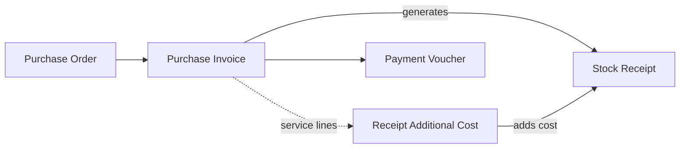
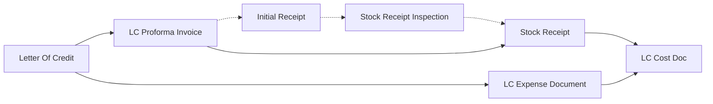

# Importer: Landed Cost and Letters of Credit

An appliance importer buys 400 ovens from a factory abroad at USD 150 each, then pays 12,000 for sea freight, 11,250 in customs and 3,750 to the clearing agent before the ovens reach its warehouse. If those 27,000 never reach the ovens, each one sits in stock at its factory price, and every margin the company reports afterwards is overstated. This page shows how the charges are put onto the goods: with an additional-cost document next to the purchase invoice, which is how most importers work, or through the letter-of-credit screens when the bank side has to be followed too.

## Who this fits

- A company that buys goods abroad in a foreign currency, where freight, insurance, customs and clearing have to land on the cost of the items.
- Across Nama installations, nearly 2 in 5 companies add landed cost to their purchases. About 1 in 3 use the **Receipt Additional Cost** document, and about 1 in 7 follow their imports through the letter-of-credit screens.
- Importing usually sits behind a selling scenario. About 2 in 3 of the companies that run sales orders also add landed cost, so this page is most often read together with [order-to-cash distribution](/business-scenarios/scenario-order-to-cash-distribution), [direct-invoice trading](/business-scenarios/scenario-direct-invoice-trading) or a [retail chain](/business-scenarios/scenario-retail-chain-pos) that buys centrally.

## What you need

::: info Required licences
`supplychain-purchases`, `supplychain-inventory` (the Receipt Additional Cost, the Initial Receipt and the receipt inspection belong to it), `supplychain-lc` for the letter-of-credit screens, and `accounting-banks` for the Exchange Rate Update and bank transfers. Add `accounting-lgt` where the supplier or customs ask for letters of guarantee.
:::

- [Supply Chain](/modules/supplychain/): purchase orders and invoices, stock receipts, the additional-cost document, the letter of credit and costing.
- [Accounting](/modules/accounting/): exchange rates and revaluation, bank accounts, and the bank side of letters of credit and guarantees.

## The document flow

The common route, where the charges follow the purchase invoice:

The letter-of-credit route, where the credit carries the goods and their expenses:

Follow the 400 ovens through the common route.

1. **The order.** The buyer sends a **Purchase Order** for 400 ovens at USD 150. The order is a commitment and books nothing.
2. **The supplier's invoice.** When the ovens arrive, the **Purchase Invoice** is entered in US dollars. Choosing the currency fetches the rate for the invoice's value date from the Exchange Rate screen, 3.75 here, so the invoice is worth 225,000 in local currency. Its term generates the **Stock Receipt** that puts the ovens into the warehouse at 562.50 each.
3. **The charges.** There are two ways to bring in the 27,000. If the forwarder's and the agent's bills are at hand, the buyer adds them to the same purchase invoice as service-item lines, and the invoice term's **Create Receipt Additional Cost With Service Items** option generates a **Receipt Additional Cost** from them. If they arrive later, a **Receipt Additional Cost** is created directly and linked to the invoice or the receipt, one line per charge, each naming its **Expense Item** and the party to credit: the shipping line, the customs authority or the clearing agent.
4. **The cost lands on the ovens.** The additional-cost document spreads the 27,000 over the received items on the basis you choose: by value, by weight, by quantity or by hand. Each oven now costs 562.50 + 67.50 = **630**. The work is done when the document's inventory request is processed in the background, so the receipt's cost columns change a moment after the save.
5. **The ovens are sold.** Each stock issue takes 630 to cost of sales, the charges included. Nothing extra needs setting up for this step.
6. **The supplier is paid.** A **Payment Voucher** or bank transfer settles the USD 60,000. While the debt is still open, an **Exchange Rate Update** restates its local value when the rate moves.

On the letter-of-credit route the same shipment goes like this:

1. The bank opens the credit. Where the bank cycle is tracked, the **LC Request**, **Opening Request** and **Opening Document** come first; the opening document creates the accounting entries and loads the down payment and the opening commission onto the goods as costs.
2. The **Letter Of Credit** file holds the supplier, the bank, the value and expiry, the ports, and whether the goods come in several shipments.
3. The **LC Proforma Invoice** lists the 400 ovens and their price. Expenses cannot be loaded onto a credit that has no proforma invoice, because there would be no item values to spread them over.
4. Each charge, as it is incurred, goes on an **LC Expense Document** (*Expense Document* on screen) naming the credit and, for a credit with several shipments, the shipment.
5. The ovens are received with a **Stock Receipt** that names the credit, or its shipment, as its **Cost Source**. Companies that check goods before accepting them put an **Initial Receipt** and a **Stock Receipt Inspection** in front of it.
6. The **LC Cost Doc** closes the costing: **Collect Item Expenses** fills it from the expenses recorded against the credit or shipment, and saving it spreads them over the received items. It is refused until at least one saved stock receipt names the credit.

## Setting it up, in order

1. **Currencies and exchange rates.** Create the currencies you buy in and enter their rates. A document looks for a Daily rate, then a Date Range, a Period and an Annual rate, and never falls back to an earlier day, so keep a Period or Annual rate behind the daily ones ([Currencies and Exchange Rates](/platform/shared-master-files/currencies-and-exchange-rates)).
2. **Foreign suppliers.** Set up the suppliers you import from, and the agreed prices and discounts if you keep them ([How a Purchase Price Is Decided](/modules/supplychain/purchase-pricing)).
3. **Expense items.** Create one **Expense Item** for each kind of charge (sea freight, customs, clearing, insurance), with its accounts and the basis it is spread on. If the charges will be typed on the purchase invoice, also create a service item for each one with its expense item filled in ([Freight, Customs and Landed Cost](/modules/servicecenter/car-purchasing/car-landed-cost) has a worked example).
4. **Purchase terms.** On the purchase invoice term, set the stock receipt it generates and, if charges go on the invoice, switch on **Create Receipt Additional Cost With Service Items** with the book and term of the generated document ([Generation & Dimensions Configuration](/modules/supplychain/document-terms/doc-term-generation-and-dimensions)). On the stock receipt term, point **Additional Cost Credit** at the account the additional-cost document debits, so the two entries meet and the clearing account comes back to zero ([Accounting Effects Configuration](/modules/supplychain/document-terms/doc-term-accounting-effects#Additional-Cost--Purchase-Return-Difference)).
5. **The letter-of-credit side, if you use it.** Set up the banks and bank accounts, decide which credits take several shipments, and read [Import Letters of Credit](/modules/supplychain/letters-of-credit) with the bank side in [Bank Letters of Credit](/modules/accounting/bank-facilities/bank-letters-of-credit).
6. **Costing.** Choose between FIFO and moving average once, for the whole company, in [Costing Configuration](/modules/supplychain/configuration/costing-configuration), before the first receipt.

## Settings and tools most companies use

- **Purchase orders.** About 7 in 10 importers order before they invoice ([The Purchasing Journey](/modules/supplychain/purchasing-journey)).
- **The additional-cost document.** It typically runs at about one for every five purchase invoices: nearly one per invoice at some importers, several per invoice at others ([Inventory Costing & Revaluation](/modules/supplychain/inventory-costing#Additional-Costs-on-Receipts-ReceiptAdditionalCost)).
- **Exchange Rate Update.** About 1 in 6 companies revalue their foreign-currency balances with it, typically once a month ([Journal Entries & Adjustments](/modules/accounting/ledger-setup/journal-entries#Exchange-Rate-Update)).
- **Letters of credit.** About 1 in 7 companies keep their [letters of credit](/modules/supplychain/letters-of-credit) in Nama, and most of them carry their credits through to the proforma invoice, the expenses and the cost distribution.
- **An inspection gate.** Fewer than 1 in 10 put an Initial Receipt and an inspection in front of the stock receipt, mostly for food and technical goods ([Receiving Stock](/modules/supplychain/receiving-stock#Integration-with-Receipt-Inspection), [Quality Control](/modules/supplychain/quality-control)).
- **Letters of guarantee.** Importers that deal with customs bonds or supplier guarantees track them on [Letters of Guarantee](/modules/accounting/bank-facilities/letters-of-guarantee).

## Variations

**Charges known before the goods arrive.** A Receipt Additional Cost can be raised against the purchase order with **Temporary Distribute Cost On Orders**. When the purchase invoice is later created from that order, the additional-cost document is moved onto the invoice by itself.

**One shipment, several invoices.** When a container is billed on several purchase invoices, one Receipt Additional Cost can cover them all: list them in its **Costed Documents** grid. The documents on one additional-cost document must all be of the same type.

**Charges that are not item cost.** A bank's annual fee or the cost of a market visit does not belong on the goods. Book it on a **Miscellaneous Invoice**, which sends it straight to an expense account ([Misc Purchasing](/modules/accounting/money-in-and-out/misc-purchasing)).

**Quality check before stock.** Food and technical importers record arrival with an **Initial Receipt**, which moves no stock, check the goods with a **Stock Receipt Inspection** or a **Quality Control** document, and only then bring the accepted quantity in with a **Stock Receipt** ([Receiving Stock](/modules/supplychain/receiving-stock#Initial-Receipt-InitialReceipt)).

**Car importers.** Vehicles follow the same mechanism on the car purchase invoice, and the cost lands on each chassis ([Freight, Customs and Landed Cost](/modules/servicecenter/car-purchasing/car-landed-cost)).

## Decisions to make before go-live

- **The additional-cost document or the letter-of-credit screens.** The additional-cost document is enough when only the item cost matters. Use the letter-of-credit screens when the credit itself has to be followed: its opening, its margin, its shipments, its expenses and its events.
- **Per invoice or per shipment.** Charges can follow each purchase invoice, or one document can spread a container's charges over all the invoices it carried. Pick one and keep to it, so that the per-item costs of different shipments stay comparable.
- **Charges on the invoice, or on their own document.** Service lines on the purchase invoice suit charges that are known when the goods are billed. A separate Receipt Additional Cost suits bills that arrive weeks later from other parties.
- **The clearing account.** Decide which account the charges pass through, and make the additional-cost document and the stock receipt term agree on it before the first shipment.
- **Charges that arrive after the goods are sold.** How a late charge reaches the cost of what has already left the warehouse depends on the costing method and its settings. Read [Inventory Costing & Revaluation](/modules/supplychain/inventory-costing) and [Costing Configuration](/modules/supplychain/configuration/costing-configuration) before go-live, rather than after the first late invoice.

## Where to read next

1. [The Purchasing Journey](/modules/supplychain/purchasing-journey) and [Receiving Stock](/modules/supplychain/receiving-stock)
2. [Inventory Costing & Revaluation](/modules/supplychain/inventory-costing)
3. [Freight, Customs and Landed Cost](/modules/servicecenter/car-purchasing/car-landed-cost), for a worked example with its accounting
4. [Import Letters of Credit](/modules/supplychain/letters-of-credit) and [Bank Letters of Credit](/modules/accounting/bank-facilities/bank-letters-of-credit)
5. [Currencies and Exchange Rates](/platform/shared-master-files/currencies-and-exchange-rates)
6. [Costing Configuration](/modules/supplychain/configuration/costing-configuration)
7. [Quality Control](/modules/supplychain/quality-control) and [Letters of Guarantee](/modules/accounting/bank-facilities/letters-of-guarantee)
