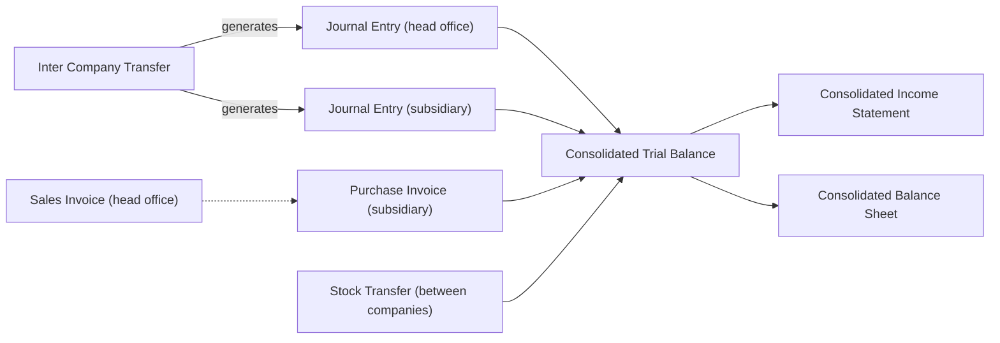

# Multi-Company Group

A family group owns a trading company in Riyadh, a factory that supplies it, and a subsidiary in Cairo that sells the same products in Egyptian pounds. Each company files its own tax returns and keeps its own books, yet the three share one item catalogue, one customer list, the same users and the same reports, and the owners want one set of statements for the whole group. Keeping all three in one Nama database gives them that: every company has its own ledger and its own numbering, and the consolidated statements put them together, with the business the companies did with each other taken out.

## Who this fits

- Sister companies that share master files, users and reports: a trading arm and a factory, one company per project or per store group, a regional subsidiary in another country.
- Across Nama installations, about 2 in 5 companies keep more than one legal entity in the same database, and about 1 in 4 keep three or more.
- A group usually runs one or more selling scenarios inside each company. A trading arm often follows [direct-invoice trading](/business-scenarios/scenario-direct-invoice-trading) or [order-to-cash distribution](/business-scenarios/scenario-order-to-cash-distribution), a factory [production on assembly documents](/business-scenarios/scenario-assembly-production) or the [full manufacturing cycle](/business-scenarios/scenario-full-manufacturing), and contractors and developers often open one company per project ([contracting company](/business-scenarios/scenario-contracting-company), [real estate developer](/business-scenarios/scenario-real-estate-developer)).

## What you need

::: info Required licences
No extra licence. `accounting` already covers the Inter-Company Transfer and the three consolidated statements. The licence sets how many active legal entities you may have; inactive and composite legal entities do not count.
:::

- [Platform](/platform/): legal entities and the other dimensions, document books, security profiles, record-level security and field filtering.
- [Accounting](/modules/accounting/): ledgers, the chart of accounts, inter-company transfers, year-end closing and the consolidated statements.
- [Human Resources](/modules/hr/): the people side. About 2 in 5 of all companies run payroll in Nama, and employees and salary documents carry their company like every other record.

## The document flow

Each company buys, sells and pays with its own documents, in its own books. What is particular to a group is the business between the companies, and the reports that put them together:

Follow one quarter in the family group.

1. **Each company works in its own books.** The trading company, the factory and the Cairo subsidiary each have a **Legal Entity** record naming its **Ledger**, which sets the company's main currency and, through the account chart type, its chart of accounts. Every document carries its company as a dimension and is numbered in a document book that belongs to that company, so a sales invoice of the factory never takes a number from the trading company's series.
2. **The masters are shared.** Items and customers are saved with the legal entity left as **PUBLIC**, so all three companies sell the same items to the same customers without keeping three copies.
3. **The factory supplies the trading company.** Both companies keep their books in riyals, so the goods can move with a **Stock Transfer** whose term's **Transfer Type** is **Global (Normal)**. Processing takes the stock off the factory's books and puts it on the trading company's, each side against the other company's **Mediator account**, at cost.
4. **The trading company sells to Cairo.** A stock transfer is refused between companies whose ledgers use different currencies, so the trading company issues a **Sales Invoice** to the subsidiary and the subsidiary records a **Purchase Invoice**, both on accounts kept for group business. Each side is recorded in its own currency.
5. **Head office funds the subsidiary.** An **Inter Company Transfer** of USD 50,000 generates a **Journal Entry** in each company in one step, each balanced on the other company's mediator account. Between companies with different currencies, each line is converted at its own company's rate, and both mediator accounts end up holding the same USD 50,000.
6. **The group reports.** The **Consolidated Trial Balance** shows one column per company, then the eliminations and the group total. It translates each company into the reporting currency and reverses every account flagged **Intercompany**, so the funding, the group sales and their cost, and the margin on stock that Cairo still holds all drop out of the group figures. The **Consolidated Income Statement** and **Consolidated Balance Sheet** present the same result. Nothing has to be posted or closed before they run.
7. **The year closes per company.** Each company closes its own year with its own **Closing Entry**: one closing entry per period per legal entity.

## Setting it up, in order

1. **Legal entities.** Create one **Legal Entity** per company, within the licensed count, with its registration and tax numbers, its ledger and its **Mediator account** ([Dimensions and Composite Dimensions](/platform/shared-master-files/dimensions-and-composite-dimensions#Extras-on-individual-types)). The mediator account must be flagged Intercompany; the screen warns you when it is not.
2. **Ledgers and charts.** Decide which companies share a chart of accounts: companies on the same **Account Chart Type** work on the same chart, and each ledger fixes its main currency and calendar once a company is linked to it ([Accounting Concepts & First-Time Setup](/modules/accounting/ledger-setup/accounting-concepts-and-setup#The-Account-Chart-Type)). Set the **Reporting Currency** the group is presented in.
3. **Document books per company.** A book belongs to one legal entity and cannot be left as *Any*, so create each company's books before its first document ([Document Books](/platform/documents-and-records/document-books)).
4. **Who sees which company.** The dimensions on the user record fence everything a user can reach; the login context picks the company the session works in, and the login context table lists the other combinations a user may switch to ([Record-Level Security](/platform/security/record-level-security)). Then give each role its [security profile](/platform/security/security-profiles), and loosen individual lookups where a document must reach another company's records with [Field Filtering by Dimension](/platform/field-filtering/field-filtering-by-dimension).
5. **Screens each company does not use.** Hide them on the company record with **Unused Entities** and **Unused Features** ([Switching screens and features off for a company](/getting-started/licensing#Switching-screens-and-features-off-for-a-company)).
6. **The other dimensions.** Decide which of sector, branch, department and analysis set the group uses, and how strictly they are checked, in [Dimensions in global configuration](/platform/global-config/global-config-dimensions).
7. **Consolidation.** Keep group balances, group sales and their cost, and capital and investments on accounts of their own under charts flagged **Intercompany**, set the equity chart to **Historical**, and enter exchange rates with the legal entity left public so they serve the group ([A group set up for consolidation](/modules/accounting/financial-reporting/consolidated-statements#A-group-set-up-for-consolidation)).

## Settings and tools most companies use

- **Approvals.** About 3 in 4 groups route documents through [approvals](/platform/approvals/approvals-system).
- **Document books.** Hundreds of [document books](/platform/documents-and-records/document-books) are normal in a group, and some keep thousands, because every company, and often every branch or project, numbers its own documents.
- **Branches inside companies.** About half of groups also split their companies into [branches](/platform/shared-master-files/dimensions-and-composite-dimensions).
- **Year-end closing.** About 2 in 5 close their years with the [Closing Entry](/modules/accounting/ledger-setup/year-end-and-period-control), one per company.
- **Inter-company transfers.** About 1 in 8 groups record the business between their companies with the [Inter Company Transfer](/modules/accounting/ledger-setup/journal-entries#Inter-Company-Transfer); where it is used it is routine, often more than a hundred a year.

## Variations

**One company per project or store.** Contractors, developers and some retail groups open a company for each project, building or store group, so that each one has its own books and its own tax registration. The structure is the same; the number of companies, and of document books, is what grows.

**Companies in different currencies.** A group with companies in several countries keeps each ledger in its local currency. Stock between them moves by sales and purchase invoices rather than by stock transfer, inter-company transfers convert each line at its own company's rate, and the consolidated statements translate each company into the reporting currency ([Consolidated Statements](/modules/accounting/financial-reporting/consolidated-statements#How-the-companies-are-translated)).

**Stock between companies in the same currency.** Where both companies keep their books in the same currency, a stock transfer with the **Global (Normal)** transfer type moves the goods at cost and books both sides on the mediator accounts ([Transfers between companies](/modules/supplychain/moving-stock#Transfers-between-companies)).

**An asset sold within the group.** A fixed asset sold by one company to another is removed from the group figures by the consolidated balance sheet, provided the seller books its gain on a gain/loss account flagged Intercompany ([An asset sold within the group](/modules/accounting/financial-reporting/consolidated-statements#An-asset-sold-within-the-group)).

## Decisions to make before go-live

- **Legal entity or branch.** Separate books and a separate tax registration mean a legal entity. A location inside one company, sharing its books, is a branch. Every document carries its company from its first save, so take this decision before the first document.
- **Which user sees which company.** What a user can reach is fenced by the dimensions on the user record, not by the company picked at sign-in. The screens and features hidden for a company also follow the company on the user record; a user whose company is PUBLIC follows their **Default Legal Entity**. Decide which users are restricted to one company and which, such as the group finance team, work across all of them.
- **Shared or separate masters.** Items and customers left PUBLIC are shared by every company. Give a record a company only when the others must not see or use it.
- **One chart or several.** Companies on the same account chart type share one chart of accounts. A company that must follow a different statutory chart gets a chart type of its own.
- **How group business is settled.** Put every balance with a group company on accounts flagged Intercompany, and record transfers between companies with the Inter Company Transfer, which books both sides at once so they always agree. A group balance left on an ordinary account is not eliminated and shows up as an elimination difference in the consolidated balance sheet.

## Where to read next

1. [Dimensions and Composite Dimensions](/platform/shared-master-files/dimensions-and-composite-dimensions) and [Dimensions in global configuration](/platform/global-config/global-config-dimensions)
2. [Accounting Concepts & First-Time Setup](/modules/accounting/ledger-setup/accounting-concepts-and-setup) and [Fiscal Periods, Period Locking & Multi-Currency](/modules/accounting/support/accounting-periods-and-currency)
3. [Document Books](/platform/documents-and-records/document-books)
4. [Record-Level Security](/platform/security/record-level-security), [Security Profile](/platform/security/security-profiles) and [Field Filtering by Dimension](/platform/field-filtering/field-filtering-by-dimension)
5. [Licensing, and Why a Screen or Field Is Missing](/getting-started/licensing)
6. [Journal Entries & Adjustments](/modules/accounting/ledger-setup/journal-entries) and [Moving Stock Between Warehouses](/modules/supplychain/moving-stock)
7. [Consolidated Statements](/modules/accounting/financial-reporting/consolidated-statements)
8. [Year-End Closing & Period Control](/modules/accounting/ledger-setup/year-end-and-period-control)
