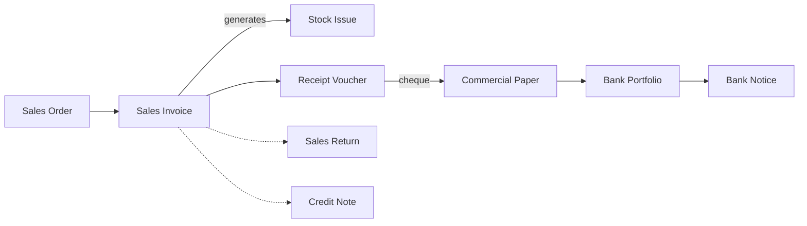
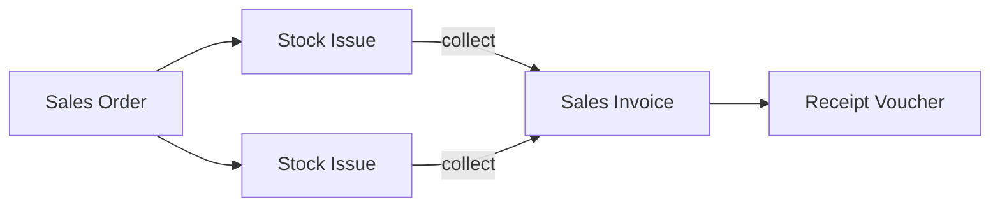

# Order-to-Cash Distribution

A medicines distributor takes about 40 orders a day from pharmacies, most of them by phone or through its reps. The goods go out on the company's own trucks the next morning, and the pharmacies pay weeks later, often with a cheque dated sixty days ahead. Between the order and the money there are reservations, deliveries, returns of short-dated stock and cheques waiting in the bank. This page shows the document chain that carries an order through all of that, and the three common ways of arranging the delivery.

## Who this fits

- Distributors of medicines and medical supplies, consumer goods, food and chemicals: orders from known account customers, delivered by the company's own vehicles, collected later, often by post-dated cheque.
- Across Nama installations, about 1 in 3 companies run sales orders routinely. About 1 in 5 have a step where the goods leave before the invoice is made, through a stock issue, a loading or a delivery document. Separate loading and delivery documents are used by about 1 in 10 companies, and van sales by a handful.
- Most distributors also import what they sell, so this page is usually read with [Importer: Landed Cost and Letters of Credit](/business-scenarios/scenario-importer-landed-cost). A distributor that negotiates prices per customer adds [Quotation-Led Selling](/business-scenarios/scenario-quotation-led-selling), and a group with several trading companies reads [Multi-Company Group](/business-scenarios/scenario-multi-company-group).

## What you need

::: info Required licences
`supplychain-sales`, `supplychain-inventory`, `supplychain-purchases`, `accounting-banks`. For reps and vans on Nama Mobile, `supplychain-sales-mobile-app` or `basic-mobile-orders`; for collectors recording receipts in the field, `accounting-electronic-receipt`; and `basic-tax-e-invoice` where electronic invoicing applies.
:::

- [Supply Chain](/modules/supplychain/) holds the order, the invoice, the stock issue, reservation, loading and delivery.
- [Accounting & Banks](/modules/accounting/) holds the receipt vouchers, the commercial papers (cheques), the bank portfolio and bank notice, and credit notes.
- [Invoicing](/modules/invoicing/) covers price lists, offers, price classifiers and electronic invoicing.
- [Mobile Applications](/modules/mobile/) puts orders, invoices and collections on the reps' phones.

## The document flow

One pharmacy order, from the phone call to the cleared cheque:

1. **The order.** A pharmacy orders 60 cartons. The sales clerk enters a **Sales Order**; the pharmacy's file fills in its price list, salesman, payment period and accounts. The order's term has **Reserve** ticked, so the 60 cartons are held for this pharmacy while the warehouse prepares the next day's loads.
2. **The invoice.** In the evening the clerk presses **Generate Invoice** on the order. The **Sales Invoice** copies the order, and saving it generates the **Stock Issue** that takes the cartons out of the warehouse and releases the order's reservation. The invoice is what the driver carries.
3. **The delivery.** The truck delivers the next morning and the pharmacy signs the invoice copy. If the company records deliveries separately, this is where the loading and delivery documents come in (see *Variations*).
4. **The collection.** Three weeks later the rep visits the pharmacy and collects a cheque dated sixty days ahead. Finance records a **Receipt Voucher** for the pharmacy, matches it to the invoice on the **Invoices** tab (**Collect Vouchers** fills it with the oldest open invoices), and enters the cheque on the **Financial Papers** tab. That creates the **Commercial Paper**, with the status *Received*.
5. **The bank.** On the due date the cheque goes to the bank on a **Bank Portfolio**, and its status moves to *Portfolioed*. When the bank confirms the money, a **Bank Notice** of collection moves it to *Collected*. If the cheque bounces, a bank notice of return moves it to *Temporary Bounced* or *Finally Bounced* and puts the amount back on the pharmacy's balance.
6. **A return.** Three cartons were short-dated and come back with the next truck. The clerk enters a **Sales Return** against the original invoice, picked in the line's **Invoice** column, so the pharmacy is credited what it paid. The return generates the **Stock Receipt** that brings the cartons back.
7. **A price claim.** The pharmacy was promised a promotional price that the invoice missed. No goods move, so finance issues a **Credit Note** for the difference, matched to the invoice on its **Details** tab, which reduces what the pharmacy owes.

## Setting it up, in order

1. **Customers with their classes, regions and credit terms.** Each customer carries the price list, salesman, payment period and credit limit that every order inherits, and the shipping address region drives delivery planning. See [Customers, Suppliers and Other Parties](/platform/shared-master-files/customers-suppliers-and-parties) and [Customer and Supplier Classes](/modules/supplychain/customer-and-supplier-classes).
2. **Price lists and price classifiers.** Price lists per customer class or category cover most needs. A sales price classifier separates prices that depend on something other than the customer and the item, such as the sales channel. See [Pricing and Offers Management Guide](/modules/invoicing/pricing-and-offers-guide) and [Sales Price Classifiers](/modules/supplychain/sales-price-classifiers).
3. **The order, invoice and issue terms**: which document reserves, which one releases the reservation, and which one generates the Stock Issue. See [Comprehensive Reservation System Guide](/modules/supplychain/reservation-system-guide) and [Generation & Dimensions Configuration](/modules/supplychain/document-terms/doc-term-generation-and-dimensions#Generation).
4. **Delivery organisations, drivers and cars**, if deliveries are planned in the system. See [Delivery & Loading](/modules/supplychain/delivery-and-loading).
5. **Commercial paper books and bank accounts**, so that received cheques are numbered, kept and deposited in the right bank. See [Cheques & Financial Papers](/modules/accounting/banks-and-cheques/cheques-financial-papers) and [Banks, Bank Accounts & Transfers](/modules/accounting/banks-and-cheques/banks-and-bank-accounts).
6. **Credit control.** The customer's credit limit is recorded but not checked on save. Distributors that must stop an order or invoice above the limit build the rule with [Criteria Based Validation](/platform/governance/criteria-based-validation#Block-a-sale-that-exceeds-the-customers-credit-limit), or route such orders through an approval.
7. **Nama Mobile and the van warehouses**, if reps take orders or sell from vans. See [Sales, Inventory & Item Inquiry](/modules/mobile/mobile-sales-inventory) and [Nama Mobile App](/modules/mobile/mobile-application-guide).

## Settings and tools most companies use

- **Sales returns**: nearly every distributor issues them. Where goods go out on trucks, returns can reach a third of the invoices, so a return term that generates its Stock Receipt saves a lot of typing. See [Returns and Replacements](/modules/supplychain/sales-journey#Returns-and-Replacements).
- **Approvals**: about 9 in 10 companies in this scenario have approval definitions, for example on orders, vouchers and new customers. See [Approvals System](/platform/approvals/approvals-system).
- **Post-dated cheques**: about half record commercial papers, against about 2 in 5 of all companies. See [Cheques & Financial Papers](/modules/accounting/banks-and-cheques/cheques-financial-papers).
- **Credit notes**: about 2 in 5 issue them, for price claims and rebates where no goods come back. See [Credit & Debit Notes](/modules/accounting/money-in-and-out/credit-and-debit-notes).
- **Landed cost**: about 2 in 3 add freight and customs to their receipts, because most distributors also import. See [Importer: Landed Cost and Letters of Credit](/business-scenarios/scenario-importer-landed-cost).
- **Matching receipts to invoices**: receipts settle the oldest open invoices on their own, and the [Aging Allocation](/modules/accounting/money-in-and-out/aging-allocation) document pairs the ones a customer wants applied differently, so the debt-age reports stay right.

## Variations

**Deliver first, invoice later.** Many distributors ship several times a week to the same customer and invoice once at the end of the month, or invoice only what actually arrived. Each delivery is a **Stock Issue** made from the Sales Order, which releases or reduces the order's reservation, depending on the issue's term. At month end the clerk opens a **Sales Invoice** for the customer, presses **Collect** with a date range to gather the customer's uninvoiced issues from that warehouse, and **Apply Receipts** turns them into priced invoice lines. Saving the invoice stamps those issues, so they are never collected twice. For this to work, the invoice term must not generate a second Stock Issue: either **Generate Document(s)** is off, or **Do Not Generate Documents Automatically If Manual Documents Are Found** is on. See [Collect and Apply](/modules/supplychain/the-document-screen#Collect-and-Apply-the-Two-Halves-of-One-Job).

**Loading and delivery documents.** Where trucks carry many customers' orders on a route, a **Loading Document** groups the deliveries onto one truck by route, driver or vehicle, and a **Delivery Document** records that each customer received and signed for the goods, optionally confirmed with a password the customer gives the driver. With **Use Delivery Organization Files** on, a **Delivery Driver Configuration** books each document on a driver and car by region, weekday and car capacity, and delivery queues give the drivers one list of what is waiting. See [Delivery & Loading](/modules/supplychain/delivery-and-loading).

**Van sales.** Each van is a warehouse of its own, loaded in the morning with a **Stock Transfer** from the main store (or a request raised from the phone and executed by the warehouse). The rep writes the **Sales Invoice** on Nama Mobile against the van's warehouse, takes cash on the invoice's payment lines or leaves it on account, and the customer and rep sign on the screen. The mobile app configuration decides which document each request from the phone becomes in the ERP, which books and warehouses the rep may use, and which customers and items are sent to the phone. See [Sales, Inventory & Item Inquiry](/modules/mobile/mobile-sales-inventory) and [Moving Stock Between Warehouses](/modules/supplychain/moving-stock).

**Collecting in the field.** Collectors who visit customers for old balances record an **Electronic Receipt Voucher** on the phone: the customer, the amount, cash or cheque with its number and bank, both signatures, and the invoices it settles. It carries its own accounting effect, and with **Create Commercial Paper** on its term a collected cheque becomes a commercial paper that joins the same portfolio and bank-notice cycle. See [Electronic Receipt Voucher](/modules/accounting/money-in-and-out/cashier-shifts#Electronic-Receipt-Voucher).

**When a customer changes the order.** A customer who cuts an order from 100 to 60 leaves 40 units reserved for nothing. The **Reservation Cancellation Document** releases that part of the hold while the order still records what was asked for. See [Sales and Purchase Operations Documents](/modules/supplychain/sales-operations-documents).

## Decisions to make before go-live

- **Where the stock leaves.** At the invoice, when you invoice before the truck leaves, or at a Stock Issue made from the order, when you deliver first and invoice later. Set the generating document on the terms and keep to one per kind of sale, otherwise the same goods leave twice.
- **Which document reserves.** Reserve at the order, release at the document that follows it, and make sure the items count reservations in what is available. A reservation that nobody releases blocks stock that is really there.
- **One warehouse per van, and how vans are refilled.** A van that shares a warehouse with the main store cannot be counted on its own. Decide whether vans are refilled by transfer every morning or topped up on request, and how unsold stock comes back.
- **Who handles field collections.** Collectors' electronic receipts and the cheques they bring in need someone in finance to check them against the invoices and deposit the cheques on time. Name that person before the first collector goes out.
- **How hard the credit limit is.** Recorded for reports only, a warning through an approval, or a refusal through a validation rule. Agree it with sales before go-live, since a refusal stops trucks.

## Where to read next

1. [The Sales Journey](/modules/supplychain/sales-journey)
2. [Comprehensive Reservation System Guide](/modules/supplychain/reservation-system-guide)
3. [Issuing Stock](/modules/supplychain/issuing-stock)
4. [The Anatomy of a Supply Chain Document](/modules/supplychain/the-document-screen)
5. [Delivery & Loading](/modules/supplychain/delivery-and-loading)
6. [Sales Price Classifiers](/modules/supplychain/sales-price-classifiers)
7. [Cheques & Financial Papers](/modules/accounting/banks-and-cheques/cheques-financial-papers)
8. [Credit & Debit Notes](/modules/accounting/money-in-and-out/credit-and-debit-notes)
9. [Aging Allocation](/modules/accounting/money-in-and-out/aging-allocation)
10. [Sales, Inventory & Item Inquiry](/modules/mobile/mobile-sales-inventory)
11. [Approvals System](/platform/approvals/approvals-system)
