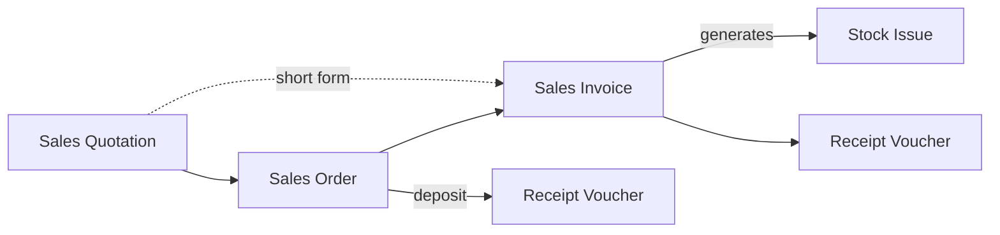

# Quotation-Led Selling (Showrooms and Projects)

A family visits a kitchen showroom, and the salesperson prices a kitchen at 85,000 with an 8% discount, valid for two weeks. The family comes back, accepts, pays 25,500 as a deposit and wants it installed in a month. In that month the showroom has to hold the cabinets for them, buy in the oven it does not stock, and on installation day invoice the balance without forgetting the deposit. This page shows how Nama carries a sale like that from the first price to the last payment.

## Who this fits

- Showrooms selling furniture, kitchens, lighting or sanitary ware, and technical traders selling to contractors and companies: any business where the price is agreed with each customer before the sale, and the customer often pays something up front.
- Across Nama installations, about 1 in 5 companies issue quotations routinely, two or more a month. About 3 in 4 of them also run sales orders.
- The selling itself usually sits on top of [Direct-Invoice Trading](/business-scenarios/scenario-direct-invoice-trading) for the walk-in customers who need no quotation. Companies that deliver on their own trucks to account customers also read [Order-to-Cash Distribution](/business-scenarios/scenario-order-to-cash-distribution), and those that import what they sell add [Importer: Landed Cost and Letters of Credit](/business-scenarios/scenario-importer-landed-cost).

## What you need

::: info Required licences
`supplychain-sales`, `supplychain-inventory`, `supplychain-purchases`. About 1 in 4 companies in this scenario add `crm` for visits and follow-ups, and `accounting-banks` is needed where deposits or balances are paid by cheque.
:::

- [Supply Chain](/modules/supplychain/) holds the quotation, the order, the invoice, reservation and the stock issue.
- [Invoicing](/modules/invoicing/) covers price lists and offers, salesman discount limits and payment schedules.
- [Accounting & Banks](/modules/accounting/) holds the receipt vouchers that take the deposit and the balance.
- [CRM](/modules/crm/), where it is licensed, records the visits, calls and follow-ups around the quotation.

## The document flow

The kitchen, step by step:

1. **The quotation.** The salesperson enters a **Sales Quotation** for the family: the cabinets, worktop, sink and oven, prices from the price list, an 8% line discount, and **Valid from** / **Valid to** covering two weeks. The salesperson's employee record allows up to 10%, so the quotation saves. At 12% the save would be refused, and a manager with a higher limit would have to save it.
2. **The approval.** The showroom has an approval definition on the Sales Quotation that starts only above a set amount, so the branch manager approves this one before it goes to the family.
3. **The order.** The family accepts within the validity period. The salesperson creates a **Sales Order** from the quotation, which copies the customer, lines, prices and discounts and links the order back to it. Had the family come back after **Valid to**, the save would have been refused with *Value date must be within the range of sales quotation valid from and valid to.*
4. **Holding the stock.** The order's term has **Reserve** ticked, so the cabinets in stock are reserved for the family. With **Include Reserved In Balance** ticked on the item configuration, other sales see them as no longer available.
5. **The deposit.** The cashier records a **Receipt Voucher** for 25,500 with the Sales Order as its **Based On** document. The order's remaining value drops to 59,500.
6. **Buying in.** The oven is not in stock, so purchasing raises a **Purchase Order** for it with the supplier, and it arrives on a purchase invoice a week later.
7. **The invoice.** On installation day, **Generate Invoice** on the order builds the **Sales Invoice**. Saving it generates the **Stock Issue** that takes the kitchen out of the warehouse and releases the order's reservation. Because the invoice term clones the order's receipt links, the deposit is already counted on the invoice, and its remaining value is 59,500, not 85,000.
8. **The balance.** The family pays the rest with a cheque, recorded on a second **Receipt Voucher** against the invoice.

## Setting it up, in order

1. **Items and price lists**, so that every quotation starts from the official price rather than a number the salesperson remembers. See [Pricing and Offers Management Guide](/modules/invoicing/pricing-and-offers-guide) and [Pricing, Offers & Coupons](/modules/supplychain/pricing-offers-and-coupons).
2. **Salesman discount limits** on each employee record: how far a salesperson, a branch manager and head office may go on each discount level. A sales offer line sets the range for everyone, and the employee limit makes the cut per person. See [Salesman Discount Limits](/modules/invoicing/salesman-discount-limits).
3. **The quotation, order and invoice terms.** Decide what each copies from the document before it, and whether it reserves stock. On the order term tick **Reserve**; on the invoice term tick **Cancel Reservation Of Related Docs** so that invoicing frees the order's hold. **Copy Price From Parent Document With From Document** keeps the agreed price on the invoice instead of repricing it, and **Ignore Max Discount Validation If Discount Exists In From Doc** lets an approved quotation discount through on the documents built from it. See [From-Document Configuration](/modules/supplychain/document-terms/doc-term-from-document), [Comprehensive Reservation System Guide](/modules/supplychain/reservation-system-guide) and [Pricing, Taxes & Discounts Configuration](/modules/supplychain/document-terms/doc-term-pricing-taxes-discounts).
4. **Approvals on large or deep-discount quotations**, using an **Apply When Query** so that only the quotations that need a second look stop for one. See [Conditional Approvals](/platform/approvals/approvals-system#Conditional-Approvals).
5. **Deposits.** Switch on **Use System Entries For Payment/Receipt Documents Relationship to Invoices** in the global configuration, then **Clone System Entries For Payment/Receipt Documents Relationship to Invoices** on the Sales Invoice term, so that receipts taken against an order follow it onto the invoice. Where a deposit and a balance are agreed up front, a **Payment Schedule Template** splits the order into them. See [Cloning Payment Vouchers from Orders to Invoices](/modules/invoicing/payment-entries#Cloning-Payment-Vouchers-from-Orders-to-Invoices) and [Payment Schedules User Guide](/modules/invoicing/payment-schedules-user-guide).
6. **Delivery documents**, if the showroom delivers and installs at the customer's address. See [Delivery & Loading](/modules/supplychain/delivery-and-loading).

## Settings and tools most companies use

- **Approvals**: nearly every company in this scenario has approval definitions, against about 7 in 10 of all companies. Quotations with special prices are the obvious candidate. See [Approvals System](/platform/approvals/approvals-system).
- **Notifications**: nearly all send them, for example to tell a manager that a quotation is waiting for approval. See [Notification Definitions](/platform/notifications/notifications-system).
- **Dashboards**: about 5 in 6 use [BI dashboards](/platform/bi/) to follow their sales.
- **Purchase orders**: about 4 in 5, more than in any other selling scenario, because ordered goods are often bought in for the customer. See [The Purchasing Journey](/modules/supplychain/purchasing-journey).
- **Locators**: about half keep shelf positions in the warehouse, which helps when large items are held for a customer. See [Warehouses & Locators](/modules/supplychain/warehouses-and-locators).
- **Transfer requests**: about 2 in 5 move stock between the showroom and the main store with a request first. See [Moving Stock Between Warehouses](/modules/supplychain/moving-stock).

## Variations

**Quotation straight to invoice.** Many quotations never become an order: the customer accepts and takes the goods the same week. **Generate Invoice** on the Sales Quotation builds the Sales Invoice directly, and the invoice generates its Stock Issue as usual. Companies split about evenly between this short form and always passing through an order.

**A proforma as the quote.** Where the customer needs an invoice-shaped document for budget approval, customs or a bank, the **Proforma Sales Invoice** plays the quotation's part. It carries the same **Generate Invoice** button once the customer approves or pays. See [The Proforma Invoice](/modules/supplychain/sales-journey#The-Proforma-Invoice-ProformaSalesInvoice).

**Home delivery and installation.** A **Delivery Document** records that the goods reached the customer and were signed for, optionally with a password the customer gives the driver, and delivery queues give the drivers one list of what is waiting. See [Delivery & Loading](/modules/supplychain/delivery-and-loading).

**Following the customer in CRM.** Technical traders who visit sites and chase quotations by phone record those visits and calls in the CRM module, about 1 in 4 of the companies in this scenario. See [CRM Overview](/modules/crm/crm-overview).

## Decisions to make before go-live

- **Quotation to invoice directly, or always through an order.** The order earns its place when goods must be reserved, bought in or paid for in advance. If none of that applies, the short form saves a document per sale.
- **Reserve at the order, at the quotation, or not at all.** Reserving at the quotation holds stock for customers who may never come back. Most showrooms reserve at the order. If both reserve, the order term needs **Cancel Reservation Of Related Docs** or **Update Reservation Of Related Docs**, otherwise the save is refused because the same stock would be held twice.
- **Deposits go against the order.** Take the deposit on a receipt voucher based on the order, and let the invoice pick it up through the cloning option. Switch both options on before the first deposit is taken, so the link is tracked from the start.
- **Who may give how much discount.** Put the highest discount anyone may give on the sales offer, and each person's own limit on their employee record. An empty **Max. Value** on an offer line counts as zero.
- **What happens to expired quotations.** Either quotations expire for good, or the order and invoice terms carry **Allow Creating Document From Expired Quotation**. Choose one, so that salespeople know whether an old price can still be honoured.

## Where to read next

1. [The Sales Journey](/modules/supplychain/sales-journey)
2. [Salesman Discount Limits](/modules/invoicing/salesman-discount-limits)
3. [Comprehensive Reservation System Guide](/modules/supplychain/reservation-system-guide)
4. [Sales & Offers Configuration](/modules/supplychain/configuration/sales-and-offers-configuration)
5. [Linking Payment Vouchers to Invoices](/modules/invoicing/payment-entries)
6. [Payment Schedules User Guide](/modules/invoicing/payment-schedules-user-guide)
7. [Invoice Discounts and Tax Calculation](/modules/invoicing/invoice-discounts-and-tax-calculation-guide)
8. [Delivery & Loading](/modules/supplychain/delivery-and-loading)
9. [Approvals System](/platform/approvals/approvals-system)
