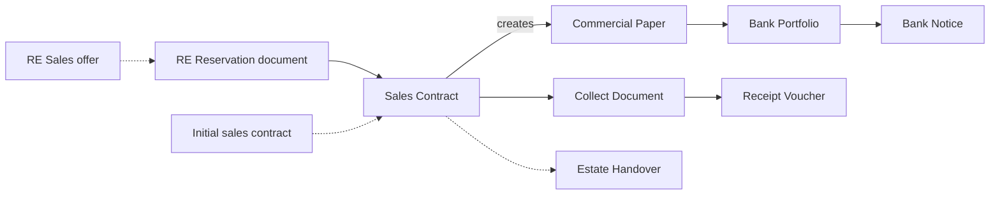

# Real Estate Developer (Off-Plan Unit Sales)

A developer launches a compound of 400 flats before the first foundation is poured. A buyer chooses
Flat 12, pays a 20,000 reservation deposit, signs a contract for 900,000 a month later with 20% down,
and hands over forty post-dated cheques for the rest, one a quarter for ten years. The developer has
to know, for every unit, whether it is free, reserved or sold, what the buyer still owes, which cheques
are at the bank, and what the building has cost so far. The real estate sales flow exists because a
unit sale is not one document: it is a reservation, a contract, a long schedule of instalments, and
years of collection.

## Who this fits

- Developers that sell flats, villas, shops or land plots off-plan or during construction, on long
  instalment plans, typically paid by post-dated cheques. Across Nama installations, about 1 in 18
  companies sell units in the real estate module.
- About 1 in 10 companies are real estate firms. About 3 in 5 of them sell units, and about 1 in 6
  lease. The off-plan, cheque-backed instalment sale is the most common shape, especially in Egypt.
- Developers usually combine this page with
  [Contracting Company](/business-scenarios/scenario-contracting-company) when they build their own
  towers, and with [Multi-Company Group](/business-scenarios/scenario-multi-company-group) when each
  project is a separate company.

## What you need

::: info Required licences
`realestate`, `realestate-sales` (sales offers, initial and final sales contracts, handover,
waivers), `accounting-banks` (cheques, bank portfolios, bank notices); `realestate-rent` for the
leasing variant.
:::

- [Real Estate](/modules/realestate/): the estate tree, the sales documents, collection, fines and
  unit cost.
- [Accounting](/modules/accounting/): receipt vouchers, cheques and their bank cycle, and
  miscellaneous invoices for construction spend.
- [Contracting](/modules/contracting/), only if the company builds through the contracting module.

## The document flow

Follow Flat 12 from the sales office to the last cheque:

1. **The quotation.** The salesperson prints an **RE Sales offer** with the price, the down payment
   and every instalment. It reserves nothing, so it can be handed out freely.
2. **The reservation.** The buyer pays 20,000. An **RE Reservation document** records the deposit,
   and once its status is *Confirmed* Flat 12 is taken off the market. Its only entry is the deposit.
3. **The contract.** On the saved reservation, **Create Sales Document** opens a **Sales Contract** with the unit, the buyer, the price and the 20,000 already paid.
   A payment plan template fills the 180,000 down payment and the forty quarterly instalments, and
   **Create installments** builds the schedule. Committing the contract marks the unit *Sold*, raises
   the receivable and books the sale. Developers that sign a preliminary agreement first use the
   **Initial sales contract**, which locks the unit and books nothing; the sales contract is then
   based on it.
4. **The cheques.** When commercial-paper columns are enabled for the sales contract, committing it
   creates one **Commercial Paper** per instalment line that carries cheque details. From the
   contract's own buttons, the cheques due this month go to the bank on a **Bank Portfolio**, and the
   bank's answer (collected or returned) is recorded on a **Bank Notice**.
5. **Cash and transfers.** Payments that do not come by cheque are collected against the contract's
   instalment codes on a **Collect Document**, which settles the instalments; its
   **Create Receipt Voucher** button raises the **Receipt Voucher** that receives the money.
6. **Late payment.** A late instalment can be charged on a **Real estate fine Doc**, raised from the
   contract with **Create Fine Document**. The fine is a separate receivable and does not change the
   instalment.
7. **Delivery.** When the building is finished, the **Estate Handover** records delivery and stamps
   the contract and the unit. If the sales term holds revenue back until delivery, the handover is
   the document that releases the contract's entry.
8. **After the sale.** If the buyer resells before completion, a **Waiver Document** *For Another
   Buyer* passes the unpaid instalments to the new buyer; *For Company* brings the unit back into
   stock.

The whole chain, and which step does what, is on
[The property sales cycle](/modules/realestate/sales/realestate-sales-cycle).

## Setting it up, in order

1. **Build the estate tree, then the units.** Create the project, then work down with the generate
   buttons: blocks, buildings, floors and units, with unit models to stamp identical flats in one
   action. Large projects are usually imported. See
   [projects, blocks and lands](/modules/realestate/properties/realestate-projects-blocks-lands) and
   [buildings, floors and units](/modules/realestate/properties/realestate-buildings-floors-and-units).
2. **Price lists and payment plan templates.** A sales price list prices each unit, and a payment
   plan template fills the down payment and instalments, so salespeople stop typing numbers. See
   [price lists and payment methods](/modules/realestate/sales/realestate-price-lists-and-payment-methods).
3. **Fee and commission types, with their accounts.** Fees and commissions take their accounts from
   their type records, not from the document term, so set them before the first contract. See
   [fee, commission and expense types](/modules/realestate/costs/realestate-fee-commission-and-expense-types).
4. **The sales terms (توجيه).** The reservation, sales contract, collect document and handover each
   take their accounts from their term, and an accounting pair is only booked when both of its sides
   are filled. Decide here whether revenue is booked at the contract or at handover. See
   [sales document terms](/modules/realestate/document-terms/realestate-terms-sales).
5. **Cheque books and bank portfolios.** Set up the commercial-paper books and banks, and list the
   sales contract among the documents that create commercial papers in the
   [module configuration](/modules/realestate/realestate-configuration). See
   [cheques and financial papers](/modules/accounting/banks-and-cheques/cheques-financial-papers).
6. **Units sold before go-live.** Load them on **Opening sales doc** in the opening fiscal period,
   marking the instalments already paid with *Fully Paid*. See
   [opening sales](/modules/realestate/opening/realestate-opening-sales).

## Settings and tools most companies use

- **Post-dated cheques.** About 3 in 4 developers record instalment cheques, and about 2 in 3 also
  use the cheque cancellation document when a cheque is replaced. See
  [cheques and financial papers](/modules/accounting/banks-and-cheques/cheques-financial-papers).
- **Waivers.** About 2 in 3 record resales and give-backs on the waiver document. See
  [waivers and cancelling a sale](/modules/realestate/sales/realestate-waiver-and-cancellation).
- **Reservations.** About 1 in 3 reserve before the contract, and about 1 reservation in 3 ends in a
  cancellation rather than a sale. See
  [reservations and initial contracts](/modules/realestate/sales/realestate-reservations-and-initial-contracts).
- **Fines.** About 1 in 4 charge late-payment fines. See [fines](/modules/realestate/collections/realestate-fines).
- **Miscellaneous invoices for construction.** About 9 in 10 record construction spend on
  [miscellaneous invoices](/modules/accounting/money-in-and-out/misc-purchasing).
- **Dashboards.** About 5 in 6 follow sales and collection on [BI dashboards](/platform/bi/).

## Variations

**Straight to the contract.** About two thirds of developers skip the reservation and sign the sales
contract directly; the contract's estate picker only offers units that are available and not
reserved, so a unit cannot be sold twice either way.

**Revenue on delivery.** With *Create Accounting Effects For Handovered Documents Only* on the sales
contract's term, the contract marks the unit sold and builds the schedule but books nothing until the
Estate Handover releases its entry. See [handing the unit over](/modules/realestate/sales/realestate-handover).

**Construction cost per unit.** Most developers book construction spend as miscellaneous invoices
tagged with the project. Those who need cost per unit enter it on the RE Cost Document instead, which
spreads each cost over the units by area, price or another basis, see
[distributing project costs](/modules/realestate/costs/realestate-cost-distribution). A few build
through the Contracting module, whose project cost can be pushed down onto the units, see
[the contracting cost bridge](/modules/contracting/costs/contracting-realestate-cost-bridge).

**Leasing.** About 1 in 30 companies hold rent contracts. The leasing track has its own chain: a
**Rent offer** that can hold the unit, the **Rent Contract** that builds the rent schedule, the
**Rent Installment Ledger** that recognises each period's revenue, collection against the contract,
and **Cancel Contract** to end a lease. See [the leasing cycle](/modules/realestate/rent/realestate-rent-cycle).

## Decisions to make before go-live

- **Reservation first, or straight to the contract.** Both are supported. If deposits are taken
  before signing, use the reservation document so the deposit is booked and the unit is locked.
- **Revenue at the contract or at handover.** Set it once on the sales term and keep it; it changes
  every contract's journal entry.
- **Cheques created by the contract, or received on receipt vouchers.** Letting the contract create
  the cheques from its instalment lines saves keying forty cheques per sale, but the commercial-paper
  columns have to be enabled before the first contract.
- **Construction cost on miscellaneous invoices, on the RE Cost Document, or through contracting.**
  Pick by whether you need cost per unit.
- **Migrate sold units through opening sales documents.** Load the remaining schedule of each sold
  unit on an opening sales document rather than re-keying old contracts and their collections.
- **Fee and commission accounts first.** They come from the type records, so set them before the
  first contract.

## Where to read next

1. [Real Estate module overview](/modules/realestate/realestate-overview)
2. [Module configuration](/modules/realestate/realestate-configuration)
3. [How properties are modelled](/modules/realestate/properties/realestate-estate-model)
4. [The property sales cycle](/modules/realestate/sales/realestate-sales-cycle)
5. [The sales contract](/modules/realestate/sales/realestate-sales-contract) and
   [building the instalment plan](/modules/realestate/sales/realestate-installment-plans)
6. [How instalment collection works](/modules/realestate/collections/realestate-collection-basics)
7. [Handing the unit over](/modules/realestate/sales/realestate-handover) and
   [waivers and cancelling a sale](/modules/realestate/sales/realestate-waiver-and-cancellation)
8. [Going live: opening balances](/modules/realestate/opening/realestate-opening-balances)
