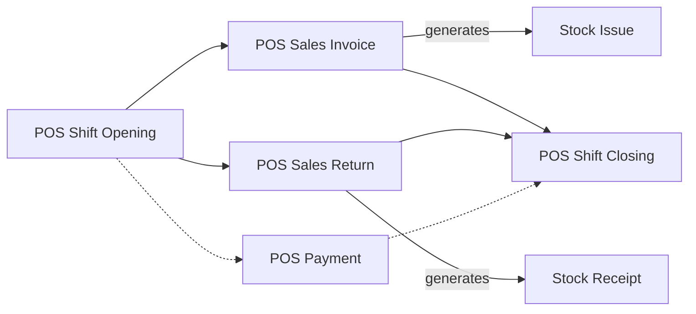
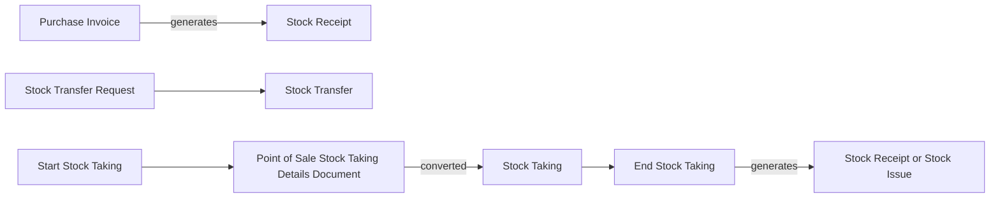

# Retail Chain with Point of Sale

A perfume chain has 8 shops, two registers in each and one central warehouse. On a busy Saturday each register rings up a few hundred tickets, the shops are refilled from the central warehouse twice a week, and every shop is counted at the end of the month. The registers keep selling when the internet drops, and every ticket, refund, shift and count reaches the server as a document that is processed into stock and accounts. This page follows that chain from the register's first ticket to the monthly count.

## Who this fits

- A business with many branches, each with its own registers and its own warehouse, all fed from a central store. Fashion, perfume, cosmetics, appliances, furniture, food service and general stores work this way.
- Across Nama installations, about 1 in 10 companies run Nama POS registers, and about 1 in 9 companies are retailers.
- The till is rarely the only way a chain sells. About 4 in 5 of these companies also issue ordinary sales invoices in the back office, for wholesale customers, deliveries and sales on account, which is the [direct-invoice trading](/business-scenarios/scenario-direct-invoice-trading) scenario running next to this one.
- Chains that buy abroad add the [importer](/business-scenarios/scenario-importer-landed-cost) scenario at head office, and a group that keeps each chain or country as its own company adds the [multi-company group](/business-scenarios/scenario-multi-company-group).

## What you need

::: info Required licences
`namapos`, `supplychain-sales`, `supplychain-inventory`, `supplychain-purchases`. Add `namapos-captain-order` for restaurants whose waiters take orders on a phone, `basic-mobile-stocktaking` or `supplychain-electronic-taking` for counting stock with scanners, and `basic-tax-e-invoice` where electronic receipts apply.
:::

The licence also sets how many active registers you may have. Inactive registers do not count, and Captain Order sub-registers have a count of their own (see [Licensing](/getting-started/licensing)).

- [Point of Sale](/modules/pos/): the register application, and the server screens where registers are set up and their documents land.
- [Supply Chain](/modules/supplychain/): items, warehouses, price lists and offers, purchasing, transfers and stock taking.
- [Accounting](/modules/accounting/): where the sales, cash and stock entries the documents produce end up.

## The document flow

Two cycles run side by side. The register day, repeated on every register:

And the stock cycle that keeps the shops filled and counted:

Here is one week at shop 3 of the perfume chain.

1. **Head office buys.** A shipment of 600 bottles arrives at the central warehouse on a **Purchase Invoice**. Its document term generates the **Stock Receipt** that puts the bottles into stock.
2. **The shop is refilled.** The central storekeeper raises a **Stock Transfer Request** for 120 bottles from the central warehouse to shop 3, and the move is done with a **Stock Transfer**: stock leaves the central warehouse and arrives in the shop's warehouse in one document.
3. **The register opens.** At 10:00 the cashier opens a **POS Shift Opening** with a float of 500 in cash. The shift gets its own code, and everything sold on this register until the close belongs to it.
4. **Tickets are rung up.** Each sale is a **POS Sales Invoice**, saved on the register first and synced to the server in the background. The server picks its book and its term from the register's **Books And Terms** and **Sales Terms** grids, and the term produces the accounting entry and generates the **Stock Issue** from the register's warehouse. The cashier never chooses a term.
5. **A customer brings a bottle back.** The refund is a **POS Sales Return** against the original ticket. Its term produces the reversing entry and the **Stock Receipt** that puts the bottle back on the shelf. The customer takes cash, or a credit note to spend later.
6. **Cash leaves the drawer.** The cashier pays 40 for cleaning from the till with a **POS Payment**, booked to the account its term names.
7. **The shift closes.** At 22:00 the cashier counts the drawer on a **POS Shift Closing**. The register sets the expected amount for each payment method against the counted amount and records the difference. With **Shift Close Reset Cash** on, the counted cash is moved out of the register in the accounts and the next shift starts from zero.
8. **The shop sends stock on.** Shop 3 has too many of a gift set that shop 5 has sold out of. From the register, a **POS Stock Transfer Request** records the 10 sets leaving shop 3 for shop 5, and the move is completed with an ordinary **Stock Transfer** that names the request as its source document.
9. **The month is counted.** The stock controller saves a **Start Stock Taking** for the shop's warehouse. The staff scan the shelves at the register into a **Point of Sale Stock Taking Details Document**. On the server, **Create StockTaking Details Document** turns that count into a **Stock Taking** record, and the **End Stock Taking** compares the counted quantities with the books and generates the receipts for surpluses and the issues for shortages.

Every document in steps 3 to 9 that comes up from a register is a system document: it can be opened, printed and reported on at the server, but not edited there. Mistakes are put right with a new document, not by changing the one the register sent.

## Setting it up, in order

1. **Branches and a warehouse per branch.** Every register sells from one warehouse, and a register cannot be saved on the "general" legal entity, so the shops, their [branches](/platform/shared-master-files/dimensions-and-composite-dimensions) and their [warehouses](/modules/supplychain/warehouses-and-locators) come first.
2. **Items with barcodes.** Load the catalogue with its barcodes, and with [colour and size](/modules/supplychain/understanding-items) where you sell by variant. Decide which items each register receives with [Pos Items To Send](/modules/pos/erp-setup/pos-items-and-sync-settings), since a bakery counter does not need the hardware catalogue.
3. **Price lists and offers.** Registers receive the [price lists and offers](/modules/supplychain/pricing-offers-and-coupons) for the items they carry, so set them up before the first sync.
4. **Registers, security profiles and screens.** Create one [register](/modules/pos/erp-setup/pos-register-setup) per machine with its warehouse, payment methods and term grids, give each cashier a [POS security profile](/modules/pos/erp-setup/pos-security-profiles), and arrange the [screens and devices](/modules/pos/erp-setup/pos-screen-and-device-settings).
5. **Document terms and numbering.** Each register's **Books And Terms** grid decides how its documents are processed on the server: see [POS Document Terms](/modules/pos/erp-setup/pos-document-terms). Set the code each register gives its documents in [Numbering POS Documents](/modules/pos/erp-setup/pos-document-numbering), so receipt numbers never clash between machines.
6. **Data sync.** Install the registers and let them pull their first data down. Every later change reaches a register through the same sync, as [How POS Data Syncs with the Server](/modules/pos/pos-data-sync) explains.
7. **Shift-close settings.** Decide what happens to the cash at close and which documents block a close, on [Shift Opening, Closing & Cash-Reset Settings](/modules/pos/erp-setup/pos-shift-close-settings).
8. **The transfer flow.** Decide who raises transfer requests and who executes them, and whether you want the one-step or the two-step transfer ([Moving Stock](/modules/supplychain/moving-stock)).
9. **Stock-taking settings.** Set how counts are compared and settled in [Stock Taking Configuration](/modules/supplychain/configuration/stock-taking-configuration), then run a first count with [Stock Taking](/modules/supplychain/stock-taking).

## Settings and tools most companies use

- **More than one branch.** Nearly all of these companies run several shops, each with its own warehouse.
- **Price lists and offers.** Nearly all use [price lists](/modules/supplychain/pricing-offers-and-coupons), and about 2 in 3 run offers, against about 1 in 4 of all companies.
- **Stock taking.** About 4 in 5 count their shops with the [stock-taking cycle](/modules/supplychain/stock-taking).
- **Transfer requests.** About 3 in 5 put a [transfer request](/modules/supplychain/moving-stock) in front of the transfer, against about 1 in 5 of all companies.
- **Back-office invoices.** About 4 in 5 also issue ordinary sales invoices next to the registers.
- **Receipt books.** About 1 in 3 keep pre-printed, numbered receipt pads under control with [receipt books](/platform/payments/receipt-books).
- **Colour and size.** Variant items are standard in fashion and phone retail; at the register they appear as [item add-ons](/modules/pos/pos-item-addons).

## Variations

**Restaurants and cafés.** A restaurant adds halls and tables, suspended orders, the call-center flow and the Captain Order app, on which waiters send orders from the table to the kitchen and the register. It needs `namapos-captain-order`. See [Tables, Reservations & Captain Order](/modules/pos/pos-tables-and-restaurant).

**Orders taken now and delivered later.** A furniture or appliance shop takes a deposit at the till with a **POS Order Reservation**, which, like a sale, produces the accounting entry and the stock issue from its term, and cancels it with a **POS Cancel Reservation** when the customer withdraws ([POS Documents on the Server](/modules/pos/erp-setup/pos-documents-on-the-server#Selling)).

**Goods in transit.** When the trip from the central warehouse to a shop takes a day or more, use the two-step transfer instead: an **Issue Stock Transfer** when the goods leave and a **Receipt Stock Transfer** when they arrive, often through a goods-in-transit warehouse ([Moving Stock](/modules/supplychain/moving-stock#The-Two-Step-Transfer-More-Control-and-Tracking)).

**Shops that receive from suppliers directly.** A shop can record a delivery at the register with a **POS Stock Receipt**. Its term decides whether a stock receipt is generated for it on the server ([Inventory Operations at the Register](/modules/pos/pos-inventory-operations)).

**Self-checkout.** Shoppers scan and pay by card on an Android kiosk, and each kiosk sale is saved on an ordinary register on the shop network ([Self-Checkout Kiosk](/modules/pos/pos-self-checkout-kiosk)).

**Counting with scanners.** Large shops count with handheld scanners through electronic stock taking (`supplychain-electronic-taking`) or the mobile stock-taking app (`basic-mobile-stocktaking`), instead of at the register ([Stock Taking](/modules/supplychain/stock-taking#Entering-Count-Results)).

## Decisions to make before go-live

- **One server invoice per ticket, or merged invoices.** **Point Of Sale - Collection Method** on POS Settings decides it. *One By One* creates one server invoice for every register invoice. *Collect Invoices* merges the invoices of the same shift into one server invoice when they share the customer, salesman, user and the other conditions listed on [The POS Settings Screen](/modules/pos/erp-setup/pos-settings-screen#Sending-documents-to-the-server), up to **Maximum Invoice Lines**. Merging gives the server far fewer documents to process and report on; one by one keeps every ticket visible as its own invoice.
- **Which sales go through the till.** Wholesale, deliveries on account and large orders with deposits often stay in the back office as ordinary sales invoices. Decide where each kind of sale belongs before the cashiers start.
- **Stock checks at the till.** A register does not check stock unless it has a **POS Item Quantity Update Configuration** ([Checking stock at the register](/modules/pos/erp-setup/pos-items-and-sync-settings#Checking-stock-at-the-register)). Without one, decide what happens to a sale that reaches the server short of stock: the register's **Term In Case Of Error** lets it be saved and dealt with afterwards ([The error term](/modules/pos/erp-setup/pos-document-terms#The-error-term)).
- **The float.** With **Shift Close Reset Cash** off, the counted cash stays in the drawer for the next shift; with it on, the till is emptied to the safe at every close. Pick the one that matches how your shops hand over cash, and close every shift on every register every day.
- **How often to count.** Some chains count every month and others once a year. A short counting window and frequent counts over a smaller scope give cleaner differences.
- **Which items reach which register.** Sending the full catalogue to every till slows the sync and clutters the search. Decide the item lists per shop type before go-live.

## Where to read next

1. [Nama POS — Overview](/modules/pos/pos-overview) and [Getting Started at the Register](/modules/pos/pos-getting-started)
2. [POS — Server-Side Setup](/modules/pos/erp-setup/) and [Setting Up a Register](/modules/pos/erp-setup/pos-register-setup)
3. [POS Document Terms](/modules/pos/erp-setup/pos-document-terms) and [POS Documents on the Server](/modules/pos/erp-setup/pos-documents-on-the-server)
4. [Shifts & Cash](/modules/pos/pos-shifts-and-cash) and [Shift Opening, Closing & Cash-Reset Settings](/modules/pos/erp-setup/pos-shift-close-settings)
5. [Returns & Replacements](/modules/pos/pos-returns-and-replacements) and [Inventory Operations at the Register](/modules/pos/pos-inventory-operations)
6. [How POS Data Syncs with the Server](/modules/pos/pos-data-sync)
7. [Moving Stock Between Warehouses](/modules/supplychain/moving-stock) and [Stock Taking](/modules/supplychain/stock-taking)
8. [Pricing, Offers & Coupons](/modules/supplychain/pricing-offers-and-coupons) and [Receipt Books](/platform/payments/receipt-books)
