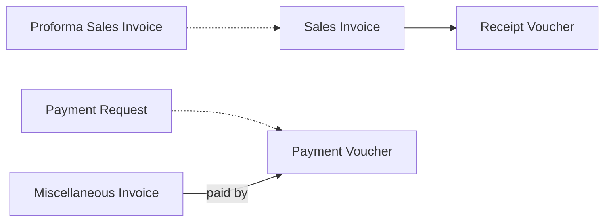

# Service Company and Finance-Only Use

A consultancy with twelve staff bills each client a monthly retainer, pays rent, salaries and a few
dozen supplier bills a month, and wants to see profit per client. A foreign-owned branch only needs a
statutory ledger kept in the local currency and closed every month. Neither of them has a warehouse,
an item in stock or a delivery. For these companies Nama is the accounting system first: services are
billed on sales invoices, spending goes through miscellaneous invoices and vouchers, and a dimension
plays the part of the job register.

## Who this fits

- Consultancies, law and audit firms, facility management, freight and logistics agents, schools and
  training centres, clinics, and foreign-owned firms that keep their statutory books in Nama. Across
  Nama installations, about 1 in 4 companies move no stock at all.
- Leaving out real estate and contracting companies, which also keep no stock but have their own
  pages, it is about 1 in 6. About half of those invoice their services through sales invoices; the
  rest use Nama for the books only.
- These companies often combine this page with
  [Multi-Company Group](/business-scenarios/scenario-multi-company-group), when a holding company or
  a set of sister firms share one database. Contractors and developers keep their head-office books
  this way too, next to [Contracting Company](/business-scenarios/scenario-contracting-company) or
  [Real Estate Developer](/business-scenarios/scenario-real-estate-developer).

## What you need

::: info Required licences
`accounting`, `accounting-banks`; `supplychain-sales` for service invoices; `humanresource-payroll`
for payroll; `basic-tax-e-invoice` where electronic invoicing applies; `ecpa` for time-based project
billing.
:::

- [Accounting](/modules/accounting/): the chart of accounts, journal entries, vouchers,
  miscellaneous invoices, notes, banks and period control.
- [Supply Chain](/modules/supplychain/): only the sales invoice and the service items it sells.
- [Human Resources](/modules/hr/): payroll, for about 1 in 5 of these companies.
- [Project Management](/modules/ecpa/): hours, tasks and project invoices, for firms that bill time.

## The document flow

Follow one month at the consultancy:

1. **The client is billed.** Each retainer goes on a **Sales Invoice** whose lines are service items:
   items that are sold but never stocked, so the invoice issues nothing from a warehouse. Firms that
   send an estimate first issue a **Proforma Sales Invoice** and build the invoice from it. Every
   invoice carries the client's job code in its analysis set.
2. **The client pays.** A **Receipt Voucher** receives the money and settles the invoice. Where
   cheques are customary, the voucher's financial-papers tab records them.
3. **Suppliers bill.** Rent, software subscriptions, the audit fee and office supplies go on a
   **Miscellaneous Invoice**, whose lines pick a **Purchase Element** that carries the expense
   account. A **Payment Voucher** pays it.
4. **Petty spending.** Staff raise a **Payment Request** for a taxi, a courier or a client lunch; the
   cashier accepts it and generates the **Payment Voucher**.
5. **Corrections without cash.** A **Credit Note** reduces what a client owes, and a **Debit Note**
   adds a charge, both without touching the cash box.
6. **Treasury and month end.** A **Bank Transfer** moves money between bank accounts, an **Exchange
   Rate Update** records the currency differences on foreign-currency balances, and the accountant
   posts accruals and adjustments as **Journal Entries**. Then the period is closed so nobody posts into it by mistake.

## Setting it up, in order

1. **Chart of accounts and dimensions.** Build the [chart of accounts](/modules/accounting/ledger-setup/chart-of-accounts)
   and decide what each [dimension](/platform/shared-master-files/dimensions-and-composite-dimensions)
   means here, because the dimensions carry the management reporting when there is no stock.
2. **Service items.** Create each service as an item of the service type. See
   [understanding items](/modules/supplychain/understanding-items).
3. **Purchase elements for expenses.** One per kind of expense, each with its default account, so
   every miscellaneous invoice line books to the right place. See
   [miscellaneous purchasing](/modules/accounting/money-in-and-out/misc-purchasing).
4. **Banks and cash boxes.** Set up the [banks and bank accounts](/modules/accounting/banks-and-cheques/banks-and-bank-accounts),
   and the cheque books if cheques are used.
5. **The job register.** Create an analysis set (or a sector) per job, client or case, and make it
   required on the documents that should carry it.
6. **Periods and period locking.** Open the fiscal year and decide who may still post into a closed
   period. See [fiscal period control](/platform/governance/fiscal-period-control-guide).

## Settings and tools most companies use

- **Journal entries.** About 9 in 10 of these companies post manual journal entries regularly. See
  [journal entries](/modules/accounting/ledger-setup/journal-entries).
- **Miscellaneous invoices.** About half record supplier bills on miscellaneous invoices. See
  [miscellaneous purchasing](/modules/accounting/money-in-and-out/misc-purchasing).
- **Debit and credit notes.** About 1 in 4 use debit notes. See
  [credit and debit notes](/modules/accounting/money-in-and-out/credit-and-debit-notes).
- **An analysis set as the register.** About 1 in 5 keep an analysis set per job, client or case. See
  [dimensions](/platform/shared-master-files/dimensions-and-composite-dimensions).
- **Approvals.** Approvals and heavy customisation are less common here than in any other scenario:
  about 2 in 5 route documents through approvals, and about 1 in 5 customise heavily. See
  [approvals](/platform/approvals/approvals-system).

## Variations

**Books only.** Some companies never issue a sales invoice in Nama: revenue arrives from another
system or as monthly totals on journal entries, and Nama keeps the ledger, the bank and the statutory
reports. The flow is then only steps 3 to 6.

**Owner-run firms and partnerships.** Where the profit is shared between partners, record each
partner's shares and split the period's profit with the profits distribution document. See
[partner shares and profit distribution](/modules/accounting/money-in-and-out/partner-shares-and-profit-distribution).

**Billing time.** Engineering offices and consultancies that bill by the hour or by phase use the
Project Management module, which records who worked on what and turns recorded hours into project
invoices. It is used by few companies, but it fits firms whose deliverable is professional time. See
the [Project Management overview](/modules/ecpa/ecpa-overview).

**Facility services.** Companies that deliver cleaning, security or maintenance to sites rather than
to machines can run their contracts and work orders on the service documents of the CRM module. See
[services or machines](/modules/crm/services-suite/crm-services-suite-overview).

## Decisions to make before go-live

- **Service or stock, once and for all.** Service items hold no quantity, and an item's type cannot
  switch between service and stock after it has been used in a stock document. The save is refused
  with:

  *You can not change item type from Service to Stock or vice-versa after using it in Stock Issue, Receipt, or Transfer* — «لا يمكنك تغيير نوع الصنف من خدمة إلى مخزني أو العكس بعد استخدامه في سند الصرف , التوريد المخزني أو التحويل المخزني»

  Create each item with the right type from the start.
- **Which job register.** An analysis set (the usual choice), a sector, or the Project Management
  module when hours must be recorded and billed.
- **Miscellaneous invoice or journal entry for expenses.** The miscellaneous invoice keeps the
  supplier's balance, its tax and its payments together; a journal entry suits only internal
  accruals and adjustments.
- **Partners.** For owner-run firms, decide up front whether each owner is kept as a
  [Partner](/modules/accounting/ledger-setup/accounts-bags-safes-and-partners) record with its own
  capital and current account, and whether the profit split is done in Nama.
- **Period closing.** Decide how soon after month end the period is closed, and who may post into a
  closed period.

## Where to read next

1. [Chart of accounts](/modules/accounting/ledger-setup/chart-of-accounts)
2. [Dimensions and composite dimensions](/platform/shared-master-files/dimensions-and-composite-dimensions)
3. [Understanding items](/modules/supplychain/understanding-items)
4. [Receipt and payment vouchers](/modules/accounting/money-in-and-out/receipts-and-payments)
5. [Miscellaneous purchasing](/modules/accounting/money-in-and-out/misc-purchasing)
6. [Credit and debit notes](/modules/accounting/money-in-and-out/credit-and-debit-notes)
7. [Journal entries](/modules/accounting/ledger-setup/journal-entries) and
   [banks and bank accounts](/modules/accounting/banks-and-cheques/banks-and-bank-accounts)
8. [Fiscal period control](/platform/governance/fiscal-period-control-guide)
