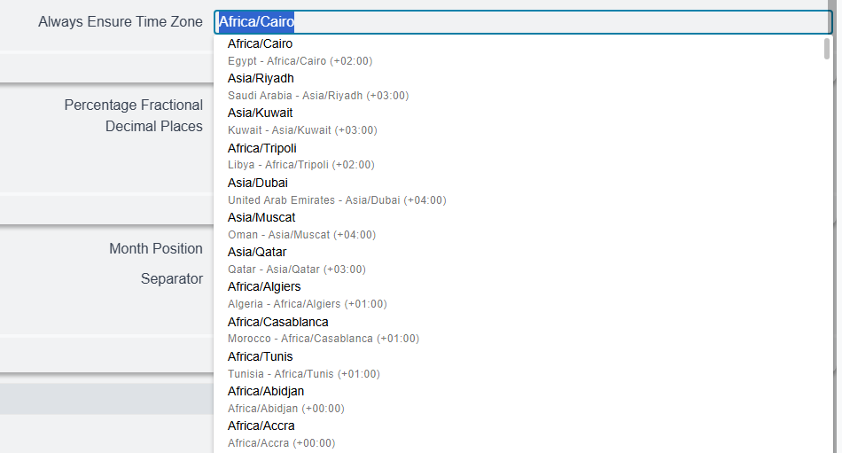

# Server Time Zone

Nama records times as plain local times: an invoice saved at 14:30 is stored as 14:30, with no time zone beside it. That makes a database belong to one time zone, and every server that writes into it has to run in that zone. A server in the wrong zone does not fail. It records times two or three hours off, and nobody can tell them from the correct ones afterwards.

This page covers the three parts of getting that right: setting the time zone of a server, the option that refuses a server running in the wrong zone, and what Nama does when servers in different time zones share one SQL Server.

::: tip Most installations need no time zone setting in Tomcat or nama.properties
Setting a time zone for Nama is needed in one case only: a Nama server has to run in a different time zone from SQL Server. When Tomcat and SQL Server are in the same time zone, and it is the time zone of the business, leave everything as it is.

When the time zone is wrong, the best fix is to change the Windows time zone of the server itself, then restart Tomcat. Tomcat and SQL Server both follow it, and nothing has to be set in Nama.

The `-Duser.timezone` option and the `timezone` line are for the case where that is not possible: more than one Nama instance runs on the same server, and they connect to a SQL Server whose time zone is different from theirs, for any reason. This happens mostly in multinational companies, where one server hosts a Nama instance for each country.
:::

## Which time zone a server runs in

A server takes its time zone from the first of these that is set:

1. **`timezone` in nama.properties**, which overrides the other two.
2. **The `-Duser.timezone` Java option of Tomcat**, which applies to that Tomcat only.
3. **The Windows time zone of the machine**, when neither of the above is there.

So a machine whose Windows clock is already in the zone of the business needs nothing. When it is not (a cloud server left on UTC is the usual case), change the Windows time zone of the machine and restart Tomcat. Use the two settings below only when one machine runs several Tomcats for businesses in different countries, so that no single Windows time zone suits them all.

### Setting it on Tomcat

1. Open **Configure Tomcat** from the Windows Start menu, or run `tomcatw.exe` from Tomcat's `bin` folder.
2. On the **Java** tab, add the option on a line of its own in the **Java Options** box.
3. Press **Apply** and restart the Tomcat service.

The option for each of the countries most Nama customers work in:

| Country | Java option | Clock |
|---|---|---|
| Egypt | `-Duser.timezone=Africa/Cairo` | UTC+02:00, and UTC+03:00 during summer time |
| Saudi Arabia | `-Duser.timezone=Asia/Riyadh` | UTC+03:00 |
| Kuwait | `-Duser.timezone=Asia/Kuwait` | UTC+03:00 |
| Libya | `-Duser.timezone=Africa/Tripoli` | UTC+02:00 |
| United Arab Emirates | `-Duser.timezone=Asia/Dubai` | UTC+04:00 |
| Oman | `-Duser.timezone=Asia/Muscat` | UTC+04:00 |
| Qatar | `-Duser.timezone=Asia/Qatar` | UTC+03:00 |
| Algeria | `-Duser.timezone=Africa/Algiers` | UTC+01:00 |
| Morocco | `-Duser.timezone=Africa/Casablanca` | UTC+01:00, and UTC+00:00 during Ramadan |
| Tunisia | `-Duser.timezone=Africa/Tunis` | UTC+01:00 |

Any other time zone works the same way, with its name after the `=`. The names are the ones the **Always Ensure Time Zone** field lists, described below.

::: warning Use the name of the place, not a fixed offset
`-Duser.timezone=GMT+2` looks right for Egypt in winter and is an hour wrong all summer. `Africa/Cairo` follows the summer-time changes by itself.
:::

::: danger Java does not complain about a misspelled name
With `-Duser.timezone=Asia/Riyad`, Tomcat starts as usual and runs on GMT. The names are case-sensitive too. Nothing reports this unless **Always Ensure Time Zone** is filled in, which is one more reason to fill it.
:::

### Setting it in nama.properties

The same names go in [nama.properties](/getting-started/nama-properties):

```properties
timezone=Asia/Riyadh
```

The line is applied when the server starts, and again by **Utilities → Reload Configuration**. Removing the line needs a restart before the server goes back to the zone of Tomcat or Windows.

A name the system does not know is ignored: the server stays in the zone it already had, and the critical errors list says so at login:

*The time zone {0} in nama.properties is not a known time zone, so it was ignored and the server runs in {1}* — «المنطقة الزمنية {0} المحددة في ملف nama.properties ليست منطقة زمنية معروفة، لذلك تم تجاهلها والخادم يعمل بالمنطقة الزمنية {1}»

## Always Ensure Time Zone

Both settings above live on the server, not in the database. Nothing stops someone from restoring the database onto a new machine, adding a second Tomcat, or moving to a cloud server whose clock is on UTC, and the first sign of trouble is a report that looks wrong weeks later.

**Always Ensure Time Zone** on the General tab of Global Configuration closes that gap. It writes the time zone into the database itself, where it travels with every backup, and from then on a server running in any other zone is refused.

<GlobalConfigOption option-code="value.info.alwaysEnsureTimeZone" />

Press the down arrow in the field, or double-click it, to open the list of time zones. The ten countries of the table above come first, then every other zone, each with its current offset. You can also type the name.



Three rules decide what the field accepts:

- **Only the zone this server is running in.** Set the zone of the server first, then select it here. That way the option can never lock out the server you are working on.
- **Zones that share one clock are the same zone.** A server on `Asia/Riyadh` accepts `Asia/Kuwait`, because the two show the same time now and will keep doing so. `Africa/Cairo` and a fixed `GMT+02:00` are not the same: they part ways every summer.
- **Empty means no check.**

### What a server in the wrong zone does

Once the option is filled in, a server that connects to this database from another time zone behaves like this:

- **Every save is refused**, on every screen and in every import, with the message below.
- **The same message is on the critical errors list** at login, and clicking it opens this option.
- **Reading still works.** Users can sign in, open records and run reports.
- **Global Configuration can still be saved**, so the option can be corrected or emptied if it is the option that is wrong.

*This server runs in the time zone {0}, while Always Ensure Time Zone in global configuration requires {1}. Saving is refused until the time zone of the server is corrected* — «هذا الخادم يعمل بالمنطقة الزمنية {0}، بينما يشترط خيار «التأكد دائما من المنطقة الزمنية» في الإعدادات العامة المنطقة الزمنية {1}. لن يتم حفظ أي بيانات حتى يتم تصحيح المنطقة الزمنية للخادم»

The fix is almost always on the server: set its time zone as described above and restart it. Saving works again as soon as the server runs in the right zone, with nothing to reset in the database.

## Servers in different time zones on one SQL Server

A hosting machine in Cairo runs one SQL Server and two Tomcats: one for an Egyptian company, one for a Saudi company. The Saudi Tomcat runs with `-Duser.timezone=Asia/Riyadh`, so everything it records is in Riyadh time.

SQL Server, though, has a single clock: the Windows clock of the machine it runs on. A report that asks the database for today's invoices with `GETDATE()` gets Cairo's today. For the Egyptian company that is right. For the Saudi company, between midnight and one in the morning Riyadh time, it is yesterday.

Nama corrects this by itself. When a server runs in a different time zone from the SQL Server machine, every query it sends has its clock calls read in the server's own time zone. When the two agree, queries are sent untouched. There is nothing to switch on.

The clock calls it covers are `GETDATE()`, `CURRENT_TIMESTAMP`, `CURRENT_DATE`, `SYSDATETIME()`, `SYSDATETIMEOFFSET()` and the `{fn NOW()}`, `{fn CURDATE()}` and `{fn CURTIME()}` forms. That holds for everything Nama runs: reports, list views, dashboards and entity flows. `GETUTCDATE()` and `SYSUTCDATETIME()` are not touched, since they do not depend on a time zone.

Nama also checks the offset of the SQL Server machine again just after every quarter hour, so a summer-time change on that machine is followed without a restart.

::: warning What still reads the clock of the SQL Server machine
- **Code stored in the database**: views, stored procedures, functions, triggers and column defaults. A report that calls a view containing `GETDATE()` gets the time of the SQL Server machine. Move the clock call into the report's own query.
- **Queries that do not go through Nama**: SQL Server Management Studio, an external reporting tool, a script that connects to the database directly.
:::

To confirm it is working, look in the Tomcat log for this line, written the first time a server finds itself in a different zone from the database machine:

`SQL clock alignment: instance offset +03:00, database offset +02:00, database clock calls are read at the instance offset`

To rule it out while investigating a query, `disable-sql-clock-alignment=true` in nama.properties switches it off.

### The setup to aim for

On a SQL Server shared between countries, do both of these for each company:

1. Give its Tomcat the `-Duser.timezone` option of its country.
2. Fill **Always Ensure Time Zone** in its database with the same zone.

Then a database opened by the wrong Tomcat refuses to save, where it would otherwise have recorded shifted times without a word.

## Messages you may see

| Message | Why | What to do |
|---|---|---|
| *This server runs in the time zone {0}, while Always Ensure Time Zone in global configuration requires {1}. Saving is refused until the time zone of the server is corrected* — «هذا الخادم يعمل بالمنطقة الزمنية {0}، بينما يشترط خيار «التأكد دائما من المنطقة الزمنية» في الإعدادات العامة المنطقة الزمنية {1}. لن يتم حفظ أي بيانات حتى يتم تصحيح المنطقة الزمنية للخادم» | The server runs in `{0}` and the database belongs to `{1}`. Shown when saving any record, and on the critical errors list. | Set the time zone of the server to `{1}` and restart it. |
| *The time zone {0} does not match the time zone of this server ({1}). Correct the time zone of the server first, then select it here* — «المنطقة الزمنية {0} لا تطابق المنطقة الزمنية لهذا الخادم ({1}). برجاء تصحيح المنطقة الزمنية للخادم أولا ثم اختيارها هنا» | You selected a zone in **Always Ensure Time Zone** that this server is not running in. | Select `{1}`, or first move the server to `{0}`. |
| *{0} is not a known time zone* — «{0} ليست منطقة زمنية معروفة» | The name typed in **Always Ensure Time Zone** is not a time zone. | Pick the name from the list. |
| *The time zone {0} in nama.properties is not a known time zone, so it was ignored and the server runs in {1}* — «المنطقة الزمنية {0} المحددة في ملف nama.properties ليست منطقة زمنية معروفة، لذلك تم تجاهلها والخادم يعمل بالمنطقة الزمنية {1}» | The `timezone` line in nama.properties is misspelled. Shown on the critical errors list. | Correct the name, then restart or run **Utilities → Reload Configuration**. |

## See also

- [nama.properties](/getting-started/nama-properties) — the `timezone` line and the other server settings
- [General tab of Global Configuration](/platform/global-config/global-config-general) — where Always Ensure Time Zone sits
- [Critical Errors at Login](/admin/troubleshooting/critical-errors) — how the list is built and refreshed
