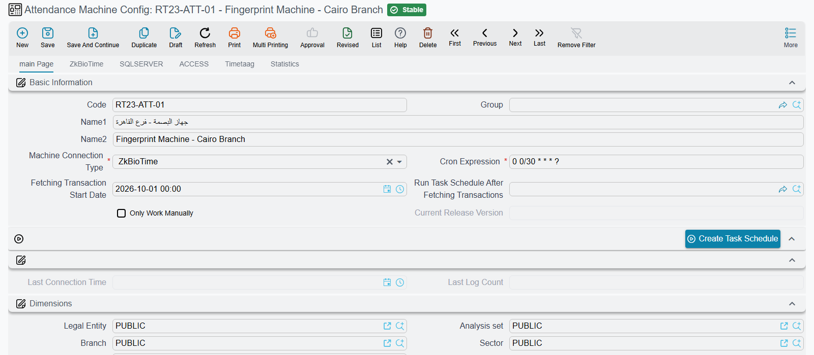

# The attcron Attendance Agent

Fingerprint machines are almost always the most awkward device on a company's network. They sit inside a branch office, behind whatever router that branch happens to have, and they expect to be talked to from the same local network. Nama, meanwhile, lives on a server somewhere else entirely — often in a data centre, often behind a firewall that lets nothing in.

**attcron** is the small application that bridges that gap. It is installed at the branch, next to the attendance machine, where it can reach the machine freely. On a schedule, it collects new punch readings and pushes them **out** to Nama. Because every connection starts at the branch, no branch needs a fixed IP address and no incoming port needs opening; the branch only needs to be able to reach the Nama server.

::: tip Read the configuration page first
Everything attcron does — which machine, which query, which schedule — is decided by an **Attendance Machine Configuration** record in Nama. The agent holds almost no settings of its own; it asks Nama for its instructions each time it starts. Set that record up first: [Attendance Machines](../modules/hr/attendance/attendance-machines.md).

The feature requires a separate license. Contact sales or technical support to obtain one.
:::

## What you need before you start

On the branch computer that will run the agent — normally the same machine that already runs the attendance machine's own software:

- **JDK 21**
- **Apache Tomcat 10**, with its startup type set to **Automatic** so the agent comes back after a reboot

And in Nama:

- an **API Credentials** record — keep its **Client ID** and **Client Secret** to hand
- a saved **Attendance Machine Configuration** — keep its **Code** to hand

## Installing

The agent is delivered by a small installer that downloads and unpacks it for you.

1. Download the installer from [https://namasoft.com/bin/nama-attcron-upgrader.jar](https://namasoft.com/bin/nama-attcron-upgrader.jar).
2. Place it **inside the Tomcat folder** and run it from there. It looks for a `webapps` folder next to itself; run it anywhere else and it stops with *"Please run from inside tomcat folder"*.
3. It downloads the application, waits for Tomcat to release the previous copy, and puts the new one in place. Messages about waiting for a folder to be deleted are normal — give it up to a minute or two.
4. Open a browser on that computer and go to `http://localhost:8080/attcron`.

::: warning Don't rename the installer
The installer decides what it is installing from its own filename. Renaming it to something that no longer contains "cron" makes it install the wrong thing.
:::

## First run: connecting to Nama

The first time you open it, the agent shows a short setup form asking for five things, all of them required:

| Field | What to enter |
|---|---|
| Nama Server URL | The address of your Nama server, e.g. `https://erp.example.com`. |
| Nama Client Id | From the API Credentials record. |
| Nama Client Secret | From the API Credentials record. |
| Attendance Machine Config File Code | The Code of the Attendance Machine Configuration record. |
| Password (from attcron-password.txt in the Tomcat folder) | The agent's own password, described under *The agent's password* below. |

You can type the server address in whatever form you have it in — with or without a trailing slash, with or without `/erp` — and the agent works out the rest.

Press **Start**. The agent immediately contacts Nama, fetches its configuration, and — unless **Only Work Manually** is ticked on that configuration — runs a first collection straight away and then settles into its schedule.

Use `https` for the Nama server address so the client secret isn't sent over the network in the clear.

## The agent's password

The agent's page is protected by a password of its own. It is not a Nama user's password and it is not stored in Nama.

- When the agent starts and finds no `attcron-password.txt` file in the Tomcat folder (or finds it empty), it creates the file and writes a random **8-character** password into it. Open the file on the branch computer to read the password.
- The password is the first line of that file. To change it, edit the file: the agent reads the file on every check, so no restart is needed, and every browser signed in with the old password is signed out.
- The agent asks for it in three places: on the setup form, on the **Sign In** page that a browser gets when the agent is already configured but that browser has not signed in yet, and in the **Logout** confirmation.
- The statistics, **Send Now** and **Read For Period** are refused until the browser has signed in.
- After **five** wrong passwords within one minute, every attempt — the correct password included — is refused until that minute is over. A wrong password and a blocked attempt show the same message, listed under *Messages you may see* below.

## The day-to-day screen

Once configured, the agent shows a status page listing recent collections — a **Date** and a **Records Count** for each — refreshing itself every thirty seconds. Four buttons sit above it:

| Button | What it does |
|---|---|
| **Read For Period** | Asks for a **From Date** and a **To Date** (date and time, pre-filled with today from 00:00 to 23:59), then re-reads exactly that range. |
| **Send Now** | Runs a collection immediately, as if the schedule had fired. |
| **Refresh** | Reloads the statistics table. |
| **Logout** | Asks for the agent's password, then stops the schedule, empties the agent's stored settings and signs every browser out. The agent returns to its setup form. |

The version of the agent is shown next to the buttons, and is also reported to Nama on every delivery, where it appears as **Current Release Version** on the configuration record.

::: tip Read For Period is the tool for backfilling
Use it after a machine has been offline, or after fixing a query. It re-reads the range you ask for without disturbing where the scheduled collection has got to, and Nama discards readings it already holds — so re-reading an overlapping period is safe and never creates duplicates.
:::

::: warning The statistics table is not history
The list of collections is held in memory only. Restarting Tomcat empties it, and once it holds more than 50 entries it is cut back to the newest 30. It is a health indicator, not a log. The permanent record is in Nama, on the configuration's **Statistics** tab.
:::

## What happens on each collection

The agent asks Nama for its current configuration, then talks to the machine in whichever way that configuration specifies — the ZkBioTime web interface, a SQL Server database, a Microsoft Access file, or the Timetaag cloud service. It collects everything newer than the point it last reached, sends it to Nama in batches, and remembers its new position.

A few numbers worth knowing when you are watching it work:

- Database collections are delivered in batches of **500** readings, and the position is saved after each batch — so a collection interrupted halfway keeps the progress it made.
- ZkBioTime collections are read a page at a time, **100** readings per page.
- Timetaag collections are also read a page at a time, **100** readings per page, but the Timetaag service filters by **date**, not by time of day: whatever start and end moments the agent asks for, it returns every reading whose punch time falls on those calendar dates. Each scheduled run therefore re-reads the whole of the current day. Nama discards what it already holds, so this produces no duplicates — but the number in the statistics table is the day's total so far, not a count of new readings, and seeing the same number repeat through the day is normal. Each scheduled Timetaag run also starts half an hour before the point the previous run reached. Just after midnight this puts the start back on the previous date, so the previous day is read one last time, and a punch made just before midnight that the device uploads a few minutes into the new day still reaches Nama.
- If Nama rejects a delivery, the agent tries it up to **three** times in all, 2.5 seconds apart, before giving up and logging the failure. The next scheduled run tries again from the same position.
- A collection that finds nothing new sends nothing to Nama, so it changes neither **Last Connection Time** nor **Last Log Count** on the configuration record. It only adds a row with a count of 0 to the agent's own statistics table.
- A *Read For Period* run deliberately does **not** move the saved position.

**Send Now** and **Read For Period** run while you wait, in the browser. A large backfill can take a while and the page will simply sit there until it finishes; that is expected.

## Where the agent keeps its state

Three files. The first two are in Tomcat's working folder (normally its `bin` directory, though this depends on how Tomcat was installed); the third is in the Tomcat folder itself.

**`attcron.properties`** holds the first four values from the setup form — with the client secret stored scrambled rather than in plain text — plus the timestamp the agent has collected up to.

**`namasoft.log`** is the agent's log, rolling over at 100 MB and keeping five compressed archives. This is where the real detail lives when something is failing silently.

**`attcron-password.txt`** holds the agent's password, described under *The agent's password* above.

Two things follow from this:

- **To start over completely**, press **Logout**, or stop Tomcat, delete or empty `attcron.properties`, and start it again. Either way the agent returns to its setup form, which still asks for the password from `attcron-password.txt`.
- **Where a restarted agent resumes from.** Each time the agent starts (a Tomcat restart, or a new setup after *Logout*) it asks Nama for the latest punch time Nama holds for the configuration. If there is one, the agent writes it over the stored timestamp and resumes from there. Only when Nama holds no reading for the configuration does it use the stored timestamp, then **Fetching Transaction Start Date**, and failing both, two months ago. Editing the timestamp in the file therefore changes nothing once Nama holds readings for the configuration; to collect an older range, use **Read For Period**.

## Upgrading

There is no automatic update. The agent reports its version to Nama on every delivery, and it is displayed as **Current Release Version** on the Attendance Machine Configuration — comparing that against your server's version is how you notice a branch has fallen behind. To upgrade, run the same installer again on the branch computer.

## When something is wrong

Start with the configuration record in Nama. **Last Connection Time** is the time of the last delivery that carried at least one reading; the **Statistics** tab tells you what has been arriving. Then work backwards:

**Last Connection Time is stale.** Either the agent isn't reaching Nama, or its collections are finding nothing to send. Check that Tomcat is running on the branch machine, open its page locally, and try **Send Now** — a failure is reported on screen, and a run that worked but found nothing adds a row with a count of 0 to the statistics table.

**The agent's statistics table shows only zeros.** The agent is running, but the machine is giving it nothing. Check the query on the configuration record and try **Read For Period** over a range you know has punches.

**Readings arrive but nothing appears in the attendance document.** They have landed in Nama but not been turned into attendance yet — check the inbox on the configuration's Statistics tab, and the scheduled task named in **Run Task Schedule After Fetching Transactions**.

**Collections seem far apart.** If the cron expression is not valid six-field syntax, the agent silently falls back to running every twelve hours.

**An Access setup won't start.** The agent insists on Machine URL, Username, Password and Cron Expression all having values, whatever the connection type and even when **Only Work Manually** is ticked. An Access connection is opened on the file path, and the agent hands Username and Password to the Access driver as the login, so put placeholder text in them when the file has no password.

### Messages you may see

| Message | Meaning |
|---|---|
| *File \[attcron.properties] is not found.* | **Send Now** or **Read For Period** was pressed after the agent's settings file was removed. Restart Tomcat and fill in the setup form again. |
| *Error While Reading Configuration File, There are one or more property not found.* | **Send Now** or **Read For Period** was pressed while the stored settings are incomplete. Empty the file, restart Tomcat and fill in the setup form again. |
| *Could not Find Attendance Machine Config File Data With Code (…)* | Nama has no configuration record with that code. Check the code, and that the record is saved. |
| *Invalid Attendance Machine Config File Data* | The configuration was found but is missing Machine URL, Username, Password or Cron Expression. |
| *IO Exception While Calling Nama ERP Server* | The branch cannot reach the server address given. Check the URL, the network and any firewall. |
| *Failed to save attendance logs after 3 retries: …* | Nama rejected the delivery three times; the trailing text is Nama's own reason. |
| *UCanAccess driver not found* | The Access support component is missing — reinstall the agent. |
| *Invalid password, or too many failed attempts* | The password typed on the setup form, the Sign In page or the Logout confirmation does not match `attcron-password.txt`, or five wrong passwords were entered within the last minute. |
| *Password is Required* | The setup form was submitted, or *Logout* was confirmed, with the password left empty. |
| *From Date and To Date Inputs are Required.* | *Read For Period* was confirmed with one of the two dates empty. |

## Related pages

- **[Attendance Machines](../modules/hr/attendance/attendance-machines.md)** — the configuration record that drives everything the agent does.
- **[Integration with Attendance Machines](attendance-machines-integration.md)** — the alternative approach of connecting the machine's database directly to Nama's, with no agent.
