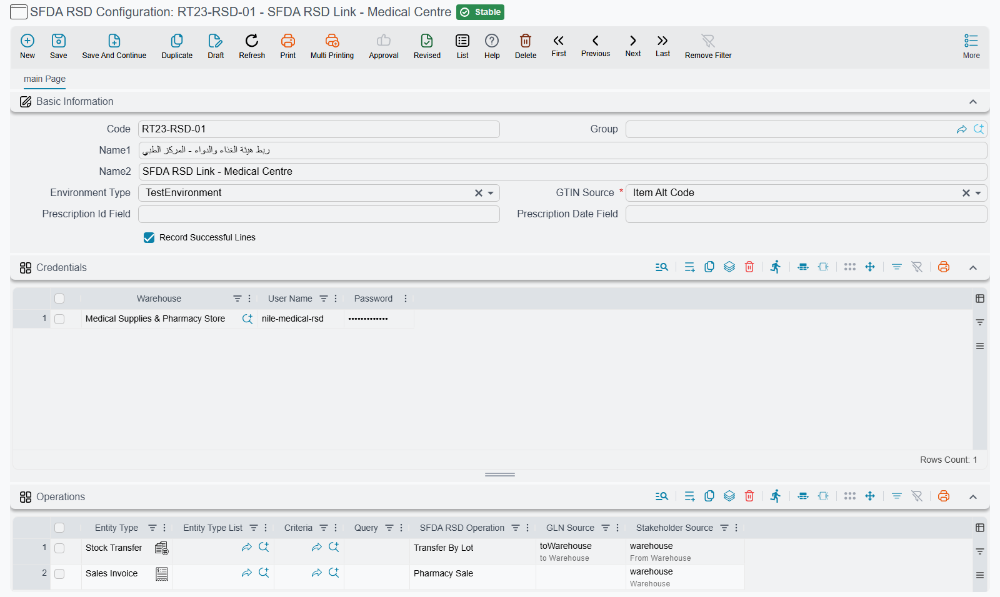

# Reporting Medicine Movements to the SFDA

The Saudi Food and Drug Authority runs a national drug track-and-trace system. Every registered medicine carries a global trade item number, a batch number and — for most products — a unique serial number on each pack, and every time one of those packs changes hands the movement has to be reported to the Authority. A wholesaler dispatching to a pharmacy reports the dispatch; the pharmacy reports the acceptance; the pharmacy reports again when it sells the pack to a patient. The Authority reconciles both halves, which is why an unreported movement does not simply go unnoticed — it leaves the other party's report unmatched.

Nama ERP does this reporting for you out of the ordinary warehouse documents your staff already raise. Nobody has to visit the Authority's portal, and there is no "send now" button to remember: once the setup below is in place, committing a stock document is what starts the report on its way.

::: tip Who this is for
This is a Saudi pharmaceutical requirement, licensed separately under `supplychain-ksa-rsd`. If you do not trade in tracked medicines, none of these screens appear.
:::

## The four pieces

**The items** decide what is in scope. On each medicine's record there is a **Subject To RSD Tracking** flag. Only lines whose item carries that flag are ever reported — everything else on the same document is simply ignored, so a mixed delivery of medicines and general goods needs no special handling.

**The SFDA RSD Configuration** — *Inventory → Settings → SFDA RSD Configuration* — holds your relationship with the Authority: which of their environments you are talking to, the login each reporting warehouse uses, where the item's trade number is read from, and the rules that say which of your documents means which kind of movement.

**The document book or document term** is what connects the two. A configuration is not chosen on the document; it is found from the document's book, and if the book does not name one, from its term. On the book it sits in the **Basic Information** group; on the term it sits under **Tax Information**. This is deliberate — routing documents into different books is how one company reports through more than one configuration.

**The report queue** carries each report to the Authority and keeps the evidence. You watch it from lists under *Administration*.

## Setting up the configuration

### Which Authority environment

**Environment Type** chooses between the Authority's test gateway and the live one. The two values are labelled **TestEnvironment** and **ProductionEnvironment**, and anything other than the production value routes to the test gateway — including leaving the field empty. Get your scenarios through the test gateway first; a report accepted there proves that your trade numbers, serial numbers and location codes are the ones the Authority is expecting.

### One login per reporting warehouse

The **Credentials** grid holds one row per warehouse that reports in its own name — the Authority calls that party the stakeholder.

| Column | What goes in it |
|---|---|
| **Warehouse** | The warehouse that reports as itself: a distribution centre, a pharmacy |
| **User Name** | The login the Authority issued to that establishment |
| **Password** | Its password |

A report whose reporting warehouse has no row here, or whose row has a blank user name or password, fails with a message naming that warehouse. The password is never copied onto the report itself, so rotating it with the Authority and updating it here is all that is needed — nothing already sent has to be re-done.

### Where the trade number comes from

**GTIN Source** tells the system which of three values on your data is the Authority's global trade item number:

| Value | Reads |
|---|---|
| **Item Code** | The item's own code |
| **Item Alt Code** | The item's alternate code |
| **Line Barcode** | The code entered on the document line |

Most installations keep their internal coding and put the trade number in the alternate code. Whichever you pick, a line whose trade number cannot be produced from it is left out of the report, so this is the first field to check if the Authority's answer covers fewer packs than you expected.

## Teaching it which document means which movement

The **Operations** grid is the heart of the setup. Each row is a rule that says "a document like *this* is a movement of *that* kind":

| Column | What it does |
|---|---|
| **Entity Type** / **Entity Type List** | Match the document type, or a list of types |
| **Criteria** / **Query** | Narrow further — a particular book, a particular warehouse, whatever distinguishes this movement from another raised on the same document type |
| **SFDA RSD Operation** | The movement being reported |
| **GLN Source** | Which field on the document holds the *other* party, whose global location number goes on the report |
| **Stakeholder Source** | Which field holds the warehouse that is reporting in its own name |

Rows are read top to bottom and **the first row that matches wins**, so put specific rules above general ones. A document matching no row is not reported at all — that is how ordinary non-pharmaceutical traffic stays out of the queue.

**Stakeholder Source** is always required. **GLN Source** is required for every movement that has a counterpart, and the configuration refuses to save without it; the three movements with no counterpart are the two pharmacy sale operations and Supply.

### The movements the Authority recognises

Each movement comes in two flavours: **By Serial**, which reports the individual packs, and **By Lot**, which reports a quantity out of a batch. Which one you choose has to match how the Authority expects that product to be traced.

| Operation | What it reports |
|---|---|
| **Dispatch By Serial** / **Dispatch By Lot** | Goods leaving you for another party |
| **Accept By Serial** / **Accept By Lot** | Goods arriving from another party |
| **Transfer By Serial** / **Transfer By Lot** | A move between two of your own locations |
| **Return By Serial** / **Return By Lot** | Goods coming back |
| **Dispatch Cancel By Serial** / **Dispatch Cancel By Lot** | Withdrawing a dispatch already reported |
| **Transfer Cancel By Serial** / **Transfer Cancel By Lot** | Withdrawing a transfer already reported |
| **Pharmacy Sale** / **Pharmacy Sale Cancel** | A sale to a patient, and its reversal |
| **Supply** | Introducing stock into the tracked chain |

### Pharmacy sales carry the prescription

A pharmacy sale is the one movement that reports something beyond the goods. Two settings on the configuration, **Prescription Id Field** and **Prescription Date Field**, name the fields on your sales document that hold the prescription's number and its date. The date is not optional — a pharmacy sale that reaches commit without one is refused, with a message saying exactly that.

A pharmacy sale has no counterpart location. The Authority understands that the goods have left the tracked chain into a patient's hands, so no other party's location number is sent.

### Supply reports one batch at a time

**Supply** describes a single batch entering the tracked chain, and the Authority's service accepts exactly one per report. A document mapped to Supply whose lines resolve to more than one distinct batch is refused at commit, and the message tells you how many batches it found. Split it into one document per batch.

## What each line has to carry

Whatever the movement, a line only becomes part of a report if it can be described the way the Authority describes stock:

- **A lot number, always.** A line with no lot number is not reported. This is the single most common reason a document reports fewer packs than it contains.
- **A serial number**, on every *By Serial* movement. A tracked line without one stops the commit and names the item.
- **A positive quantity**, on every *By Lot* movement. Zero or less stops the commit the same way.
- **A resolvable trade number**, from whichever source you configured.

## How a report actually happens

Nothing is sent while you are still looking at the screen.

1. **You commit a stock document.** Stock Issue, Stock Receipt, Issue Stock Transfer and Receipt Stock Transfer are the four that report.
2. **The system works out what is owed.** It compares the tracked lines now on the document against everything the Authority has already accepted for it. Lines that are new are queued as a report; lines the Authority accepted before but that have since been removed are queued as the *reverse* movement — a dispatch becomes a dispatch cancel, an acceptance becomes a return. Editing a document therefore corrects the Authority's record instead of duplicating it.
3. **Anything still queued from an earlier save is discarded first**, so saving a document three times before the queue runs produces one report, not three. Reports that have already gone stay on file as the audit trail.
4. **A background job picks the queue up about once a minute** and sends the reports one at a time, in order.

The queued report carries the user, the dimensions and the interface language from the moment of commit, so what reaches the Authority is what that person raised, however much later it is actually transmitted.

## Watching it

Two read-only lists under *Administration* answer the two questions people actually ask.

**SFDA RSD Document Status** answers *"is this document reported?"* — one row per source document, summarising every report raised for it:

| Column | What it tells you |
|---|---|
| **Document #** | The document reported |
| **Status** | Its overall state (below) |
| **Operation** and **Cancel** | Which movement, and whether this one is a reversal |
| **Lines Count**, **Successful Lines Count**, **Failed Lines Count** | How many packs or batches were reported, and how many the Authority took |
| **Reports Count**, **Failed Reports Count** | How many attempts the document has needed |
| **Submition Date**, **Execution Date** | When it was queued, and when it actually went |
| **Notification ID** | The Authority's own reference for the accepted report |
| **Error Message** | Why it failed, when it did |
| **Requester** | Who committed the document |

Beside it sits the report list, which answers *"what exactly went to the Authority?"* — one row per call, with the same status and error columns plus **Trials**. Its hidden columns are where the evidence lives: **Partner GLN**, **Stakeholder Warehouse**, and the exact request and response exchanged with the Authority, kept verbatim so that months later you can show precisely what was sent and precisely what came back.

### What the statuses mean

| Status | Meaning |
|---|---|
| **Initial** | Queued at commit, not yet sent |
| **Executed** | The Authority accepted it and returned a notification reference |
| **Partial** | Some of the document's lines were accepted and some were not |
| **Failed** | The call itself did not succeed — no credentials for the warehouse, no location number, or the Authority's service refused the request outright |
| **Blocked** | The Authority answered, but rejected every line on the report |

A rejection is per line, and the Authority explains itself: each rejected pack is listed with its trade number, its serial or lot, and the Authority's own numbered reason, fetched from the Authority in your interface language. That detail is written to **Error Desciption**, which is not one of the columns shown by default — add it from the column chooser when you need to read it, or filter on it to find every document rejected for the same reason.

### Pack by pack: SFDA RSD Line Results

When you need the answer for one pack rather than for the whole document, open **SFDA RSD Line Results**, also under *Administration*. It has one row per pack (or per batch quantity, on a *By Lot* movement) of each reported document, and it is rebuilt every time the document is saved or one of its reports comes back:

| Column | What it tells you |
|---|---|
| **Document #**, **Operation** | The document and the movement reported |
| **Status**, **Succeeded** | Whether the Authority accepted this pack, or whether its report is still waiting to go |
| **Item**, **GTIN**, **Batch Number**, **Serial Number**, **Expiry Date** | What was sent to the Authority |
| **RSD Response Code**, **Error Desciption** | The Authority's numbered answer for this pack and its explanation |
| **Document Batch Number**, **Document Serial Number**, **Document Expiry Date** | The same values as they stand on the document line, so a typing mistake shows up side by side with what the Authority expected |

By default the list keeps only the packs that were rejected or are still waiting. Tick **Record Successful Lines** on the configuration to keep the accepted packs as well — useful while you are proving a new setup, noisy once it is running.

## Putting a failed report right

A report that failed stays failed; the queue does not keep retrying it on its own. That is deliberate, because nearly every failure is a data problem that retrying would only repeat — a warehouse with no location number, a missing credential, a batch the Authority does not recognise.

The recovery path is a single action on the **SFDA RSD Document Status** list: select the rows and choose **Recommit Selected Documents** from the More menu. It asks whether to stop at the first error, then re-saves each source document, which puts it back through the same reconciliation as step 2 above. Because that reconciliation only queues what the Authority has *not* already accepted, recommitting a partially accepted document sends the missing lines and nothing else — there is no way to report the same pack twice.

So the working sequence when something has gone wrong is always the same: read the reason on the status row, fix it where it lives — the item's trade number, the warehouse's location number, the credentials grid, the missing lot number on the document — and then recommit.

## Receiving: matching the supplier's dispatch notifications

Everything above is about telling the Authority what *you* did. The receiving side works the other way round. When a supplier dispatches medicines to you, the supplier reports the dispatch and the Authority issues a **dispatch notification** for it; the notification number comes with the goods. Nama can read that notification from the Authority and check your purchase invoice against it, so a wrong batch, a wrong expiry date or an over-delivery is caught at the desk instead of in an audit.

### Where the notification number goes

Pick a field on the Purchase Invoice to hold the notification number — usually a spare text field on the header — and name it in **Purchase Invoice RSD Notification ID Field** on the SFDA RSD Configuration. The field may also sit in a grid; then the first line that carries a value is used, because one invoice receives one notification. The configuration is found from the invoice's book or term, exactly as for outgoing reports.

### The SFDA RSD Incoming Dispatches list

**SFDA RSD Incoming Dispatches**, under *Administration*, is the worklist of what suppliers have sent you. It has one row per notification, GTIN and batch:

| Column | What it tells you |
|---|---|
| **Notification ID**, **Dispatch Date** | The Authority's notification and when the goods were dispatched |
| **Status** | **Waiting Receipt**, **Partially Received** or **Fully Received** |
| **GTIN**, **Item**, **Batch Number**, **Expiry Date** | What was dispatched. The item is found from the GTIN, using the configuration's **GTIN Source** |
| **Quantity**, **Received Quantity**, **Remaining Quantity** | What was dispatched, what your purchase invoices have received so far, and what is left |
| **Supplier** | The supplier whose GLN sent the notification |
| **Related Invoices**, **Receipt Document** | The purchase invoices that received it, and the latest of them |
| **Last Pull Date** | When the row was last read from the Authority |

The Authority offers no way to list the notifications addressed to you; it answers one notification number at a time. So a notification enters the list in one of two ways:

- **Refresh Incoming Dispatches**, in the list's More menu. It asks for the **RSD Configuration** whose logins should read the notification, and for one or more **Notification ID**s, separated by commas or spaces. Leave the notification ID empty to re-read the rows you selected — or, with nothing selected, every notification of that configuration that is not yet fully received. A new notification is tried with each login of the **Credentials** grid until the one it was addressed to answers.
- **Committing a purchase invoice** that carries a notification number the list does not have yet reads it from the Authority on the spot.

The received quantities follow your purchase invoices: committing, editing or deleting a Purchase Invoice that carries a notification number recalculates that notification's rows.

### Checking the invoice against the notification

The check compares the invoice with the notification as the Authority holds it now — it reads the notification afresh every time — and refuses when:

- the GLN of the invoice's supplier is not the GLN that sent the notification;
- a line whose item is **Subject To RSD Tracking** has a GTIN that is not in the notification, or a lot that is not one of the dispatched batches for that GTIN;
- the notification carries an expiry date and the line's expiry date differs from it;
- the invoice, together with the purchase invoices already committed for the same notification, receives more of a GTIN and batch than was dispatched.

Lines of untracked items are ignored, and an invoice with no notification number is not checked at all.

There are two ways to run it. To stop a mismatched invoice from being saved, add the entity flow action [EAValidateSFDARSDIncomingDispatches](/entity-flows/supplychain/EAValidateSFDARSDIncomingDispatches) to the Purchase Invoice; its page says which event to attach it to. To check a saved invoice by hand, use **Validate Against RSD Notifications** in the invoice's More menu — it lists every mismatch at once, or answers *Done successfully*.

## Messages you may see

The receiving side raises these messages:

| Message | Why | What to do |
|---|---|---|
| *SFDA RSD: no SFDA RSD configuration is set on the book or the term of document {0}* — «SFDA RSD: لا توجد إعدادات تتبع الأدوية (رصد) على دفتر أو توجيه المستند {0}» | Neither the invoice's book nor its term names an SFDA RSD Configuration | Set the configuration on the book or the term |
| *SFDA RSD: the purchase invoice RSD notification ID field is not set in SFDA RSD configuration {0}* — «SFDA RSD: حقل رقم إشعار رصد في فاتورة الشراء غير محدد في إعدادات تتبع الأدوية {0}» | The configuration does not say which invoice field holds the notification number | Fill **Purchase Invoice RSD Notification ID Field** |
| *SFDA RSD: save the invoice before validating it against its dispatch notifications* | **Validate Against RSD Notifications** was pressed on an invoice that was never saved. This message has no Arabic text, so it appears in English on Arabic screens too | Save the invoice, then press it again |
| *SFDA RSD: dispatch notification {0} was not found* — «SFDA RSD: إشعار رصد رقم {0} غير موجود» | The Authority returned nothing for that number | Check the number typed on the invoice against the supplier's paperwork |
| *SFDA RSD: dispatch notification {0} carries no products* — «SFDA RSD: إشعار رصد رقم {0} لا يحتوي على أي أصناف» | The Authority answered, but the notification lists no products | Check the number with the supplier |
| *SFDA RSD: configuration {0} has no credential carrying a user name and a password* — «SFDA RSD: إعدادات تتبع الأدوية {0} لا تحتوي على بيانات اعتماد بها اسم مستخدم وكلمة مرور» | No row of the **Credentials** grid has both a user name and a password, so nothing can read the notification | Complete the Credentials grid |
| *SFDA RSD: choose the SFDA RSD configuration to read the dispatch notifications with* — «SFDA RSD: اختر إعدادات تتبع الأدوية (رصد) التي تُقرأ بها إشعارات الشحن» | **Refresh Incoming Dispatches** was run without an RSD Configuration | Run it again and choose the configuration |
| *SFDA RSD: dispatch notification {0} was sent by GLN {1}, while the GLN of supplier {2} is {3}* — «SFDA RSD: إشعار رصد رقم {0} مُرسَل من رقم الموقع العالمي (GLN) {1}، بينما رقم الموقع العالمي للمورد {2} هو {3}» | The notification came from a different party than the invoice's supplier | Correct the supplier on the invoice, or the GLN on the supplier's record |
| *SFDA RSD: line {0}: item {1} is not part of dispatch notification {2}* — «SFDA RSD: السطر {0}: الصنف {1} غير موجود في إشعار رصد رقم {2}» | No product in the notification has this item's GTIN | Check the item on the line, or its GTIN |
| *SFDA RSD: line {0}: batch {1} of item {2} is not part of dispatch notification {3}* — «SFDA RSD: السطر {0}: رقم التشغيلة {1} للصنف {2} غير موجود في إشعار رصد رقم {3}» | The GTIN is in the notification, but not with this batch | Correct the lot on the line to the dispatched batch |
| *SFDA RSD: line {0}: expiry date {1} of item {2} differs from {3} in dispatch notification {4}* — «SFDA RSD: السطر {0}: تاريخ الإنتهاء {1} للصنف {2} يختلف عن {3} في إشعار رصد رقم {4}» | The line's expiry date is not the one the supplier reported | Correct the expiry date on the line |
| *SFDA RSD: quantity {0} of GTIN {1} batch {2} exceeds {3} still available to receive from dispatch notification {4}* — «SFDA RSD: الكمية {0} لرقم GTIN {1} رقم التشغيلة {2} تتجاوز الكمية المتبقية للاستلام {3} من إشعار رصد رقم {4}» | This invoice plus the invoices already committed for the same notification receive more than was dispatched | Reduce the quantity, or check the earlier invoices in **Related Invoices** |
