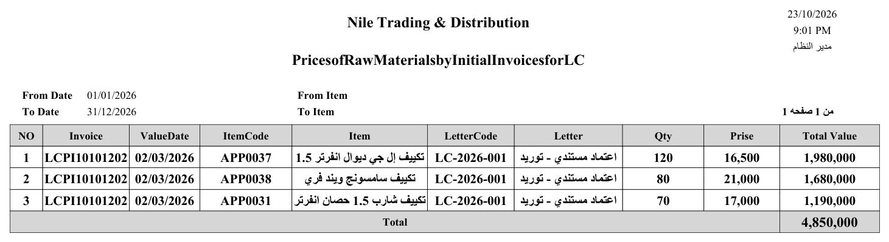

# Bank Letters of Credit

A letter of credit (LC) is a tool an importer uses to reassure the supplier: the bank undertakes to pay the supplier the shipment's value once they present shipping documents matching the terms. Like a letter of guarantee, an LC **reserves part of your facility limit** and charges you **fees**, and it's tracked as a master file with a succession of opening, changing and closing documents, keeping two sets of figures: the **initial values** and the **current values**. Its structure is very close to that of [Letters of Guarantee](./letters-of-guarantee.md).

::: info Required license
Letters of credit are part of the `accounting-blc` license. The **Bank Letter Of Credit Type** list is part of the `accounting-financial-commitments-regulation` license.
:::

## The LC's lifecycle

Every screen hangs off the **Banks > Bank LC** root:

1. **Bank LC Request** — documenting the LC request before opening it (no accounting effect).
2. **Bank LC** — the master file in its initial status "Initial".
3. **Bank LC Opening** — the moment the bank actually opens the LC (it creates a journal entry, reserves the facility, and the status flips to "Issued").
4. **Bank LC Changing** — changing the value, term or fees (updates the current values).
5. **Bank LC Closing** — closing the LC and releasing the reserved facility.

## The LC's master file

On the **Bank LC** screen (`Banks > Bank LC > Bank LC`) the LC's data is defined:

- **Basic information**: the code and names, the **English Code**, and the link to the **LC request**, the **project contract** and the **project contract extract** when needed.
- **Initial Bank LC Values**: figures you type on the master file itself — the **LC amount** and **currency**, **Delivered To**, **from date / to date**, the **covered** percentage and amount (covered in cash), and the **fees** percentage and value. No document changes them.
- **Bank LC** (the current values): the **status**, the same figures as written by the latest saved document on the LC, and the **bank** and **bank account**. The **Transactions** tab lists those documents.

The **Bank Letter Of Credit Type** list (`Banks > Bank LC > Bank Letter Of Credit Type`) is a plain classification file — code, Arabic and English names, remarks and dimensions. It is picked on the [Facility Limit](./credit-facilities.md) lines, in the LC **Type** column that sits beside the guarantee-type and loan-type columns, to label which kind of LC a line of the ceiling is meant for. It is a label only: no amount, account or check reads it.

### LC statuses

The LC moves through **Initial** → **Issued** → **Finished** / **Canceled** / **Liquidated**. The opening document sets **Issued**, a changing document keeps the status as it is, and the closing document sets whichever of the last three you pick in its **Status** field.

## Opening and reserving the facility

When a **Bank LC Opening** (`Banks > Bank LC > Bank LC Opening`) is recorded its accounting effect is created and, when the LC carries a facility limit, the full LC amount is reserved against it. The opening term covers the sides: **LC amount debit/credit**, **facilities amount debit/credit**, **fees debit/credit** (with **tax fees 1 and 2**), and the **covering** side. (Where the accounts come from is in the [Document terms](../support/accounting-document-terms.md) reference.)

::: warning Facility-limit check
When the LC carries a facility limit, the opening recalculates that limit and is blocked if any of its lines is left with a negative remaining amount. Details in [Credit Facilities](./credit-facilities.md).
:::

## Amendment and closing

A **Bank LC Changing** (`Banks > Bank LC > Bank LC Changing`) raises or lowers the LC value, changes its dates or covered amount, and records **Change Fees**. Its LC field lists only LCs past **Initial**. The document copies the LC's current figures, read-only, and you type the new ones in its **New Info** group. On save the new figures become the LC's current values, the change fees add up in **Total Change Fees**, and the status and the initial values stay as they are. The changing document does not touch the facility limit.

A **Bank LC Closing** (`Banks > Bank LC > Bank LC Closing`) closes the LC. Its **Status** field is required and takes **Finished**, **Canceled** or **Liquidated**, and that becomes the LC's status. The document takes the LC's current values, and when the LC carries a facility limit it releases the LC amount from those current values. It can also carry **Bank LC Closing Fees**.

A changing or closing document needs an earlier document on the LC. Otherwise the save is refused with:
*Bank LC {0} does not have a previous entry. Please create Openning document.* — «الاعتماد البنكي {0} لا يوجد له سند سابق لهذا السند. يرجى عمل سند افتتاحي أولا»

## Actions on this screen

Two buttons build the rest of the chain, one on each screen:

- **Create Bank LC**, on the **Bank LC Request** — turns the request into the LC's master file, carrying over its names, type, amount and currency, bank, bank account, dates, **Delivered To**, covered amount and fees, and opening it as a new record for you to review and save. It is refused when the request's type is **Rejected**, and when the request was already turned into an LC.
- **Create Bank LC Opening Document**, on the **Bank LC** master file — opens a new **Bank LC Opening** document for that LC, pre-filled with its bank, bank account, dates, amount and currency, covered amount and fees.

Each needs its record **saved** first.

## Reports

Both reports read the supply-chain **Letter of Credit** (its proforma invoices and expense documents), not the Bank LC of this page.

| Report | Answers |
|---|---|
| Raw-material prices by initial LC invoices (SYSR-LCD001) | Linking imported-material cost to the LC's initial invoices. |
| Analysis of costly LCs (SYSR-LCD002) | The highest-cost LCs for comparison and analysis. |

## Banking or Import? — How It Differs from the Supply-Chain LC

Nama has two letters of credit that share a name but serve different purposes:

- **The Bank LC (this page)** is a *treasury/banking* instrument: it cares about your commitment to the bank — how much of your **facility limit** it reserves, the opening and amendment **fees**, and the **journal entries**. It tracks no shipments, no proforma invoices, no goods, and never touches inventory.
- **The Supply-Chain LC** (`LC > Master Files > Letter of Credit`) is an *import/procurement* process: it manages the supplier, the **shipments** (containers, bills of lading, customs), and the **proforma invoices**, and accumulates insurance, freight, and customs charges onto the goods to reach the true **landed cost**, then receives them into inventory.

In short: the Bank LC answers "what does this LC do to my facility and my ledger?", while the Supply-Chain LC answers "how do I run this import shipment and its costs all the way into the warehouse?" They are two independent features — different entities and licenses — not two views of one document.

::: info Imports and shipment management
For the full import cycle — shipments, proforma invoices, additional costs, and landed cost — see [Letters of Credit in Supply Chain](../../supplychain/letters-of-credit.md).
:::

## For Support

- **"Couldn't open the LC — limit exceeded"** — the reserved amount exceeds the linked facility limit; see [Credit Facilities](./credit-facilities.md).
- **"What's the difference between initial and current values?"** — the initial ones are typed on the master file and no document changes them; the current ones are written by the latest saved document on the LC.
- **"Where do the amount, facility and fee accounts come from?"** — from the **Bank LC Opening** term; see [Document terms](../support/accounting-document-terms.md).
- The accounting-processing mechanism is in [How documents are processed into accounting effects](../support/accounting-request-processing.md).
