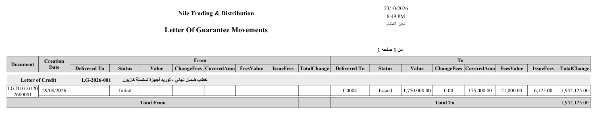

# Letters of Guarantee

A letter of guarantee is an undertaking the bank issues on your behalf in favor of a third party (a government body, a project owner…) guaranteeing that you'll meet some obligation — like a tender-entry guarantee or a contract performance guarantee. No actual cash leaves you when it's issued, but it **freezes part of your facility limit** with the bank and charges you **fees**. So Nama tracks the letter of guarantee as a master file with a succession of movement documents that issue it, receive and deliver it, amend it and close it — always keeping two snapshots: the **initial values** at issue and the **current values** after amendments.

::: info Required license
Letters of guarantee are part of the `accounting-lgt` license.
:::

## The letter's lifecycle

Every screen hangs off the **Banks > Letters Of Guarantee** root:

1. **LGT Request** — documenting the request before issuing (no accounting effect).
2. **Letter Of Guarantee** — the master file in its initial status "Initial".
3. **LGT Issue** — the moment the bank actually issues the letter (it creates a journal entry, and the status flips to "Issued").
4. **LGT Receipt / Delivery** — tracking the circulation of the paper copy with the beneficiary.
5. **LGT Changing** — extending the term or changing the value or fees (updates the current values and records the change fees).
6. **LGT Closing** — closing the letter when it ends or is canceled.

An **LGT Opening Doc** is used to enter the balances of existing letters when starting work on the system.

## The letter's master file

On the **Letter Of Guarantee** screen (`Banks > Letters Of Guarantee > Letter Of Guarantee`) the letter's data is defined:

- **Basic information**: linking the letter to the **LGT request** that preceded it, to the **facility limit** it reserves from, and to a **project contract** when needed.
- **Initial LGT values**: the terms you type on the master file, copied into the current values until the letter gets its first document — the **amount** and **currency**, **who it's delivered to**, **from date / to date**, the **covered amount** (covered in cash), the **facilities** (the reserved portion of the facility limit), and the **fees**.
- **Letter of guarantee (current values)**: the **LGT type**, the **guarantee type** and the **status**, plus the values in force after any amendment (amount, covered, facilities, change fees).

The **guarantee type** classifies the letter's purpose: **initial guarantee** (tender entry), **final guarantee** (performance), **advance-payment guarantee**, **customs guarantee**, or other types.

### Letter statuses

| Status | When |
|---|---|
| Initial | when saved before issuing. |
| Issued | after the issue document is saved. |
| Received | after an **LGT Receipt** is saved. |
| Totally Delivered | after an **LGT Delivery** is saved. |
| Finished | after an **LGT Closing** whose **Status** field is Finished (a normal close). |
| Canceled | after an **LGT Closing** whose **Status** field is Canceled. |
| Liquidated | after an **LGT Closing** whose **Status** field is Liquidated (the beneficiary claims the letter's value). |

## Issuing and reserving the facility

When an **LGT Issue** (`Banks > Letters Of Guarantee > LGT Issue`) is recorded its accounting effect is created and, when the letter carries a facility limit, the letter's full value is reserved against it. The issue term covers several sides: **LGT amount debit/credit**, **facilities amount debit/credit** (the reserved portion of the facility limit), **fees debit/credit** (with **tax fees 1 and 2**), and the **covering** side. (Where these accounts come from is explained in the [Document terms](../support/accounting-document-terms.md) reference.)

::: warning Facility-limit check
When the letter carries a **facility limit**, the issue recalculates that limit and is blocked if any of its lines is left with a negative remaining amount. The issue is also checked against the limit line that matches the letter's project contract. The details of facility limits are in [Credit Facilities](./credit-facilities.md).
:::

## Receipt, delivery, amendment and closing

The **Receipt** and **Delivery** documents track the circulation of the paper copy of the letter. **Changing** is used to extend the letter's term or change its value or fees — it updates the current values while keeping the initial values as a reference, and records the **change fees**. Finally, **Closing** closes the letter and releases the reserved facility.

::: warning Only Issue and Changing decide the letter's money
Receipt, Delivery and Closing show the letter's value, covered amount and fees, but they do not
own those figures — each one inherits them from the document that comes before it in the letter's
chain. **Issue** sets the opening figures, **Changing** moves them afterwards, and everything else
simply carries forward whatever the chain says at that point.

So if a delivery is showing 200,000 and you need it to read 250,000, typing over the amount on the
delivery will not do it. The document still saves, but the figure snaps back to what the chain says
and you get this warning:
*The values of letter of guarantee {0} are inherited from the document before this one in the letter's chain and cannot be edited here. Use an LGT Changing document to change the value or the fees.* — «قيم خطاب الضمان {0} موروثة من السند السابق له في سلسلة الخطاب ولا يمكن تعديلها هنا. استخدم سند تعديل خطاب ضمان لتغيير القيمة أو الرسوم»
Enter an **LGT Changing** dated before the
delivery instead, and the delivery picks the new figure up on its own.
Editing the amount on the **Letter Of Guarantee** master file has no effect on the documents
either, for the same reason: the chain, not the master file, is what they read.
:::

## Actions on this screen

Two buttons, one on each screen, save re-keying the whole letter twice:

- **Create Letter Of Guarantee**, on the **LGT Request** — turns the request into the letter's master file, carrying over its type, amount, bank, bank account, dates, covered amount and fees. The letter opens as a new record for you to review and save. It is refused when the request's type is **Rejected**, and when the request was already turned into a letter.
- **Create LGT Issue**, on the **Letter Of Guarantee** master file — opens a new **LGT Issue** document for that letter, pre-filled with its bank, bank account, dates, amount and currency, covered amount and fees. Reach for it when the bank has actually issued the letter and you want to record the accounting effect straight away.

Each needs its record **saved** first — an unsaved record has nothing for the new document to be built from.

## Reports

| Report | Answers |
|---|---|
| Letter of Guarantee movements (SYSR-LGT001) | Each letter's movements: issue, amendments, closing, and covered/facility balances. |

## For Support

- **"Couldn't issue the letter — limit exceeded"** — the reserved amount exceeds the linked facility limit; see [Credit Facilities](./credit-facilities.md).
- **"What's the difference between initial and current values?"** — the initial ones are typed on the master file, and the current ones are written by the latest document on the letter; both stay on the letter for comparison.
- **"Where do the amount, facility and fee accounts come from?"** — from the **LGT Issue** term; see [Document terms](../support/accounting-document-terms.md).
- The accounting-processing mechanism is in [How documents are processed into accounting effects](../support/accounting-request-processing.md).
