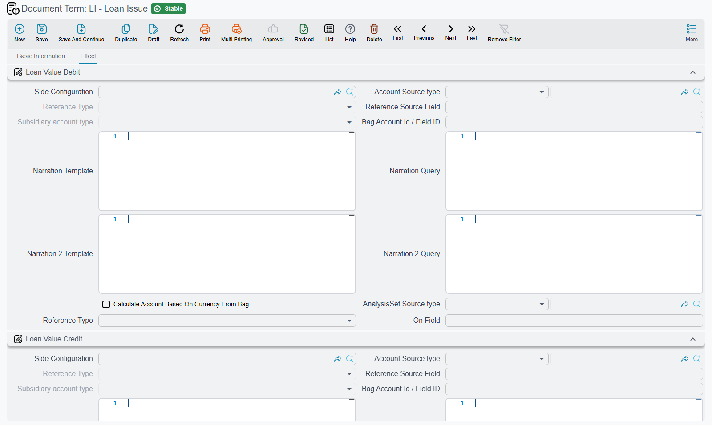

# Loan, Deposit and Credit Facility Document Terms

Borrowing from a bank and lending to one are mirror images, and their terms look alike: a pair of
sides for the principal, a pair for the interest, and sometimes a pair for the fees. What makes each
term worth reading is *which* amount of the document each pair picks up — a loan payment, for
example, can record the same instalment twice through two different pairs, and that is by design.

The two kinds of side on these screens — a full account-side block, and a single reference to a
saved side marked *(record)* below — are explained on
[Letter of Guarantee and Letter of Credit Document Terms](/modules/accounting/document-terms/acc-terms-guarantees-and-credits).
As everywhere, a pair creates a ledger entry only when both its debit and its credit are filled in.

## Bank loans

The documents are on [Bank Loans](/modules/accounting/bank-facilities/bank-loans).

### Loan Issue

| Group on screen | Field | What it books |
|---|---|---|
| **Loan Value Debit / Credit** | `termConfig.loanValDebit`, `termConfig.loanValCredit` | The loan's value — usually the bank account debited and the loan liability credited. |
| **Fees Value Debit / Credit** | `termConfig.feesValDebit`, `termConfig.feesValCredit` | The fees value on the issue document. |
| **Interest Value Debit / Credit** | `termConfig.interestValDebit`, `termConfig.interestValCredit` | The total interest the loan will carry over its life, calculated from the loan. Customers who recognise interest only as it falls due leave this pair empty and record interest through the interest-calculation document instead. |
| **Fees Tax** group: **Fees Tax Debit / Credit** *(record)* | `termConfig.feesTaxDebit`, `termConfig.feesTaxCredit` | The tax on the fees. |

### Loan Installment Payment

A payment document has two grids — instalment lines and interest lines — and the term has pairs for
each.

| Group on screen | Field | What it books |
|---|---|---|
| **Debit / Credit** | `termConfig.config.debit`, `termConfig.config.credit` | The paid amount of **each instalment line**. |
| **Interest value Debit / Credit** | `termConfig.collectDebit1`, `termConfig.collectCredit1` | The paid amount of **each interest line**. |
| **Other effects**: **Debit 2 / Credit 2** *(record)* | `termConfig.debit2`, `termConfig.credit2` | The instalment paid amount again, through a second pair. |
| **Other effects**: **Interest Payment Value Debit2 / Credit2** *(record)* | `termConfig.interestValueDebit2`, `termConfig.interestValueCredit2` | The interest paid amount again, through a second pair. |
| **Fines**: **Fine Debit / Credit** *(record)* | `termConfig.fineDebit`, `termConfig.fineCredit` | The fine value on each instalment line. |

The second pairs record the same amounts a second time, on a second pair of accounts — use them only
when one payment must move two sets of balances at once. Leave them empty otherwise.

Two options in the **Other effects** group change how the document behaves rather than where it
records its entries:

| Option | Field | What it does |
|---|---|---|
| **Regard Paid Amount In Document Header When Collecting Installments** | `termConfig.regardPaidAmountInDocHeader` | When the instalment lines are generated, the amount typed in the document header is spread over them in order, oldest first; lines left with nothing to pay are removed. Without it every due instalment comes in at its full amount. |
| **Pay Interest Payments Only** | `termConfig.payInterestPaymentsOnly` | Allows a payment that has interest lines and no instalment lines. Left off, the instalment grid must not be empty. |

### Loan Interests Calculation

**Debit / Credit** `termConfig.config.debit`, `termConfig.config.credit` book the interest value of
each line — the periodic accrual of interest expense against interest payable.

### Bank Loan Changing Document

The document that amends or cancels an issued loan has a term with one **Effect** tab and one group,
**Cancel Loan Effect**, holding three pairs, all *(record)*:

| Group on screen | Field | What it books |
|---|---|---|
| **Cancel Loan Debit / Credit** | `termConfig.cancelLoanDebit`, `termConfig.cancelLoanCredit` | The **Loan Value** typed on the changing document. |
| **Modification Fees Debit / Credit** | `termConfig.modificationFeesDebit`, `termConfig.modificationFeesCredit` | The sides for the modification fees. |
| **Modification Fees Tax Debit / Credit** | `termConfig.modificationFeesTaxDebit`, `termConfig.modificationFeesTaxCredit` | The sides for the tax on the modification fees. |

::: warning An entry only on cancellation, and only with all six sides
The term records an entry only when the document's **Cancel Loan** box is ticked. A changing document
that just amends the loan — its value, interest or schedule — records nothing, and unticking **Cancel
Loan** on a saved document removes the entry it had written. Unlike the other terms on this page, the
pairs are not independent: **all six sides must be filled**, or the document records no entry at all —
not even the cancel pair.
:::

## Credit facilities

The documents are on [Credit Facilities](/modules/accounting/bank-facilities/credit-facilities).

**Credit Facility Issuance** has a single **Debit / Credit** pair *(record)*
(`termConfig.debit`, `termConfig.credit`), and it records two amounts through it: the facility value
and the fees value. Both land on the same accounts.

**Credit Facility Payment** has three pairs, all *(record)*:

| Group on screen | Field | What it books |
|---|---|---|
| **Payment Value Debit / Credit** | `termConfig.paymentValueDebit`, `…Credit` | The payment value of each line. |
| **Payment Of Credit Facility Value Debit / Credit** | `termConfig.paymentOfCreditFacilityValueDebit`, `…Credit` | The part of each line's payment that reduces the facility. |
| **Payment Of Interest Value Debit / Credit** | `termConfig.paymentOfInterestValueDebit`, `…Credit` | The part of each line's payment that settles interest. |

**Allow Zero Payment To Calculate Interest** `termConfig.allowZeroPaymentToCalculateInterest` lets a
line be saved without a payment value — useful when the document is raised only to calculate the
interest due. Left off, each line's payment value is required unless **Pay All Interests Amount** is
ticked on the document.

## Fixed deposits

The documents are on [Fixed Deposits](/modules/accounting/bank-facilities/fixed-deposits).

**Fixed Deposit Issue**

| Group on screen | Field | What it books |
|---|---|---|
| **Debit / Credit** | `termConfig.config.debit`, `termConfig.config.credit` | The deposit value — usually the deposit account debited and the bank account credited. |
| **Interest Value Debit / Credit** | `termConfig.interestValDebit`, `termConfig.interestValCredit` | The total interest of the deposit over its term. |

**Fixed Deposit Changing** has two pairs *(record)*, and the document's **Cancel Deposit** box picks
one of them:

| Group on screen | Field | Used when |
|---|---|---|
| **Cancel Fixed Deposit Effect** | `termConfig.cancelDepositDebit`, `termConfig.cancelDepositCredit` | **Cancel Deposit** is ticked — the deposit is broken and its value returns. |
| **Changing Fixed Deposit Effect** | `termConfig.changingDepositDebit`, `termConfig.changingDepositCredit` | **Cancel Deposit** is not ticked — the deposit is amended. |

Either way the amount recorded is the deposit value.

**Interest Payment Document** — the document that books the profit a deposit earns — has a
**Settings** tab with the term's basic data and an **Effect** tab whose **Debit / Credit**
(`termConfig.config.debit`, `termConfig.config.credit`) book the interest value of each line.
