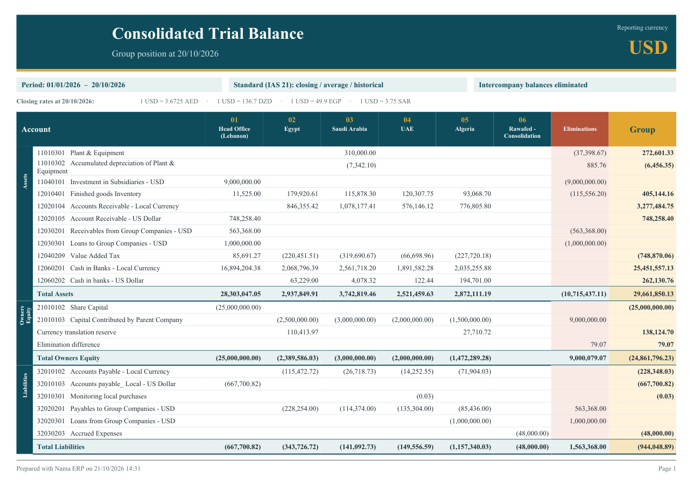
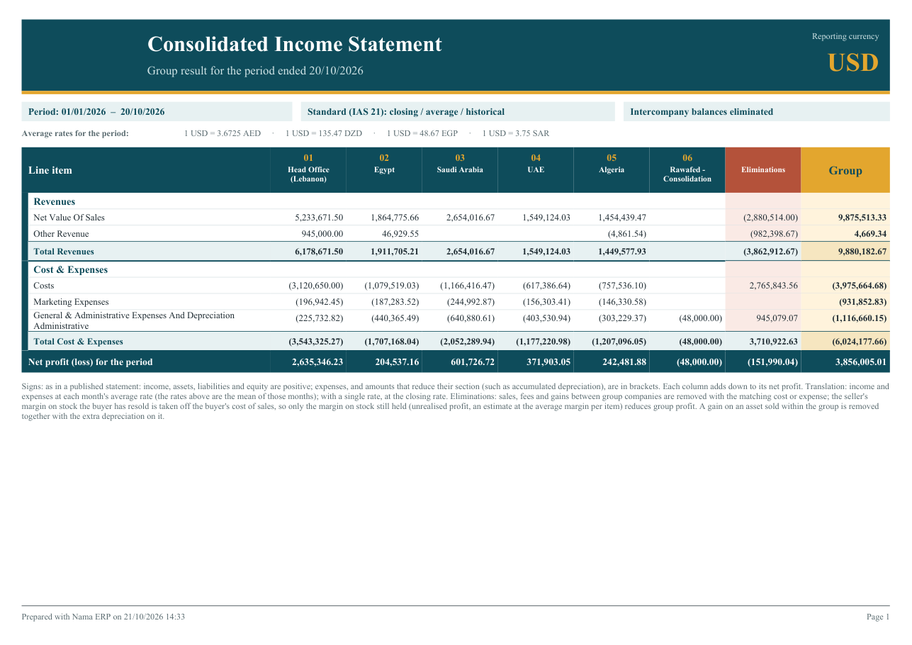
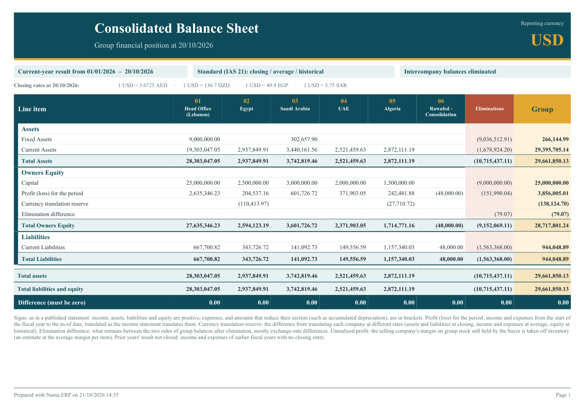
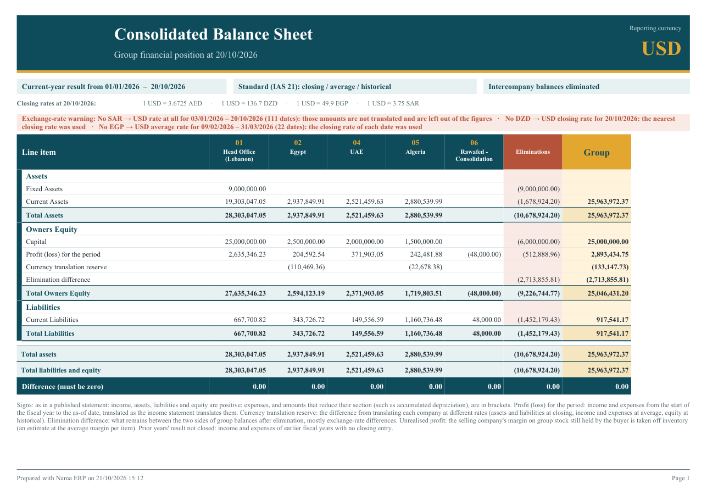

# Consolidated Statements

The consolidated statements give a group of companies one trial balance, one income statement and one balance sheet, in one reporting currency, with the business the companies did with each other taken out. They are three system reports, and they read the books of every company in the database each time they run, so there is no entry to record and nothing to close beforehand.

A group that keeps several companies in one Nama database already has every company's books in one place. Filtering a report on several legal entities does not consolidate them, though: it adds up local amounts, and once the companies keep their books in different currencies, an Egyptian pound and a Saudi riyal end up in the same total. It also counts the group twice. When the head office sells books to its Egyptian company, the head office shows the sale and Egypt shows the purchase, but the group as a whole has sold nothing. The consolidated reports deal with both problems. They **translate** each company into one currency, and they **eliminate** what the companies owe, sell and charge each other.

::: info Required license
The three reports are part of the core `accounting` license.
:::

## The three reports

| Report | Code | What it answers |
|---|---|---|
| **Consolidated Trial Balance** «ميزان المراجعة الموحد» | `SYSR-FNS018` | Every account, one column per company, then the eliminations and the group total. The working paper behind the other two. |
| **Consolidated Income Statement** «قائمة الدخل الموحدة» | `SYSR-FNS019` | Revenue and expenses for a period, down to the group's net profit. |
| **Consolidated Balance Sheet** «قائمة المركز المالي الموحدة» | `SYSR-FNS020` | Assets, liabilities and equity at a date, including the profit for the year, the currency translation reserve and the elimination difference. |

All three share one layout. Each company gets a column headed by its code and name. Next comes an **Eliminations** column «الاستبعادات», and last a **Group** column «المجموعة», which is the sum of the companies and the eliminations. The header names the reporting currency and shows the period, the translation method, whether eliminations are on, and the closing rates the report used, for example `1 USD = 49.9 EGP`. The reports print in Arabic or English with the user's language. Amounts that reduce their section are shown in brackets.

### Consolidated Trial Balance

The trial balance lists every account that has a balance, grouped under the top-level charts of the chart of accounts (assets, equity, liabilities, revenue, expenses), with a total per section. Balance-sheet accounts show their balance at the **As of Date**. Income and expense accounts show only their movement between the **From Date** and the **As of Date**. The equity section also carries two lines that belong to no account: the **Currency translation reserve** «احتياطي فروق ترجمة العملات» and the **Elimination difference** «فرق الاستبعادات», both explained below. The last row, **Difference (must be zero)** «الفرق (يجب أن يكون صفراً)», checks that every column balances.

### Consolidated Income Statement

The income statement covers the period between **From Date** and **To Date**. By default it prints the top-level sections (revenues, costs and expenses) and the chart groups one level below them, each with a subtotal. Tick **Show Accounts** to list the individual accounts under each group instead. Each column adds down to **Net profit (loss) for the period** «صافي الربح (الخسارة) للفترة». Income is positive and expenses are in brackets, as in a published statement. Because the chart of accounts has no general marker for cost of sales, the statement shows the section totals and net profit, with no separate gross or operating profit line.

### Consolidated Balance Sheet

The balance sheet takes one date, the **As of Date**. It finds the fiscal year that date falls in and treats income and expenses from the start of that year as the year's result. Assets, liabilities and equity are positive, and amounts that reduce their section, such as accumulated depreciation, are in brackets. Under equity, a **Consolidation items** «بنود التوحيد» group holds the lines that come from consolidation rather than from an account:

- **Profit (loss) for the period** «ربح (خسارة) الفترة»: income and expenses from the start of the fiscal year to the as-of date, translated the way the income statement translates them. The group figure matches the income statement's net profit.
- **Prior years' result not closed** «نتائج سنوات سابقة لم تُقفل»: income and expenses of earlier fiscal years that no closing entry has carried into equity. It prints only when there is such a balance.
- **Currency translation reserve** and **Elimination difference**, as in the trial balance.

At the bottom, **Total assets**, **Total liabilities and equity** and **Difference (must be zero)** check each column.

The consolidation items go into the equity section of the chart. The report takes that to be the section holding the profit-and-loss account of the latest closing entry. Failing that, it uses a credit-side balance-sheet section whose name contains "equity" (or «حقوق» / «ملكية»), and failing that, the first credit-side balance-sheet section.

## Parameters

| Parameter | Reports | What it does |
|---|---|---|
| **From Date** «من تاريخ» | TB, IS | Start of the period for income and expense accounts. Defaults to the start of the year. |
| **As of Date** «حتى تاريخ» | TB | The date balances are taken at, and the date of the closing rates. Defaults to today. |
| **To Date** «إلى تاريخ» | IS | End of the period, and the date of the closing rates. Defaults to today. |
| **As of Date** «في تاريخ» | BS | The balance sheet date, and the date of the closing rates. Defaults to today. The year's result runs from the start of the fiscal year this date falls in. |
| **Legal Entities (empty = all)** «الشركات (فارغ = الكل)» | all | The companies to include, picked as a list. Leave it empty for every company that has a ledger. |
| **Reporting Currency** «عملة التقرير» | all | The currency the group is presented in. Leave it empty to use the **Reporting Currency** of the ledger of the company you are logged into, or that ledger's main currency if it has none. |
| **Translation Method** «طريقة ترجمة العملات» | all | **Standard (IAS 21)** «قياسي (IAS 21)», the default, or **Single closing rate** «سعر إقفال واحد». See below. |
| **Eliminate Intercompany** «استبعاد المعاملات بين شركات المجموعة» | all | On by default. Untick it to see the companies simply translated and added up. |
| **Show Accounts** «إظهار الحسابات» | IS, BS | Lists accounts under each group instead of group totals. |

Set the **Reporting Currency** on the ledger once, and everyone who runs the reports from that company gets the right currency without choosing it. See [The Ledger](../ledger-setup/accounting-concepts-and-setup.md#The-Ledger).

## How the companies are translated

Every company keeps its books in its own ledger's main currency. The report converts each company's balances into the reporting currency account by account, at the rate that account calls for. Each account takes its rate from its **Consolidation Rate** «سعر الترجمة في التوحيد» setting:

| Consolidation Rate | Rate used with **Standard (IAS 21)** | Typical accounts |
|---|---|---|
| **Closing** «اغلاق» | The closing rate at the as-of date | Cash, receivables, stock, payables, loans: everything the company holds or owes today |
| **Average** «متوسط» | The average rate of the month each amount was booked in | Revenue and expenses |
| **Historical** «تاريخي» | The rate on the date each amount was booked | Share capital and capital contributed by the parent |

You rarely set it account by account. Income-statement charts default to **Average**, and balance-sheet and other charts default to **Closing**. Set **Historical** once on the equity chart, and every account under it follows. The setting and how it is inherited are described on [Chart of Accounts](../ledger-setup/chart-of-accounts.md#Consolidation-settings) and [Accounts](../ledger-setup/accounts.md#Consolidation-settings).

A few details decide the exact figure:

- **Closing rate.** A **Daily** or **Date Range** exchange rate counts as the closing rate from its date until the next one. A Date Range rate counts only until its **To Date**. The closing rate at the as-of date is therefore the latest such rate on or before it.
- **Average rate.** A **Period** rate covers the dates of its fiscal period. An **Annual** rate covers the days of its fiscal year that no Period rate covers. Where a date has no average rate, the closing rate on that date is used, and the report warns about it.
- **Historical rate.** This is the rate Nama itself used on that date: a Daily rate that starts on the line's date, else the period's average rate, else the closing rate. Translating capital this way brings it back to what the parent actually paid.
- **Single closing rate.** Every account, income and expenses included, is translated at the closing rate at the as-of date. This is a quick view, not an IAS 21 statement.

### The currency translation reserve

Translating one company's balanced trial balance at three different rates leaves it out of balance. If assets are at today's rate, capital at the rate of the day it was paid in and profit at the monthly averages, the pieces no longer add up to zero, even though the company's own books do. The report puts that difference in each company's column as the **Currency translation reserve**. It is the figure IAS 21 shows in equity, and it is computed each time the report runs: no journal entry is created. A company whose currency is the reporting currency has no reserve, and with **Single closing rate** the reserve is normally zero.

## How intercompany business is eliminated

Elimination works from one setting: the **Intercompany** «حساب بين شركات المجموعة» flag on accounts and charts. Every account that carries it, or sits under a chart that carries it, is an intercompany account. With **Eliminate Intercompany** on, the balance of each intercompany account is reversed in the **Eliminations** column, so it comes to zero in the **Group** column.

So the setup is to keep business with group companies on accounts of its own and flag them. For example:

- receivables from and payables to group companies, and each company's **Mediator account** «الحساب الوسيط» (see [the Legal Entity](../../../platform/shared-master-files/dimensions-and-composite-dimensions.md#Extras-on-individual-types));
- loans to and from group companies;
- the parent's investment in subsidiaries and the subsidiaries' capital contributed by the parent;
- sales to group companies and their cost of sales, management fees charged and received.

Flag the chart that groups such accounts, and every account under it is flagged too.

### The elimination difference

When both sides of a group balance agree, their eliminations cancel. A receivable of USD 563,368 in the head office and payables of the same total in four subsidiaries leave nothing behind. They rarely agree to the cent once currencies are involved. A subsidiary records a fee at its own month's rate, and the head office records it in dollars. What is left after elimination prints as the **Elimination difference** in equity, and it keeps the Eliminations column balanced. A small figure is normal exchange-rate residue. A large one usually means a group balance sits on an account that is not flagged, or one side of a transaction was never recorded.

### Unrealised profit in stock

When the head office sells books to Egypt at a margin and Egypt has not yet sold them on, the group has made no profit on those books. Eliminating the intercompany sale and its cost removes the sale itself. The report then estimates the head office's margin on what Egypt bought from group companies in the period:

- the share Egypt **still holds** at the as-of date is taken off Egypt's stock, translated at the closing rate;
- the share Egypt **has already sold on** is taken off Egypt's cost of sales, so that the group's cost of sales carries the original cost and not the transfer price.

This works because the item master is shared. The same item is sold by one company and bought by another, so the report can match the two. It is an estimate, and it is worth knowing how it is reached:

- A **group sale** is a Sales Invoice with a line on an intercompany account. A **group purchase** is a stock receipt on a document with a line on an intercompany account.
- The seller's margin is the sales value less the cost of the items issued. It is averaged per item over all group sellers in the period, because nothing links a customer record to a group company, so there is no margin per pair of companies.
- The quantity still held is the buyer's closing quantity of the item, capped at what it bought from group companies in the period. Group stock is assumed to be held before stock bought locally.
- Only purchases in the period count, so there is no unrealised profit carried in from earlier years. Only Sales Invoices count: other invoice types, point-of-sale sales and intercompany returns are not adjusted, and their margin shows in the elimination difference instead.
- Each buyer's stock account and cost-of-sales account are the ones its own journal entries used most for those items.

### An asset sold within the group

A fixed asset sold by one group company to another is a sale with a gain in the seller and a purchase at the selling price in the buyer. For the group, the asset has only moved. The report removes the gain, takes the same amount off the buyer's asset accounts, and reverses the depreciation the buyer charged on that extra amount. Two things make this work:

- the seller's disposal books its gain or loss on a **gain/loss account flagged Intercompany**, kept for sales to group companies. The report reads the gain from the disposal's gain/loss lines only, so the proceeds can go straight to the group receivable;
- the buyer's fixed asset purchase has an intercompany account (the group payable) on its other side.

When several assets are bought from group companies, the eliminated gains are spread over them in proportion to their purchase cost.

## Exchange rates the reports need

The reports read a **currency cross-rate table** that Nama builds from the **Exchange Rate** screen (see [Currencies and exchange rates](../../../platform/shared-master-files/currencies-and-exchange-rates.md)). You never edit this table. It is rebuilt automatically for the affected currencies every time an Exchange Rate record is saved or deleted.

- **Only group rates count.** Exchange rates entered with the **Legal Entity** left public feed the consolidated reports. A rate entered for one company still serves that company's own documents, but it is not used to translate the group.
- **Each company's ledger already holds what is needed.** The Egyptian company's ledger holds the US dollar rate it uses for its own dollar invoices, and the report uses that rate to translate Egypt into dollars. A rate is used in both directions: a rate of 49.9 EGP per dollar also translates pounds into dollars. Where no ledger rates two currencies against each other, the table may cross them through a third currency that the ledgers link.
- **When two ledgers rate the same pair,** each direction is read from one of them. A correction typed into only one ledger may therefore not change the other direction, so correct both.
- **When a rate is missing, the report says so.** Where a date has no average rate, the closing rate of that date is used. Where a date has no rate of the kind needed at all, the nearest closing rate for that pair of currencies is used. In both cases a coral **Exchange-rate warning** «تنبيه أسعار الصرف» line prints above the table. It names the currency pair, the kind of rate that was missing, the dates affected and what the report did instead. If two currencies have no rate between them at all, the amounts of that currency cannot be translated and are left out of the figures, and the warning says so. When every rate is in place, no warning line prints.

## A group set up for consolidation

1. **Set the Reporting Currency** on the ledger of the head office (or of every company), so the reports default to it.
2. **Flag the intercompany accounts.** Put group balances, group sales and costs, and capital and investments on accounts of their own, under charts flagged **Intercompany**.
3. **Set Historical on equity.** Set **Consolidation Rate = Historical** on the equity chart.
4. **Check each company's Mediator account.** It must be flagged Intercompany. The Legal Entity screen warns you when it is not.
5. **Enter the rates as group rates.** Use Daily or Date Range rates for closing and Period rates for monthly averages, with the legal entity left public.
6. **Run the Consolidated Trial Balance first.** Check that Difference is zero in every column and that the elimination difference is small, then print the income statement and balance sheet.

## Messages you may see

| Message | Why | What to do |
|---|---|---|
| *The mediator account {0} is not marked as intercompany, so the consolidated reports will not eliminate its balances. Mark the account, or a chart above it, as intercompany.* — «الحساب الوسيط {0} غير محدد كحساب بين شركات المجموعة، لذلك لن تستبعد التقارير الموحدة أرصدته. حدد الحساب، أو إحدى شجرات الحسابات الأعلى منه، كحساب بين شركات المجموعة.» | A warning, not a refusal: the Legal Entity is saved. It appears when a company's mediator account is set or changed to an account without the Intercompany flag. | Tick **Intercompany** on the account or on a chart above it. |

## Related pages

- [Chart of Accounts](../ledger-setup/chart-of-accounts.md) and [Accounts](../ledger-setup/accounts.md): the Intercompany and Consolidation Rate fields.
- [Journal entries & adjustments](../ledger-setup/journal-entries.md#Inter-Company-Transfer): moving value between group companies, including across currencies.
- [Moving stock](../../supplychain/moving-stock.md) and [Fixed asset transfers between companies](../../fixedassets/movement/fixedassets-intercompany-transfers.md): what can move between companies directly, and when to sell and buy instead.
- [Financial Statements](./financial-statements.md): the configurable statements engine for a single company.
